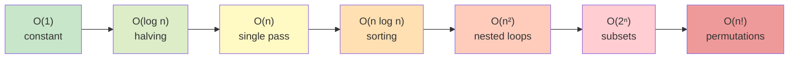
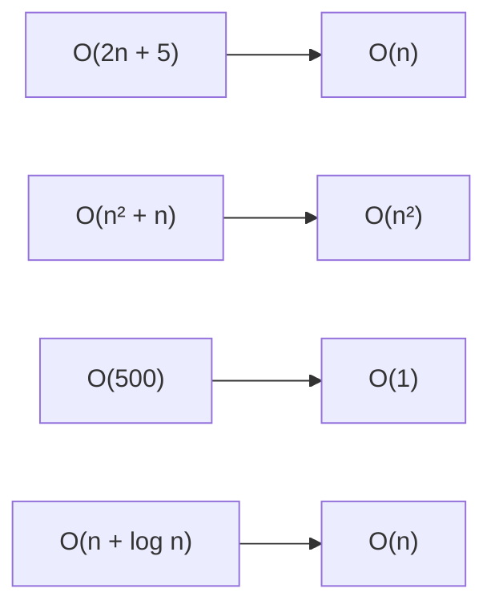
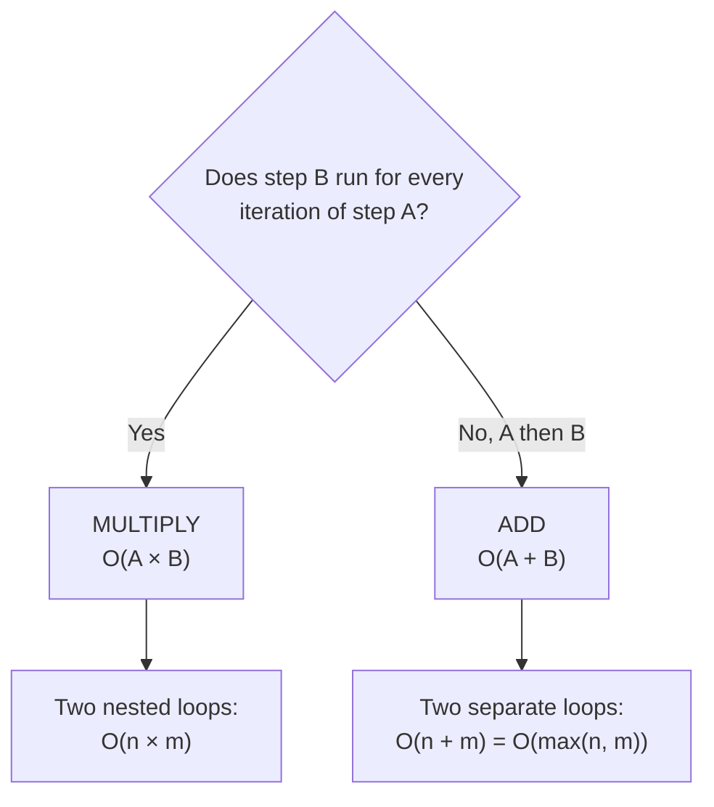
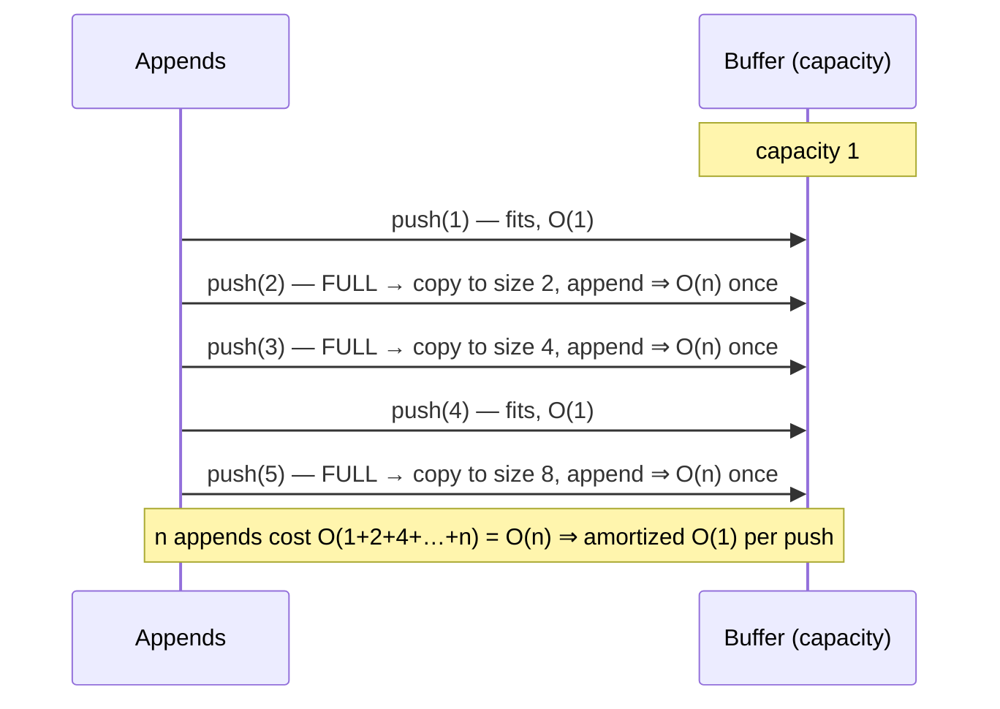
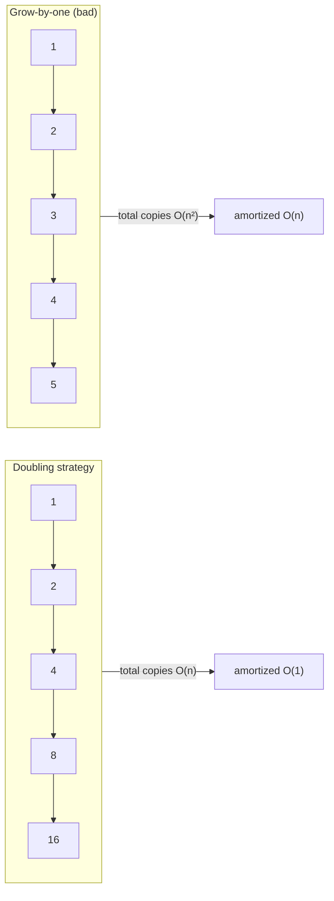
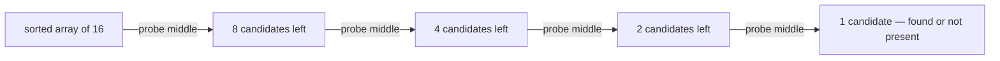
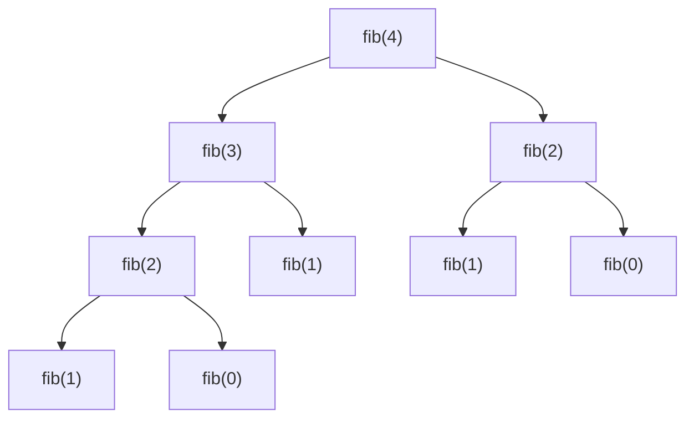
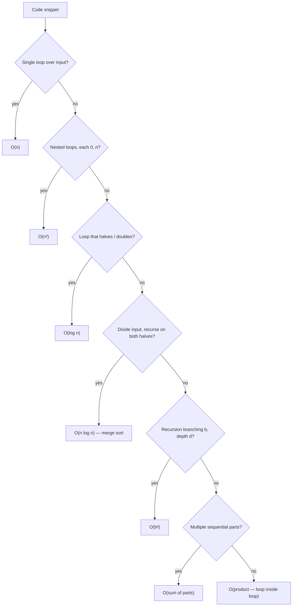
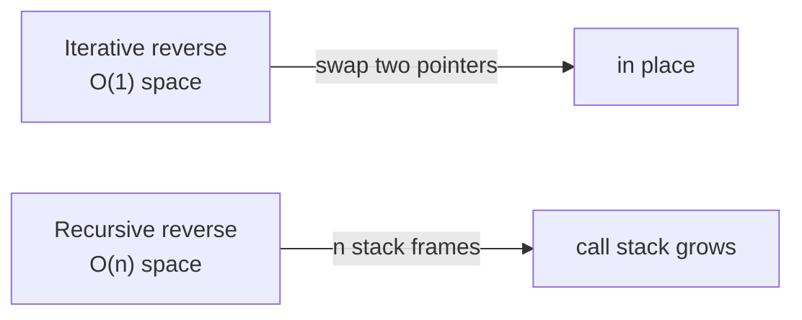

# 00 · Big-O Notation

> Book reference: **VI. Big O** — “Drop the Constants”, “Drop the Non-Dominant Terms”,
> “Multi-Part Algorithms”, “Amortized Time”, “Log N Runtimes”, “Recursive Runtimes”.

Big-O describes how runtime (or memory) **scales** with input size. It is *not* a stopwatch:
an `O(n²)` algorithm can beat an `O(n)` one for tiny `n` — it loses only once the input grows.

---

## The growth ladder



| n | O(1) | O(log n) | O(n) | O(n log n) | O(n²) | O(2ⁿ) |
|---|------|----------|------|------------|-------|-------|
| 10 | 1 | ~3 | 10 | ~33 | 100 | 1,024 |
| 1,000 | 1 | ~10 | 1,000 | ~10,000 | 10⁶ | ∞ |
| 1,000,000 | 1 | ~20 | 10⁶ | ~2·10⁷ | 10¹² | ∞ |

> Rule of thumb for interviews: **10⁶–10⁸ simple operations/second**. If `n = 100,000`,
> an `O(n²)` solution (~10¹⁰ ops) is dead on arrival — you must find `O(n log n)` or `O(n)`.

---

## Drop the constants, drop the non-dominant terms



```java
// Java — all three are O(n), only the constant differs
boolean a(int[] xs) { for (int x : xs) if (x == 0) return true; return false; }      // O(n)
boolean b(int[] xs) { for (int x : xs) { if (x == 0) return true; if (x == 1) return true; } return false; } // O(2n) → O(n)
boolean c(int[] xs) { return a(xs) || b(xs); }                                        // O(3n) → O(n)
```

```python
# Python — same story
def a(xs): return any(x == 0 for x in xs)          # O(n)
def b(xs): return 0 in xs or 1 in xs               # O(2n) → O(n)
```

```csharp
// C#
bool A(int[] xs) => Array.IndexOf(xs, 0) >= 0;                  // O(n)
bool B(int[] xs) => Array.IndexOf(xs, 0) >= 0 || Array.IndexOf(xs, 1) >= 0; // O(2n) → O(n)
```

```javascript
// JavaScript
const a = xs => xs.includes(0);                    // O(n)
const b = xs => xs.includes(0) || xs.includes(1);  // O(2n) → O(n)
```

---

## Multi-part algorithms: **add** vs **multiply**

When the steps are *independent and sequential* → **add**.
When one step runs *inside* another → **multiply**.



```python
# ADD: O(n + m) — sequential passes
def two_passes(a, b):
    total = 0
    for x in a: total += x        # O(n)
    for y in b: total += y        # O(m)
    return total                  # overall O(n + m)

# MULTIPLY: O(n × m) — nested
def pairs(a, b):
    return [(x, y) for x in a for y in b]   # n × m
```

---

## Amortized time

Some operations are *occasionally* expensive but rare — averaged over a sequence they are cheap.
The classic: **dynamic array growth (ArrayList / list / List&lt;T&gt; / Array)**.





---

## Log N runtimes — what makes them logarithmic?

Logarithms appear when the problem size **halves (or shrinks by a constant factor) each step**.



```java
// Java — binary search: log₂(n) steps
int binarySearch(int[] a, int target) {
    int lo = 0, hi = a.length - 1;
    while (lo <= hi) {
        int mid = lo + (hi - lo) / 2;
        if (a[mid] == target) return mid;
        if (a[mid] < target) lo = mid + 1; else hi = mid - 1;
    }
    return -1;
}
```

```python
# Python
def binary_search(a, target):
    lo, hi = 0, len(a) - 1
    while lo <= hi:
        mid = (lo + hi) // 2
        if a[mid] == target: return mid
        lo, hi = (mid + 1, hi) if a[mid] < target else (lo, mid - 1)
    return -1
```

```csharp
// C#
static int BinarySearch(int[] a, int target) {
    int lo = 0, hi = a.Length - 1;
    while (lo <= hi) {
        int mid = lo + (hi - lo) / 2;
        if (a[mid] == target) return mid;
        if (a[mid] < target) lo = mid + 1; else hi = mid - 1;
    }
    return -1;
}
```

```javascript
// JavaScript
function binarySearch(a, target) {
  let lo = 0, hi = a.length - 1;
  while (lo <= hi) {
    const mid = (lo + hi) >> 1;
    if (a[mid] === target) return mid;
    a[mid] < target ? (lo = mid + 1) : (hi = mid - 1);
  }
  return -1;
}
```

Sorted-array operations, balanced-tree lookups, binary heaps, and divide-and-conquer (merge sort,
quickselect) all ride this halving behavior.

---

## Recursive runtimes

A recursion that makes `b` calls per level and has depth `d` costs **O(bᵈ)**.



`fib(n)` branches in 2 with depth `n` ⇒ **O(2ⁿ)**. Memoizing the repeated subtree (`fib(2)` above)
collapses it to **O(n)**.

| Recursion | Branching | Depth | Cost |
|-----------|-----------|-------|------|
| `factorial(n)` | 1 | n | O(n) |
| `fib(n)` naive | 2 | n | O(2ⁿ) |
| `fib(n)` memoized | 1 | n | O(n) |
| merge sort | 2 | log n | O(n log n) |
| permutation gen | n | n | O(n!) |

---

## How to analyze any snippet — decision flow



## Space complexity

Same notation, counting **extra memory**. Recursion pays for its call stack.



| Task | Time | Space |
|------|------|-------|
| Reverse a string in place | O(n) | O(1) |
| Merge two sorted arrays | O(n + m) | O(n + m) |
| Binary search | O(log n) | O(1) iterative / O(log n) recursive |
| Heapsort | O(n log n) | O(1) |
| Merge sort | O(n log n) | O(n) |

---

## Practice — mapped tasks

Write down time **and** space complexity before coding; task
[200 README template](../tasks/beginner/200-build-readme-template-that-documents-test-cases-and-complexity-f.md)
makes that documentation habit part of the repo.

- [008 Linear search](../tasks/beginner/008-find-the-index-of-a-target-in-an-unsorted-array-linear-search.md) — O(n) vs binary search O(log n)
- [075 Binary search iterative](../tasks/beginner/075-binary-search-iterative-on-sorted-array.md)
- [034 Sieve of Eratosthenes](../tasks/beginner/034-sieve-of-eratosthenes-to-list-primes-up-to-n.md) — O(n log log n)
- [087 Merge sort inversion counting](../tasks/beginner/087-implement-merge-and-count-inversions-using-merge-sort.md) — O(n log n) beat O(n²)
- [160 LRU cache](../tasks/beginner/160-implement-lru-cache-using-linked-list-hashmap.md) — O(1) per operation
- [164 Running median](../tasks/beginner/164-compute-running-median-using-two-heaps.md) — two heaps, O(log n) insert
- [409 Burrows-Wheeler transform](../tasks/advanced/409-implement-burrows-wheeler-transform-and-inverse.md) — related suffix-array complexity classes

## Quick self-check

1. Two separate loops over the same array of size `n` — what's the complexity?
2. `for i in range(n): for j in range(i, n): …` — how many iterations exactly, and in Big-O?
3. A dynamic array that doubles — why is `append` amortized O(1)?
4. `T(n) = 2·T(n/2) + O(n)` — which familiar algorithm is this, and its complexity?

<details>
<summary>Answers</summary>

1. O(n) — add the parts (`O(n + n) = O(n)`), do not multiply.
2. `n + (n−1) + … + 1 = n(n+1)/2` ⇒ **O(n²)** (drop the ½).
3. Copies happen at sizes 1, 2, 4, 8, …, n: total work `1+2+4+…+n < 2n` ⇒ O(1) amortized per append.
4. Merge sort; the Master Theorem gives **O(n log n)**.

</details>
