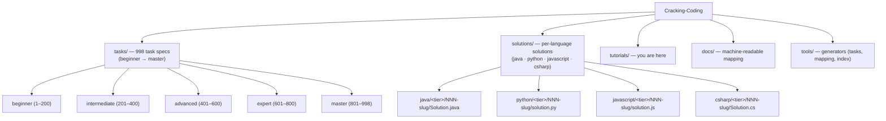
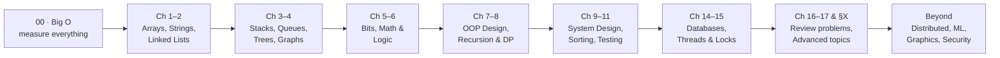
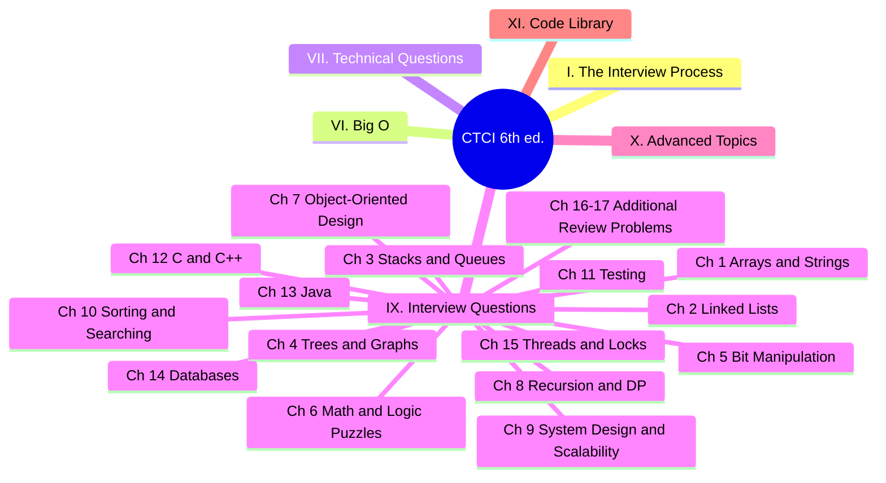
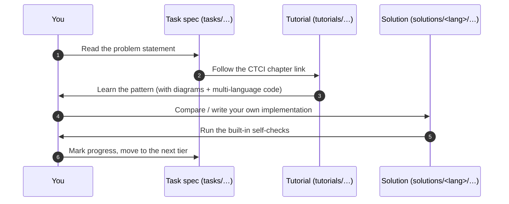
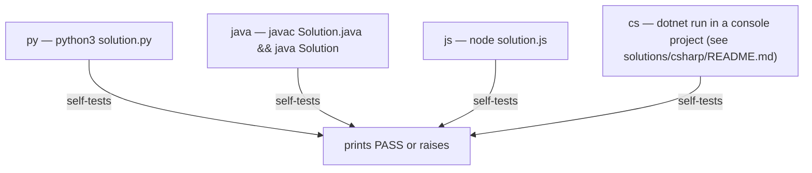
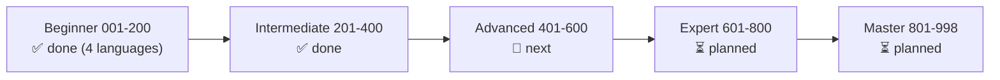

# Tutorials — Cracking the Coding Interview & the 998-Task Roadmap

Welcome to the tutorials section. Every tutorial is a self-contained `.md` file with:

- 📖 **Theory** straight from the *Cracking the Coding Interview (6th Edition)* structure,
- 🧭 **Mermaid diagrams** (flowcharts, sequence diagrams, state machines, class diagrams) — as many as it takes to *see* the algorithm,
- 💻 **Code in four languages** — Java, Python, C# and JavaScript,
- 🔗 **Links to the mapped tasks** in [`tasks/`](../tasks) so you can practice immediately.

> The full mapping of all **998 README tasks** onto the book's chapters lives in
> [**ctci-mapping.md**](ctci-mapping.md) — generated by [`tools/ctci_map.py`](../tools/ctci_map.py).

---

## Repository map

## Learning path

Follow the book's own pedagogical order — data structures first, algorithms second, systems last.

## The book at a glance

## Tutorial index

| # | Tutorial | Book reference | Mermaid diagrams |
|---|----------|----------------|------------------|
| 00 | [Big-O Notation](00-big-o.md) | VI. Big O | growth ladder, recursion tree, amortization |
| 01 | [Arrays and Strings](ctci/01-arrays-and-strings.md) | Ch 1 | two-pointer, sliding window, string building |
| 02 | [Linked Lists](ctci/02-linked-lists.md) | Ch 2 | node chains, runner technique, reversal |
| 03 | [Stacks and Queues](ctci/03-stacks-and-queues.md) | Ch 3 | LIFO/FIFO flows, monotonic stack, RPN |
| 04 | [Trees and Graphs](ctci/04-trees-and-graphs.md) | Ch 4 | BFS/DFS order, BST invariants, tries, topo sort |
| 05 | [Bit Manipulation](ctci/05-bit-manipulation.md) | Ch 5 | bit layout, masks, two's complement |
| 06 | [Math and Logic](ctci/06-math-and-logic.md) | Ch 6 | sieve, Euclid, fast power |
| 07 | [Object-Oriented Design](ctci/07-object-oriented-design.md) | Ch 7 | class diagrams, state machines, patterns |
| 08 | [Recursion and DP](ctci/08-recursion-and-dp.md) | Ch 8 | recursion trees, memoization, DP tables |
| 09 | [System Design and Scalability](ctci/09-system-design-scalability.md) | Ch 9 | load balancing, sharding, caches, MapReduce |
| 10 | [Sorting and Searching](ctci/10-sorting-and-searching.md) | Ch 10 | sort decision tree, binary-search variants |
| 11 | [Testing](ctci/11-testing.md) | Ch 11 | test pyramid, fuzzing loop, flaky-test triage |
| 14 | [Databases](ctci/14-databases.md) | Ch 14 | ER diagrams, normalization, indexes, transactions |
| 15 | [Threads and Locks](ctci/15-threads-and-locks.md) | Ch 15 | threads, locks, deadlock cycles, producer-consumer |
| 16 | [Additional Review Problems](ctci/16-17-additional-review.md) | Ch 16–17 | moderate/hard problem strategies |
| X | [Advanced Topics](ctci/x-advanced-topics.md) | §X | useful math, topo sort, Dijkstra, hashing, AVL/RB trees, MapReduce |

### Language companion tutorials

| Language | Tutorial | Focus |
|----------|----------|-------|
| Java | [languages/java.md](languages/java.md) | collections, generics, streams, common interview idioms |
| Python | [languages/python.md](languages/python.md) | list/dict/set idioms, slicing, comprehensions |
| C# | [languages/csharp.md](languages/csharp.md) | `List<T>`, LINQ, `Span<T>`, nullable types |
| JavaScript | [languages/javascript.md](languages/javascript.md) | arrays, Maps/Sets, closures, BigInt pitfalls |

## How the pieces fit together

## Running the solutions

## Status

- ✅ 998 task specs generated under [`tasks/`](../tasks) with CTCI chapter labels.
- ✅ Full chapter mapping in [ctci-mapping.md](ctci-mapping.md).
- ✅ **Beginner tier complete: tasks 001–200 implemented in all four languages** (Java, Python,
  JavaScript, C#), every file passing its built-in self-checks
  (`python3 tools/run_solutions.py` → 200/200 per language).
- ✅ **Intermediate tier complete: tasks 201–400 implemented** in all four languages
  (400/998 tasks × 4 languages = 1600 self-checking solutions; the concurrency tasks 341–360
  use real threads in Python/Java/C# and the documented deterministic async simulation in JS,
  since Node has no shared-memory threads).
- 🚧 Remaining tiers land next, tier by tier — progress table lives in
  [`docs/TASK-INDEX.md`](../docs/TASK-INDEX.md), and per-language conventions in
  [`solutions/<lang>/README.md`](../solutions).

### Implementation progress (staged delivery)

---

*Companion book: “Cracking the Coding Interview, 6th Edition — 189 Programming Questions and Solutions” by Gayle Laakmann McDowell. This repository is an independent study companion; it summarizes concepts and maps its own exercises to the book's chapters.*
