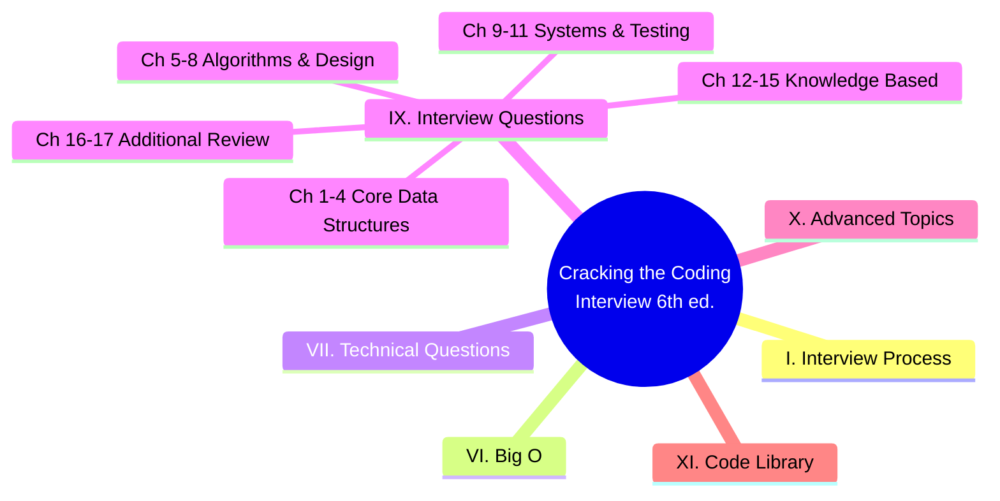
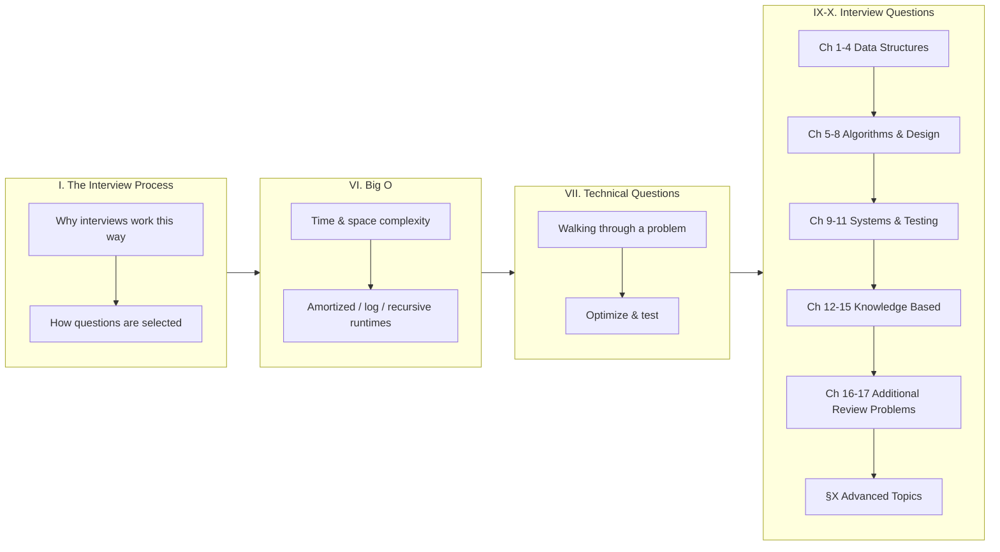
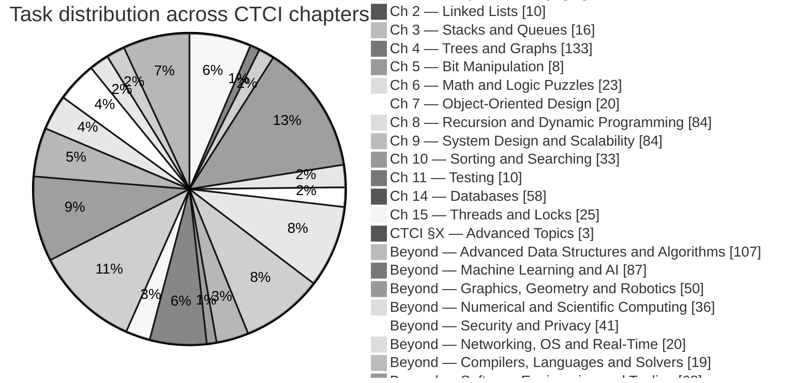

# Task → CTCI Chapter Mapping (all 998 tasks)

Every task in the repo [README](../README.md) classified against the structure of
_**Cracking the Coding Interview, 6th Edition**_ (Gayle Laakmann McDowell).

Generated by [`tools/ctci_map.py`](../tools/ctci_map.py) — re-run it after editing
the keywords/overrides to refresh this file.

**How to read this mapping** — tasks were classified by their dominant topic.
Chapters 12 (C and C++) and 13 (Java) are *knowledge-based* chapters with no numbered
questions; this repo covers their spirit through the per-language tutorials
([Java](languages/java.md), [Python](languages/python.md), [C#](languages/csharp.md),
[JavaScript](languages/javascript.md)). Tasks that go clearly beyond the book
(systems, ML, graphics, security, …) are marked **Beyond** so the book's chapters keep
their original meaning.

> Re-generate with `python3 tools/ctci_map.py`.

## Distribution

| Chapter / topic | Tasks |
|---|---|
| Ch 1 — Arrays and Strings | 63 |
| Ch 2 — Linked Lists | 10 |
| Ch 3 — Stacks and Queues | 16 |
| Ch 4 — Trees and Graphs | 133 |
| Ch 5 — Bit Manipulation | 8 |
| Ch 6 — Math and Logic Puzzles | 23 |
| Ch 7 — Object-Oriented Design | 20 |
| Ch 8 — Recursion and Dynamic Programming | 84 |
| Ch 9 — System Design and Scalability | 84 |
| Ch 10 — Sorting and Searching | 33 |
| Ch 11 — Testing | 10 |
| Ch 12 — C and C++ | 0 |
| Ch 13 — Java | 0 |
| Ch 14 — Databases | 58 |
| Ch 15 — Threads and Locks | 25 |
| CTCI §X — Advanced Topics | 3 |
| Ch 16 — Moderate (additional review problems) | 0 |
| Ch 17 — Hard (additional review problems) | 0 |
| Beyond — Advanced Data Structures & Algorithms | 107 |
| Beyond — Machine Learning & AI | 87 |
| Beyond — Graphics, Geometry & Robotics | 50 |
| Beyond — Numerical & Scientific Computing | 36 |
| Beyond — Security & Privacy | 41 |
| Beyond — Networking, OS & Real-Time | 20 |
| Beyond — Compilers, Languages & Solvers | 19 |
| Beyond — Software Engineering & Tooling | 68 |

## Ch 1 — Arrays and Strings — 63 tasks

| # | Task | Tier |
|---|---|---|
| 1 | Reverse a string. | Beginner |
| 2 | Check if a string is a palindrome. | Beginner |
| 3 | Count vowels and consonants in a string. | Beginner |
| 4 | Remove duplicates from an array (create new array). | Beginner |
| 5 | Find maximum value in an int array. | Beginner |
| 6 | Find minimum value in an int array. | Beginner |
| 7 | Compute sum and average of array elements. | Beginner |
| 15 | Check if two strings are anagrams. | Beginner |
| 16 | Count occurrences of each character in a string. | Beginner |
| 17 | Convert string to integer (atoi) basic. | Beginner |
| 18 | Convert integer to string. | Beginner |
| 21 | Rotate array right by k positions (create new array). | Beginner |
| 22 | Rotate array in-place by k positions. | Beginner |
| 23 | Find second largest element in an array. | Beginner |
| 24 | Remove element at index from array (in-place). | Beginner |
| 25 | Find duplicate element when exactly one number repeats (1..n). | Beginner |
| 26 | Check if array contains any duplicates (boolean). | Beginner |
| 27 | Find missing number in 1..n given n-1 elements. | Beginner |
| 40 | Merge two strings alternately. | Beginner |
| 43 | Count words in a string. | Beginner |
| 44 | Trim leading and trailing spaces from string. | Beginner |
| 47 | Find first non-repeating character in a string. | Beginner |
| 48 | Find most frequent element in array. | Beginner |
| 51 | Implement dynamic array (basic ArrayList). | Beginner |
| 52 | Implement simple LinkedList insert at head. | Beginner |
| 53 | Implement LinkedList insert at tail. | Beginner |
| 81 | Compute prefix sums for an array. | Beginner |
| 82 | Range sum query naive using prefix sums. | Beginner |
| 83 | Two-sum problem (brute force). | Beginner |
| 84 | Two-sum using hashmap. | Beginner |
| 85 | Three-sum (return any triplet). | Beginner |
| 88 | Classic Caesar cipher encode/decode. | Beginner |
| 89 | Implement simple frequency histogram (integers). | Beginner |
| 90 | Implement sliding window sum of size k. | Beginner |
| 91 | Max over sliding window naive. | Beginner |
| 95 | Validate IPv4 address (basic). | Beginner |
| 97 | Flatten a 2D array (row-major). | Beginner |
| 98 | Transpose a 2D matrix. | Beginner |
| 99 | Rotate matrix 90 degrees clockwise (in-place for square). | Beginner |
| 100 | Check if matrix is symmetric. | Beginner |
| 166 | Boyer-Moore majority vote algorithm (find element > n/2). | Beginner |
| 167 | Find all elements appearing > n/3 (generalized). | Beginner |
| 169 | Implement sliding window for unique characters (longest unique substring). | Beginner |
| 201 | Two-sum unique pairs (return all unique pairs). | Intermediate |
| 202 | 3-sum all unique triplets. | Intermediate |
| 203 | 4-sum problem (k-sum generalization). | Intermediate |
| 204 | Count pairs with given difference K in array (hash). | Intermediate |
| 205 | Count pairs with sum K when array unsorted (hash). | Intermediate |
| 207 | Three-sum closest. | Intermediate |
| 209 | Longest subarray with sum equal to K (array of positives). | Intermediate |
| 210 | Longest subarray with sum equal to K (with negatives) using hashmap. | Intermediate |
| 211 | Subarray sum equals K count (hashmap). | Intermediate |
| 230 | Longest palindrome substring (expand center). | Intermediate |
| 231 | Manacher’s algorithm for longest palindromic substring. | Intermediate |
| 232 | Minimum window substring covering all chars of pattern. | Intermediate |
| 234 | Group anagrams (count signature as key). | Intermediate |
| 318 | Minimum window subsequence (not necessarily contiguous). | Intermediate |
| 319 | Sliding window with variable constraints (two pointers advanced). | Intermediate |
| 323 | Insert interval and merge intervals. | Intermediate |
| 324 | Interval scheduling to maximize number of non-overlapping intervals (greedy). | Intermediate |
| 326 | Meeting rooms required (interval partitioning). | Intermediate |
| 327 | Car pooling capacity check (difference array / sweep). | Intermediate |
| 388 | Implement string compression (run-length encoding + decode). | Intermediate |

## Ch 2 — Linked Lists — 10 tasks

| # | Task | Tier |
|---|---|---|
| 54 | Traverse linked list and print nodes. | Beginner |
| 55 | Delete node by value in singly linked list. | Beginner |
| 56 | Find length of linked list. | Beginner |
| 57 | Find middle node of linked list (two pointers). | Beginner |
| 58 | Detect cycle in linked list (Floyd). | Beginner |
| 60 | Remove nth node from end of linked list. | Beginner |
| 61 | Reverse singly linked list (iterative). | Beginner |
| 63 | Implement doubly linked list insert/delete. | Beginner |
| 154 | Implement a basic circular linked list. | Beginner |
| 155 | Josephus problem simulation. | Beginner |

## Ch 3 — Stacks and Queues — 16 tasks

| # | Task | Tier |
|---|---|---|
| 41 | Check if brackets are balanced (single type). | Beginner |
| 42 | Check balanced parentheses with three bracket types. | Beginner |
| 49 | Implement stack with array (push/pop). | Beginner |
| 50 | Implement queue with array (enqueue/dequeue). | Beginner |
| 64 | Implement circular queue (ring buffer). | Beginner |
| 65 | Implement priority queue using built-in heap. | Beginner |
| 92 | Max over sliding window using deque. | Beginner |
| 172 | Implement stack that supports getMin in O(1). | Beginner |
| 173 | Implement queue that supports getMin in O(1). | Beginner |
| 190 | Parse and evaluate postfix (RPN) expression. | Beginner |
| 191 | Convert infix to postfix (shunting-yard simplified). | Beginner |
| 192 | Evaluate arithmetic expression with +,-,*,/, parentheses (shunting-yard + eval). | Beginner |
| 193 | Implement simple expression tokenizer. | Beginner |
| 208 | Implement sliding window minimum using deque. | Intermediate |
| 341 | Balanced parentheses longest valid substring (stack). | Intermediate |
| 342 | Implement expression evaluator with variables and precedence. | Intermediate |

## Ch 4 — Trees and Graphs — 133 tasks

| # | Task | Tier |
|---|---|---|
| 66 | Implement min-heap push/pop. | Beginner |
| 67 | Implement max-heap push/pop. | Beginner |
| 101 | Count islands in boolean grid (DFS). | Beginner |
| 102 | Flood fill algorithm (DFS/BFS). | Beginner |
| 104 | Implement BFS on adjacency list graph. | Beginner |
| 106 | Topological sort using DFS (DAG). | Beginner |
| 107 | Detect cycle in directed graph (DFS coloring). | Beginner |
| 108 | Detect cycle in undirected graph (union-find). | Beginner |
| 109 | Implement union-find / disjoint set (basic). | Beginner |
| 110 | Path compression in union-find. | Beginner |
| 111 | Kruskal’s MST using union-find. | Beginner |
| 112 | Prim’s MST using heap. | Beginner |
| 113 | Simple Dijkstra’s algorithm (non-negative weights). | Beginner |
| 114 | Bellman-Ford algorithm (with negative edges). | Beginner |
| 115 | Implement a basic trie for lowercase words. | Beginner |
| 116 | Insert and search in trie. | Beginner |
| 117 | Autocomplete top-k prefix suggestions (trie). | Beginner |
| 135 | Check if two binary trees are identical. | Beginner |
| 136 | Tree preorder traversal recursive. | Beginner |
| 137 | Tree inorder traversal recursive. | Beginner |
| 138 | Tree postorder traversal recursive. | Beginner |
| 139 | Level order traversal (BFS) of tree. | Beginner |
| 140 | Max depth of binary tree. | Beginner |
| 141 | Min depth of binary tree. | Beginner |
| 142 | Check if tree is balanced (height difference <=1). | Beginner |
| 143 | Symmetric tree check (mirror). | Beginner |
| 144 | Convert sorted array to balanced BST. | Beginner |
| 145 | Validate BST property (inorder). | Beginner |
| 146 | Lowest common ancestor in BST (iterative). | Beginner |
| 147 | Lowest common ancestor in binary tree (general). | Beginner |
| 148 | Serialize and deserialize binary tree (preorder). | Beginner |
| 149 | Convert binary tree to linked list (flatten). | Beginner |
| 150 | Sum of root-to-leaf numbers in tree. | Beginner |
| 151 | Path sum existence in tree. | Beginner |
| 153 | Count nodes in complete binary tree faster than O(n). | Beginner |
| 156 | Implement iterator for a binary tree (inorder). | Beginner |
| 164 | Compute running median using two heaps. | Beginner |
| 176 | Check matrix connectivity (graph view). | Beginner |
| 178 | Compute transitive closure (Floyd-Warshall naive). | Beginner |
| 179 | Implement simple heap-based median-of-stream class. | Beginner |
| 180 | Implement binary indexed tree (Fenwick) basic: point update, prefix sum. | Beginner |
| 181 | Range update, point query with Fenwick tree. | Beginner |
| 182 | Implement segment tree for range sum (build/query/update). | Beginner |
| 183 | Implement iterative segment tree. | Beginner |
| 235 | Serialize and deserialize N-ary tree. | Intermediate |
| 236 | Count nodes at distance K from target in binary tree. | Intermediate |
| 237 | Binary tree zigzag level order traversal. | Intermediate |
| 238 | Binary tree vertical order traversal. | Intermediate |
| 239 | Connect next pointers in each node (perfect binary tree). | Intermediate |
| 240 | Sum of nodes at each level (level order). | Intermediate |
| 241 | Maximum path sum in binary tree (any path). | Intermediate |
| 242 | Convert binary tree to doubly linked list (inorder). | Intermediate |
| 243 | Reconstruct binary tree from inorder and preorder. | Intermediate |
| 244 | Reconstruct binary tree from inorder and postorder. | Intermediate |
| 245 | Reconstruct binary tree from preorder with null markers. | Intermediate |
| 246 | Serialize/deserialize binary search tree compactly. | Intermediate |
| 249 | Implement Treap (BST+heap) insert/delete. | Intermediate |
| 250 | Implement splay tree access operation (basic). | Intermediate |
| 252 | Design a phonebook using trie with counts and delete. | Intermediate |
| 253 | Implement compressed trie (radix tree) basics. | Intermediate |
| 268 | Word ladder shortest transformation (BFS). | Intermediate |
| 269 | Word ladder all shortest sequences (BFS + backtracking). | Intermediate |
| 270 | Implement A* algorithm for grid pathfinding. | Intermediate |
| 271 | Minimum height trees (find centers of undirected tree). | Intermediate |
| 272 | Reconstruct itinerary problem (Eulerian path / Hierholzer). | Intermediate |
| 273 | Find Eulerian trail in directed graph (Hierholzer). | Intermediate |
| 274 | Check if graph is bipartite (BFS coloring). | Intermediate |
| 275 | Maximum bipartite matching (Hopcroft–Karp outline). | Intermediate |
| 276 | Implement Hungarian algorithm (assignment) basic. | Intermediate |
| 277 | Maximum flow (Edmonds–Karp). | Intermediate |
| 278 | Dinic’s algorithm for max flow (basic). | Intermediate |
| 279 | Min-cut using max-flow (s-t cut extraction). | Intermediate |
| 280 | Count connected components in directed graph strongly connected (Kosaraju). | Intermediate |
| 281 | Tarjan’s strongly connected components. | Intermediate |
| 282 | Bridge edges in undirected graph (Tarjan). | Intermediate |
| 283 | Articulation points (cut vertices). | Intermediate |
| 309 | Longest common prefix among many strings (trie or divide & conquer). | Intermediate |
| 329 | Range intersection queries (interval trees basics). | Intermediate |
| 335 | Implement data structure for skyline queries (segment tree variant). | Intermediate |
| 343 | Graph isomorphism simple checks (degree sequence, invariants). | Intermediate |
| 361 | Implement interval stabbing queries with segment tree. | Intermediate |
| 362 | Implement 2D segment tree for range sum (conceptual). | Intermediate |
| 363 | Implement kd-tree for 2D nearest neighbor (basic). | Intermediate |
| 364 | Implement quad-tree for 2D region queries. | Intermediate |
| 399 | Implement centroid decomposition on tree for distance queries. | Intermediate |
| 400 | Implement heavy-light decomposition basics for path queries. | Intermediate |
| 419 | Implement dynamic tree (link-cut tree basic operations). | Advanced |
| 420 | Implement Euler tour tree for dynamic forests (conceptual). | Advanced |
| 424 | Implement small-to-large merging on trees for frequency queries. | Advanced |
| 425 | Implement centroid decomposition for k-distance pairs. | Advanced |
| 426 | Implement tree DP for independent set in tree. | Advanced |
| 427 | Implement rerooting DP technique on trees. | Advanced |
| 428 | Implement binary lifting for LCA and ancestor queries. | Advanced |
| 430 | Implement Mo’s algorithm on trees (Euler tour + Mo). | Advanced |
| 441 | Implement range add range max with lazy propagation segment tree. | Advanced |
| 442 | Implement segment tree beats for complex range operations (conceptual). | Advanced |
| 443 | Implement 2D Fenwick tree for rectangle sum/update. | Advanced |
| 444 | Implement 2D segment tree for range sum rectangle queries. | Advanced |
| 446 | Implement offline dynamic connectivity (divide & conquer + union find). | Advanced |
| 447 | Implement dynamic MST under edge insertions (conceptual). | Advanced |
| 449 | Implement global min-cut (Karger randomized algorithm). | Advanced |
| 450 | Implement stoer-wagner minimum cut algorithm. | Advanced |
| 451 | Implement Gomory-Hu tree for all-pairs min-cut (outline). | Advanced |
| 452 | Implement minimum mean cycle detection (Karp). | Advanced |
| 453 | Implement circulation with lower bounds (flow transform). | Advanced |
| 454 | Implement push-relabel max-flow algorithm. | Advanced |
| 455 | Implement capacity scaling for max flow. | Advanced |
| 456 | Implement matchings in general graph (Edmonds blossom outline). | Advanced |
| 457 | Implement blossom algorithm (conceptual/skeleton). | Advanced |
| 458 | Implement dynamic programming on trees with knapsack per node. | Advanced |
| 459 | Implement virtual tree building from set of nodes (for queries). | Advanced |
| 534 | Implement matching in general graphs improved heuristics (Edmonds practical). | Advanced |
| 542 | Implement tree isomorphism hashing (AHU algorithm). | Advanced |
| 543 | Implement fingerprinting for graph similarity (Weisfeiler-Lehman sketch). | Advanced |
| 544 | Implement streaming graph triangle counting approximation. | Advanced |
| 545 | Implement pagerank iterative solver and convergence check. | Advanced |
| 546 | Implement pagerank with dangling node handling. | Advanced |
| 551 | Implement subgraph isomorphism backtracking (Ullmann outline). | Advanced |
| 552 | Implement VF2 algorithm skeleton for subgraph iso. | Advanced |
| 553 | Implement induced subgraph frequency sampling. | Advanced |
| 554 | Implement motif counting in small graphs (enumeration). | Advanced |
| 566 | Implement Steiner tree approximate on small graphs (heuristic). | Advanced |
| 703 | Implement dynamic graph connectivity with link-cut trees in practice. | Expert |
| 704 | Implement offline dynamic connectivity with divide & conquer + UF rollback. | Expert |
| 705 | Implement Steiner forest approximations large graphs. | Expert |
| 706 | Implement max flow with lower/upper bounds and circulation feasibility. | Expert |
| 707 | Implement multi-commodity flow approximate algorithm outline. | Expert |
| 708 | Implement fractional packing/covering using multiplicative weights update. | Expert |
| 746 | Implement topological sort with cycle debugging and minimal feedback arc set heuristics. | Expert |
| 772 | Implement dynamic planar graph algorithms (face updates) outline. | Expert |
| 845 | Implement approximate personalized PageRank with bookmark coloring. | Master |
| 948 | Implement sublinear time algorithms for property testing on graphs (e.g., bipartiteness). | Master |
| 949 | Implement approximate maximum matching in huge graphs with streaming algorithms. | Master |

## Ch 5 — Bit Manipulation — 8 tasks

| # | Task | Tier |
|---|---|---|
| 14 | Swap two variables without a temporary variable. | Beginner |
| 28 | Count number of set bits in an integer. | Beginner |
| 29 | Check if integer is power of two. | Beginner |
| 163 | Implement basic encryption/decryption with XOR. | Beginner |
| 168 | Implement basic checksum (sum bytes). | Beginner |
| 298 | Bitmask iterate subsets of mask. | Intermediate |
| 374 | Implement bitset operations for small-universe set (fast ops). | Intermediate |
| 558 | Implement boolean matrix multiplication optimization using bitsets. | Advanced |

## Ch 6 — Math and Logic Puzzles — 23 tasks

| # | Task | Tier |
|---|---|---|
| 30 | Reverse digits of an integer. | Beginner |
| 31 | Palindrome number check (without string conversion). | Beginner |
| 32 | Check prime number naive. | Beginner |
| 33 | List primes up to N using trial division. | Beginner |
| 34 | Sieve of Eratosthenes to list primes up to N. | Beginner |
| 36 | Least common multiple (LCM) using GCD. | Beginner |
| 37 | Compute power(x, n) iterative. | Beginner |
| 38 | Implement binary exponentiation (fast power). | Beginner |
| 39 | Simple linear congruential pseudorandom generator. | Beginner |
| 118 | Longest increasing subarray (contiguous). | Beginner |
| 119 | Longest increasing subsequence (naive DP O(n^2)). | Beginner |
| 158 | Implement simple memoized prime checker cache. | Beginner |
| 165 | Reservoir sampling for k items from stream. | Beginner |
| 174 | Implement basic matrix multiplication (naive). | Beginner |
| 175 | Multiply large integers as strings. | Beginner |
| 378 | Implement integer partition DP (count ways). | Intermediate |
| 379 | Implement combinatorics nCr modulo prime (precompute factorials). | Intermediate |
| 380 | Implement modular inverse / fast modular exponent. | Intermediate |
| 381 | Chinese remainder theorem solver for pairwise coprime moduli. | Intermediate |
| 382 | Implement primality test Miller-Rabin (deterministic small bases). | Intermediate |
| 383 | Factor large integer with Pollard’s Rho (outline/test small). | Intermediate |
| 384 | Implement discrete logarithm baby-step giant-step. | Intermediate |
| 464 | Implement reservoir sampling with weighted probabilities. | Advanced |

## Ch 7 — Object-Oriented Design — 20 tasks

| # | Task | Tier |
|---|---|---|
| 80 | Implement string builder/concatenation efficient. | Beginner |
| 96 | Simple URL parser (extract protocol, host). | Beginner |
| 157 | Design a simple finite state machine (FSM) for number validation. | Beginner |
| 160 | Implement LRU cache using linked list + hashmap. | Beginner |
| 161 | Implement LFU cache (basic variant). | Beginner |
| 162 | Implement rate limiter (token bucket simple). | Beginner |
| 177 | Implement basic sparse matrix storage (coordinate list). | Beginner |
| 189 | Implement simple CSV parser (line -> fields). | Beginner |
| 194 | Implement caching of expensive function results with TTL. | Beginner |
| 196 | Implement file line reader that yields lines lazily. | Beginner |
| 198 | Serialize object to JSON string (manual). | Beginner |
| 199 | Deserialize JSON with arrays & objects (basic). | Beginner |
| 332 | Implement calendar booking (MyCalendar I/II/III style). | Intermediate |
| 333 | Design hit counter (sliding time window). | Intermediate |
| 334 | Implement rolling median with delete operation (multiset or two heaps + lazy deletion). | Intermediate |
| 336 | Design a snapshot array (persisting versions basic). | Intermediate |
| 337 | Design majority vote generalized (> n/k) using count map. | Intermediate |
| 344 | Design and implement a URL shortener basic (hash + collision handling). | Intermediate |
| 345 | Design a randomized set with insert/delete/getRandom. | Intermediate |
| 346 | Implement optimistic concurrency control sketch (version numbers). | Intermediate |

## Ch 8 — Recursion and Dynamic Programming — 84 tasks

| # | Task | Tier |
|---|---|---|
| 9 | Implement iterative factorial. | Beginner |
| 10 | Implement recursive factorial. | Beginner |
| 11 | Generate first N Fibonacci numbers (iterative). | Beginner |
| 12 | Compute nth Fibonacci using recursion. | Beginner |
| 13 | Compute nth Fibonacci with memoization. | Beginner |
| 62 | Reverse singly linked list (recursive). | Beginner |
| 76 | Binary search recursive. | Beginner |
| 93 | Implement basic regex-like matching for '.' and '*' (simple). | Beginner |
| 94 | Find longest common prefix in array of strings. | Beginner |
| 105 | Implement DFS (recursive) on graph. | Beginner |
| 121 | Longest common subsequence (LCS) DP. | Beginner |
| 122 | Longest common substring (DP). | Beginner |
| 123 | Edit distance (Levenshtein) DP. | Beginner |
| 124 | Word break (DP). | Beginner |
| 125 | Climbing stairs DP (count ways). | Beginner |
| 126 | House robber problem (1D DP). | Beginner |
| 127 | Decode ways (num decodings) DP. | Beginner |
| 128 | Implement basic memoization wrapper. | Beginner |
| 129 | Implement tail recursion (if language supports). | Beginner |
| 130 | Generate all subsets (power set) iterative. | Beginner |
| 131 | Generate all subsets recursive. | Beginner |
| 132 | Generate permutations of distinct elements. | Beginner |
| 133 | Generate permutations with duplicates (unique). | Beginner |
| 134 | Next lexicographical permutation. | Beginner |
| 152 | All root-to-leaf paths with given sum. | Beginner |
| 159 | Implement function memoizer decorator (or equivalent). | Beginner |
| 170 | Simple palindrome partitioning backtracking (list partitions). | Beginner |
| 171 | Minimum cuts for palindrome partitioning (DP). | Beginner |
| 212 | Find subarray with maximum sum (Kadane’s algorithm). | Intermediate |
| 213 | Maximum product subarray. | Intermediate |
| 214 | Subarray with given product (positive integers). | Intermediate |
| 215 | Partition array into equal-sum subsets (subset sum). | Intermediate |
| 216 | Partition array into k equal-sum subsets (backtracking). | Intermediate |
| 217 | Subset sum decision problem (DP boolean). | Intermediate |
| 218 | Count subsets that sum to target (DP). | Intermediate |
| 219 | Implement meet-in-the-middle for subset problems (n~40). | Intermediate |
| 220 | Implement bitmask DP for TSP small N. | Intermediate |
| 221 | Circular array maximum subarray (Kadane variant). | Intermediate |
| 222 | Stock buy/sell single transaction max profit. | Intermediate |
| 223 | Stock buy/sell multiple transactions (greedy). | Intermediate |
| 224 | Stock with cooldown (DP). | Intermediate |
| 225 | Stock with transaction fee (DP). | Intermediate |
| 226 | Longest arithmetic progression subsequence (DP). | Intermediate |
| 227 | Longest bitonic subarray. | Intermediate |
| 228 | Maximum sum increasing subsequence. | Intermediate |
| 229 | Longest alternating subsequence. | Intermediate |
| 264 | Find longest path in DAG (DP on topo order). | Intermediate |
| 265 | Count number of ways in matrix with obstacles (DP). | Intermediate |
| 266 | Unique paths in grid with obstacles (DP). | Intermediate |
| 267 | Minimum path sum in grid (DP). | Intermediate |
| 284 | Word search in board (DFS backtracking). | Intermediate |
| 285 | N-Queens problem (backtracking). | Intermediate |
| 286 | Sudoku solver (backtracking + heuristics). | Intermediate |
| 287 | Combination sum (backtracking). | Intermediate |
| 288 | Generate parentheses (balanced parentheses generator). | Intermediate |
| 289 | Restore IP addresses from string (backtracking). | Intermediate |
| 290 | Palindrome partitioning all partitions (backtracking). | Intermediate |
| 291 | Partition equal subset DP with reconstructing sets. | Intermediate |
| 292 | Minimum subset sum difference (DP). | Intermediate |
| 293 | Coin change number of ways (DP). | Intermediate |
| 294 | Coin change minimum coins (DP). | Intermediate |
| 295 | 0/1 Knapsack (DP) with reconstruction. | Intermediate |
| 296 | Fractional knapsack (greedy). | Intermediate |
| 297 | Multi-dimensional DP example (edit distance variants). | Intermediate |
| 303 | Count palindromic substrings (DP). | Intermediate |
| 304 | Minimum deletion to make palindrome (LCS trick). | Intermediate |
| 307 | Longest palindromic subsequence (DP). | Intermediate |
| 308 | Distinct subsequences count (DP). | Intermediate |
| 321 | Sudoku uniqueness check optimization. | Intermediate |
| 330 | Weighted interval scheduling (DP). | Intermediate |
| 331 | Weighted job scheduling with reconstruction. | Intermediate |
| 397 | Implement knuth optimization demonstration for DP speedup. | Intermediate |
| 398 | Implement divide & conquer DP optimization example. | Intermediate |
| 414 | Implement edit distance with low memory (Hirschberg). | Advanced |
| 415 | Implement sequence alignment with affine gap penalties (bio DP). | Advanced |
| 416 | Implement bitset DP optimizations for subset problems. | Advanced |
| 417 | Implement DP with monotone queue optimization. | Advanced |
| 423 | Implement offline queries with divide & conquer on value (CDQ). | Advanced |
| 535 | Implement dynamic programming on DAG with topological order caching. | Advanced |
| 536 | Implement constrained shortest path (resource constrained) DP. | Advanced |
| 541 | Implement dynamic programming with divide-and-conquer monotone optimization. | Advanced |
| 584 | Implement offline dynamic programming with bitset acceleration tricks. | Advanced |
| 768 | Implement skyline queries in multi-criteria optimization (Pareto front). | Expert |
| 769 | Implement knapsack approximation PTAS idea demonstration. | Expert |

## Ch 9 — System Design and Scalability — 84 tasks

| # | Task | Tier |
|---|---|---|
| 470 | Implement consistent hashing ring (virtual nodes). | Advanced |
| 471 | Implement vector clock for distributed event ordering. | Advanced |
| 472 | Implement basic Raft consensus pseudo-simulation (leader election outline). | Advanced |
| 473 | Implement Paxos basic single-decree outline. | Advanced |
| 505 | Implement bloom-filter-backed cache for web responses simulation. | Advanced |
| 506 | Implement rate-limited queue with leaky-bucket test harness. | Advanced |
| 507 | Implement throttling middleware simulation (sliding window counters). | Advanced |
| 508 | Implement background job scheduler with retry/backoff semantics. | Advanced |
| 509 | Implement dependency graph scheduling (topo + priorities). | Advanced |
| 510 | Implement task DAG executor with parallel workers (respect dependencies). | Advanced |
| 511 | Implement checkpointed parallel map-reduce worker for crash recovery. | Advanced |
| 532 | Implement online algorithm competitive analysis example (ski rental). | Advanced |
| 616 | Implement distributed snapshot algorithm (Chandy-Lamport). | Expert |
| 617 | Implement consistent snapshot across shards simulation. | Expert |
| 627 | Implement transactional key-value store with two-phase commit simulation. | Expert |
| 628 | Implement distributed consensus simulation with network partitions (Raft test harness). | Expert |
| 629 | Implement dynamic reconfiguration in Raft (joint consensus). | Expert |
| 630 | Implement causal consistency protocol simulation (vector clocks). | Expert |
| 631 | Implement gossip protocol for membership and failure detection. | Expert |
| 632 | Implement anti-entropy Merkle tree reconciliation demo. | Expert |
| 633 | Implement CRDT counter and set examples (operation-based and state-based). | Expert |
| 634 | Implement CRDT sequence (RGA / Logoot) basics for collaborative editing. | Expert |
| 635 | Implement operational transform simplified for collaborative text editing. | Expert |
| 636 | Implement hybrid logical clocks and test ordering in distributed events. | Expert |
| 657 | Implement distributed join shuffle simulation in map-reduce. | Expert |
| 658 | Implement straggler mitigation via speculative execution simulation. | Expert |
| 659 | Implement consistent hashing with weighted nodes and replication. | Expert |
| 660 | Implement quorum consensus read/write latency optimization tradeoffs. | Expert |
| 661 | Implement chain replication simulation for strong consistency. | Expert |
| 662 | Implement Paxos multi-decree long-running simulation with leader change. | Expert |
| 663 | Implement snapshot-based log compaction and recovery for replicated log. | Expert |
| 664 | Implement CRDT-based collaborative editor with undo support. | Expert |
| 665 | Implement operational transform with intention preservation tests. | Expert |
| 666 | Implement conflict-free replicated JSON structure (complex CRDT). | Expert |
| 682 | Implement map-reduce optimization for skewed keys (combiner + partitioning). | Expert |
| 692 | Implement reliable ordered multicast with failure handling. | Expert |
| 693 | Implement erasure coding (Reed-Solomon) encoder/decoder small GF(2^8). | Expert |
| 694 | Implement distributed erasure-coded storage simulation with repair. | Expert |
| 695 | Implement anti-entropy repair scheduling with bandwidth bounds. | Expert |
| 700 | Implement work partitioning heuristics for heterogeneous clusters. | Expert |
| 719 | Implement parameter server simulation for distributed ML training. | Expert |
| 720 | Implement ring-allreduce simulation and communication cost modeling. | Expert |
| 759 | Implement Byzantine fault tolerant consensus small simulation (PBFT). | Expert |
| 760 | Implement distributed snapshot-based auditing for integrity. | Expert |
| 780 | Implement distributed sampling reservoir with merge operation. | Expert |
| 781 | Implement distributed join planning with cardinality estimation errors simulation. | Expert |
| 801 | Implement production-grade Raft library (replication, reconfiguration, snapshots). | Master |
| 802 | Implement fully ACID transactional key-value store with MVCC and 2PC. | Master |
| 803 | Build a small SQL engine with parser, planner, and executor supporting joins and aggregates. | Master |
| 804 | Implement distributed SQL with sharding, routing, and distributed transactions. | Master |
| 805 | Implement eventual-consistent multi-master datastore with conflict resolution policies. | Master |
| 806 | Implement fully persistent B-tree with copy-on-write pages and concurrency. | Master |
| 807 | Implement global scale consistent snapshot across geographically distributed shards. | Master |
| 808 | Implement highly-available lease-based leader election with failover testing. | Master |
| 809 | Implement elastic autoscaling policy with predictive forecasting and control loop. | Master |
| 810 | Implement cross-datacenter replication with causal consistency guarantees. | Master |
| 811 | Implement Byzantine fault-tolerant replicated state machine (Practical BFT). | Master |
| 812 | Implement secure enclave-backed key-value store with remote attestation. | Master |
| 813 | Implement end-to-end encrypted collaborative editor with operational transforms and access control. | Master |
| 817 | Implement scheduler for heterogeneous GPU/CPU cluster with multi-tenant isolation. | Master |
| 831 | Implement blockchain light client with SPV proofs and pruning. | Master |
| 832 | Implement sharded blockchain prototype with cross-shard messaging. | Master |
| 833 | Implement consensus over heterogeneous trust (federated consensus) simulation. | Master |
| 841 | Implement secure enclaves chain-of-trust verification demo. | Master |
| 842 | Implement blockchain light node gossip + header stitching robustly. | Master |
| 843 | Implement large-scale graph processing pipeline (Pregel-like) with fault tolerance. | Master |
| 844 | Implement streaming graph processing with windowed aggregations and state eviction. | Master |
| 846 | Implement subgraph-centric distributed processing framework and test on motifs. | Master |
| 847 | Implement heavy-hitter detection with distributed sketches mergeable. | Master |
| 848 | Implement distributed sampling with global randomness coordination. | Master |
| 849 | Implement scalable approximate joins in streaming (sketch-based). | Master |
| 851 | Implement latency-slash-throughput tradeoff benchmarks for various consistency levels. | Master |
| 852 | Implement global snapshotting for distributed streaming pipeline (Chandy-Lamport at scale). | Master |
| 903 | Implement adaptive replication factoring hot keys and node load. | Master |
| 905 | Implement real-time SLA-aware scheduler for multi-tenant inference. | Master |
| 906 | Implement multi-fidelity simulation orchestration with surrogate models. | Master |
| 916 | Implement large-scale streaming joins with approximate state and bounded memory. | Master |
| 917 | Implement self-healing storage cluster with automatic rebalancing and throttled repairs. | Master |
| 923 | Implement distributed ledger with privacy-preserving transaction aggregation. | Master |
| 924 | Implement low-latency replicated state machine optimized for WANs with batching. | Master |
| 934 | Implement distributed gradient compression with error correction under packet loss. | Master |
| 935 | Implement multi-tenant GPU scheduler with preemption and memory reclamation. | Master |
| 946 | Implement high-performance external-memory graph traversal with partitioning. | Master |
| 947 | Implement large-scale graph partitioner with balance and cut heuristics. | Master |

## Ch 10 — Sorting and Searching — 33 tasks

| # | Task | Tier |
|---|---|---|
| 8 | Find the index of a target in an unsorted array (linear search). | Beginner |
| 19 | Check if array is sorted (ascending). | Beginner |
| 20 | Merge two sorted arrays into a sorted array. | Beginner |
| 46 | Implement substring search (naive). | Beginner |
| 59 | Merge two sorted linked lists. | Beginner |
| 68 | Heapsort using heap operations. | Beginner |
| 69 | Selection sort. | Beginner |
| 70 | Insertion sort. | Beginner |
| 71 | Bubble sort (optimized). | Beginner |
| 72 | Count sort for small integer range. | Beginner |
| 73 | Radix sort for non-negative integers. | Beginner |
| 74 | Implement simple stable partition. | Beginner |
| 75 | Binary search iterative on sorted array. | Beginner |
| 77 | Find first occurrence of target in sorted array with duplicates. | Beginner |
| 78 | Find last occurrence of target in sorted array with duplicates. | Beginner |
| 79 | Find insert position for target in sorted array. | Beginner |
| 86 | Count inversion pairs using naive O(n^2). | Beginner |
| 87 | Implement merge and count inversions using merge sort. | Beginner |
| 120 | Implement LIS using patience sorting idea (O(n log n) outline). | Beginner |
| 206 | Pair with sum closest to target in sorted array. | Intermediate |
| 233 | Group anagrams (hashmap with sorted key). | Intermediate |
| 256 | Top K frequent elements in array (heap). | Intermediate |
| 257 | Top K frequent words (heap + lexicographic tie). | Intermediate |
| 258 | Kth largest element in stream (min-heap). | Intermediate |
| 260 | Quickselect randomized implementation. | Intermediate |
| 261 | Median of two sorted arrays (log min(n,m) algorithm). | Intermediate |
| 262 | Merge K sorted lists (heap). | Intermediate |
| 263 | Merge K sorted arrays (divide & conquer). | Intermediate |
| 438 | Implement external-memory sort outline (multiway merge). | Advanced |
| 490 | Implement exponential search for unbounded arrays. | Advanced |
| 491 | Implement search in bitonic array. | Advanced |
| 531 | Implement weighted median selection algorithm. | Advanced |
| 533 | Implement linear-time median of medians selection. | Advanced |

## Ch 11 — Testing — 10 tasks

| # | Task | Tier |
|---|---|---|
| 35 | Greatest common divisor (GCD) Euclid’s algorithm. | Beginner |
| 103 | Shortest path in unweighted grid (BFS). | Beginner |
| 305 | Shortest common supersequence length (DP). | Intermediate |
| 306 | Reconstruct shortest common supersequence. | Intermediate |
| 750 | Implement fuzzing harness with coverage-guided mutation (AFL-like). | Expert |
| 751 | Implement grammar-based fuzzing for structured inputs. | Expert |
| 940 | Implement high-fidelity load generator with correlated user behavior models. | Master |
| 952 | Implement autograder that runs tests, measures complexity, and reports regression. | Master |
| 957 | Implement randomized test-case generator with oracle checker for each problem. | Master |
| 958 | Implement plagiarism detector comparing code structure and logic patterns. | Master |

## Ch 14 — Databases — 58 tasks

| # | Task | Tier |
|---|---|---|
| 360 | Implement versioned key-value store basic. | Intermediate |
| 421 | Implement persistent segment tree (versioned). | Advanced |
| 422 | Persistent union-find (partial persistence) basic. | Advanced |
| 437 | Implement B-tree node insert/delete basics. | Advanced |
| 476 | Implement snapshot isolation simulator for transactions (conceptual). | Advanced |
| 477 | Implement B+ tree leaf-range query and insert basics. | Advanced |
| 478 | Implement log-structured merge tree (LSM) basic flush/merge simulation. | Advanced |
| 479 | Implement compaction strategies for LSM (levelled vs size-tiered). | Advanced |
| 480 | Implement write-ahead logging (WAL) + crash recovery simulation. | Advanced |
| 481 | Implement optimistic checkpointing/restart simulation. | Advanced |
| 482 | Implement bloom filter per SSTable prototype and test. | Advanced |
| 483 | Implement consistent snapshot retrieval using MVCC. | Advanced |
| 484 | Implement simple key-value store with memtable + SSTable. | Advanced |
| 485 | Implement cache eviction policies: LRU, LFU, ARC (simulate). | Advanced |
| 486 | Implement adaptive replacement cache (ARC) outline & test. | Advanced |
| 487 | Implement prefetching simulation for sequential access patterns. | Advanced |
| 488 | Implement compression-aware storage layout simulation. | Advanced |
| 614 | Implement persistent B-tree for versioned DB index. | Expert |
| 637 | Implement SNAPSHOT isolation anomalies demonstrator (write skew). | Expert |
| 638 | Implement serializable snapshot isolation tester. | Expert |
| 639 | Implement two-phase locking simulator with deadlock detection. | Expert |
| 640 | Implement optimistic concurrency control simulation with validation phase. | Expert |
| 641 | Implement advanced query planner cost model stub and plan enumeration. | Expert |
| 642 | Implement join algorithms: nested-loop, hash join, sort-merge join. | Expert |
| 643 | Implement multi-way join ordering via dynamic programming (Selinger-style). | Expert |
| 644 | Implement query execution engine operator pipelining simulation. | Expert |
| 645 | Implement materialized view maintenance incremental algorithm. | Expert |
| 646 | Implement approximate query processing via sampling reservoir. | Expert |
| 647 | Implement column-store compressed page layout and predicate pushdown simulation. | Expert |
| 648 | Implement vectorized execution for simple SQL operators. | Expert |
| 649 | Implement bloom join filter application and benchmarking. | Expert |
| 650 | Implement online aggregation progressive estimator. | Expert |
| 651 | Implement adaptive indexing (database cracking) prototype. | Expert |
| 652 | Implement bitmap index and fast AND/OR operations. | Expert |
| 653 | Implement compressed column encoding schemes (RLE, dictionary) and decode. | Expert |
| 654 | Implement workload-driven index selection greedy heuristic. | Expert |
| 655 | Implement query rewriter for simple view unfolding. | Expert |
| 656 | Implement cost-based materialized view selection sketch. | Expert |
| 774 | Implement concurrent B-tree with latch-free readers (reader-writer locks). | Expert |
| 775 | Implement speculative B-tree inserts with conflict resolution. | Expert |
| 776 | Implement optimistic B-tree rebalancing algorithm sketch. | Expert |
| 777 | Implement write-optimized LSM tuning simulation for read/write tradeoffs. | Expert |
| 778 | Implement cold-start heuristics for cache warming and prefetching. | Expert |
| 853 | Implement fine-grained access control and auditing for database operations. | Master |
| 854 | Implement system for differential testing and fuzzing of database engines. | Master |
| 855 | Implement automated plan regression detector for query optimizer changes. | Master |
| 856 | Implement runtime adaptive operator re-optimization and replanning. | Master |
| 857 | Implement ML-based cost model for query planner with online learning. | Master |
| 859 | Implement self-tuning database storage layout optimizer (auto compaction policy). | Master |
| 887 | Implement query-aware in-memory compression scheme (column-store). | Master |
| 888 | Implement incremental view maintenance with delta propagation and bounded memory. | Master |
| 895 | Implement learned index replacement for B-tree with fallback correctness checks. | Master |
| 896 | Implement joint optimization of storage layout + access patterns using reinforcement learning. | Master |
| 925 | Implement hybrid transactional/analytical processing demo (HTAP) with maintenance. | Master |
| 926 | Implement query-aware caching for OLTP workloads with eviction hints. | Master |
| 927 | Implement model-backed materialized views updating with streaming features. | Master |
| 928 | Implement production-grade feature store with lineage and drift detection. | Master |
| 929 | Implement end-to-end automated ML system with monitoring, drift alerts, and retraining. | Master |

## Ch 15 — Threads and Locks — 25 tasks

| # | Task | Tier |
|---|---|---|
| 195 | Implement basic producer-consumer using threads (mutex/condition). | Beginner |
| 347 | Implement read-write lock basic (no starvation). | Intermediate |
| 348 | Producer-consumer using semaphore/locks with multiple producers. | Intermediate |
| 349 | Barrier synchronization primitive simple implementation. | Intermediate |
| 350 | Implement thread-safe singleton (double-checked locking). | Intermediate |
| 351 | Implement thread pool basic with worker threads and task queue. | Intermediate |
| 352 | Implement fork-join style parallel sum (threads). | Intermediate |
| 353 | Implement concurrent hashmap simplified (sharding). | Intermediate |
| 354 | Implement wait-free counter sketch (atomic operations). | Intermediate |
| 355 | Implement epoch-based reclamation idea for concurrent data structure safe delete. | Intermediate |
| 356 | Implement lock-free stack outline (CAS). | Intermediate |
| 357 | Deadlock detection for resource allocation graph (algorithm). | Intermediate |
| 358 | Dining philosophers solution using ordered locks. | Intermediate |
| 359 | Readers-writers fairness implementation and tests. | Intermediate |
| 492 | Implement circular buffer with lock-free design (atomic). | Advanced |
| 615 | Implement transactional memory simulator basics. | Expert |
| 618 | Implement linearizability checker for concurrent histories. | Expert |
| 619 | Implement formal model for happens-before and verify. | Expert |
| 620 | Implement lock-elision simulation and contention measurement. | Expert |
| 621 | Implement scalable concurrent queue (Michael-Scott queue). | Expert |
| 622 | Implement non-blocking hash table (split-ordered lists). | Expert |
| 623 | Implement hazard pointers memory reclamation in concurrent structures. | Expert |
| 624 | Implement RCU-style read-copy-update sketch with tests. | Expert |
| 625 | Implement wait-free queue algorithm (Kogan-Petrank style outline). | Expert |
| 626 | Implement work-stealing deque (Chase-Lev) for task scheduler. | Expert |

## CTCI §X — Advanced Topics — 3 tasks

| # | Task | Tier |
|---|---|---|
| 247 | Implement AVL tree insert & rotations (balance). | Intermediate |
| 248 | Implement red-black tree insert basic (conceptual). | Intermediate |
| 469 | Implement distributed aggregations map-reduce toy. | Advanced |

## Beyond — Advanced Data Structures & Algorithms — 107 tasks

| # | Task | Tier |
|---|---|---|
| 184 | Implement prefix function (KMP) for pattern matching. | Beginner |
| 185 | KMP search using prefix function. | Beginner |
| 186 | Rabin-Karp rolling hash string search. | Beginner |
| 187 | Implement basic rolling hash for integer arrays. | Beginner |
| 251 | Implement skip list insert/search/delete. | Intermediate |
| 254 | Implement bloom filter insert/check (probabilistic). | Intermediate |
| 255 | Implement rolling bloom filter sliding window. | Intermediate |
| 310 | Implement suffix array naive (sorting suffixes). | Intermediate |
| 311 | Build suffix automaton basic (conceptual / small cases). | Intermediate |
| 312 | Find substring occurrences with suffix array + LCP. | Intermediate |
| 313 | Implement Z-function for pattern matching. | Intermediate |
| 314 | Implement Aho-Corasick for multiple pattern match (outline). | Intermediate |
| 315 | Rolling hash double-hash to reduce collisions. | Intermediate |
| 316 | Find repeated DNA sequences (length-10) with hashing. | Intermediate |
| 317 | Longest duplicate substring (binary search + hash). | Intermediate |
| 338 | Implement sparse table for RMQ (immutable). | Intermediate |
| 339 | Range minimum query with offline queries (Mo’s algorithm simple). | Intermediate |
| 340 | Implement palindrome tree (Eertree) overview & small test. | Intermediate |
| 387 | Implement minimal perfect hash concept (CHM) small example. | Intermediate |
| 389 | Implement Huffman coding for characters frequency. | Intermediate |
| 390 | Implement Shannon-Fano coding (contrast with Huffman). | Intermediate |
| 391 | Implement adaptive Huffman outline (conceptual). | Intermediate |
| 392 | Implement LZW compression encoder/decoder skeleton. | Intermediate |
| 393 | Implement basic Brotli or deflate idea demo (LZ77+Huffman simpl.). | Intermediate |
| 395 | Implement dynamic convex hull trick for max queries (Li Chao tree basic). | Intermediate |
| 396 | Implement offline convex hull trick with divide & conquer DP optimization. | Intermediate |
| 401 | Implement suffix array (SA-IS or doubling) for medium N. | Advanced |
| 402 | Build LCP array from suffix array (Kasai). | Advanced |
| 403 | Use suffix array + LCP for longest repeated substring. | Advanced |
| 404 | Implement suffix automaton and count different substrings. | Advanced |
| 405 | Implement minimal DFA for string set (conceptual). | Advanced |
| 406 | Implement online suffix tree (Ukkonen outline). | Advanced |
| 407 | Implement generalized suffix array for multiple strings. | Advanced |
| 408 | Pattern matching with suffix tree (outline). | Advanced |
| 409 | Implement Burrows-Wheeler transform and inverse. | Advanced |
| 410 | FM-index basic concept and small demo. | Advanced |
| 411 | Implement advanced rolling hash with modular and base tuning. | Advanced |
| 412 | Implement string factorization (LZ77 parse). | Advanced |
| 413 | Implement data structure for dynamic string operations (rope). | Advanced |
| 418 | Implement online convex hull maintenance (dynamic). | Advanced |
| 429 | Implement range kth order statistic using persistent segtree. | Advanced |
| 431 | Implement suffix automaton for distinct substring queries. | Advanced |
| 432 | Implement data structure for dynamic median (order-statistics tree). | Advanced |
| 433 | Implement order statistics tree using balanced BST (rank/select). | Advanced |
| 434 | Implement scapegoat tree basics (rebuild heuristic). | Advanced |
| 435 | Implement finger tree (sequence operations) concept. | Advanced |
| 436 | Implement rope with concatenation and split in O(log n). | Advanced |
| 439 | Implement compressed Fenwick / sparse Fenwick idea. | Advanced |
| 440 | Implement integer set with van Emde Boas (conceptual small universe). | Advanced |
| 445 | Implement fractional cascading for multiple binary searches. | Advanced |
| 448 | Implement parametric search for optimizing monotone predicates. | Advanced |
| 460 | Implement small epsilon-approximate nearest neighbor in high-dim (LSH idea). | Advanced |
| 461 | Implement kd-tree nearest neighbor with pruning heuristics. | Advanced |
| 462 | Implement vantage-point tree (VP-tree) for metric spaces. | Advanced |
| 463 | Implement locality sensitive hashing (conceptual demo). | Advanced |
| 465 | Implement count-min sketch for frequency estimation. | Advanced |
| 466 | Implement hyperloglog sketch for cardinality estimation (outline). | Advanced |
| 467 | Implement bloom filter with double hashing and test false positive. | Advanced |
| 468 | Implement streaming quantiles (Greenwald-Khanna outline). | Advanced |
| 489 | Implement suffix-prefix automaton based string counting (advanced). | Advanced |
| 493 | Implement probabilistic data structure composition (bloom + cmsketch). | Advanced |
| 503 | Implement locality-sensitive hashing for cosine similarity (simhash). | Advanced |
| 504 | Implement approximate nearest neighbor with product quantization outline. | Advanced |
| 526 | Implement suffix automaton with endpos count (advanced). | Advanced |
| 527 | Implement minimal rotation (Booth’s algorithm). | Advanced |
| 528 | Implement Karp-Rabin for many patterns with automaton. | Advanced |
| 529 | Implement advanced string factoring (Lyndon factorization Duval). | Advanced |
| 530 | Implement Lyndon array and uses. | Advanced |
| 550 | Implement graph sketches for neighborhood similarity (MinHash). | Advanced |
| 555 | Implement dynamic programming for counting paths of length k in DAG (matrix exponentiation). | Advanced |
| 556 | Implement adjacency matrix exponentiation for path counting (fast exponent). | Advanced |
| 557 | Implement algebraic path finding with min-plus matrix multiply (tropical semiring). | Advanced |
| 559 | Implement fast exponentiation of linear recurrences using matrix power. | Advanced |
| 560 | Implement Berlekamp–Massey for minimal linear recurrence (conceptual). | Advanced |
| 561 | Implement online algorithm for sliding-window distinct count (HyperLogLog outline). | Advanced |
| 577 | Implement k-d tree with bulk insertion & balancing heuristics. | Advanced |
| 578 | Implement dynamic orthogonal range counting with wavelet tree (conceptual). | Advanced |
| 579 | Implement wavelet tree for strings (rank/select). | Advanced |
| 580 | Implement FM-index search for substring count (conceptual). | Advanced |
| 581 | Implement compressed suffix array prototype (conceptual). | Advanced |
| 582 | Implement run-length encoded segment tree for binary string operations. | Advanced |
| 583 | Implement compressed persistent trie for integers (binary trie persistent). | Advanced |
| 599 | Implement locality-preserving hashing demo for nearest neighbor. | Advanced |
| 601 | Implement full suffix tree (Ukkonen) and test with large text. | Expert |
| 602 | Implement compressed suffix automaton with substring queries optimized. | Expert |
| 603 | Implement generalized suffix tree for multiple texts and LCS of many strings. | Expert |
| 604 | Implement compressed suffix array (CSA) advanced. | Expert |
| 605 | Implement FM-index full search with rank/select structures. | Expert |
| 606 | Implement wavelet matrix for large alphabet rank/select. | Expert |
| 607 | Implement external-memory suffix array construction (disk-based). | Expert |
| 608 | Implement BWT-based full-text index with fast locate. | Expert |
| 609 | Implement advanced compressed bitvectors (RRR) and rank/select. | Expert |
| 610 | Implement succinct tree representations (DFUDS) and navigation ops. | Expert |
| 611 | Implement dynamic succinct trees (conceptual). | Expert |
| 612 | Implement advanced persistent data structures with path copying optimization. | Expert |
| 613 | Implement fully persistent union-find (complex). | Expert |
| 701 | Implement approximate string matching with edit distance threshold using Ukkonen. | Expert |
| 702 | Implement advanced approximate nearest neighbor via HNSW sketch. | Expert |
| 765 | Implement approximate nearest neighbor for embeddings at scale with IVF+PQ. | Expert |
| 766 | Implement dense vector index with HNSW and quantization integration. | Expert |
| 770 | Implement streaming algorithms for heavy hitters under memory constraints. | Expert |
| 773 | Implement self-adjusting skip lists with locality heuristics. | Expert |
| 779 | Implement approximate nearest neighbor with quantization for billion-scale (outline). | Expert |
| 795 | Implement advanced LSH parameter tuning for recall/precision. | Expert |
| 815 | Implement real-time vector search at billion-vector scale with sharding and reranking. | Master |
| 911 | Implement probabilistic data structure for heavy hitters with error guarantees and mergeability. | Master |
| 950 | Implement scalable nearest neighbor with multi-index hashing and rerank pipeline. | Master |

## Beyond — Machine Learning & AI — 87 tasks

| # | Task | Tier |
|---|---|---|
| 320 | Count distinct islands shapes in grid (normalized traversal). | Intermediate |
| 494 | Implement Thompson sampling simulator for bandit problems. | Advanced |
| 495 | Implement UCB (upper confidence bound) algorithm simulation. | Advanced |
| 496 | Implement online convex optimization simple gradient descent demo. | Advanced |
| 497 | Implement L-BFGS numeric optimizer skeleton for small dims. | Advanced |
| 498 | Implement k-means clustering (kmeans++) initialization. | Advanced |
| 499 | Implement DBSCAN clustering (grid-based accelerate). | Advanced |
| 500 | Implement spectral clustering small example (eigen decomposition). | Advanced |
| 501 | Implement PCA via power iteration for largest eigenvector. | Advanced |
| 502 | Implement randomized SVD basic using power method. | Advanced |
| 512 | Implement gradient check numerical derivative utility. | Advanced |
| 513 | Implement auto-differentiation simple reverse-mode for scalar functions. | Advanced |
| 514 | Implement small neural-network forward/backprop demo (no libraries). | Advanced |
| 515 | Implement minibatch gradient descent training loop for logistic regression. | Advanced |
| 516 | Implement SGD with learning rate schedule (decay). | Advanced |
| 517 | Implement Adam optimizer skeleton. | Advanced |
| 518 | Implement k-nearest neighbor classification fast with kd-tree. | Advanced |
| 519 | Implement confusion matrix + precision/recall metrics calculator. | Advanced |
| 520 | Implement ROC AUC estimator from predictions. | Advanced |
| 521 | Implement reservoir-sampling-based stratified sampling. | Advanced |
| 522 | Implement bootstrap sampling estimator for mean CI. | Advanced |
| 523 | Implement simple Markov chain Monte Carlo (Metropolis-Hastings). | Advanced |
| 524 | Implement Hidden Markov Model Viterbi algorithm. | Advanced |
| 525 | Implement HMM forward-backward for probabilities. | Advanced |
| 547 | Implement spectral graph partitioning small demo. | Advanced |
| 548 | Implement community detection (Louvain heuristic outline). | Advanced |
| 549 | Implement label propagation for community detection. | Advanced |
| 567 | Implement facility location greedy approximation (k-median sketch). | Advanced |
| 568 | Implement submodular maximization greedy guarantee example. | Advanced |
| 569 | Implement maximum coverage greedy approximation. | Advanced |
| 589 | Implement spectral clustering using sparse eigen solver (power iteration multiple vectors). | Advanced |
| 590 | Implement non-negative matrix factorization simple multiplicative update. | Advanced |
| 591 | Implement K-SVD sketch for dictionary learning (outline). | Advanced |
| 592 | Implement sparse coding orthogonal matching pursuit (OMP). | Advanced |
| 593 | Implement L1-regularized least squares via coordinate descent. | Advanced |
| 597 | Implement streaming PCA with incremental updates. | Advanced |
| 598 | Implement online SVM perceptron with kernel trick (simple). | Advanced |
| 714 | Implement federated averaging simulation with stragglers and compression. | Expert |
| 715 | Implement sparse neural network training sketch with magnitude pruning. | Expert |
| 716 | Implement quantized neural network inference simulation (8-bit). | Expert |
| 717 | Implement mixed-precision training utility (FP16/FP32 accumulator). | Expert |
| 718 | Implement gradient compression techniques (top-k) and error feedback. | Expert |
| 721 | Implement checkpoint compression and incremental checkpointing. | Expert |
| 722 | Implement gradient checkpointing (recompute vs memory tradeoff). | Expert |
| 723 | Implement automatic batching (microbatch merging) skeleton. | Expert |
| 724 | Implement memory planner for computation graph scheduling (simple greedy). | Expert |
| 725 | Implement operator fusion simulation for compute graph speedups. | Expert |
| 763 | Implement advanced index structures for full-text search (inverted index with positional info). | Expert |
| 764 | Implement ranking functions TF-IDF + BM25 simple scoring and evaluation. | Expert |
| 767 | Implement online re-ranking with features and click simulation (learning-to-rank). | Expert |
| 782 | Implement probabilistic graphical models inference (belief propagation). | Expert |
| 783 | Implement variational inference simple mean-field for mixture models. | Expert |
| 784 | Implement Gibbs sampling for topic models (LDA) small dataset. | Expert |
| 785 | Implement collapsed Gibbs for LDA and perplexity evaluation. | Expert |
| 797 | Implement multi-armed bandit with contextual features (contextual bandits). | Expert |
| 798 | Implement Thompson sampling with hierarchical prior simulation. | Expert |
| 816 | Implement distributed training system with fault-tolerant all-reduce and elastic workers. | Master |
| 818 | Implement model parallel training partitioner and pipeline parallel executor. | Master |
| 819 | Implement memory-efficient checkpointing for massive models (block-level dedup). | Master |
| 820 | Implement sparse-embedding table sharding and warm-up strategies for recommender systems. | Master |
| 821 | Implement revenue-optimized bidding engine with real-time constraints (auction simulator). | Master |
| 822 | Implement fraud-detection streaming pipeline with low-latency scoring and feedback. | Master |
| 823 | Implement real-time anomaly detection via streaming PCA or sketching. | Master |
| 824 | Implement differentiable renderer basic and integrate into autograd. | Master |
| 825 | Implement end-to-end differentiable physics simulation toy. | Master |
| 826 | Implement automatic mixed-precision training full pipeline with loss-scaling. | Master |
| 827 | Implement distributed hyperparameter search with early stopping and resource allocation (BOHB). | Master |
| 828 | Implement black-box optimizer with Bayesian optimization and EI acquisition. | Master |
| 858 | Implement streaming transfer learning pipeline with concept drift detection. | Master |
| 860 | Implement probabilistic programming inference engine with variational methods. | Master |
| 861 | Implement large-scale MCMC with asynchronous proposals and convergence diagnostics. | Master |
| 862 | Implement approximate Bayesian computation pipeline for simulator-based inference. | Master |
| 863 | Implement large-scale graph embedding training with negative sampling optimization. | Master |
| 864 | Implement distributed HNSW graph builder with merge strategy and recall guarantees. | Master |
| 865 | Implement transparent model serving with versioning, canary, shadow tests, and rollback. | Master |
| 866 | Implement feature attribution runtime (SHAP-like) scalable for tabular models. | Master |
| 867 | Implement counterfactual explanation generator for classifiers (optimization-based). | Master |
| 868 | Implement fairness-aware training loop with constraint optimization (demographic parity). | Master |
| 869 | Implement causality identification in time series with Granger causality and robustness. | Master |
| 897 | Implement compressed neural network runtime with weight sharing and Huffman coding. | Master |
| 898 | Implement neural architecture search pipeline with resource-constrained objective. | Master |
| 907 | Implement differentiable programming demo for physical simulation parameter fitting. | Master |
| 908 | Implement certified ML predictions with conformal prediction intervals. | Master |
| 909 | Implement continuous learning with catastrophic forgetting mitigation (replay buffers). | Master |
| 910 | Implement neural-symbolic hybrid pipeline for structured reasoning tasks. | Master |
| 930 | Implement adversarial attack generator for models and defenses (PGD). | Master |
| 931 | Implement certified robustness verifier for small networks (interval bound propagation). | Master |

## Beyond — Graphics, Geometry & Robotics — 50 tasks

| # | Task | Tier |
|---|---|---|
| 322 | Implement algorithm to find skyline (divide & conquer). | Intermediate |
| 328 | Skyline problem (heap + sweep line). | Intermediate |
| 365 | Implement skyline of buildings via divide & conquer (detailed). | Intermediate |
| 366 | Compute convex hull (Graham scan). | Intermediate |
| 367 | Compute convex hull (Andrew monotone chain). | Intermediate |
| 368 | Point-in-polygon test (ray casting). | Intermediate |
| 369 | Closest pair of points (divide & conquer). | Intermediate |
| 370 | Line sweep for rectangle area union. | Intermediate |
| 371 | Detect line segment intersection (Bentley–Ottmann outline). | Intermediate |
| 372 | Implement polygon area (shoelace formula). | Intermediate |
| 373 | Implement rotating calipers for diameter of convex polygon. | Intermediate |
| 394 | Implement skyline merging with multiset (detailed). | Intermediate |
| 537 | Implement approximate TSP heuristics (2-opt / 3-opt). | Advanced |
| 538 | Implement Christofides algorithm outline for metric TSP. | Advanced |
| 573 | Implement geometric hashing for object recognition small demo. | Advanced |
| 574 | Implement RANSAC robust model fitting algorithm. | Advanced |
| 575 | Implement epipolar geometry eight-point algorithm outline. | Advanced |
| 576 | Implement bundle adjustment simple Gauss-Newton iterate (conceptual). | Advanced |
| 731 | Implement adaptive mesh refinement driving solver coupling. | Expert |
| 732 | Implement particle-in-cell simplified simulation outline. | Expert |
| 733 | Implement kd-tree based n-body Barnes-Hut approximation for gravity. | Expert |
| 734 | Implement fast multipole method conceptual small demo. | Expert |
| 735 | Implement advanced geometric data structures: dynamic convex hull maintenance. | Expert |
| 736 | Implement intersection detection in 3D using bounding volume hierarchies. | Expert |
| 737 | Implement oriented bounding box tree building (OBB-tree) outline. | Expert |
| 738 | Implement motion planning basic RRT (rapidly exploring random tree). | Expert |
| 739 | Implement PRM (probabilistic roadmap) for motion planning small. | Expert |
| 740 | Implement visibility graph path planning for polygons. | Expert |
| 741 | Implement Art Gallery problem approximation heuristics. | Expert |
| 742 | Implement polygon triangulation (ear clipping) and improvement. | Expert |
| 743 | Implement constrained Delaunay triangulation outline. | Expert |
| 744 | Implement Voronoi diagram via Fortune’s sweep-line (outline). | Expert |
| 745 | Implement robust predicates for computational geometry (exact arithmetic). | Expert |
| 789 | Implement shape-matching registration (ICP) iterative closest point. | Expert |
| 790 | Implement bundle adjustment sparse solver outline with Levenberg–Marquardt. | Expert |
| 791 | Implement SLAM small demo with extended Kalman filter (EKF-SLAM). | Expert |
| 792 | Implement particle filter localization for robot. | Expert |
| 793 | Implement RANSAC-based robust model fitting for line/circle detection. | Expert |
| 794 | Implement 3D point cloud voxelization and octree building. | Expert |
| 877 | Implement full-featured computational geometry library with robust predicates. | Master |
| 878 | Implement production-ready collision detection and physics engine basics. | Master |
| 879 | Implement high-performance raytracer with BVH build and traversal optimization. | Master |
| 880 | Implement distributed rendering coordinator with tile-based scheduling. | Master |
| 881 | Implement global illumination importance sampling techniques in renderer. | Master |
| 882 | Implement real-time denoising neural network pipeline integration for raytracer. | Master |
| 918 | Implement dynamic QP solver for real-time control in robotics (MPC small demo). | Master |
| 919 | Implement motion planning under differential constraints using trajectory optimization. | Master |
| 920 | Implement end-to-end SLAM with loop closure detection and pose graph optimization. | Master |
| 921 | Implement robot manipulation planner with grasp sampling and scoring. | Master |
| 922 | Implement multi-robot coordination with conflict resolution and task allocation. | Master |

## Beyond — Numerical & Scientific Computing — 36 tasks

| # | Task | Tier |
|---|---|---|
| 259 | Kth smallest element using order statistics / quickselect. | Intermediate |
| 300 | Implement convolution (naive) for polynomials. | Intermediate |
| 301 | FFT outline and small convolution using library (conceptual). | Intermediate |
| 302 | Implement convolution using number theoretic transform (outline/test small primes). | Intermediate |
| 375 | Implement Gaussian elimination for solving linear systems (double). | Intermediate |
| 376 | Solve linear equations with integer coefficients (rational) small. | Intermediate |
| 377 | Implement simplex algorithm outline for small LP. | Intermediate |
| 539 | Implement bitset convolution using FWHT (XOR convolution) small N. | Advanced |
| 540 | Implement Möbius transform on subset lattice (SOS). | Advanced |
| 570 | Implement linear programming simplex pivot demonstration. | Advanced |
| 572 | Implement robust median estimator for noisy data (median-of-means). | Advanced |
| 585 | Implement modular FFT for polynomial multiplication (NTT) small prime. | Advanced |
| 586 | Implement chirp z-transform outline for non-power-of-two convolutions. | Advanced |
| 587 | Implement matrix determinant via LU decomposition (modular or double). | Advanced |
| 588 | Implement matrix inverse with Gaussian elimination (careful with numeric). | Advanced |
| 594 | Implement randomized numerical linear algebra (random projection) demo. | Advanced |
| 595 | Implement approximate matrix multiplication via sampling. | Advanced |
| 596 | Implement CUR decomposition sketch demonstration. | Advanced |
| 696 | Implement compensated arithmetic for numerical stability (Kahan). | Expert |
| 697 | Implement iterative linear solver (CG) with preconditioning demo. | Expert |
| 698 | Implement multigrid method outline for Poisson equation small grid. | Expert |
| 726 | Implement sparse-dense matrix multiply block algorithm optimizations. | Expert |
| 727 | Implement Strassen matrix multiplication and recursion cutoff tuning. | Expert |
| 728 | Implement cache-oblivious matrix multiplication idea demo. | Expert |
| 729 | Implement numeric stability tests for pivot strategies in LU. | Expert |
| 730 | Implement randomized numerical linear algebra low-rank approx demo. | Expert |
| 771 | Implement epsilon-kernel for approximate convex hull (coresets). | Expert |
| 786 | Implement advanced numerical integrator (Runge-Kutta 4) and stability tests. | Expert |
| 787 | Implement adaptive step-size ODE integrator (Dormand-Prince outline). | Expert |
| 788 | Implement stiff ODE solver L-stable method concept. | Expert |
| 799 | Implement constrained optimization with Lagrange multipliers numeric solver. | Expert |
| 800 | Implement global optimization via simulated annealing with cooling schedules. | Expert |
| 875 | Implement high-performance FFT tuned for cache and threading parameters. | Master |
| 876 | Implement parallel N-body gravitational simulator with GPU offload sketch. | Master |
| 932 | Implement differential testing between CPU/GPU implementations for numerical ops. | Master |
| 944 | Implement high-precision numeric library with arbitrary precision rational arithmetic. | Master |

## Beyond — Security & Privacy — 41 tasks

| # | Task | Tier |
|---|---|---|
| 385 | Implement RSA key generation and basic encrypt/decrypt (demo). | Intermediate |
| 386 | Implement elliptic curve point arithmetic (outline). | Intermediate |
| 474 | Implement Merkle tree for log integrity and proof generation. | Advanced |
| 475 | Implement authenticated data structure example (Merkle+proof). | Advanced |
| 571 | Implement collision-resistant hash property tests (statistical). | Advanced |
| 709 | Implement differential privacy noise addition and utility tradeoff demo. | Expert |
| 710 | Implement private-count sketches with Laplace mechanism simulation. | Expert |
| 711 | Implement homomorphic encryption simple operations demo (Paillier). | Expert |
| 712 | Implement privacy-preserving set intersection via hashing sketch. | Expert |
| 713 | Implement secure aggregation protocol sketch for federated averaging. | Expert |
| 752 | Implement taint analysis simple propagation for security checks. | Expert |
| 753 | Implement control-flow integrity checker skeleton. | Expert |
| 754 | Implement memory sanitizer style shadow memory detector (toy). | Expert |
| 755 | Implement timing attack resistant comparison function and test. | Expert |
| 756 | Implement side-channel resistant constant-time modular exponentiation. | Expert |
| 757 | Implement ORAM (oblivious RAM) sketch for simple access patterns. | Expert |
| 758 | Implement secure multiparty computation basic XOR-sharing demo. | Expert |
| 761 | Implement trusted execution environment simulation (attestation sketch). | Expert |
| 762 | Implement searchable encryption simple demo (deterministic encryption with leakage analysis). | Expert |
| 796 | Implement privacy-preserving federated evaluation aggregator. | Expert |
| 814 | Implement searchable encrypted index with limited leakage and proof-of-correctness. | Master |
| 829 | Implement privacy-preserving federated learning with secure aggregation and differential privacy. | Master |
| 830 | Implement verifiable computation for ML inference with succinct proofs (conceptual). | Master |
| 834 | Implement zk-SNARK circuit for a simple arithmetic program (toy). | Master |
| 835 | Implement recursive SNARK composition outline (conceptual). | Master |
| 836 | Implement verifiable delay function small prototype (VDF). | Master |
| 837 | Implement decentralized identity (DID) system with verifiable credentials simulation. | Master |
| 838 | Implement secure multi-party aggregation for machine learning (additive secret sharing). | Master |
| 839 | Implement oblivious transfer based protocol for private set intersection. | Master |
| 840 | Implement fully homomorphic encryption demo simple arithmetic (toy). | Master |
| 886 | Implement end-to-end encrypted search for large document corpus with privacy budget. | Master |
| 889 | Implement secure multiparty computation for private set intersection at scale. | Master |
| 890 | Implement private information retrieval scheme practical demo (PIR). | Master |
| 899 | Implement end-to-end encrypted collaborative machine learning with secure aggregation and model aggregation proofs. | Master |
| 902 | Implement self-verifying distributed logs with Merkle trees and authenticated queries. | Master |
| 912 | Implement end-to-end pipeline for privacy-preserving analytics with DP budgeting. | Master |
| 915 | Implement secure remote attestation flow integrated with orchestration for trust chain. | Master |
| 943 | Implement composable privacy guarantees across combined DP mechanisms. | Master |
| 945 | Implement certified random number generator with proof of uniformity (small demo). | Master |
| 965 | Implement secure sandbox to run untrusted student submissions with resource cgroups. | Master |
| 983 | Implement end-to-end security review checklist and automated scans for repository code. | Master |

## Beyond — Networking, OS & Real-Time — 20 tasks

| # | Task | Tier |
|---|---|---|
| 197 | Implement checksum-based file difference (simplified rsync idea). | Beginner |
| 299 | DP over subsets (SOS DP simple task). | Intermediate |
| 667 | Implement schedulability analysis for real-time systems (rate-monotonic). | Expert |
| 668 | Implement priority inheritance protocol simulation for priority inversion. | Expert |
| 669 | Implement earliest deadline first scheduler simulator and feasibility check. | Expert |
| 670 | Implement resource allocation graph and Banker's algorithm simulator. | Expert |
| 677 | Implement cache coherence protocol simulator (MESI). | Expert |
| 678 | Implement multiprocessor memory model litmus tests (TSO). | Expert |
| 679 | Implement transactional memory conflict manager and bench. | Expert |
| 683 | Implement compacted trie (Patricia trie) for IP routing table simulation. | Expert |
| 684 | Implement longest-prefix-match lookup optimized (binary trie). | Expert |
| 685 | Implement fast IP routing simulation with TCAM-like behavior (bitwise). | Expert |
| 686 | Implement BGP path-vector simplified policy simulation. | Expert |
| 687 | Implement routing algorithm link-state (OSPF) simulation with LSAs. | Expert |
| 688 | Implement distance-vector routing (RIP) with split horizon. | Expert |
| 689 | Implement congestion control algorithms simulator (TCP Reno/CUBIC). | Expert |
| 690 | Implement rate-based congestion control (BBR outline). | Expert |
| 691 | Implement additive-increase multiplicative-decrease (AIMD) simulation. | Expert |
| 699 | Implement GPU-style parallel prefix-sum algorithm simulation. | Expert |
| 914 | Implement cross-language optimized RPC with zero-copy serialization and backpressure. | Master |

## Beyond — Compilers, Languages & Solvers — 19 tasks

| # | Task | Tier |
|---|---|---|
| 562 | Implement mixed integer programming small model using branch-and-bound outline. | Advanced |
| 563 | Implement SAT solver basic DPLL algorithm. | Advanced |
| 564 | Implement 2-SAT solver using implication graph & SCC. | Advanced |
| 565 | Implement clause learning sketch for SAT (CDCL outline). | Advanced |
| 671 | Implement static program analysis: reaching definitions simple algorithm. | Expert |
| 672 | Implement liveness analysis on small CFG and dead code elimination. | Expert |
| 673 | Implement SSA construction and basic optimizations. | Expert |
| 674 | Implement register allocation via graph coloring (simplified). | Expert |
| 675 | Implement instruction scheduling heuristics for pipelined CPU model. | Expert |
| 676 | Implement speculatively executed branch prediction simulation. | Expert |
| 680 | Implement auto-parallelization heuristics for loops (dependence analysis). | Expert |
| 681 | Implement numeric GPU kernel mapping to CPU threads simulation. | Expert |
| 747 | Implement advanced SAT techniques: clause learning and watched literals in practice. | Expert |
| 748 | Implement SMT solver front-end sketch (theory combination simple). | Expert |
| 749 | Implement symbolic execution skeleton for small programs. | Expert |
| 883 | Implement automatic differentiation for GPU kernels across fused operators. | Master |
| 884 | Implement autotuner that explores kernel/block/grid parameters and caches best. | Master |
| 885 | Implement dynamic recompilation pipeline for DSL to optimized kernels with heuristics. | Master |
| 933 | Implement runtime that compiles high-level ops into fused kernels with autotuning. | Master |

## Beyond — Software Engineering & Tooling — 68 tasks

| # | Task | Tier |
|---|---|---|
| 45 | Replace spaces with `%20` (URLify). | Beginner |
| 188 | Implement stable sort wrapper around existing unstable sort. | Beginner |
| 200 | Build README template that documents test cases and complexity for each exercise above. | Beginner |
| 325 | Minimum number of platforms for trains (sweep-line). | Intermediate |
| 600 | Implement advanced checkpoint-restore for long-running computations (save state). | Advanced |
| 850 | Implement monetizable feature store with lineage, versioning, and online/ offline sync. | Master |
| 870 | Implement continuous integration pipeline for large-scale numerical code with reproducibility. | Master |
| 871 | Implement reproducible ML experiments registry with artifact provenance. | Master |
| 872 | Implement differential testing harness for numerical linear algebra (BLAS correctness). | Master |
| 873 | Implement verified numerics small library for interval arithmetic. | Master |
| 874 | Implement certified numerical solver for polynomial roots (Sturm sequences). | Master |
| 891 | Implement benchmarking harness for large distributed systems with failure injection. | Master |
| 892 | Implement chaos-monkey style fault injection and recovery validation. | Master |
| 893 | Implement causal trace capture across microservices for latency debugging. | Master |
| 894 | Implement automated root-cause analysis heuristics using dependency graphs. | Master |
| 900 | Implement full-featured reproducible research platform with hardware config capture. | Master |
| 901 | Implement provable bounds for randomized algorithms used in your projects, with tests. | Master |
| 904 | Implement automated SLO-driven tiered storage migration with safety. | Master |
| 913 | Implement verified randomized algorithm reproducibility with seed management and audit logs. | Master |
| 936 | Implement transparent operator checkpointing and resume in compute graph. | Master |
| 937 | Implement deployment pipeline with canary analysis using online metrics and rollback. | Master |
| 938 | Implement safe experiment platform that enforces SLOs and budget on experiments. | Master |
| 939 | Implement trace-based replay system for production debugging. | Master |
| 941 | Implement continuous profiling pipeline that attributes CPU/ memory hotspots to code and inputs. | Master |
| 942 | Implement hot-path optimization analyzer that suggests inline and caching opportunities. | Master |
| 951 | Implement end-to-end reproducible benchmarking harness for all exercises in repo. | Master |
| 953 | Implement contributor guide and templates for new problems, tests, and solutions. | Master |
| 954 | Implement CI pipeline that runs on multiple JDKs and OSes with resource limits. | Master |
| 955 | Implement canonical solution repository with multiple language solutions and performance baselines. | Master |
| 956 | Implement grading rubric generator that assigns difficulty and expected complexity. | Master |
| 959 | Implement leaderboard with verified performance metrics and reproducible runs. | Master |
| 960 | Implement gamification layer with badges for completing tiers and streaks. | Master |
| 961 | Implement mentoring workflow pairing novices with maintainers for PR review. | Master |
| 962 | Implement automated issue triage using NLP to tag difficulty/area. | Master |
| 963 | Implement docs site generator that publishes exercises, editorial notes, and solutions. | Master |
| 964 | Implement interactive REPL/web UI for running and testing problems in-browser (sandboxed). | Master |
| 966 | Implement proctoring/anticheat measures for timed contests (privacy-aware). | Master |
| 967 | Implement accessibility features for lesson content (screen-reader friendly). | Master |
| 968 | Implement localization pipeline to translate problems into multiple languages. | Master |
| 969 | Implement curriculum mapping to academic topics and pacing suggestions. | Master |
| 970 | Implement analytics dashboard tracking learner progress and drop-off. | Master |
| 971 | Implement spaced-repetition scheduling for problem revisit recommendations. | Master |
| 972 | Implement personalized learning paths using performance clustering. | Master |
| 973 | Implement automated hint generator using solved-solution decomposition. | Master |
| 974 | Implement step-by-step solution explainer generator using AST of canonical solution. | Master |
| 975 | Implement natural-language problem paraphrasing generator for diverse practice. | Master |
| 976 | Implement automatic difficulty calibration from crowd-sourced runtimes. | Master |
| 977 | Implement long-term retention estimator using learner response models. | Master |
| 978 | Implement adaptive test generator that adjusts difficulty to target percentile. | Master |
| 979 | Implement certification exam generator and proctoring integration. | Master |
| 980 | Implement continuous feedback loop for curriculum improvement from user telemetry. | Master |
| 981 | Implement reproducible deployment of full platform via infra-as-code. | Master |
| 982 | Implement monitoring and alerting playbooks for platform incidents. | Master |
| 984 | Implement legal/privacy compliance checks for user data handling in platform. | Master |
| 985 | Implement contribution recognition system with verified citations for authors. | Master |
| 986 | Implement open dataset packaging and licensing automation for practice problems. | Master |
| 987 | Implement migration tools for older problem formats to new canonical schema. | Master |
| 988 | Implement cross-repo synchronization and dependency management tool for exercises. | Master |
| 989 | Implement offline mode packaging so learners can download problem sets + tests. | Master |
| 990 | Implement reproducible Docker images for canonical environment with JDK/test harness. | Master |
| 991 | Implement benchmark suite across machines and store historical performance. | Master |
| 992 | Implement reproducible random-seed protocol for benchmarking fairness. | Master |
| 993 | Implement academic citation generator for editorial solutions with references. | Master |
| 994 | Implement editorial writing assistant that drafts explanations per solution. | Master |
| 995 | Implement interactive visualization generator for algorithm steps (trace player). | Master |
| 996 | Implement layer that converts problems into contest-ready format (time limits, scoring). | Master |
| 997 | Implement ethics section generator for problems with privacy/security implications. | Master |
| 998 | Implement community moderation tools and quality review workflow. | Master |
