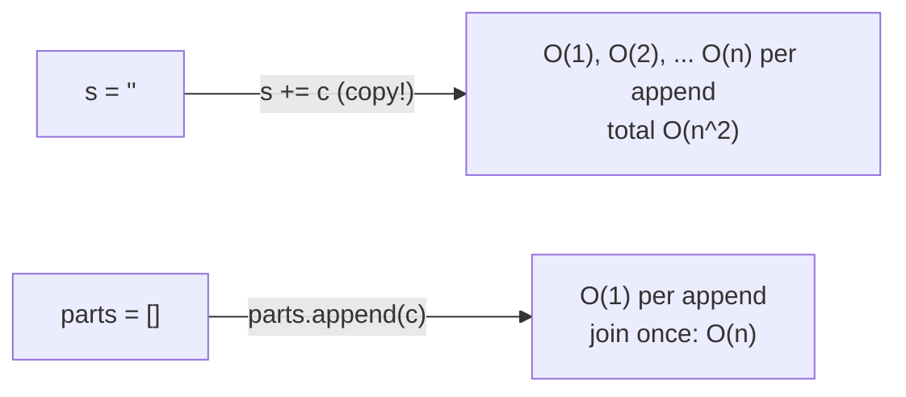
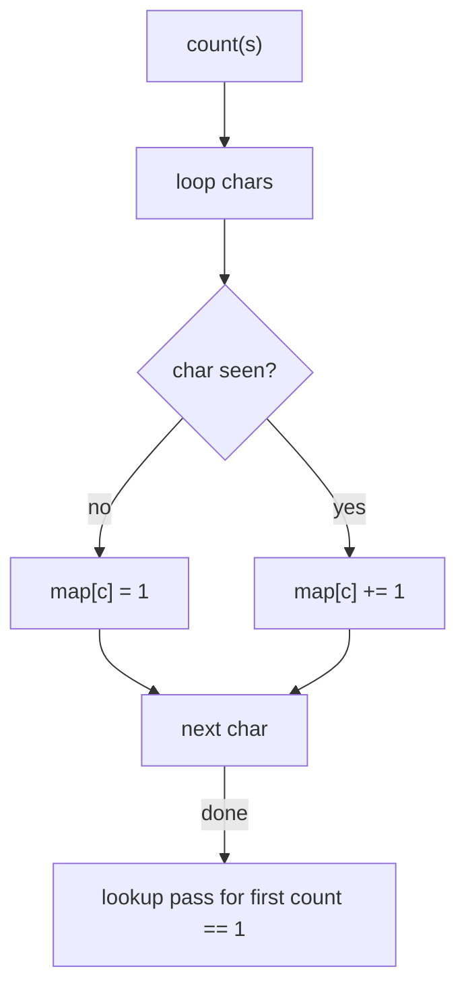
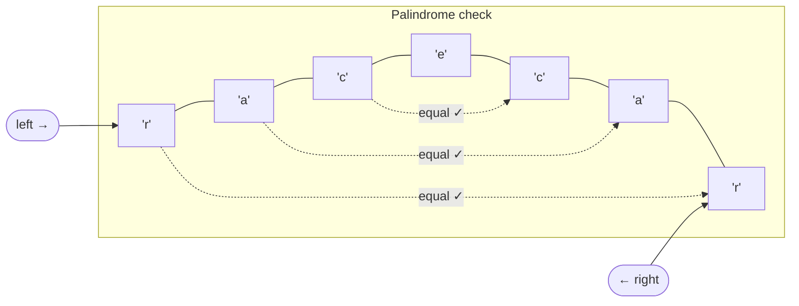
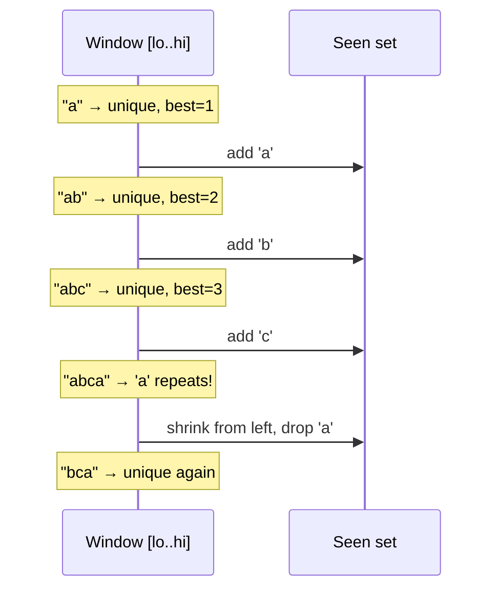
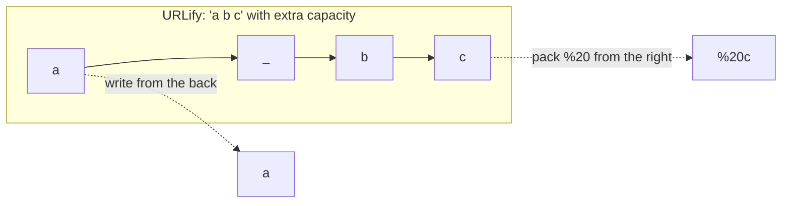
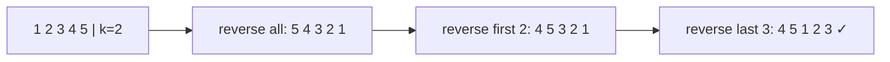
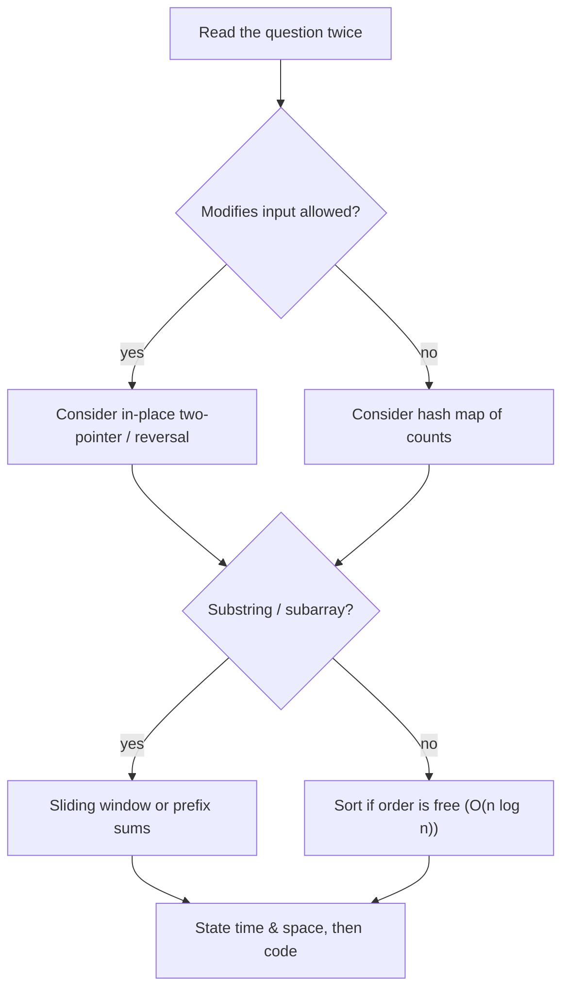

# Chapter 1 · Arrays and Strings

> Book reference: **Ch 1 — Arrays and Strings** (hash tables, `StringBuilder`, two-pointer & sliding-window patterns).

Strings and arrays are the most common interview surface. Almost every Ch 1 question is one of five patterns:

```mermaid
mindmap
  root((Arrays and Strings))
    Frequency counting
      hash map / array of 256
      anagrams, duplicates, first-unique
    Two pointers
      palindrome, sorted pair sums
      in-place compaction
    Sliding window
      longest unique substring
      min window covering pattern
    In-place surgery
      URLify shift, rotate, remove element
    String building
      StringBuilder / join
      avoid O(n2) concatenation
```

---

## 1. Strings are immutable — build, don't concatenate



```java
// Java — StringBuilder is the interview-safe choice
String joinWords(String[] words) {
    StringBuilder sb = new StringBuilder();
    for (String w : words) sb.append(w);
    return sb.toString();
}
```

```python
# Python — ''.join is idiomatic and fast
def join_words(words):
    return "".join(words)
```

```csharp
// C# — StringBuilder for loops, string.Join for one-shot
using System.Text;
string JoinWords(string[] words) {
    var sb = new StringBuilder();
    foreach (var w in words) sb.Append(w);
    return sb.ToString();
}
```

```javascript
// JavaScript — array join
const joinWords = words => words.join("");
```

---

## 2. Frequency counting (anagrams, duplicates, first unique)



```java
boolean isAnagram(String a, String b) {
    if (a.length() != b.length()) return false;
    int[] count = new int[128];
    for (int i = 0; i < a.length(); i++) { count[a.charAt(i)]++; count[b.charAt(i)]--; }
    for (int c : count) if (c != 0) return false;
    return true;
}
```

```python
from collections import Counter

def is_anagram(a, b):
    return Counter(a) == Counter(b)
```

```csharp
bool IsAnagram(string a, string b) {
    if (a.Length != b.Length) return false;
    var count = new int[128];
    for (int i = 0; i < a.Length; i++) { count[a[i]]++; count[b[i]]--; }
    return count.All(c => c == 0);
}
```

```javascript
function isAnagram(a, b) {
  if (a.length !== b.length) return false;
  const count = new Array(128).fill(0);
  for (let i = 0; i < a.length; i++) { count[a.charCodeAt(i)]++; count[b.charCodeAt(i)]--; }
  return count.every(c => c === 0);
}
```

Why 128/256-wide arrays? When the alphabet is small and known, an array beats a hash map —
constant factors matter in interviews. Use a map/set for arbitrary Unicode.

---

## 3. Two pointers



```java
boolean isPalindrome(String s) {
    for (int i = 0, j = s.length() - 1; i < j; i++, j--)
        if (s.charAt(i) != s.charAt(j)) return false;
    return true;
}
```

```python
def is_palindrome(s):
    i, j = 0, len(s) - 1
    while i < j:
        if s[i] != s[j]: return False
        i, j = i + 1, j - 1
    return True
```

```csharp
bool IsPalindrome(string s) {
    for (int i = 0, j = s.Length - 1; i < j; i++, j--)
        if (s[i] != s[j]) return false;
    return true;
}
```

```javascript
const isPalindrome = s => {
  for (let i = 0, j = s.length - 1; i < j; i++, j--)
    if (s[i] !== s[j]) return false;
  return true;
};
```

Two pointers also solve: sorted two-sum, container-with-most-water, merging sorted arrays,
and in-place removal (write pointer + read pointer).

---

## 4. Sliding window — the pattern for substrings/subarrays



```java
int longestUniqueSubstring(String s) {
    Map<Character, Integer> last = new HashMap<>();
    int best = 0, lo = 0;
    for (int hi = 0; hi < s.length(); hi++) {
        char c = s.charAt(hi);
        if (last.containsKey(c) && last.get(c) >= lo) lo = last.get(c) + 1;
        last.put(c, hi);
        best = Math.max(best, hi - lo + 1);
    }
    return best;
}
```

```python
def longest_unique_substring(s):
    last, best, lo = {}, 0, 0
    for hi, c in enumerate(s):
        if c in last and last[c] >= lo:
            lo = last[c] + 1
        last[c] = hi
        best = max(best, hi - lo + 1)
    return best
```

```csharp
int LongestUniqueSubstring(string s) {
    var last = new Dictionary<char, int>();
    int best = 0, lo = 0;
    for (int hi = 0; hi < s.Length; hi++) {
        char c = s[hi];
        if (last.TryGetValue(c, out int p) && p >= lo) lo = p + 1;
        last[c] = hi;
        best = Math.Max(best, hi - lo + 1);
    }
    return best;
}
```

```javascript
function longestUniqueSubstring(s) {
  const last = new Map();
  let best = 0, lo = 0;
  for (let hi = 0; hi < s.length; hi++) {
    const c = s[hi];
    if (last.has(c) && last.get(c) >= lo) lo = last.get(c) + 1;
    last.set(c, hi);
    best = Math.max(best, hi - lo + 1);
  }
  return best;
}
```

Window rules of thumb:

| Question asks | Window type |
|---------------|-------------|
| longest/shortest … with property P | expand `hi`, shrink `lo` while P breaks |
| fixed size k | slide both pointers together |
| max/min in every window of size k | deque (monotonic) — see Ch 3 |

---

## 5. In-place surgery — URLify, rotate, remove



```python
def urlify(chars, length):
    """Replace spaces with %20 in a char array with enough trailing capacity."""
    write = len(chars) - 1
    for read in range(length - 1, -1, -1):
        if chars[read] == " ":
            chars[write - 2:write + 1] = ["%", "2", "0"]
            write -= 3
        else:
            chars[write] = chars[read]
            write -= 1
    return chars
```

```java
// Java — rotate right by k using the three-reversal trick
void rotate(int[] a, int k) {
    k %= a.length;
    reverse(a, 0, a.length - 1);
    reverse(a, 0, k - 1);
    reverse(a, k, a.length - 1);
}
private void reverse(int[] a, int i, int j) {
    while (i < j) { int t = a[i]; a[i++] = a[j]; a[j--] = t; }
}
```

Reversal trick intuition:



---

## Complexity cheat sheet

| Operation | Array | StringBuilder / list | Hash map |
|-----------|-------|----------------------|----------|
| index / get | O(1) | O(1) | O(1) avg |
| search | O(n) | O(n) | O(1) avg |
| append | — | O(1) amortized | O(1) avg |
| insert middle | O(n) | O(n) | — |
| in-place reverse | O(n) | O(n) | — |

## Mapped tasks to practice

- [001 Reverse a string](../../tasks/beginner/001-reverse-a-string.md) · [002 Palindrome](../../tasks/beginner/002-check-if-a-string-is-a-palindrome.md) · [003 Vowels/consonants](../../tasks/beginner/003-count-vowels-and-consonants-in-a-string.md)
- [004 Remove duplicates](../../tasks/beginner/004-remove-duplicates-from-an-array-create-new-array.md) · [015 Anagrams](../../tasks/beginner/015-check-if-two-strings-are-anagrams.md) · [016 Char counts](../../tasks/beginner/016-count-occurrences-of-each-character-in-a-string.md)
- [017 atoi](../../tasks/beginner/017-convert-string-to-integer-atoi-basic.md) · [018 itoa](../../tasks/beginner/018-convert-integer-to-string.md) · [045 URLify](../../tasks/beginner/045-replace-spaces-with-20-urlify.md)
- [022 Rotate in place](../../tasks/beginner/022-rotate-array-in-place-by-k-positions.md) · [027 Missing number](../../tasks/beginner/027-find-missing-number-in-1-n-given-n-1-elements.md) · [047 First non-repeating char](../../tasks/beginner/047-find-first-non-repeating-character-in-a-string.md)
- [169 Longest unique substring](../../tasks/beginner/169-implement-sliding-window-for-unique-characters-longest-unique-su.md) · [232 Min window substring](../../tasks/intermediate/232-minimum-window-substring-covering-all-chars-of-pattern.md) · [233 Group anagrams](../../tasks/intermediate/233-group-anagrams-hashmap-with-sorted-key.md)

> See the full chapter list: [ctci-mapping.md → Ch 1](../ctci-mapping.md).

## Interview checklist


