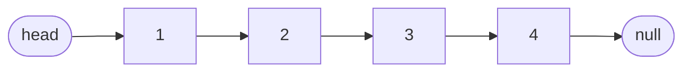
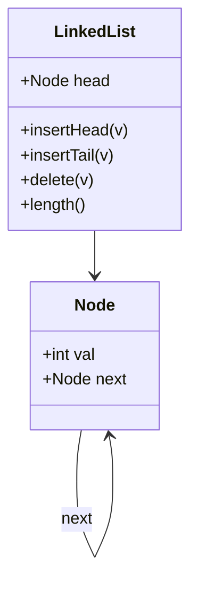
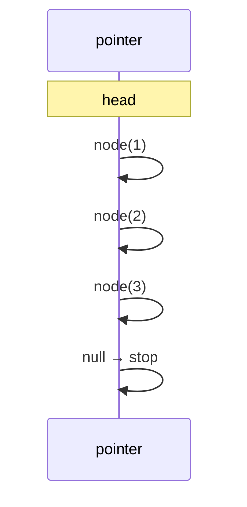
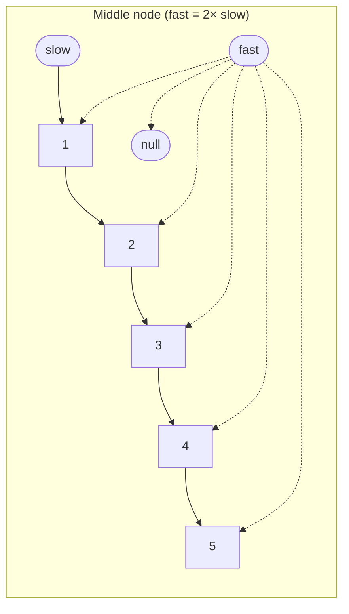
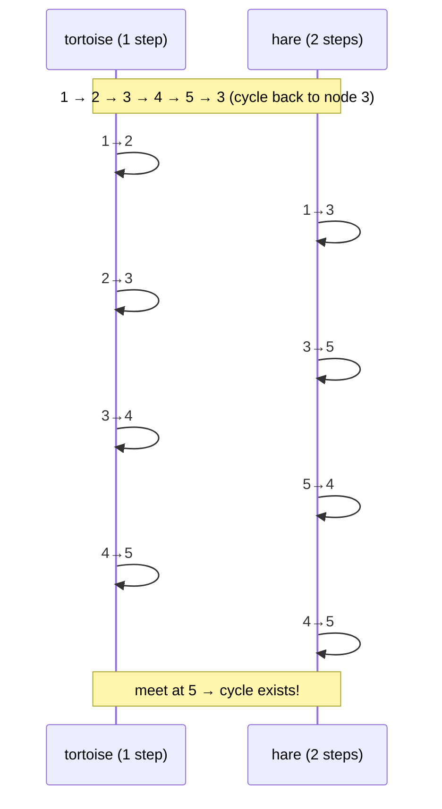
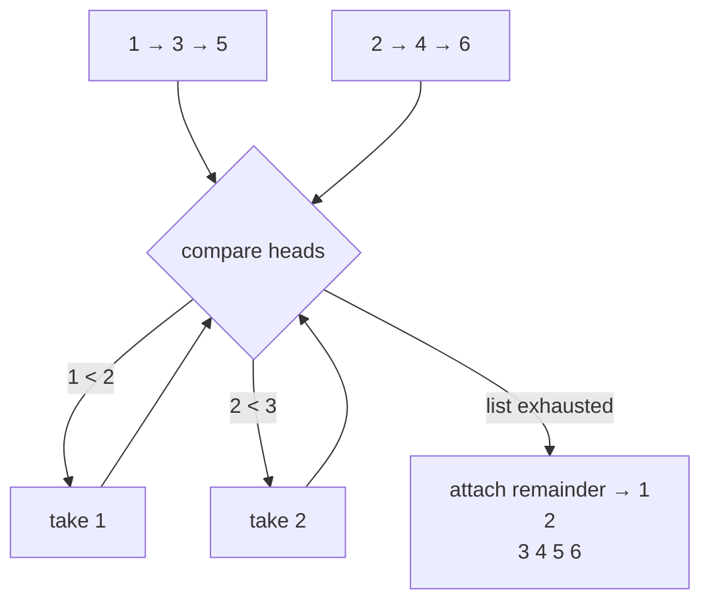
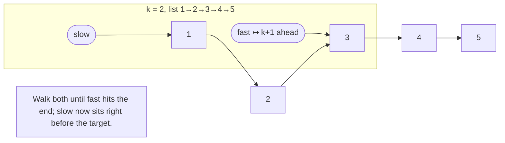
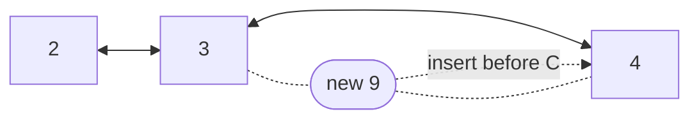
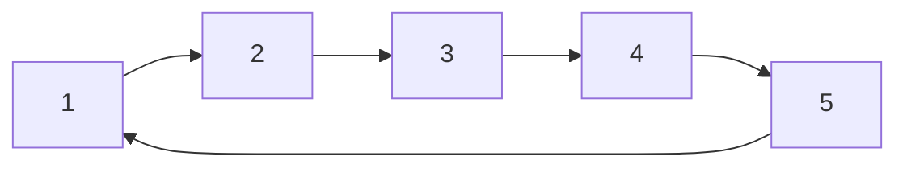

# Chapter 2 · Linked Lists

> Book reference: **Ch 2 — Linked Lists** (runner technique, recursion, in-place reversal).

A linked list trades random access for O(1) insertion/removal at a known node.
Interviewers love it because pointer manipulation exposes whether you can draw before you code.



**Always draw the boxes and arrows first.** Most "bugs" in list questions are pointer-order mistakes,
not logic mistakes.

---

## 1. The node — four languages, one shape



```java
// Java
class Node {
    int val; Node next;
    Node(int v) { val = v; }
}
```

```python
# Python
class Node:
    __slots__ = ("val", "next")
    def __init__(self, val, nxt=None):
        self.val = val
        self.next = nxt
```

```csharp
// C#
class Node {
    public int Val;
    public Node? Next;
    public Node(int v) { Val = v; }
}
```

```javascript
// JavaScript
class Node {
  constructor(val, next = null) { this.val = val; this.next = next; }
}
```

---

## 2. Traversal, length, insert



```java
int length(Node head) {
    int n = 0;
    for (Node p = head; p != null; p = p.next) n++;
    return n;
}

Node insertHead(Node head, int v) {
    Node n = new Node(v);
    n.next = head;
    return n;               // new head
}
```

```python
def length(head):
    n, p = 0, head
    while p:
        n, p = n + 1, p.next
    return n

def insert_head(head, v):
    return Node(v, head)
```

```csharp
int Length(Node? head) {
    int n = 0;
    for (var p = head; p != null; p = p.Next) n++;
    return n;
}

Node InsertHead(Node? head, int v) => new Node(v) { Next = head };
```

```javascript
const length = head => { let n = 0; for (let p = head; p; p = p.next) n++; return n; };
const insertHead = (head, v) => new Node(v, head);
```

---

## 3. Runner technique — the second pointer that moves faster

Used for: middle of list, k-th from end, cycle detection, palindrome list.



```python
def middle(head):
    slow = fast = head
    while fast and fast.next:
        slow, fast = slow.next, fast.next.next
    return slow          # for even length, second of the two middles
```

```java
Node middle(Node head) {
    Node slow = head, fast = head;
    while (fast != null && fast.next != null) {
        slow = slow.next; fast = fast.next.next;
    }
    return slow;
}
```

```csharp
Node? Middle(Node? head) {
    var slow = head; var fast = head;
    while (fast != null && fast.Next != null) { slow = slow!.Next; fast = fast.Next.Next; }
    return slow;
}
```

```javascript
function middle(head) {
  let slow = head, fast = head;
  while (fast && fast.next) { slow = slow.next; fast = fast.next.next; }
  return slow;
}
```

---

## 4. Floyd's cycle detection (tortoise & hare)



```java
boolean hasCycle(Node head) {
    Node slow = head, fast = head;
    while (fast != null && fast.next != null) {
        slow = slow.next; fast = fast.next.next;
        if (slow == fast) return true;
    }
    return false;
}
```

*Why it works:* inside the cycle the hare gains exactly one step per move on the tortoise,
so it must eventually land on the same node (relative speed 1).

---

## 5. Reversal — the pointer dance

```mermaid
flowchart TD
    subgraph Before
      B0(["prev=null"]) -.-> B1["1 (curr)"] --> B2["2"] --> B3["3"] --> B4["null"]
    end
    subgraph Step1["Step 1 — flip 1→null, advance"]
      S0(["prev=1"]) -.-> S1["1 → null"] 
      S2["2 (curr)"] --> S3["3"]
    end
    subgraph Step2["Step 2 — flip 2→1, advance"]
      T0(["prev=2"]) 
      T1["2 → 1"] 
      T2["3 (curr)"]
    end
    subgraph After["Step 3 — flip 3→2"]
      A1(["prev=3=head"]) 
      A2["3 → 2 → 1 → null"]
    end
    Before --> Step1 --> Step2 --> After
```



```java
Node reverse(Node head) {
    Node prev = null;
    while (head != null) {
        Node next = head.next;   // 1. save
        head.next = prev;        // 2. flip
        prev = head;             // 3. advance prev
        head = next;             // 4. advance curr
    }
    return prev;
}
```

```python
def reverse(head):
    prev = None
    while head:
        head.next, prev, head = prev, head, head.next
    return prev

def reverse_recursive(head):
    if not head or not head.next:
        return head
    new_head = reverse_recursive(head.next)
    head.next.next = head
    head.next = None
    return new_head
```

```csharp
Node? Reverse(Node? head) {
    Node? prev = null;
    while (head != null) {
        var next = head.Next;
        head.Next = prev;
        prev = head;
        head = next;
    }
    return prev;
}
```

```javascript
function reverse(head) {
  let prev = null;
  while (head) {
    const next = head.next;
    head.next = prev;
    prev = head;
    head = next;
  }
  return prev;
}
```

Order matters: **save next before flipping**, or you lose the rest of the list.

---

## 6. Merge two sorted lists



```python
def merge(a, b):
    dummy = tail = Node(0)
    while a and b:
        if a.val <= b.val:
            tail.next, a = a, a.next
        else:
            tail.next, b = b, b.next
        tail = tail.next
    tail.next = a or b
    return dummy.next
```

```java
Node merge(Node a, Node b) {
    Node dummy = new Node(0), tail = dummy;
    while (a != null && b != null) {
        if (a.val <= b.val) { tail.next = a; a = a.next; }
        else                 { tail.next = b; b = b.next; }
        tail = tail.next;
    }
    tail.next = (a != null) ? a : b;
    return dummy.next;
}
```

```csharp
Node? Merge(Node? a, Node? b) {
    var dummy = new Node(0); var tail = dummy;
    while (a != null && b != null) {
        if (a.Val <= b.Val) { tail.Next = a; a = a.Next; }
        else                { tail.Next = b; b = b.Next; }
        tail = tail.Next;
    }
    tail.Next = a ?? b;
    return dummy.Next;
}
```

```javascript
function merge(a, b) {
  const dummy = new Node(0);
  let tail = dummy;
  while (a && b) {
    if (a.val <= b.val) { tail.next = a; a = a.next; }
    else                { tail.next = b; b = b.next; }
    tail = tail.next;
  }
  tail.next = a || b;
  return dummy.next;
}
```

The dummy-head idiom removes every "is this the first node?" special case.

---

## 7. Remove k-th node from the end (two pointers with a k-gap)



```java
Node removeNthFromEnd(Node head, int k) {
    Node dummy = new Node(0); dummy.next = head;
    Node slow = dummy, fast = dummy;
    for (int i = 0; i <= k; i++) fast = fast.next;   // fast leads by k+1
    while (fast != null) { slow = slow.next; fast = fast.next; }
    slow.next = slow.next.next;                      // unlink
    return dummy.next;
}
```

---

## 8. Doubly linked list — insert & delete



```python
class DNode:
    def __init__(self, val):
        self.val, self.prev, self.next = val, None, None

def insert_before(node, val):
    n = DNode(val)
    n.prev, n.next = node.prev, node
    if node.prev: node.prev.next = n
    node.prev = n
    return n

def delete(node):
    if node.prev: node.prev.next = node.next
    if node.next: node.next.prev = node.prev
    node.prev = node.next = None
```

Doubly linked lists power LRU caches (list order = recency) — see task 160.

## Circular lists & the Josephus problem



Josephus: repeatedly count k around the circle and eliminate —
task [155](../../tasks/beginner/155-josephus-problem-simulation.md). A circular buffer is the array analogue
(task 64).

---

## Complexity cheat sheet

| Operation | Singly | Doubly | Array |
|-----------|--------|--------|-------|
| access i-th | O(n) | O(n) | O(1) |
| insert/delete at head | O(1) | O(1) | O(n) |
| delete given node | O(n) O(1) if prev known | **O(1)** | O(n) |
| search | O(n) | O(n) | O(log n) sorted |
| reverse | O(n) | O(n) | O(n) swap |

## Mapped tasks to practice

- [052 insert at head](../../tasks/beginner/052-implement-simple-linkedlist-insert-at-head.md) · [053 insert at tail](../../tasks/beginner/053-implement-linkedlist-insert-at-tail.md) · [054 traverse](../../tasks/beginner/054-traverse-linked-list-and-print-nodes.md)
- [055 delete by value](../../tasks/beginner/055-delete-node-by-value-in-singly-linked-list.md) · [056 length](../../tasks/beginner/056-find-length-of-linked-list.md) · [057 middle](../../tasks/beginner/057-find-middle-node-of-linked-list-two-pointers.md)
- [058 Floyd cycle](../../tasks/beginner/058-detect-cycle-in-linked-list-floyd.md) · [059 merge sorted](../../tasks/beginner/059-merge-two-sorted-linked-lists.md) · [060 remove nth from end](../../tasks/beginner/060-remove-nth-node-from-end-of-linked-list.md)
- [061 reverse iterative](../../tasks/beginner/061-reverse-singly-linked-list-iterative.md) · [062 reverse recursive](../../tasks/beginner/062-reverse-singly-linked-list-recursive.md) · [063 doubly linked list](../../tasks/beginner/063-implement-doubly-linked-list-insert-delete.md)
- [154 circular linked list](../../tasks/beginner/154-implement-a-basic-circular-linked-list.md) · [155 Josephus](../../tasks/beginner/155-josephus-problem-simulation.md) · [160 LRU cache](../../tasks/beginner/160-implement-lru-cache-using-linked-list-hashmap.md)

> Full list: [ctci-mapping.md → Ch 2](../ctci-mapping.md).
