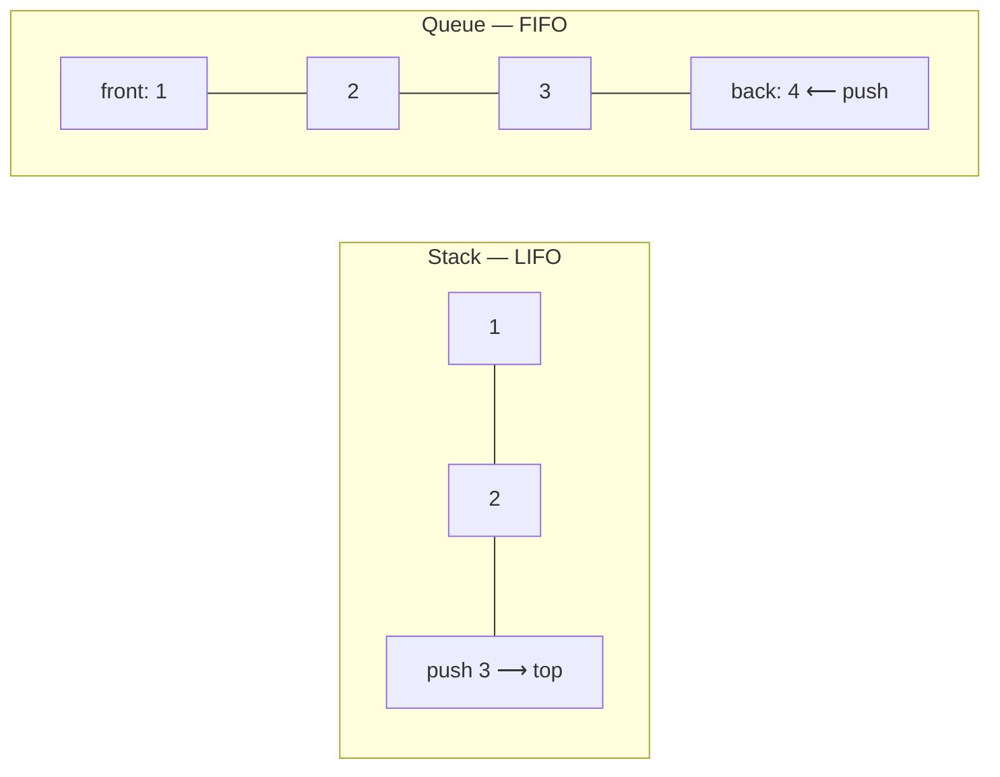
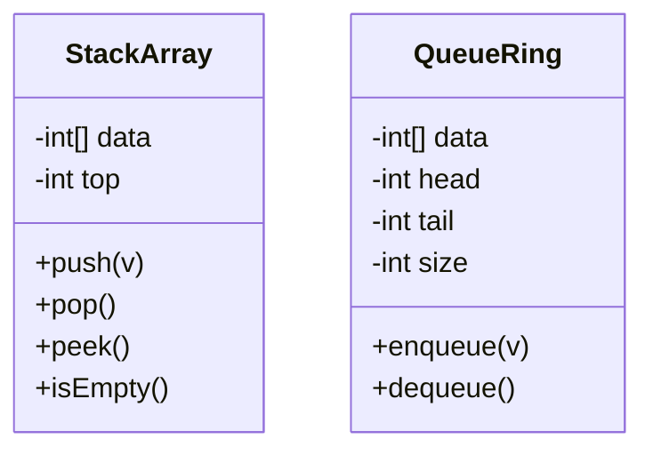
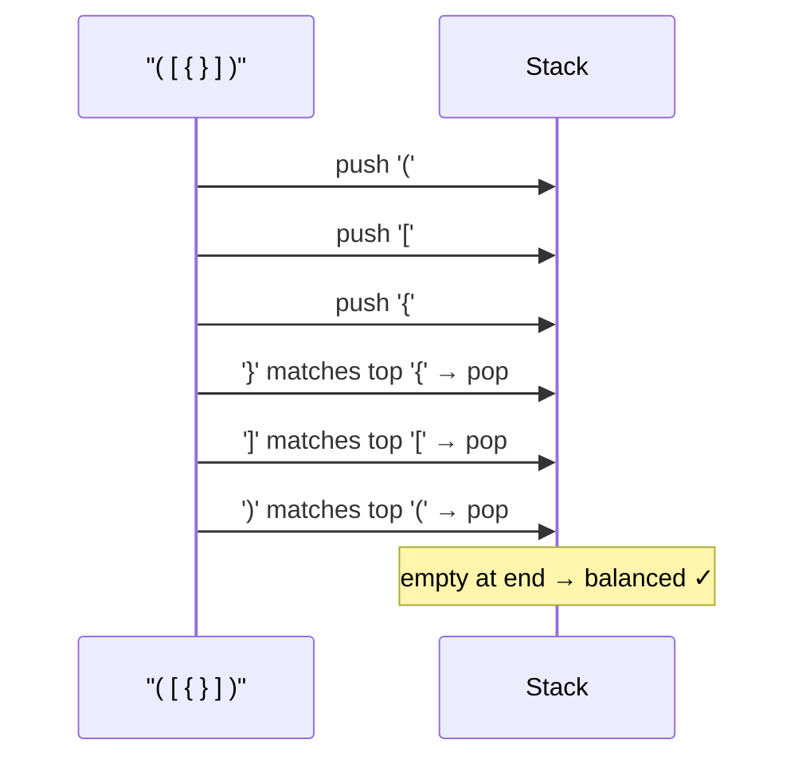
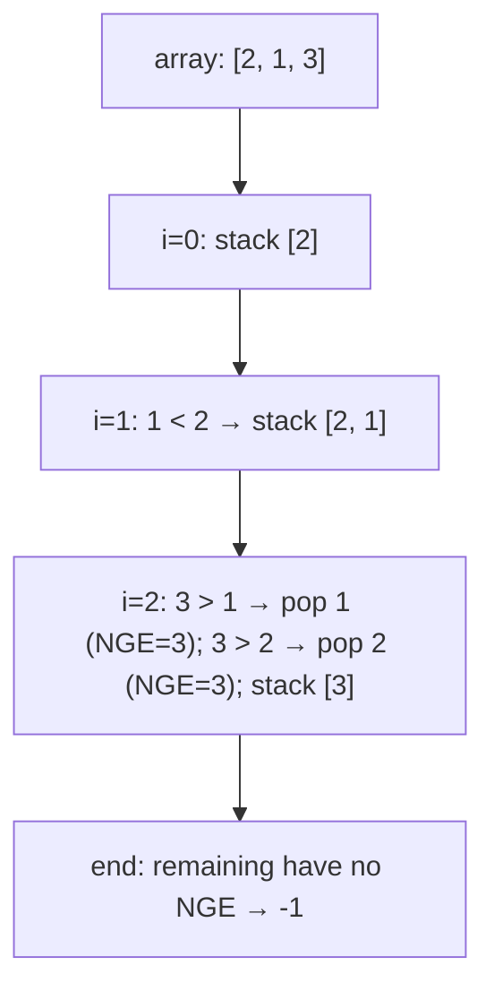
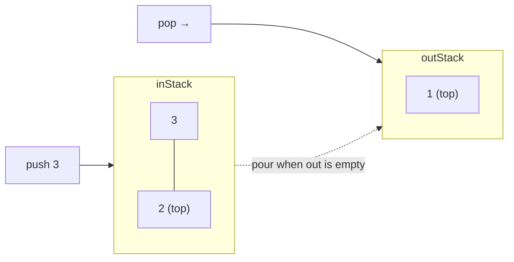
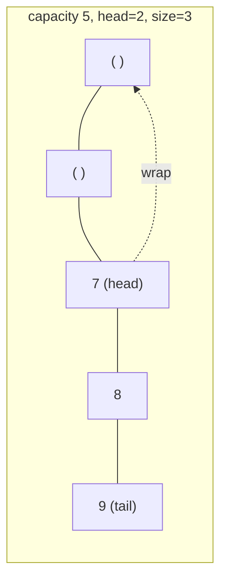
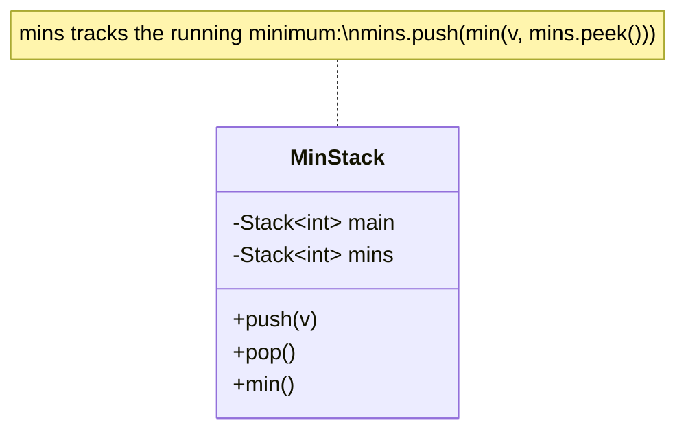
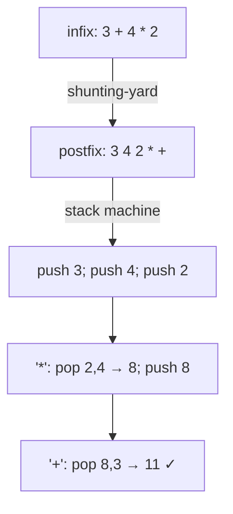

# Chapter 3 · Stacks and Queues

> Book reference: **Ch 3 — Stacks and Queues** (implementations, `getMin` stack, queue via stacks, monotonic stacks).



| | Stack | Queue |
|--|-------|-------|
| Order | Last-In-First-Out | First-In-First-Out |
| Core ops | push, pop, peek | enqueue, dequeue, front |
| Typical uses | parsing, DFS, undo, expression eval, monotonic problems | BFS, scheduling, buffers, producer-consumer |
| Array cost | O(1) amortized | ring buffer O(1) |

---

## 1. Implementations



```java
// Java — array-based stack
class StackArray {
    private final int[] data;
    private int top = -1;
    StackArray(int cap) { data = new int[cap]; }
    void push(int v) {
        if (top + 1 == data.length) throw new IllegalStateException("full");
        data[++top] = v;
    }
    int pop() {
        if (top < 0) throw new IllegalStateException("empty");
        return data[top--];
    }
    int peek() { return data[top]; }
    boolean isEmpty() { return top < 0; }
}
```

```python
# Python — list is a stack; deque is a queue
stack = []
stack.append(1); stack.append(2)
top = stack[-1]; stack.pop()

from collections import deque
queue = deque([1, 2, 3])
queue.append(4)       # enqueue at back
front = queue.popleft()  # dequeue at front
```

```csharp
// C# — Stack<T> / Queue<T> in the BCL; here is the array flavour
class StackArray {
    private readonly int[] data;
    private int top = -1;
    public StackArray(int cap) => data = new int[cap];
    public void Push(int v) { if (top + 1 == data.Length) throw new InvalidOperationException("full"); data[++top] = v; }
    public int Pop() { if (top < 0) throw new InvalidOperationException("empty"); return data[top--]; }
    public int Peek() => data[top];
    public bool IsEmpty => top < 0;
}
```

```javascript
// JavaScript — arrays with push/pop; avoid shift() for hot paths (O(n))
const stack = [];
stack.push(1); stack.push(2);
const top = stack[stack.length - 1];
stack.pop();
```

---

## 2. Balanced parentheses — the canonical stack problem



```python
def is_balanced(s):
    pairs = {")": "(", "]": "[", "}": "{"}
    stack = []
    for ch in s:
        if ch in "([{":
            stack.append(ch)
        elif ch in pairs:
            if not stack or stack.pop() != pairs[ch]:
                return False
    return not stack
```

```java
boolean isBalanced(String s) {
    Deque<Character> stack = new ArrayDeque<>();
    for (char c : s.toCharArray()) {
        if (c == '(' || c == '[' || c == '{') stack.push(c);
        else if (c == ')' || c == ']' || c == '}') {
            if (stack.isEmpty()) return false;
            char open = stack.pop();
            if (c == ')' && open != '(') return false;
            if (c == ']' && open != '[') return false;
            if (c == '}' && open != '{') return false;
        }
    }
    return stack.isEmpty();
}
```

```csharp
bool IsBalanced(string s) {
    var pairs = new Dictionary<char, char> { [')'] = '(', [']'] = '[', ['}'] = '{' };
    var stack = new Stack<char>();
    foreach (var c in s) {
        if (c is '(' or '[' or '{') stack.Push(c);
        else if (pairs.TryGetValue(c, out var open)) {
            if (stack.Count == 0 || stack.Pop() != open) return false;
        }
    }
    return stack.Count == 0;
}
```

```javascript
function isBalanced(s) {
  const pairs = { ")": "(", "]": "[", "}": "{" };
  const stack = [];
  for (const c of s) {
    if ("([{".includes(c)) stack.push(c);
    else if (pairs[c]) {
      if (stack.pop() !== pairs[c]) return false;
    }
  }
  return stack.length === 0;
}
```

---

## 3. Monotonic stack — next greater element in O(n)



```java
int[] nextGreater(int[] a) {
    int[] res = new int[a.length];
    Arrays.fill(res, -1);
    Deque<Integer> stack = new ArrayDeque<>();   // indices, values decreasing
    for (int i = 0; i < a.length; i++) {
        while (!stack.isEmpty() && a[stack.peek()] < a[i])
            res[stack.pop()] = a[i];
        stack.push(i);
    }
    return res;
}
```

The same shape solves: daily temperatures, largest rectangle in histogram, sliding-window maximum
(monotonic **deque** — task 92), stock span.

---

## 4. Queue built from two stacks



```python
class QueueViaStacks:
    def __init__(self):
        self._in, self._out = [], []

    def push(self, v):
        self._in.append(v)

    def pop(self):
        if not self._out:
            while self._in:
                self._out.append(self._in.pop())
        return self._out.pop()
```

Each element moves at most twice ⇒ **amortized O(1)** per operation (see Big-O → amortized time).

---

## 5. Circular queue (ring buffer)



```java
class Ring {
    private final int[] data;
    private int head = 0, size = 0;
    Ring(int cap) { data = new int[cap]; }
    boolean enqueue(int v) {
        if (size == data.length) return false;
        data[(head + size++) % data.length] = v;
        return true;
    }
    int dequeue() {
        if (size == 0) throw new NoSuchElementException();
        int v = data[head];
        head = (head + 1) % data.length;
        size--;
        return v;
    }
}
```

```csharp
class Ring {
    private readonly int[] data;
    private int head = 0, size = 0;
    public Ring(int cap) => data = new int[cap];
    public bool Enqueue(int v) {
        if (size == data.Length) return false;
        data[(head + size++) % data.Length] = v;
        return true;
    }
    public int Dequeue() {
        if (size == 0) throw new InvalidOperationException();
        int v = data[head];
        head = (head + 1) % data.Length;
        size--;
        return v;
    }
}
```

Modulo indexing is also how **producer-consumer** bounded buffers are built — see Ch 15.

---

## 6. Min-stack in O(1) — design problem



```java
class MinStack {
    private final Deque<Integer> main = new ArrayDeque<>();
    private final Deque<Integer> mins = new ArrayDeque<>();

    void push(int v) {
        main.push(v);
        mins.push(mins.isEmpty() ? v : Math.min(v, mins.peek()));
    }
    int pop() { mins.pop(); return main.pop(); }
    int min() { return mins.peek(); }
}
```

```python
class MinStack:
    def __init__(self):
        self._main, self._mins = [], []

    def push(self, v):
        self._main.append(v)
        self._mins.append(min(v, self._mins[-1]) if self._mins else v)

    def pop(self):
        self._mins.pop()
        return self._main.pop()

    def min(self):
        return self._mins[-1]
```

---

## 7. Expression evaluation (tasks 190–193)



```python
def eval_rpn(tokens):
    stack = []
    ops = {"+": lambda a, b: a + b, "-": lambda a, b: a - b,
           "*": lambda a, b: a * b, "/": lambda a, b: int(a / b)}
    for t in tokens:
        if t in ops:
            b, a = stack.pop(), stack.pop()
            stack.append(ops[t](a, b))
        else:
            stack.append(int(t))
    return stack[-1]
```

Priority rule for shunting-yard: pop operators while `prec(top) >= prec(current)` (left-associative),
then push. Parentheses: `(` pushes unconditionally, `)` pops until `(`.

---

## Complexity cheat sheet

| Structure | push/enqueue | pop/dequeue | peek | search |
|-----------|--------------|-------------|------|--------|
| array stack | O(1) amortized | O(1) | O(1) | O(n) |
| list stack | O(1) | O(1) | O(1) | O(n) |
| ring queue | O(1) | O(1) | O(1) | O(n) |
| queue via 2 stacks | O(1) amortized | O(1) amortized | O(1) amortized | O(n) |
| heap (priority queue) | O(log n) | O(log n) | O(1) | O(n) |

## Mapped tasks to practice

- [041 single-type brackets](../../tasks/beginner/041-check-if-brackets-are-balanced-single-type.md) · [042 three bracket types](../../tasks/beginner/042-check-balanced-parentheses-with-three-bracket-types.md) · [049 stack with array](../../tasks/beginner/049-implement-stack-with-array-push-pop.md)
- [050 queue with array](../../tasks/beginner/050-implement-queue-with-array-enqueue-dequeue.md) · [064 circular queue](../../tasks/beginner/064-implement-circular-queue-ring-buffer.md) · [065 priority queue](../../tasks/beginner/065-implement-priority-queue-using-built-in-heap.md)
- [172 min-stack](../../tasks/beginner/172-implement-stack-that-supports-getmin-in-o-1.md) · [173 min-queue](../../tasks/beginner/173-implement-queue-that-supports-getmin-in-o-1.md) · [190 RPN eval](../../tasks/beginner/190-parse-and-evaluate-postfix-rpn-expression.md)
- [191 infix→postfix](../../tasks/beginner/191-convert-infix-to-postfix-shunting-yard-simplified.md) · [192 full expression evaluator](../../tasks/beginner/192-evaluate-arithmetic-expression-with-parentheses-shunting-yard-ev.md) · [193 tokenizer](../../tasks/beginner/193-implement-simple-expression-tokenizer.md)
- [092 sliding window max](../../tasks/beginner/092-max-over-sliding-window-using-deque.md) · [208 sliding window min](../../tasks/intermediate/208-implement-sliding-window-minimum-using-deque.md) · [341 longest valid parentheses](../../tasks/intermediate/341-balanced-parentheses-longest-valid-substring-stack.md)

> Full list: [ctci-mapping.md → Ch 3](../ctci-mapping.md).
