# Chapter 4 · Trees and Graphs

> Book reference: **Ch 4 — Trees and Graphs** (types of trees, traversals, binary heaps, tries, graphs, BFS/DFS).

Trees and graphs are where interviews separate candidates: recursion, queues/stacks, and complexity
analysis all meet. This is also the largest mapped chapter of the repo (133 tasks).

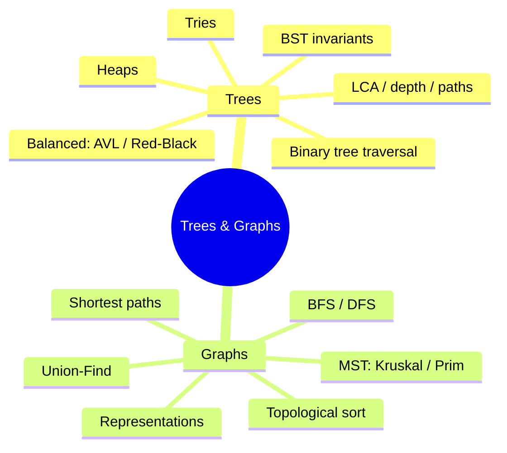

---

## 1. Vocabulary you must use fluently

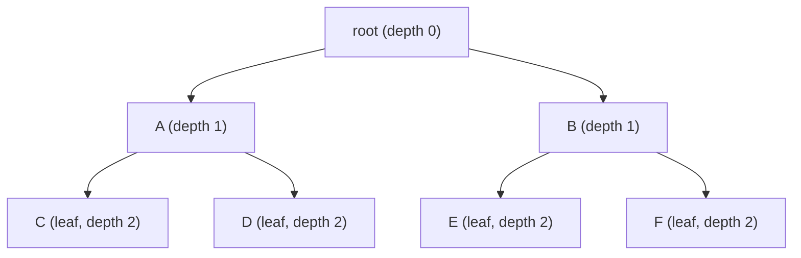

| Term | Meaning |
|------|---------|
| depth of node | edges from root down to it |
| height of node | edges on the longest path down to a leaf |
| complete tree | every level full except possibly the last, filled left→right |
| full tree | every node has 0 or 2 children |
| perfect tree | all internal nodes have 2 children, all leaves at same depth |
| balanced | heights of left/right subtrees differ by ≤ 1 at every node |

Heap trick: a **complete** binary tree fits in an array — children of `i` are `2i+1` and `2i+2`.

---

## 2. Traversals — visit orders

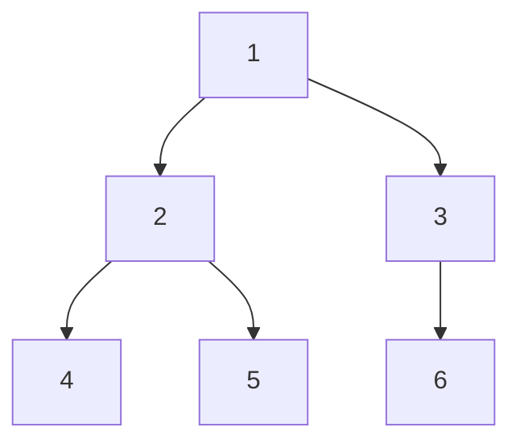

| Traversal | Order for the tree above | Typical use |
|-----------|--------------------------|-------------|
| Preorder (node, L, R) | 1 2 4 5 3 6 | serialize/copy tree |
| Inorder (L, node, R) | 4 2 5 1 6 3 | BST → sorted order |
| Postorder (L, R, node) | 4 5 2 6 3 1 | delete/free, evaluate expression trees |
| Level order (BFS) | 1 2 3 4 5 6 | depth, right view, level averages |

```java
// Java — recursive in-order + iterative in-order
void inOrder(Node n, List<Integer> out) {
    if (n == null) return;
    inOrder(n.left, out); out.add(n.val); inOrder(n.right, out);
}

List<Integer> inOrderIterative(Node root) {
    List<Integer> out = new ArrayList<>();
    Deque<Node> stack = new ArrayDeque<>();
    Node cur = root;
    while (cur != null || !stack.isEmpty()) {
        while (cur != null) { stack.push(cur); cur = cur.left; }
        cur = stack.pop(); out.add(cur.val); cur = cur.right;
    }
    return out;
}
```

```python
# Python
def in_order(n, out=None):
    out = [] if out is None else out
    if not n: return out
    in_order(n.left, out); out.append(n.val); in_order(n.right, out)
    return out

from collections import deque

def level_order(root):
    if not root: return []
    out, q = [], deque([root])
    while q:
        level = []
        for _ in range(len(q)):          # snapshot of current level size
            n = q.popleft()
            level.append(n.val)
            if n.left: q.append(n.left)
            if n.right: q.append(n.right)
        out.append(level)
    return out
```

```csharp
// C#
void InOrder(Node? n, List<int> out_) {
    if (n == null) return;
    InOrder(n.Left, out_); out_.Add(n.Val); InOrder(n.Right, out_);
}
```

```javascript
// JavaScript
function inOrder(n, out = []) {
  if (!n) return out;
  inOrder(n.left, out); out.push(n.val); inOrder(n.right, out);
  return out;
}
```

**Choosing a traversal:**

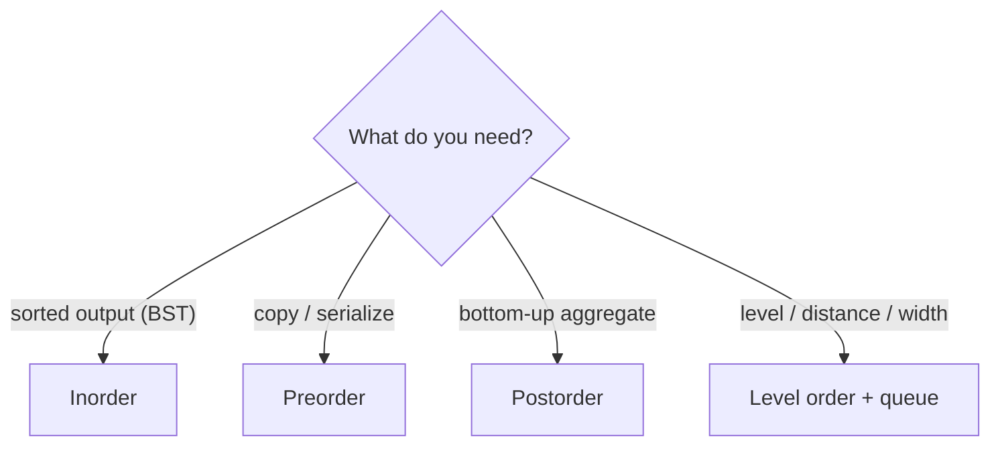

---

## 3. BST invariants

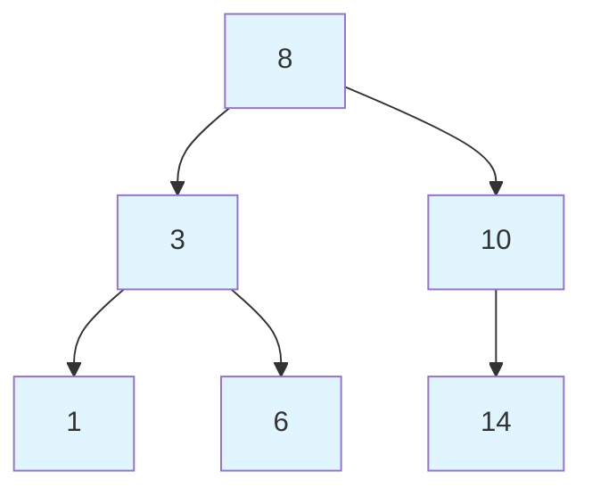

Invariant: **all** nodes in the left subtree < node < **all** nodes in the right subtree
(not just direct children!). Inorder traversal of a valid BST is sorted — that is the cheapest validator.

```java
boolean isValidBst(Node n, long lo, long hi) {
    if (n == null) return true;
    if (n.val <= lo || n.val >= hi) return false;
    return isValidBst(n.left, lo, n.val) && isValidBst(n.right, n.val, hi);
}
// call: isValidBst(root, Long.MIN_VALUE, Long.MAX_VALUE)
```

```python
def is_valid_bst(n, lo=float("-inf"), hi=float("inf")):
    if not n:
        return True
    if not lo < n.val < hi:
        return False
    return is_valid_bst(n.left, lo, n.val) and is_valid_bst(n.right, n.val, hi)
```

LCA in a BST is iterative and O(h): walk down while both targets are on the same side.

```java
Node lcaBst(Node root, int p, int q) {
    while (root != null) {
        if (p < root.val && q < root.val) root = root.left;
        else if (p > root.val && q > root.val) root = root.right;
        else return root;   // split point
    }
    return null;
}
```

---

## 4. Balanced trees — AVL & Red-Black (book §X)

Unbalanced BSTs degrade to O(n). Balanced trees keep height O(log n).

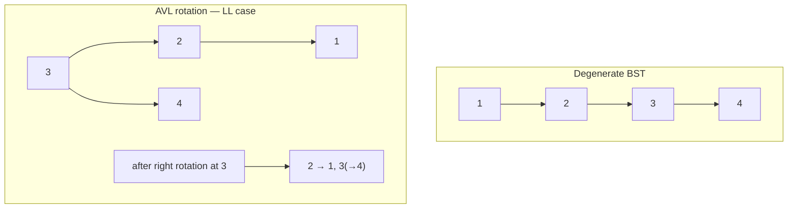

| Tree | Balance rule | Height | Notes |
|------|--------------|--------|-------|
| AVL | subtree heights differ ≤ 1, rotations on insert/delete | ≤ 1.44 log n | faster lookups, slower updates |
| Red-Black | color invariants, ≤ 2 children flips per insert | ≤ 2 log n | used by `TreeMap`, most std libraries |
| Treap | BST + random heap priority | expected O(log n) | elegant, randomization |

Library reality check: you will almost never implement AVL/RB in an interview — but you must know
their guarantees. Implementations live in tasks [247](../../tasks/intermediate/247-implement-avl-tree-insert-rotations-balance.md),
[248](../../tasks/intermediate/248-implement-red-black-tree-insert-basic-conceptual.md), [249](../../tasks/intermediate/249-implement-treap-bst-heap-insert-delete.md).

---

## 5. Heaps (priority queues)

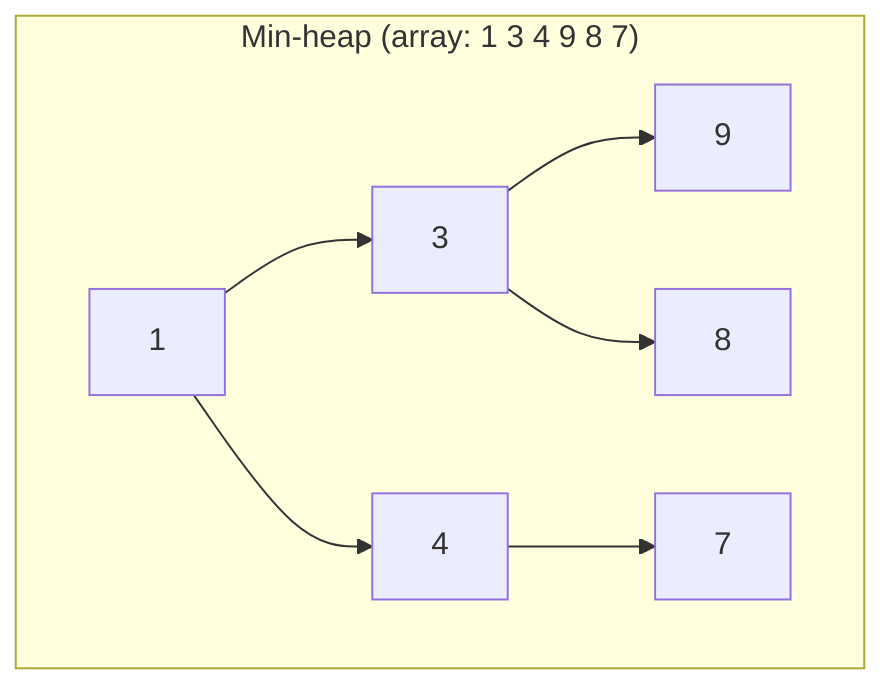

Parent ≤ children (min-heap). `push` = bubble up; `pop` = swap root with last, shrink, sift down.

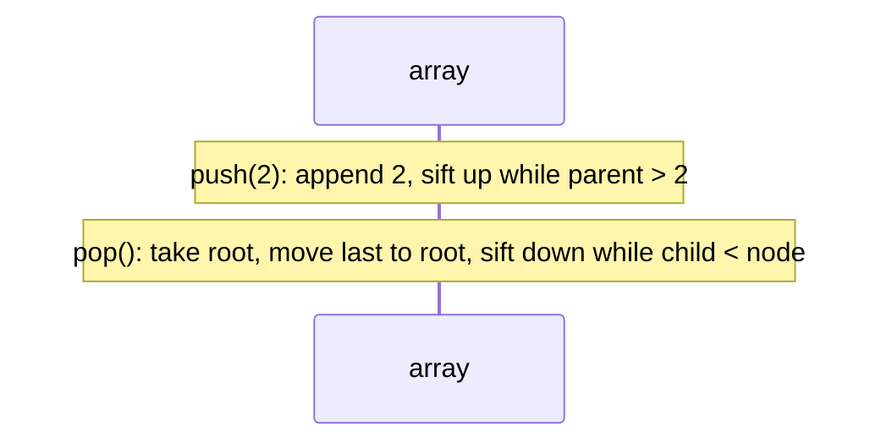

```python
import heapq

h = []
heapq.heappush(h, 5); heapq.heappush(h, 1)
smallest = h[0]
heapq.heappop(h)

# max-heap via negation
neg = [-5, -1]
heapq.heapify(neg)
largest = -neg[0]
```

```csharp
// C# — PriorityQueue<TElement, TPriority> (.NET 6+)
var pq = new PriorityQueue<string, int>();
pq.Enqueue("low", 5);
pq.Enqueue("high", 1);
var top = pq.Dequeue();   // "high"
```

Top-K pattern: keep a **min**-heap of size k while scanning; above k, pop the smallest —
leftover heap is the k largest. Used by tasks [256](../../tasks/intermediate/256-top-k-frequent-elements-in-array-heap.md),
[257](../../tasks/intermediate/257-top-k-frequent-words-heap-lexicographic-tie.md),
[262](../../tasks/intermediate/262-merge-k-sorted-lists-heap.md).

Heap operations: push O(log n), pop O(log n), peek O(1), build-heap O(n), heapsort O(n log n).

---

## 6. Tries (prefix trees)

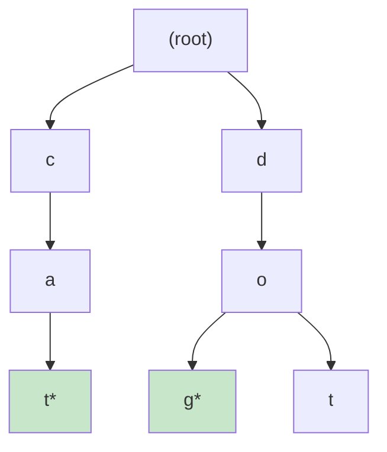

Each node = one character; `*` marks a word end. Children may live in a hash map (sparse) or an
array of 26 (dense, fast).

```java
class TrieNode {
    TrieNode[] kids = new TrieNode[26];
    boolean isWord;
}
class Trie {
    private final TrieNode root = new TrieNode();
    void insert(String w) {
        TrieNode n = root;
        for (char c : w.toCharArray()) {
            int i = c - 'a';
            if (n.kids[i] == null) n.kids[i] = new TrieNode();
            n = n.kids[i];
        }
        n.isWord = true;
    }
    boolean search(String w) {
        TrieNode n = root;
        for (char c : w.toCharArray()) {
            n = n.kids[c - 'a'];
            if (n == null) return false;
        }
        return n.isWord;
    }
}
```

```python
class Trie:
    def __init__(self):
        self.root = {}

    def insert(self, word):
        node = self.root
        for ch in word:
            node = node.setdefault(ch, {})
        node["$"] = True        # word terminator

    def search(self, word):
        node = self.root
        for ch in word:
            if ch not in node:
                return False
            node = node[ch]
        return "$" in node
```

Cost: O(L) per operation, independent of dictionary size. Tasks [115](../../tasks/beginner/115-implement-a-basic-trie-for-lowercase-words.md),
[116](../../tasks/beginner/116-insert-and-search-in-trie.md), [117](../../tasks/beginner/117-autocomplete-top-k-prefix-suggestions-trie.md),
[252](../../tasks/intermediate/252-design-a-phonebook-using-trie-with-counts-and-delete.md).

---

## 7. Graph representations

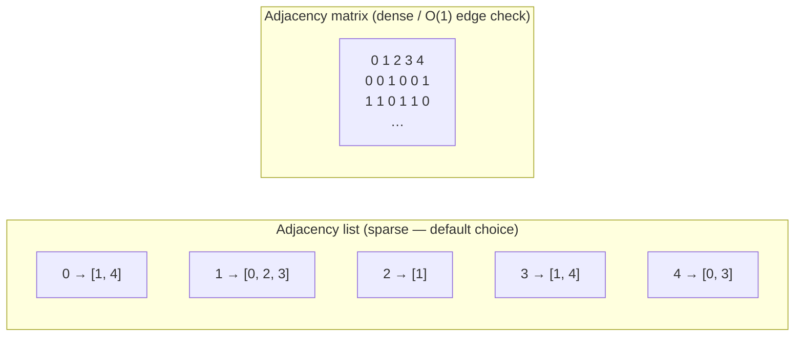

| | adjacency list | adjacency matrix |
|--|----------------|------------------|
| space | O(V + E) | O(V²) |
| edge exists? | O(degree) | O(1) |
| iterate neighbors | O(degree) — fast | O(V) |
| use when | sparse (most interview graphs) | dense, tiny V, many edge queries |

---

## 8. BFS vs DFS

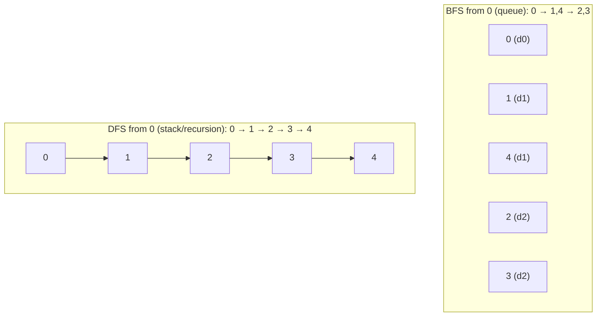

| Question | BFS | DFS |
|----------|-----|-----|
| shortest path in unweighted graph/grid | ✅ | ❌ |
| connected components / flood fill | ✅ | ✅ |
| cycle detection, topological sort | possible | ✅ natural |
| memory | O(width) | O(depth) |
| level-order anything | ✅ | ❌ |

```python
# Grid BFS — shortest path in unweighted grid
from collections import deque

def shortest_path(grid, start, goal):
    R, C = len(grid), len(grid[0])
    q, seen = deque([(start, 0)]), {start}
    while q:
        (r, c), d = q.popleft()
        if (r, c) == goal: return d
        for dr, dc in ((1,0),(-1,0),(0,1),(0,-1)):
            nr, nc = r + dr, c + dc
            if 0 <= nr < R and 0 <= nc < C and grid[nr][nc] == 0 and (nr, nc) not in seen:
                seen.add((nr, nc))
                q.append(((nr, nc), d + 1))
    return -1
```

```java
// Java — island counting with DFS flood fill
int countIslands(int[][] grid) {
    int count = 0;
    for (int r = 0; r < grid.length; r++)
        for (int c = 0; c < grid[0].length; c++)
            if (grid[r][c] == 1) { count++; flood(grid, r, c); }
    return count;
}
private void flood(int[][] g, int r, int c) {
    if (r < 0 || c < 0 || r >= g.length || c >= g[0].length || g[r][c] != 1) return;
    g[r][c] = 0;
    flood(g, r+1, c); flood(g, r-1, c); flood(g, r, c+1); flood(g, r, c-1);
}
```

```csharp
// C# — iterative DFS with an explicit stack (no recursion depth limits)
bool HasPath(Dictionary<int, List<int>> g, int src, int dst) {
    var stack = new Stack<int>();
    var seen = new HashSet<int> { src };
    stack.Push(src);
    while (stack.Count > 0) {
        var u = stack.Pop();
        if (u == dst) return true;
        foreach (var v in g[u]) if (seen.Add(v)) stack.Push(v);
    }
    return false;
}
```

---

## 9. Directed cycles & topological sort

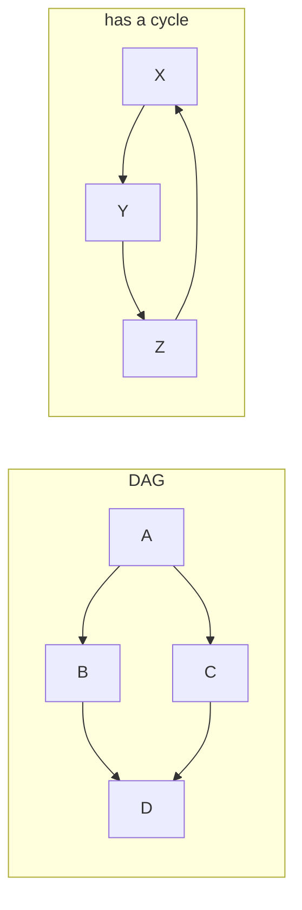

Kahn's algorithm: repeatedly take nodes with **in-degree 0**. If you emit fewer than V nodes,
a cycle exists.

```python
def topo_sort(n, edges):
    from collections import deque
    adj = [[] for _ in range(n)]
    indeg = [0] * n
    for u, v in edges:
        adj[u].append(v)
        indeg[v] += 1
    q = deque(i for i in range(n) if indeg[i] == 0)
    order = []
    while q:
        u = q.popleft()
        order.append(u)
        for v in adj[u]:
            indeg[v] -= 1
            if indeg[v] == 0:
                q.append(v)
    return order if len(order) == n else None   # None → cycle
```

DFS version: color nodes white/gray/black; an edge to a **gray** node means a back edge → cycle.
Tasks: [106](../../tasks/beginner/106-topological-sort-using-dfs-dag.md), [107](../../tasks/beginner/107-detect-cycle-in-directed-graph-dfs-coloring.md).

---

## 10. Union-Find (disjoint set)

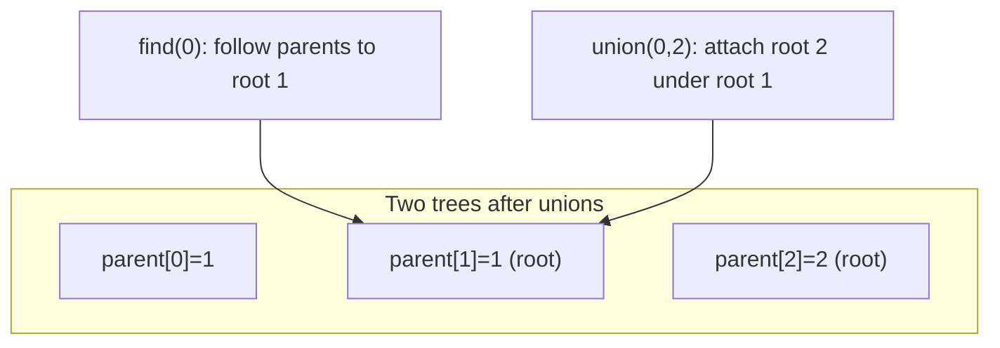

```java
class Dsu {
    private final int[] parent, rank;
    Dsu(int n) {
        parent = new int[n]; rank = new int[n];
        for (int i = 0; i < n; i++) parent[i] = i;
    }
    int find(int x) {
        if (parent[x] != x) parent[x] = find(parent[x]); // path compression
        return parent[x];
    }
    boolean union(int a, int b) {
        int ra = find(a), rb = find(b);
        if (ra == rb) return false;
        if (rank[ra] < rank[rb]) { int t = ra; ra = rb; rb = t; }
        parent[rb] = ra;
        if (rank[ra] == rank[rb]) rank[ra]++;
        return true;
    }
}
```

With union by rank + path compression: near-O(1) amortized (inverse Ackermann α(n), effectively ≤ 4).
Powers: Kruskal MST, undirected cycle detection, connected components, dynamic connectivity.

---

## 11. Shortest paths & MST

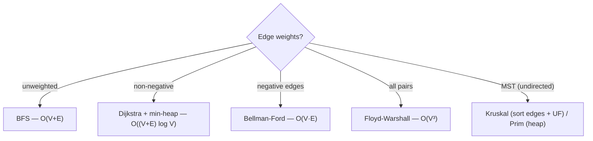

```csharp
// C# — Dijkstra with a priority queue (lazy deletion)
long[] Dijkstra(List<(int to, int w)>[] g, int src) {
    int n = g.Length;
    var dist = new long[n];
    Array.Fill(dist, long.MaxValue);
    dist[src] = 0;
    var pq = new PriorityQueue<int, long>();
    pq.Enqueue(src, 0);
    while (pq.Count > 0) {
        var u = pq.Dequeue();
        foreach (var (v, w) in g[u]) {
            long nd = dist[u] + w;
            if (nd < dist[v]) { dist[v] = nd; pq.Enqueue(v, nd); }
        }
    }
    return dist;
}
```

```javascript
// JavaScript — Kruskal's MST with union-find
function kruskal(n, edges) {
  edges = [...edges].sort((a, b) => a[2] - b[2]);      // [u, v, w]
  const parent = Array.from({ length: n }, (_, i) => i);
  const find = x => (parent[x] === x ? x : (parent[x] = find(parent[x])));
  let total = 0, used = 0;
  for (const [u, v, w] of edges) {
    const ru = find(u), rv = find(v);
    if (ru !== rv) {
      parent[ru] = rv;
      total += w;
      if (++used === n - 1) break;
    }
  }
  return used === n - 1 ? total : null;   // null → disconnected
}
```

---

## 12. Complexity cheat sheet

| Structure / algorithm | Time | Space |
|-----------------------|------|-------|
| BST search/insert/delete | O(h) — O(log n) balanced, O(n) worst | O(n) |
| Heap push/pop / build | O(log n) / O(n) | O(n) |
| Trie insert/search | O(L) | O(total chars) |
| BFS / DFS | O(V + E) | O(V) |
| Topological sort | O(V + E) | O(V + E) |
| Union-Find ops | ~O(1) amortized | O(V) |
| Dijkstra (binary heap) | O((V+E) log V) | O(V) |
| Bellman-Ford | O(V·E) | O(V) |
| Kruskal / Prim | O(E log E) / O(E log V) | O(V) |
| Floyd-Warshall | O(V³) | O(V²) |

## Mapped tasks to practice

- Traversals & properties: [135 identical](../../tasks/beginner/135-check-if-two-binary-trees-are-identical.md) · [136–138 pre/in/post](../../tasks/beginner/136-tree-preorder-traversal-recursive.md) · [139 BFS level order](../../tasks/beginner/139-level-order-traversal-bfs-of-tree.md) · [140 max depth](../../tasks/beginner/140-max-depth-of-binary-tree.md) · [142 balanced](../../tasks/beginner/142-check-if-tree-is-balanced-height-difference-1.md) · [145 validate BST](../../tasks/beginner/145-validate-bst-property-inorder.md)
- BST & LCA: [144 sorted→BST](../../tasks/beginner/144-convert-sorted-array-to-balanced-bst.md) · [146 LCA in BST](../../tasks/beginner/146-lowest-common-ancestor-in-bst-iterative.md) · [147 LCA general](../../tasks/beginner/147-lowest-common-ancestor-in-binary-tree-general.md) · [148 serialize tree](../../tasks/beginner/148-serialize-and-deserialize-binary-tree-preorder.md) · [150 root-to-leaf numbers](../../tasks/beginner/150-sum-of-root-to-leaf-numbers-in-tree.md)
- Heaps: [066 min-heap](../../tasks/beginner/066-implement-min-heap-push-pop.md) · [067 max-heap](../../tasks/beginner/067-implement-max-heap-push-pop.md) · [068 heapsort](../../tasks/beginner/068-heapsort-using-heap-operations.md) · [164 running median](../../tasks/beginner/164-compute-running-median-using-two-heaps.md)
- Graphs: [101 islands](../../tasks/beginner/101-count-islands-in-boolean-grid-dfs.md) · [103 grid BFS](../../tasks/beginner/103-shortest-path-in-unweighted-grid-bfs.md) · [104 BFS](../../tasks/beginner/104-implement-bfs-on-adjacency-list-graph.md) · [105 DFS](../../tasks/beginner/105-implement-dfs-recursive-on-graph.md) · [106 topo sort](../../tasks/beginner/106-topological-sort-using-dfs-dag.md) · [107 directed cycle](../../tasks/beginner/107-detect-cycle-in-directed-graph-dfs-coloring.md)
- Union-Find & MST: [109 DSU](../../tasks/beginner/109-implement-union-find-disjoint-set-basic.md) · [110 path compression](../../tasks/beginner/110-path-compression-in-union-find.md) · [111 Kruskal](../../tasks/beginner/111-kruskal-s-mst-using-union-find.md) · [112 Prim](../../tasks/beginner/112-prim-s-mst-using-heap.md) · [113 Dijkstra](../../tasks/beginner/113-simple-dijkstra-s-algorithm-non-negative-weights.md) · [114 Bellman-Ford](../../tasks/beginner/114-bellman-ford-algorithm-with-negative-edges.md)
- Tries: [115](../../tasks/beginner/115-implement-a-basic-trie-for-lowercase-words.md) · [116](../../tasks/beginner/116-insert-and-search-in-trie.md) · [117 autocomplete](../../tasks/beginner/117-autocomplete-top-k-prefix-suggestions-trie.md)
- Intermediate classics: [237 zigzag](../../tasks/intermediate/237-binary-tree-zigzag-level-order-traversal.md) · [241 max path sum](../../tasks/intermediate/241-maximum-path-sum-in-binary-tree-any-path.md) · [243 reconstruct pre+in](../../tasks/intermediate/243-reconstruct-binary-tree-from-inorder-and-preorder.md) · [262 merge k lists](../../tasks/intermediate/262-merge-k-sorted-lists-heap.md) · [268 word ladder](../../tasks/intermediate/268-word-ladder-shortest-transformation-bfs.md) · [277 max flow](../../tasks/intermediate/277-maximum-flow-edmonds-karp.md)

> Full list: [ctci-mapping.md → Ch 4](../ctci-mapping.md).

## Interview checklist

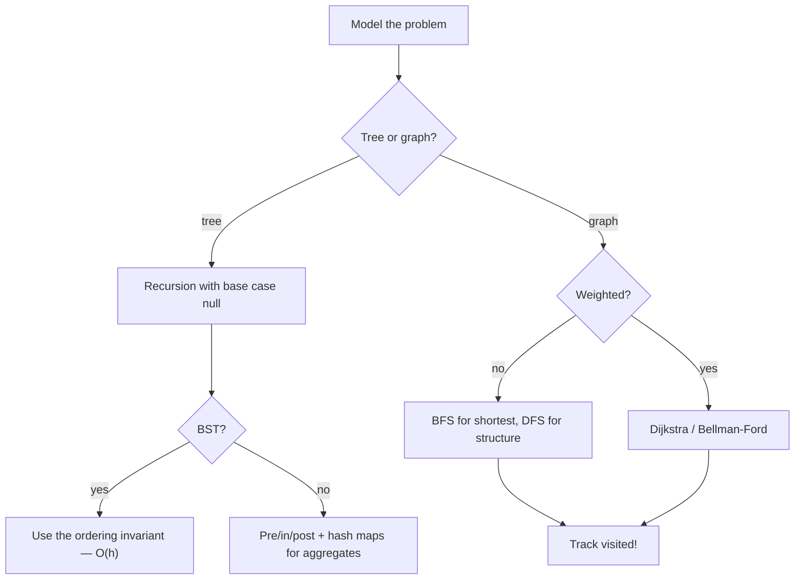
