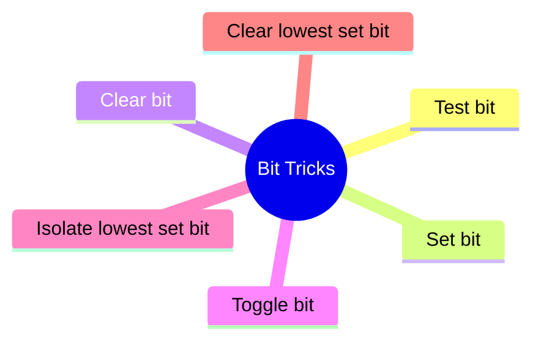
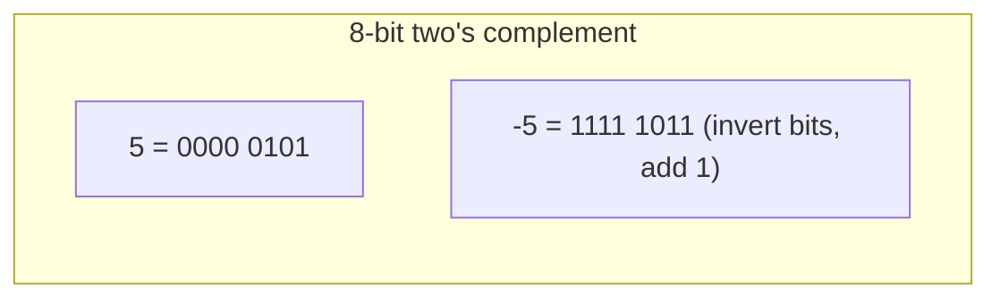
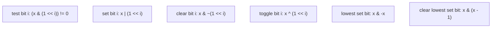
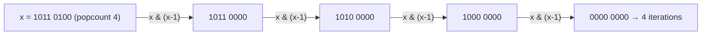
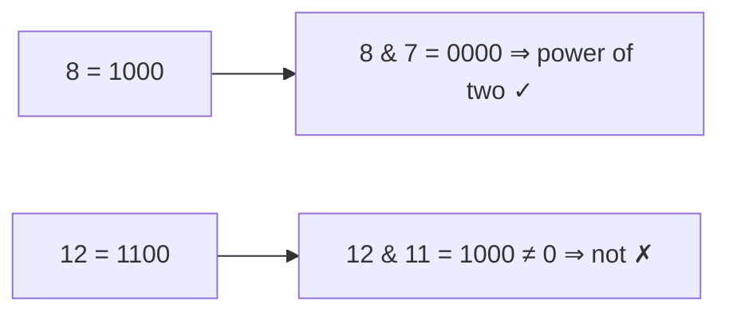
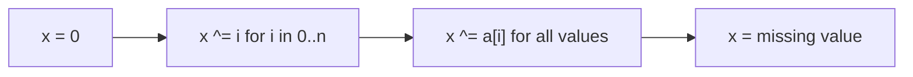
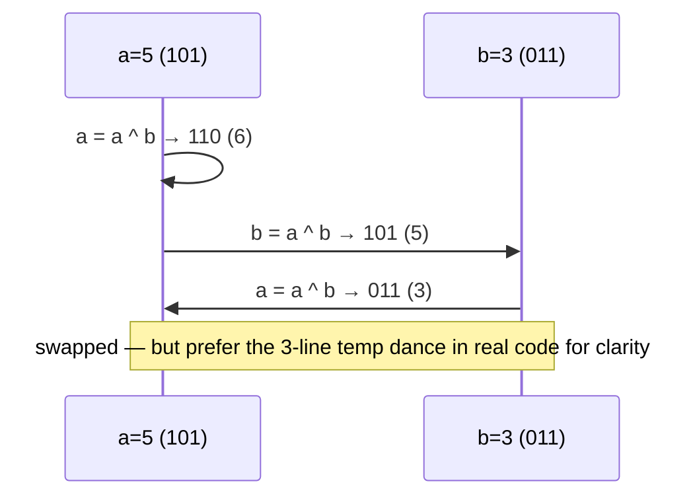
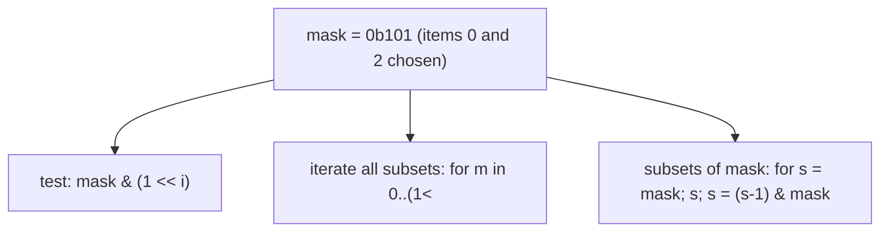

# Chapter 5 · Bit Manipulation

> Book reference: **Ch 5 — Bit Manipulation** (two's complement, shifts, common bit tasks).

Nothing says "low-level fluency" like bits. Interview bit questions are 90% these six tricks.



---

## 1. Two's complement & shifts



| Operation | Java (`int`) | Python | C# | JavaScript |
|-----------|--------------|--------|-----|------------|
| logical right shift | `>>>` | `>>` (ints are unbounded, non-negative result for non-negative input) | `>>>` | `>>>` |
| arithmetic right shift | `>>` | n/a (no fixed width) | `>>` | `>>` |
| mask to 32 bits | n/a | `& 0xFFFFFFFF` | n/a | values are doubles → use `>>> 0` after ops |

⚠️ JavaScript bitwise ops coerce to **32-bit signed**; `1 << 31` is negative. Use `>>> 0` to view as unsigned.

---

## 2. The six bit tasks



```java
boolean getBit(int x, int i)  { return (x & (1 << i)) != 0; }
int setBit(int x, int i)      { return x | (1 << i); }
int clearBit(int x, int i)    { return x & ~(1 << i); }
int toggleBit(int x, int i)   { return x ^ (1 << i); }
int lowestSetBit(int x)       { return x & -x; }
int clearLowestBit(int x)     { return x & (x - 1); }
```

```python
def get_bit(x, i):   return (x >> i) & 1
def set_bit(x, i):   return x | (1 << i)
def clear_bit(x, i): return x & ~(1 << i)
def toggle_bit(x, i): return x ^ (1 << i)
def lowest_set_bit(x): return x & -x
def clear_lowest(x):   return x & (x - 1)
```

```csharp
bool GetBit(int x, int i)  => (x & (1 << i)) != 0;
int SetBit(int x, int i)   => x | (1 << i);
int ClearBit(int x, int i) => x & ~(1 << i);
int ToggleBit(int x, int i)=> x ^ (1 << i);
int LowestSetBit(int x)    => x & -x;
int ClearLowest(int x)     => x & (x - 1);
```

```javascript
const getBit = (x, i) => ((x >> i) & 1) === 1;
const setBit = (x, i) => x | (1 << i);
const clearBit = (x, i) => x & ~(1 << i);
const toggleBit = (x, i) => x ^ (1 << i);
const lowestSetBit = x => x & -x;
const clearLowest = x => x & (x - 1);
```

---

## 3. Classic puzzles, explained by diagrams

### Count set bits (Brian Kernighan)



```java
int popCount(int x) {
    int count = 0;
    while (x != 0) { x &= x - 1; count++; }   // clears one bit per iteration
    return count;
}
// or: Integer.bitCount(x);  // C#: BitOperations.PopCount((uint)x)
```

### Is power of two?

Exactly one set bit ⇒ `x > 0 && (x & (x - 1)) == 0`.



### Missing number in 1..n (XOR)

XOR of all indices with all values cancels pairs; the survivor is the missing number.



```python
def missing_number(a, n):
    x = 0
    for i in range(n + 1): x ^= i
    for v in a: x ^= v
    return x
```

### XOR swap (no temp variable)



### XOR encryption (task 163)

`cipher = plain ^ key` and `plain = cipher ^ key` — XOR is its own inverse. Useful for puzzles,
never for real security.

---

## 4. Bitmasks — subsets as integers

With n items there are 2ⁿ subsets; each subset is a mask.



```java
// iterate all subsets of an array of n items
for (int mask = 0; mask < (1 << n); mask++) {
    // bit i set ⇒ include a[i]
}
```

This powers bitmask DP (task 220: TSP over subsets), subset-sum meet-in-the-middle (task 219),
and boolean matrix ops with bitsets (tasks 374, 558).

---

## Complexity cheat sheet

| Operation | Cost |
|-----------|------|
| get/set/clear/toggle bit | O(1) |
| popcount naive / Kernighan / hardware | O(bits) / O(set bits) / O(1) |
| subset enumeration (2ⁿ masks) | O(2ⁿ) |
| subsets of a mask (m bits set) | O(2ᵐ) |

## Mapped tasks to practice

- [028 count set bits](../../tasks/beginner/028-count-number-of-set-bits-in-an-integer.md) · [029 power of two](../../tasks/beginner/029-check-if-integer-is-power-of-two.md) · [014 swap without temp](../../tasks/beginner/014-swap-two-variables-without-a-temporary-variable.md) · [027 missing number](../../tasks/beginner/027-find-missing-number-in-1-n-given-n-1-elements.md)
- [163 XOR encryption](../../tasks/beginner/163-implement-basic-encryption-decryption-with-xor.md) · [168 checksum](../../tasks/beginner/168-implement-basic-checksum-sum-bytes.md) · [374 bitset ops](../../tasks/intermediate/374-implement-bitset-operations-for-small-universe-set-fast-ops.md)
- [220 bitmask DP TSP](../../tasks/intermediate/220-implement-bitmask-dp-for-tsp-small-n.md) · [298 subsets of mask](../../tasks/intermediate/298-bitmask-iterate-subsets-of-mask.md) · [558 bitset matmul](../../tasks/advanced/558-implement-boolean-matrix-multiplication-optimization-using-bitse.md)

> Full list: [ctci-mapping.md → Ch 5](../ctci-mapping.md).
