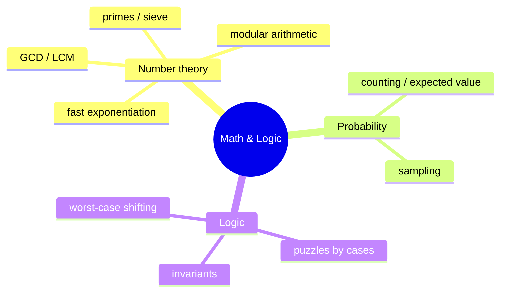
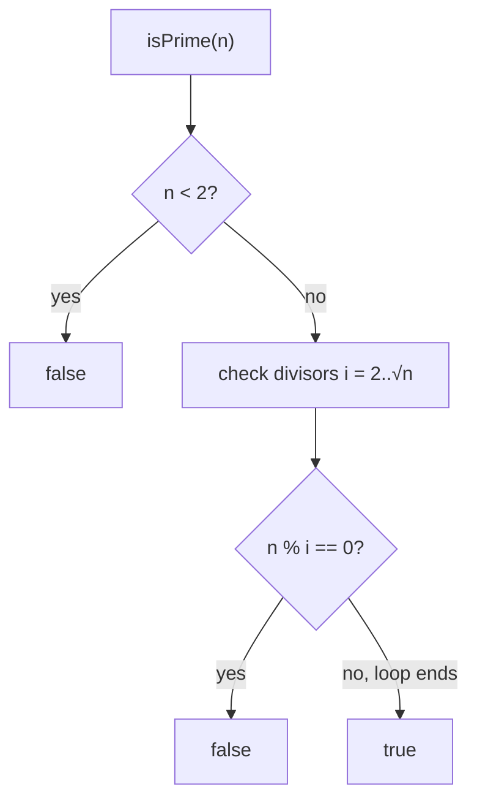
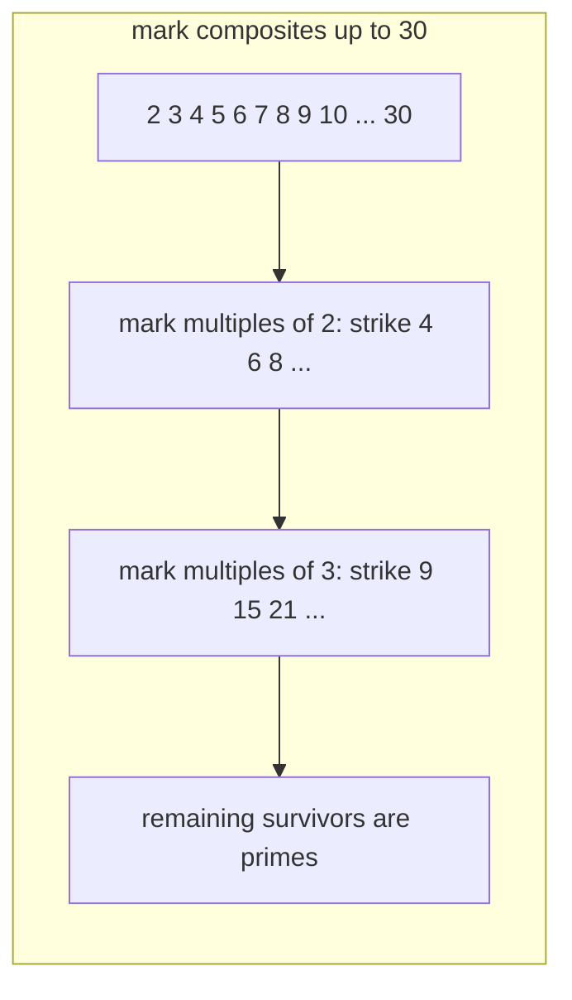
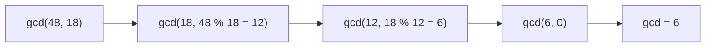
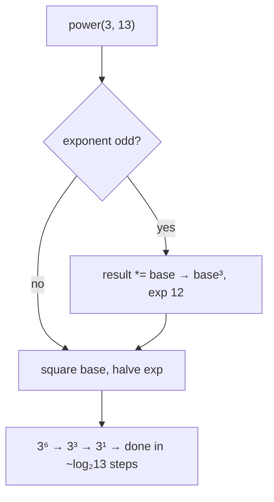
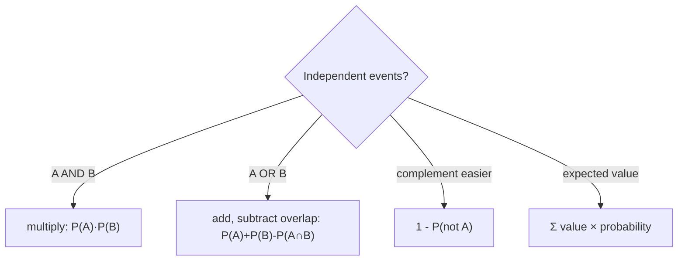
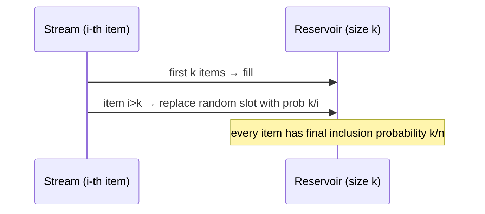
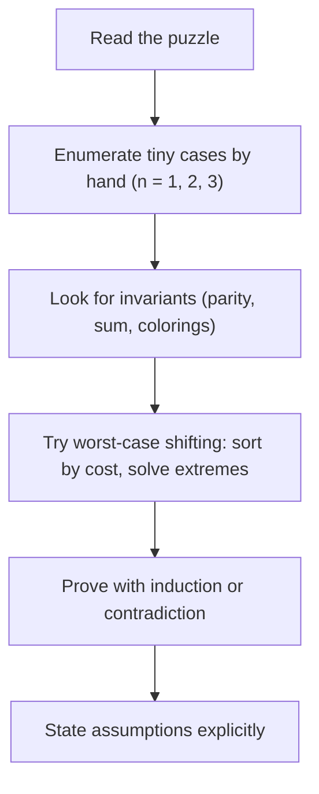

# Chapter 6 · Math and Logic Puzzles

> Book reference: **Ch 6 — Math and Logic Puzzles** (primes, probability, "start talking", rules & patterns).

Math questions test *structured reasoning*, not arithmetic. Say your assumptions out loud, shrink the
problem to small cases, and look for a rule.



---

## 1. Primes



Why stop at √n: divisors pair up as `d × n/d` — if both were > √n their product would exceed n.

```python
import math

def is_prime(n):
    if n < 2: return False
    for i in range(2, math.isqrt(n) + 1):
        if n % i == 0: return False
    return True
```

### Sieve of Eratosthenes — O(n log log n)



```java
boolean[] sieve(int n) {
    boolean[] isPrime = new boolean[n + 1];
    Arrays.fill(isPrime, true);
    isPrime[0] = isPrime[1] = false;
    for (int p = 2; p * p <= n; p++)
        if (isPrime[p])
            for (int multiple = p * p; multiple <= n; multiple += p)
                isPrime[multiple] = false;
    return isPrime;
}
```

```csharp
bool[] Sieve(int n) {
    var isPrime = new bool[n + 1];
    Array.Fill(isPrime, true);
    if (n >= 0) isPrime[0] = false;
    if (n >= 1) isPrime[1] = false;
    for (int p = 2; (long)p * p <= n; p++)
        if (isPrime[p])
            for (long m = (long)p * p; m <= n; m += p)
                isPrime[m] = false;
    return isPrime;
}
```

Large numbers: Miller-Rabin (probabilistic, deterministic for small bases — task 382), Pollard's Rho
for factoring (task 383).

---

## 2. GCD / LCM — Euclid



```java
int gcd(int a, int b) { return b == 0 ? a : gcd(b, a % b); }
int lcm(int a, int b) { return a / gcd(a, b) * b; }   // divide first to limit overflow
```

```python
def gcd(a, b):
    while b:
        a, b = b, a % b
    return a

def lcm(a, b):
    return a // gcd(a, b) * b
```

```csharp
static int Gcd(int a, int b) => b == 0 ? a : Gcd(b, a % b);
static int Lcm(int a, int b) => a / Gcd(a, b) * b;
```

```javascript
const gcd = (a, b) => (b === 0 ? a : gcd(b, a % b));
const lcm = (a, b) => (a / gcd(a, b)) * b;
```

---

## 3. Fast exponentiation — O(log n)



```csharp
// C# — iterative binary exponentiation
long Power(long baseV, long exp) {
    long result = 1;
    while (exp > 0) {
        if ((exp & 1) == 1) result *= baseV;
        baseV *= baseV;
        exp >>= 1;
    }
    return result;
}
```

```javascript
// JavaScript — modular variant (used by RSA / hashing)
function powMod(base, exp, mod) {
  let result = 1n;
  base %= mod;
  while (exp > 0n) {
    if (exp & 1n) result = (result * base) % mod;
    base = (base * base) % mod;
    exp >>= 1n;
  }
  return result;
}
```

Related tooling: modular inverse via Fermat (`a^(p-2) mod p`), CRT (task 381). For big inputs use
`BigInteger`/`Math.pow`-free loops as above — plain `pow` overflows silently.

---

## 4. Probability — the interview toolkit



Classic results worth memorizing:

| Question | Answer |
|----------|--------|
| Birthday paradox: 23 people share a birthday with probability… | ≈ 50% |
| Two children, one is a boy — P(both boys)? | 1/3 (sample space BB, BG, GB) |
| Expected flips to get one head | 2 |
| Reservoir sampling: probability item i is in the sample | k/n, uniform |

Reservoir sampling (task 165):

```python
import random

def reservoir(stream, k):
    sample = []
    for i, item in enumerate(stream):
        if i < k:
            sample.append(item)
        else:
            j = random.randint(0, i)
            if j < k:
                sample[j] = item
    return sample
```



---

## 5. Logic puzzles — strategy



Examples mapped in the repo: [032 prime check](../../tasks/beginner/032-check-prime-number-naive.md),
[033 trial division](../../tasks/beginner/033-list-primes-up-to-n-using-trial-division.md),
[034 sieve](../../tasks/beginner/034-sieve-of-eratosthenes-to-list-primes-up-to-n.md),
[035 GCD](../../tasks/beginner/035-greatest-common-divisor-gcd-euclid-s-algorithm.md),
[037 power](../../tasks/beginner/037-compute-power-x-n-iterative.md),
[038 fast power](../../tasks/beginner/038-implement-binary-exponentiation-fast-power.md),
[039 LCG PRNG](../../tasks/beginner/039-simple-linear-congruential-pseudorandom-generator.md),
[165 reservoir sampling](../../tasks/beginner/165-reservoir-sampling-for-k-items-from-stream.md),
[379 nCr mod p](../../tasks/intermediate/379-implement-combinatorics-ncr-modulo-prime-precompute-factorials.md),
[380 modular inverse](../../tasks/intermediate/380-implement-modular-inverse-fast-modular-exponent.md),
[381 CRT](../../tasks/intermediate/381-chinese-remainder-theorem-solver-for-pairwise-coprime-moduli.md),
[382 Miller-Rabin](../../tasks/intermediate/382-implement-primality-test-miller-rabin-deterministic-small-bases.md).

> Full list: [ctci-mapping.md → Ch 6](../ctci-mapping.md).
