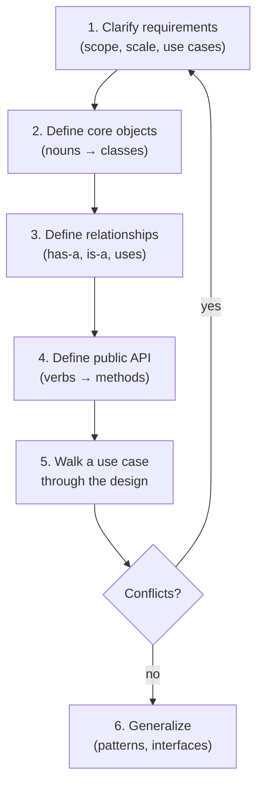
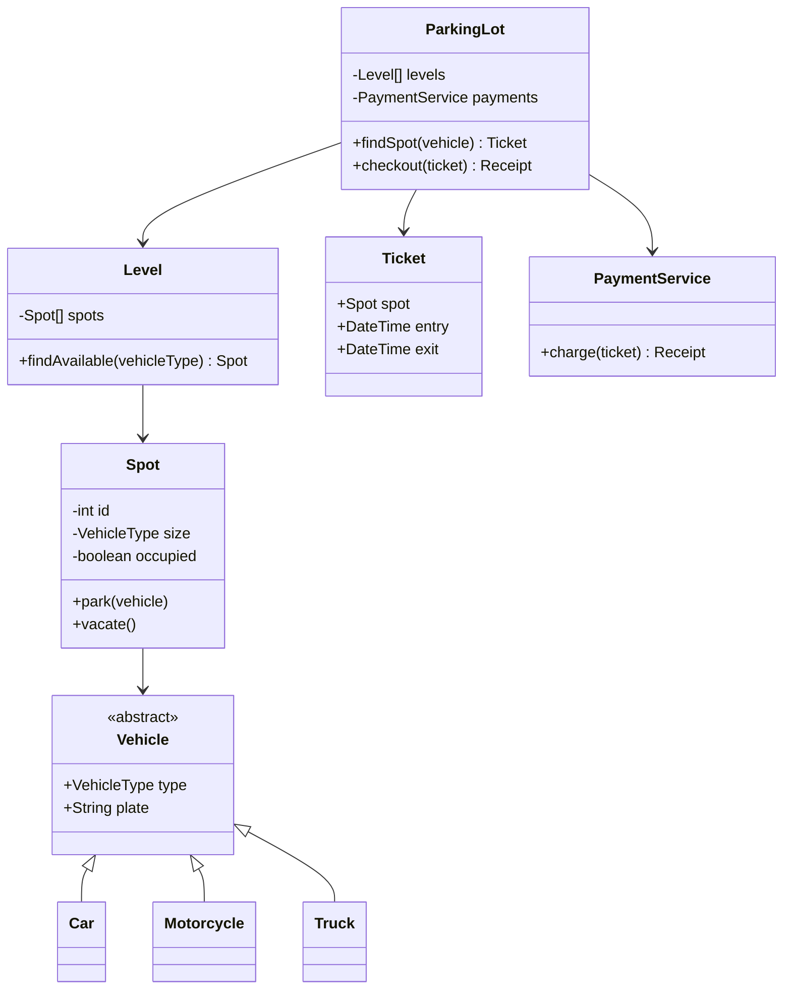
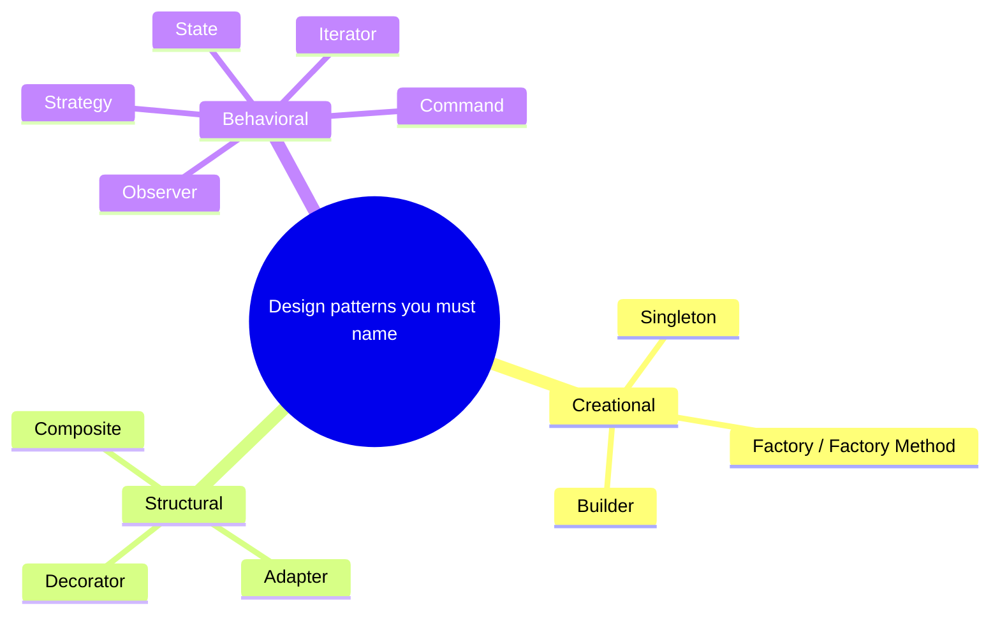
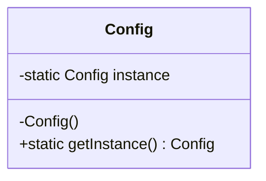
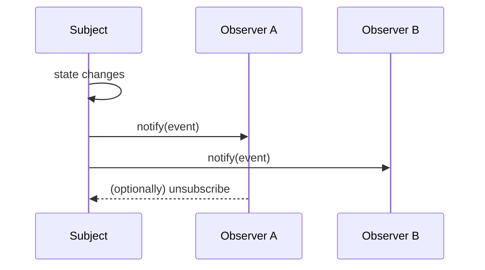
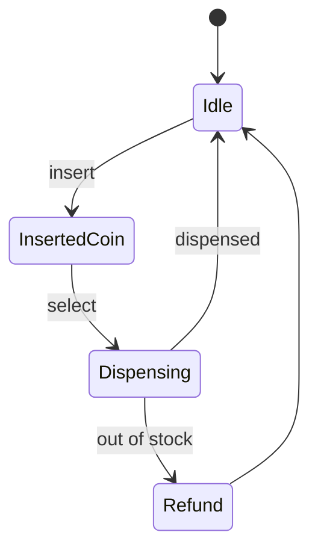
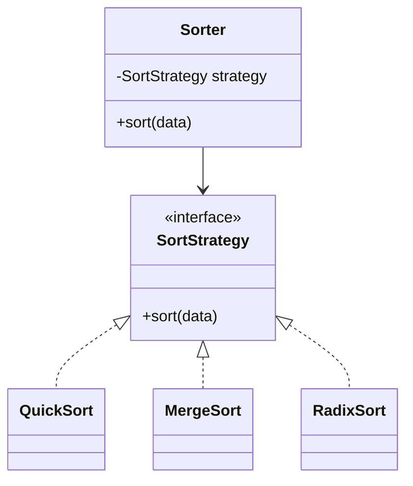
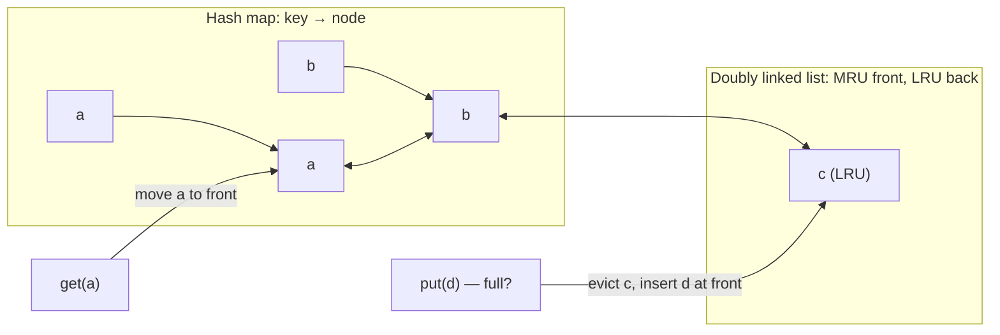
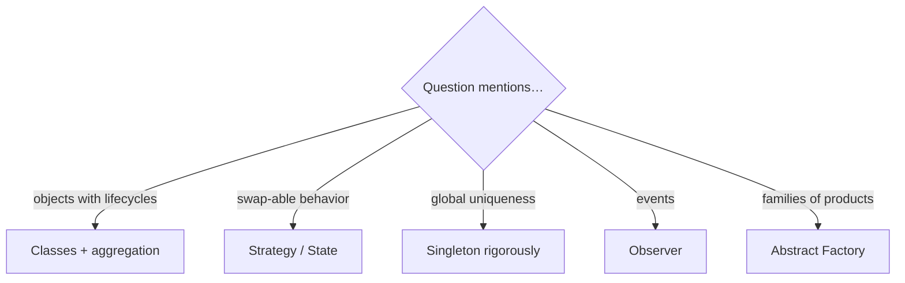

# Chapter 7 · Object-Oriented Design

> Book reference: **Ch 7 — Object-Oriented Design** (how to approach, design patterns).

OOD questions ask you to model a world: a parking lot, a deck of cards, an LRU cache, a state machine.
The interviewer grades **requirements gathering, class decomposition, and pattern vocabulary** — not
whether you remembered a specific API.



---

## 1. From nouns to classes — a worked example

Task: **parking lot**.



Key design decisions to *say out loud*:

1. **Scope first**: single lot, multi-level? online payment? reservations? Choose one.
2. **Encapsulation**: `Spot` owns occupancy state — nobody flips it from outside.
3. **Extensibility**: new vehicle size → enum + validator, not a new subclass tree.

---

## 2. Pattern vocabulary (know these six cold)



### Singleton — one shared instance



```java
class Config {
    private static volatile Config instance;
    private Config() {}
    static Config getInstance() {                 // double-checked locking
        if (instance == null) {
            synchronized (Config.class) {
                if (instance == null) instance = new Config();
            }
        }
        return instance;
    }
}
```

```csharp
// C# — static initialization is thread-safe by the runtime
sealed class Config {
    public static Config Instance { get; } = new();
    private Config() {}
}
```

```python
# Python — module-level objects are singletons naturally
class Config:
    _instance = None
    def __new__(cls):
        if cls._instance is None:
            cls._instance = super().__new__(cls)
        return cls._instance
```

### Observer — publish/subscribe



### State — replace conditionals with objects



This is the OO version of task [157 — FSM for number validation](../../tasks/beginner/157-design-a-simple-finite-state-machine-fsm-for-number-validation.md).

### Strategy — swap algorithms behind an interface



---

## 3. Case study — LRU cache in O(1) (task 160)

The classic OOD + data-structure hybrid: **hash map + doubly linked list**.



```python
from collections import OrderedDict

class LRUCache:
    def __init__(self, cap):
        self.cap = cap
        self.data = OrderedDict()

    def get(self, key):
        if key not in self.data:
            return -1
        self.data.move_to_end(key)          # most recently used → back
        return self.data[key]

    def put(self, key, value):
        if key in self.data:
            self.data.move_to_end(key)
        self.data[key] = value
        if len(self.data) > self.cap:
            self.data.popitem(last=False)   # evict least recently used
```

```java
// Java — LinkedHashMap with accessOrder=true gives LRU semantics for free
class LruCache<K, V> extends LinkedHashMap<K, V> {
    private final int cap;
    LruCache(int cap) { super(16, 0.75f, true); this.cap = cap; }
    @Override protected boolean removeEldestEntry(Map.Entry<K, V> eldest) {
        return size() > cap;
    }
}
```

Interview-grade answers explain: why the doubly linked list (O(1) unlink with node handle),
why the map (O(1) find), and what happens under concurrency (see Ch 15; tasks [346](../../tasks/intermediate/346-implement-optimistic-concurrency-control-sketch-version-numbers.md), [485](../../tasks/advanced/485-implement-cache-eviction-policies-lru-lfu-arc-simulate.md)).

---

## 4. Designing the other mapped classics

| Task | Core objects | Pattern |
|------|--------------|---------|
| [162 rate limiter](../../tasks/beginner/162-implement-rate-limiter-token-bucket-simple.md) | TokenBucket, Clock | Strategy for algorithms |
| [194 TTL cache](../../tasks/beginner/194-implement-caching-of-expensive-function-results-with-ttl.md) | Entry(value, expiry), Map | Decorator/memo wrapper |
| [336 snapshot array](../../tasks/intermediate/336-design-a-snapshot-array-persisting-versions-basic.md) | Versioned cells | Copy-on-write / memento |
| [344 URL shortener](../../tasks/intermediate/344-design-and-implement-a-url-shortener-basic-hash-collision-handli.md) | Encoder, Store | Facade + Strategy |



## Mapped tasks to practice

- [157 FSM](../../tasks/beginner/157-design-a-simple-finite-state-machine-fsm-for-number-validation.md) · [160 LRU](../../tasks/beginner/160-implement-lru-cache-using-linked-list-hashmap.md) · [161 LFU](../../tasks/beginner/161-implement-lfu-cache-basic-variant.md) · [162 rate limiter](../../tasks/beginner/162-implement-rate-limiter-token-bucket-simple.md)
- [194 TTL cache](../../tasks/beginner/194-implement-caching-of-expensive-function-results-with-ttl.md) · [196 lazy reader](../../tasks/beginner/196-implement-file-line-reader-that-yields-lines-lazily.md) · [198 JSON serialize](../../tasks/beginner/198-serialize-object-to-json-string-manual.md) · [199 JSON parse](../../tasks/beginner/199-deserialize-json-with-arrays-objects-basic.md)
- [332 calendar](../../tasks/intermediate/332-implement-calendar-booking-mycalendar-i-ii-iii-style.md) · [333 hit counter](../../tasks/intermediate/333-design-hit-counter-sliding-time-window.md) · [336 snapshot array](../../tasks/intermediate/336-design-a-snapshot-array-persisting-versions-basic.md) · [345 randomized set](../../tasks/intermediate/345-design-a-randomized-set-with-insert-delete-getrandom.md)
- [350 thread-safe singleton](../../tasks/intermediate/350-implement-thread-safe-singleton-double-checked-locking.md) · [344 URL shortener](../../tasks/intermediate/344-design-and-implement-a-url-shortener-basic-hash-collision-handli.md) · [360 versioned KV store](../../tasks/intermediate/360-implement-versioned-key-value-store-basic.md) · [577 skip list](../../tasks/advanced/577-implement-k-d-tree-with-bulk-insertion-balancing-heuristics.md)

> Full list: [ctci-mapping.md → Ch 7](../ctci-mapping.md).
