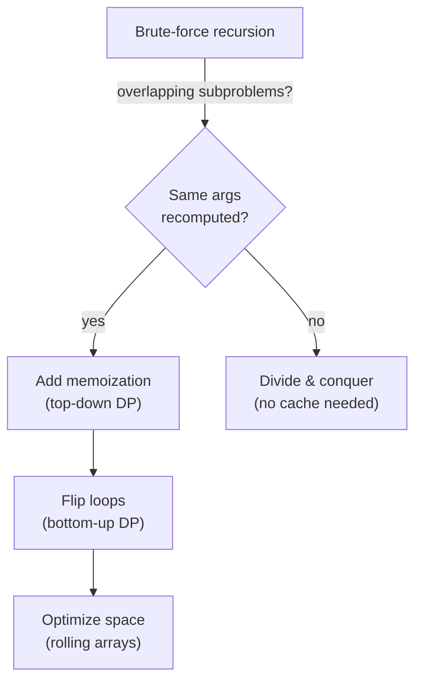
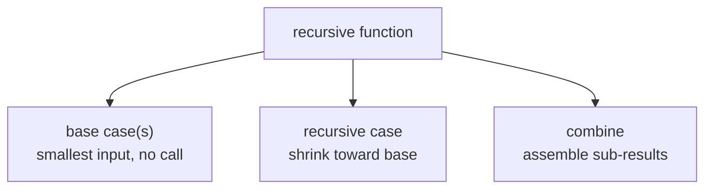
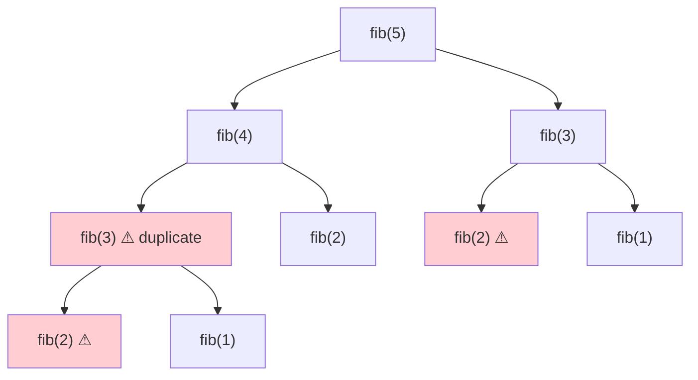
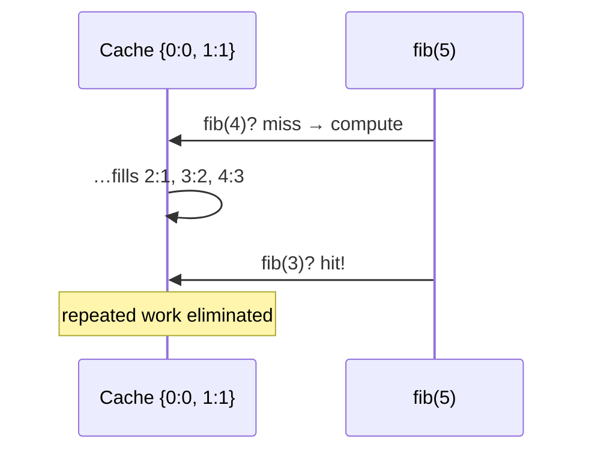
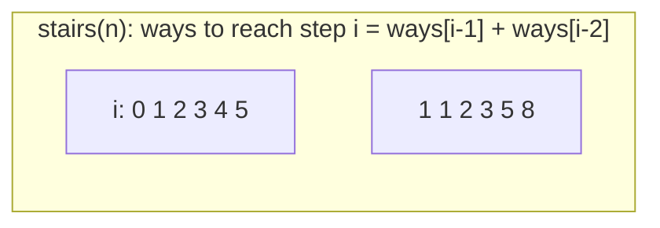
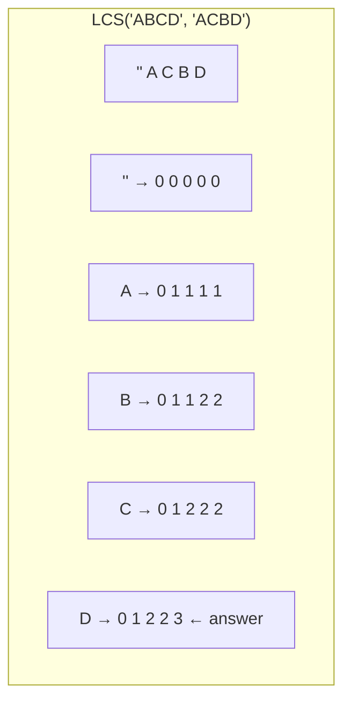
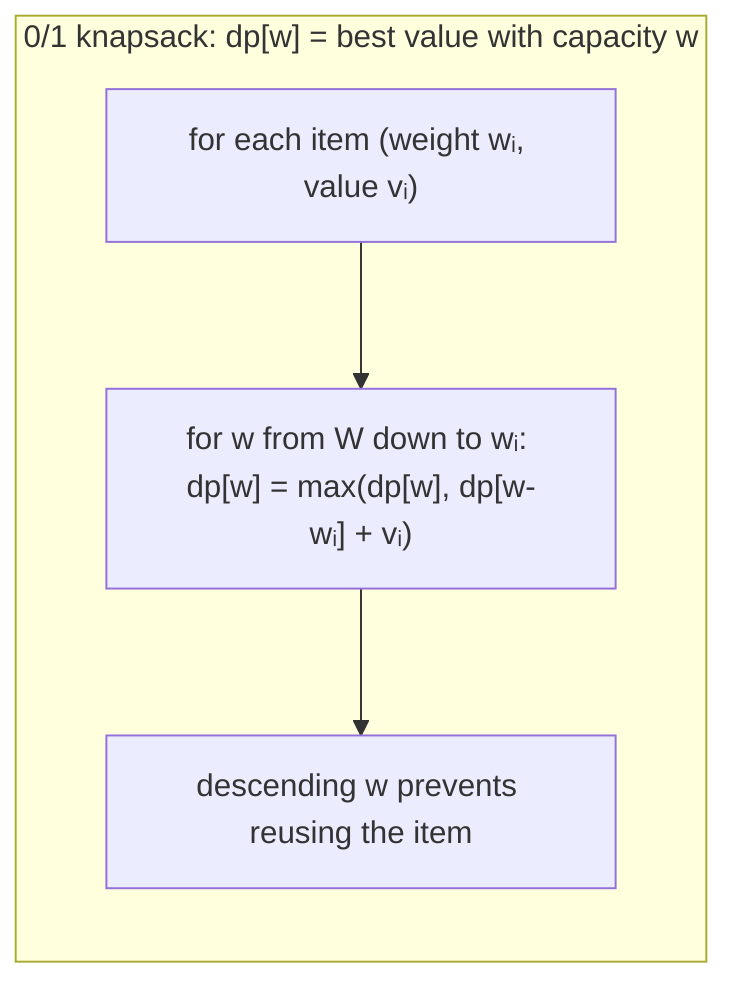
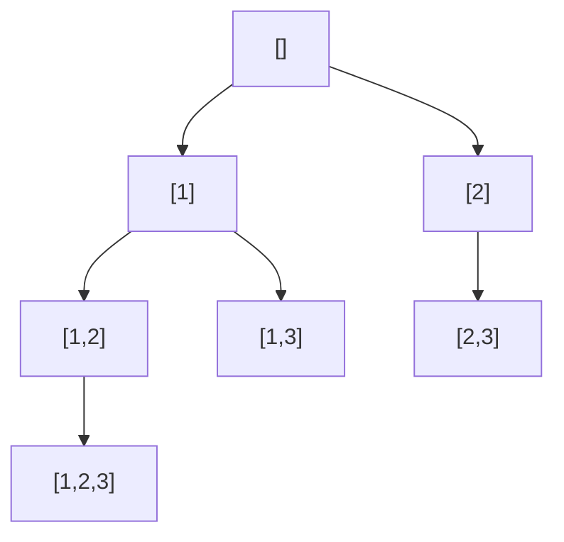
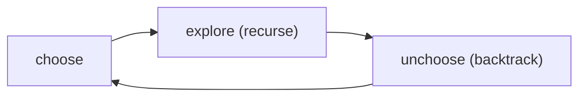
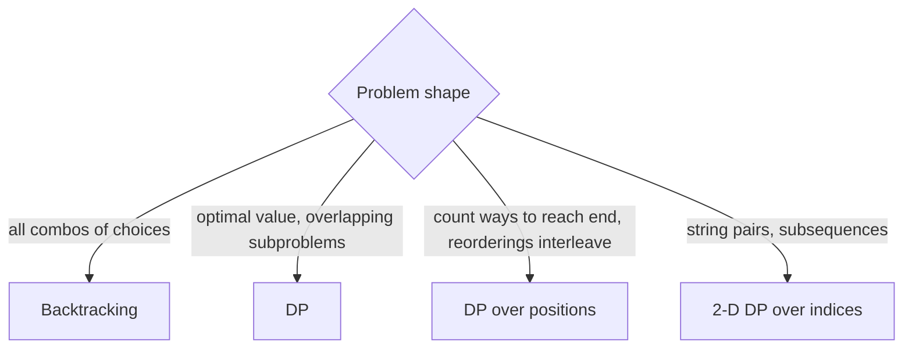

# Chapter 8 · Recursion and Dynamic Programming

> Book reference: **Ch 8 — Recursion and DP** (how to approach, recursive vs iterative, memoization).

DP = recursion + remembering. If you can write the brute-force recursion, you are one cache away
from the optimal solution.



---

## 1. Recursion anatomy



```java
// Java — the canonical pair
long factorial(int n) {
    if (n <= 1) return 1;              // base
    return n * factorial(n - 1);       // shrink + combine
}

int fib(int n) {
    if (n <= 1) return n;
    return fib(n - 1) + fib(n - 2);    // O(2^n) — fix with memo!
}
```

```python
def factorial(n):
    return 1 if n <= 1 else n * factorial(n - 1)

def fib(n):
    return n if n <= 1 else fib(n - 1) + fib(n - 2)
```

```csharp
long Factorial(int n) => n <= 1 ? 1 : n * Factorial(n - 1);
int Fib(int n) => n <= 1 ? n : Fib(n - 1) + Fib(n - 2);
```

```javascript
const factorial = n => (n <= 1 ? 1 : n * factorial(n - 1));
const fib = n => (n <= 1 ? n : fib(n - 1) + fib(n - 2));
```

Python recursion limit: `sys.setrecursionlimit(10**6)` for deep chains; Java/C# use the thread stack
(`StackOverflowError` at ~10⁴–10⁵ frames). Only recursion depth O(log n) or small n is safe on default stacks.

---

## 2. Recursion trees → why memoization works



Each ⚠ subtree is *the same subproblem*. Cache `fib(k)` and the tree collapses from O(2ⁿ) to O(n)
time (O(n) space for the memo).

```python
from functools import lru_cache

@lru_cache(maxsize=None)
def fib(n):
    return n if n <= 1 else fib(n - 1) + fib(n - 2)
```



---

## 3. Case studies with DP tables

### Climbing stairs / house robber (1-D)



```java
int climbStairs(int n) {
    int a = 1, b = 1;                 // rolling window: O(1) space
    for (int i = 2; i <= n; i++) {
        int c = a + b; a = b; b = c;
    }
    return n == 0 ? 1 : b;
}
```

```csharp
// House robber — cannot take adjacent houses
int Rob(int[] nums) {
    int take = 0, skip = 0;
    foreach (var n in nums) {
        (skip, take) = (Math.Max(skip, take), skip + n);
    }
    return Math.Max(skip, take);
}
```

### Longest common subsequence (2-D table)



Transition: equal chars → `1 + dp[i-1][j-1]`, else → `max(dp[i-1][j], dp[i][j-1])`.

```python
def lcs(a, b):
    dp = [[0] * (len(b) + 1) for _ in range(len(a) + 1)]
    for i, ca in enumerate(a, 1):
        for j, cb in enumerate(b, 1):
            dp[i][j] = 1 + dp[i-1][j-1] if ca == cb else max(dp[i-1][j], dp[i][j-1])
    return dp[len(a)][len(b)]
```

### Knapsack (the parent of half the DP canon)



```javascript
function knapsack(weights, values, W) {
  const dp = new Array(W + 1).fill(0);
  for (let i = 0; i < weights.length; i++) {
    for (let w = W; w >= weights[i]; w--) {          // descending!
      dp[w] = Math.max(dp[w], dp[w - weights[i]] + values[i]);
    }
  }
  return dp[W];
}
```

---

## 4. Backtracking — recursion that explores a tree of choices





```python
def subsets(nums):
    out, cur = [], []

    def backtrack(i):
        if i == len(nums):
            out.append(cur[:])
            return
        cur.append(nums[i])      # choose
        backtrack(i + 1)         # explore
        cur.pop()                # unchoose
        backtrack(i + 1)         # skip branch

    backtrack(0)
    return out
```

Same skeleton solves permutations (swap in/out), N-Queens (place/undo a queen), Sudoku
(place digit/undo), palindrome partitioning, and word search on a board.



## Complexity cheat sheet

| Problem | Time | Space |
|---------|------|-------|
| fib naive / memoized | O(2ⁿ) / O(n) | O(n) |
| subsets / permutations | O(2ⁿ · n) / O(n!) | O(n) recursion |
| LCS / edit distance | O(n·m) | O(min(n, m)) with rolling rows |
| 0/1 knapsack | O(n·W) | O(W) |
| N-Queens | O(n!) worst | O(n) |

## Mapped tasks to practice

- Recursion intro: [009–013 factorial & Fibonacci](../../tasks/beginner/012-compute-nth-fibonacci-using-recursion.md) · [128 memo wrapper](../../tasks/beginner/128-implement-basic-memoization-wrapper.md) · [129 tail recursion](../../tasks/beginner/129-implement-tail-recursion-if-language-supports.md) · [158 memoized prime checker](../../tasks/beginner/158-implement-simple-memoized-prime-checker-cache.md)
- Subsets & permutations: [130–134](../../tasks/beginner/130-generate-all-subsets-power-set-iterative.md) · [287 combination sum](../../tasks/intermediate/287-combination-sum-backtracking.md) · [288 generate parentheses](../../tasks/intermediate/288-generate-parentheses-balanced-parentheses-generator.md) · [285 N-Queens](../../tasks/intermediate/285-n-queens-problem-backtracking.md) · [286 Sudoku solver](../../tasks/intermediate/286-sudoku-solver-backtracking-heuristics.md)
- 1-D DP: [125 stairs](../../tasks/beginner/125-climbing-stairs-dp-count-ways.md) · [126 house robber](../../tasks/beginner/126-house-robber-problem-1d-dp.md) · [127 decode ways](../../tasks/beginner/127-decode-ways-num-decodings-dp.md) · [212 Kadane](../../tasks/intermediate/212-find-subarray-with-maximum-sum-kadane-s-algorithm.md) · [224 stock cooldown](../../tasks/intermediate/224-stock-with-cooldown-dp.md)
- Sequence DP: [119 LIS naive](../../tasks/beginner/119-longest-increasing-subsequence-naive-dp-o-n-2.md) · [120 LIS patience](../../tasks/beginner/120-implement-lis-using-patience-sorting-idea-o-n-log-n-outline.md) · [121 LCS](../../tasks/beginner/121-longest-common-subsequence-lcs-dp.md) · [122 longest common substring](../../tasks/beginner/122-longest-common-substring-dp.md) · [123 edit distance](../../tasks/beginner/123-edit-distance-levenshtein-dp.md)
- Backtracking & partitioning: [170](../../tasks/beginner/170-simple-palindrome-partitioning-backtracking-list-partitions.md) · [171 min cuts](../../tasks/beginner/171-minimum-cuts-for-palindrome-partitioning-dp.md) · [284 word search](../../tasks/intermediate/284-word-search-in-board-dfs-backtracking.md) · [290 palindrome partitions](../../tasks/intermediate/290-palindrome-partitioning-all-partitions-backtracking.md)
- Knapsack family: [215–218](../../tasks/intermediate/217-subset-sum-decision-problem-dp-boolean.md) · [291 min subset diff](../../tasks/intermediate/291-partition-equal-subset-dp-with-reconstructing-sets.md) · [293–296 coin change & knapsack](../../tasks/intermediate/293-coin-change-number-of-ways-dp.md)

> Full list: [ctci-mapping.md → Ch 8](../ctci-mapping.md).
