# Chapter 9 · System Design and Scalability

> Book reference: **Ch 9 — System Design and Scalability** (“Design: Step-by-Step”, “Algorithms that Scale”).

System design interviews are evaluated as a conversation. Drive it with a structure, then dive deep.

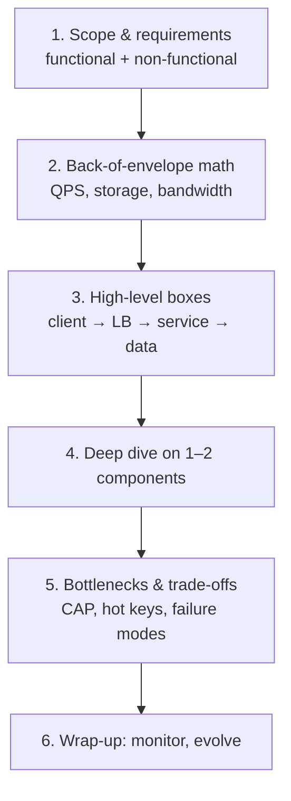

---

## 1. Scale out, not up

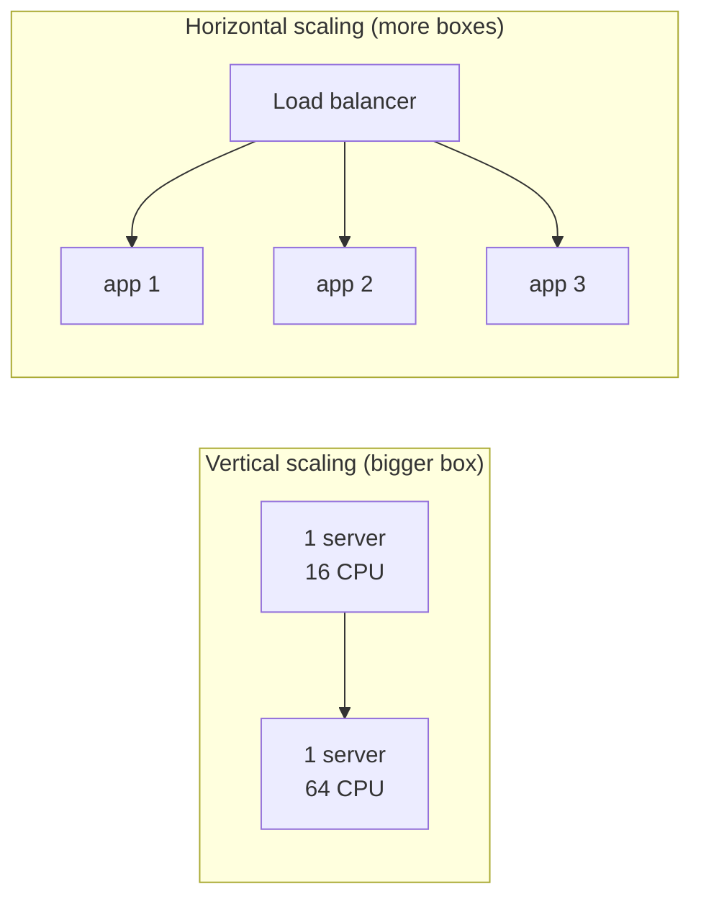

Horizontal wins for availability and cost — but forces you to solve **statelessness, coordination,
and data partitioning**.

### Load balancing

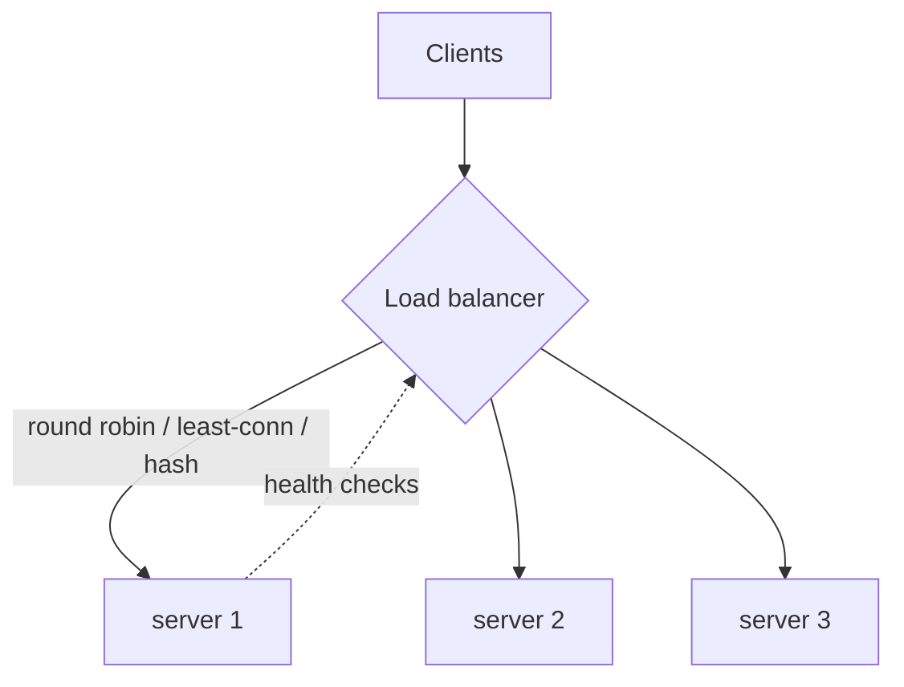

| Algorithm | Good for | Watch out |
|-----------|----------|-----------|
| round robin | uniform requests | ignores server load |
| least connections | long-lived connections | needs connection tracking |
| consistent hash (by key) | cache locality | hot keys; add virtual nodes |

---

## 2. Caching — every layer

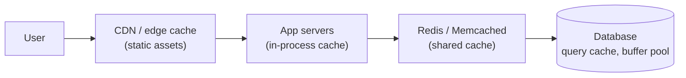

Cache checklist for interviews:

1. **What to cache** (read-heavy, expensive, tolerable staleness)
2. **Eviction** — LRU / LFU / TTL (tasks [160](../../tasks/beginner/160-implement-lru-cache-using-linked-list-hashmap.md), [485](../../tasks/advanced/485-implement-cache-eviction-policies-lru-lfu-arc-simulate.md))
3. **Invalidation** — TTL vs write-through vs explicit bust (hardest problem in CS!)
4. **Stampedes** — request coalescing, jittered TTLs

---

## 3. Databases at scale

### Replication (leader–follower)

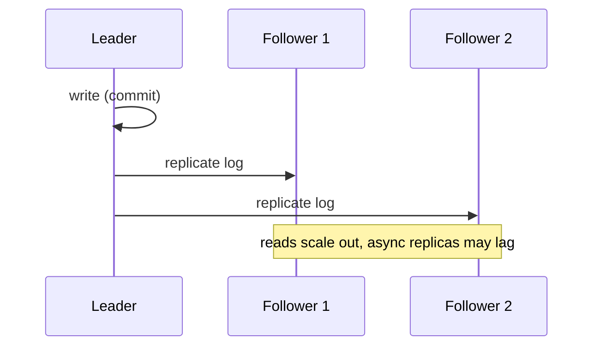

### Sharding (partitioning)

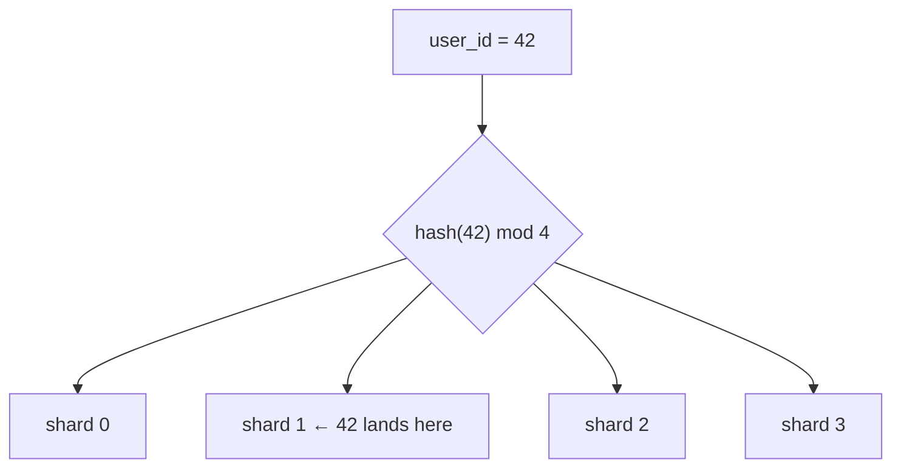

| Strategy | Pro | Con |
|----------|-----|-----|
| range (id 0–1M → shard 0) | range scans | hot ranges (new ids) |
| hash mod N | even spread | reshuffles everything when N changes |
| consistent hashing ring | only ~1/N keys move on change | needs virtual nodes |

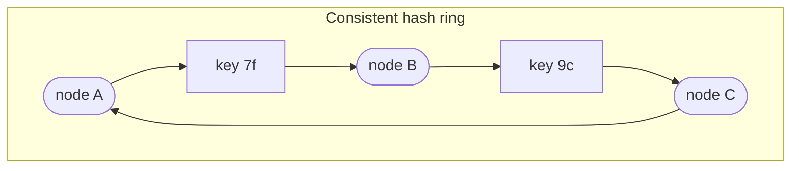

### CAP & consistency

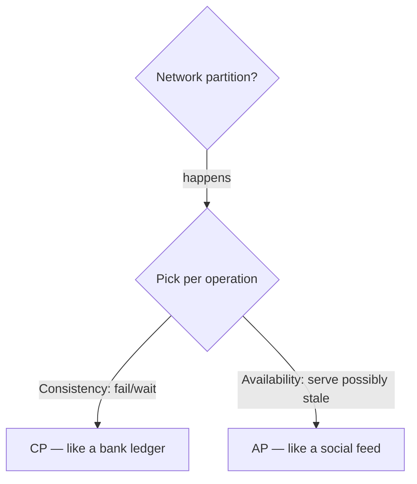

Quorums: with replicas `n`, write quorum `W`, read quorum `R` — if `W + R > n` reads see the latest write.

---

## 4. Async processing & MapReduce

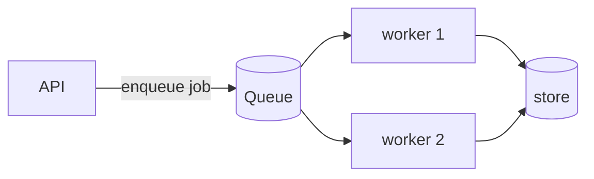

Decouples spikes from capacity; enables retries/backoff (task [508](../../tasks/advanced/508-implement-background-job-scheduler-with-retry-backoff-semantics.md)).

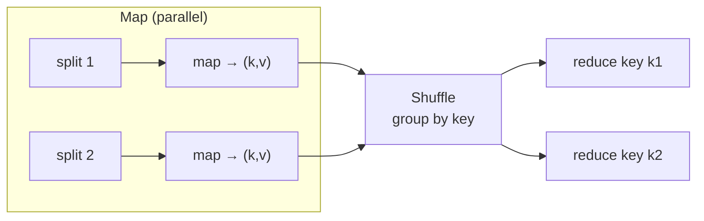

Word count: map emits `(word, 1)`; shuffle groups; reduce sums. Task [469](../../tasks/advanced/469-implement-distributed-aggregations-map-reduce-toy.md) builds the toy version.

---

## 5. A 10-minute worked design — URL shortener

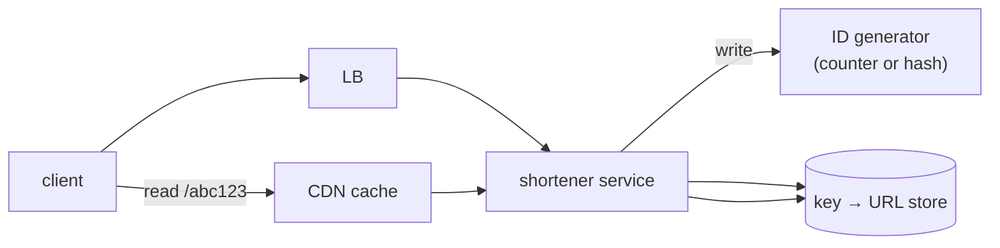

| Step | Answer sketch |
|------|---------------|
| Requirements | ~100M writes/day, 10× reads, low latency, links never expire |
| ID | base62 counter chunks or `hash(longURL)` + collision retry (task [344](../../tasks/intermediate/344-design-and-implement-a-url-shortener-basic-hash-collision-handli.md)) |
| Storage | KV store, partition by short key; replicate for read scaling |
| Cache | CDN for hot redirects; LRU in-memory |
| Bottleneck | the ID generator → use per-node ranges (Snowflake-style) |

Other mapped system tasks to practice: [470 consistent hashing](../../tasks/advanced/470-implement-consistent-hashing-ring-virtual-nodes.md),
[471 vector clocks](../../tasks/advanced/471-implement-vector-clock-for-distributed-event-ordering.md),
[472 Raft](../../tasks/advanced/472-implement-basic-raft-consensus-pseudo-simulation-leader-election.md),
[473 Paxos](../../tasks/advanced/473-implement-paxos-basic-single-decree-outline.md),
[616 Chandy-Lamport](../../tasks/expert/616-implement-distributed-snapshot-algorithm-chandy-lamport.md),
[801 production Raft](../../tasks/master/801-implement-production-grade-raft-library-replication-reconfigurat.md),
[803 mini SQL engine](../../tasks/master/803-build-a-small-sql-engine-with-parser-planner-and-executor-suppor.md).

> Full list: [ctci-mapping.md → Ch 9](../ctci-mapping.md).
