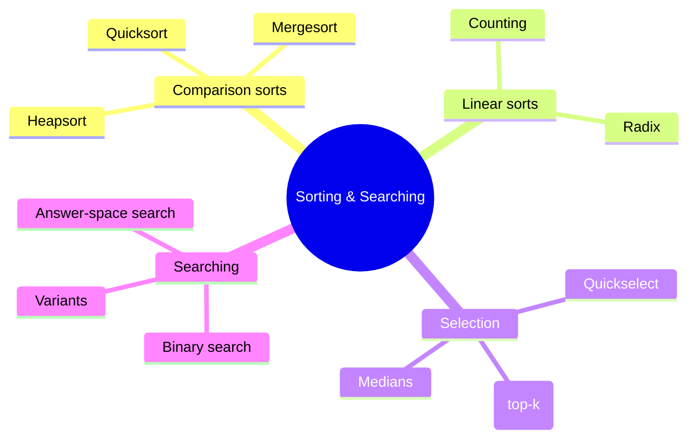
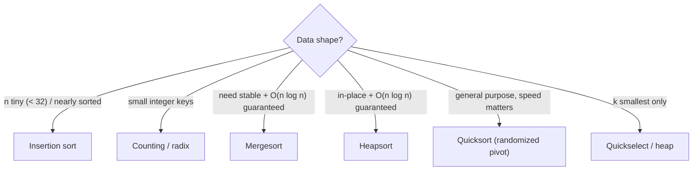
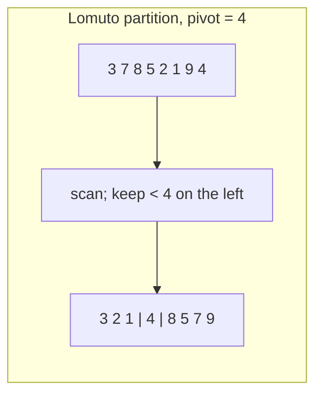
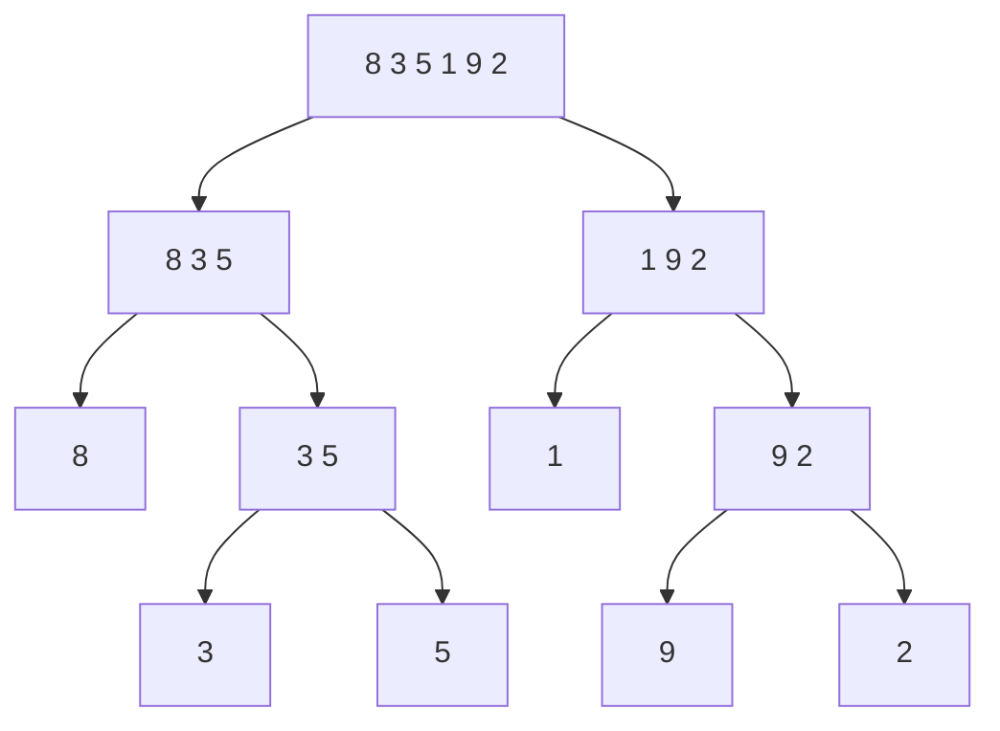
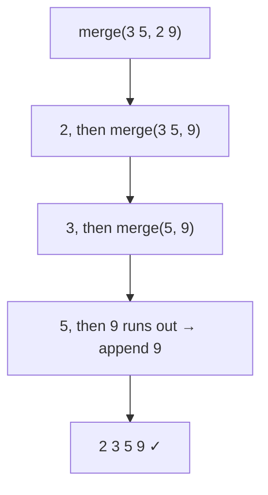
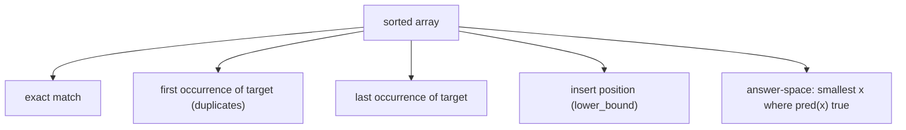
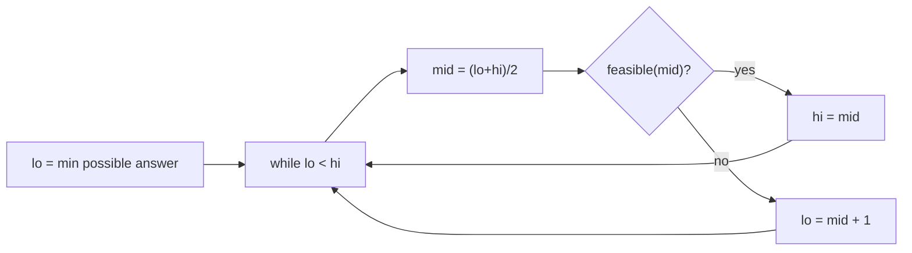
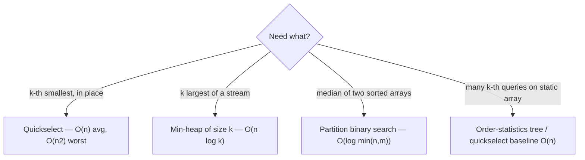

# Chapter 10 · Sorting and Searching

> Book reference: **Ch 10 — Sorting and Searching** (common sorting algorithms, searching algorithms).

Sorting is the handshake of interview algorithms: once data is sorted you get binary search,
two pointers, dedup-in-place, and greedy shortcuts. Know the table cold.



---

## 1. The big table

| Algorithm | Best | Average | Worst | Space | Stable | Notes |
|-----------|------|---------|-------|-------|--------|-------|
| Quicksort | O(n log n) | O(n log n) | **O(n²)** | O(log n) | ❌ | fastest in practice; randomize pivot |
| Mergesort | O(n log n) | O(n log n) | O(n log n) | O(n) | ✅ | linked lists, external sort |
| Heapsort | O(n log n) | O(n log n) | O(n log n) | O(1) | ❌ | in-place, cache-unfriendly |
| Counting sort | O(n + k) | O(n + k) | O(n + k) | O(k) | ✅ | small integer range only |
| Radix sort | O(d(n + b)) | — | — | O(n + b) | ✅ | fixed-width ints/strings |
| Insertion sort | O(n) | O(n²) | O(n²) | O(1) | ✅ | king for n < ~16, near-sorted data |
| Bubble sort (optimized) | O(n) | O(n²) | O(n²) | O(1) | ✅ | education only |



---

## 2. Quicksort partition — the heart



```java
void quickSort(int[] a, int lo, int hi) {
    if (lo >= hi) return;
    int p = partition(a, lo, hi);
    quickSort(a, lo, p - 1);
    quickSort(a, p + 1, hi);
}
int partition(int[] a, int lo, int hi) {
    int pivot = a[hi], i = lo;
    for (int j = lo; j < hi; j++)
        if (a[j] < pivot) { int t = a[i]; a[i++] = a[j]; a[j] = t; }
    int t = a[i]; a[i] = a[hi]; a[hi] = t;
    return i;
}
```

```python
import random

def quick_sort(a, lo=0, hi=None):
    hi = len(a) - 1 if hi is None else hi
    if lo >= hi: return a
    p = random.randint(lo, hi)
    a[p], a[hi] = a[hi], a[p]          # randomize pivot → avoids O(n²) on sorted input
    i = lo
    for j in range(lo, hi):
        if a[j] < a[hi]:
            a[i], a[j] = a[j], a[i]; i += 1
    a[i], a[hi] = a[hi], a[i]
    quick_sort(a, lo, i - 1); quick_sort(a, i + 1, hi)
    return a
```

---

## 3. Mergesort — divide, conquer, merge





```csharp
// C# — top-down mergesort
void MergeSort(int[] a, int lo, int hi) {
    if (hi - lo <= 1) return;
    int mid = (lo + hi) / 2;
    MergeSort(a, lo, mid);
    MergeSort(a, mid, hi);
    Merge(a, lo, mid, hi);
}
void Merge(int[] a, int lo, int mid, int hi) {
    var tmp = new int[hi - lo];
    int i = lo, j = mid, k = 0;
    while (i < mid && j < hi) tmp[k++] = a[i] <= a[j] ? a[i++] : a[j++];
    while (i < mid) tmp[k++] = a[i++];
    while (j < hi) tmp[k++] = a[j++];
    Array.Copy(tmp, 0, a, lo, tmp.Length);
}
```

Mergesort's merge step also counts **inversions** (task [87](../../tasks/beginner/087-implement-merge-and-count-inversions-using-merge-sort.md)) —
a classic "sorting gives you more than sorting" problem.

---

## 4. Binary search — five variants you must write from memory



```python
import bisect

def first_occurrence(a, t):
    i = bisect.bisect_left(a, t)
    return i if i < len(a) and a[i] == t else -1

def insert_position(a, t):
    return bisect.bisect_left(a, t)
```

```javascript
// lower_bound by hand — the template to memorize
function lowerBound(a, target) {
  let lo = 0, hi = a.length - 1;
  while (lo < hi) {
    const mid = (lo + hi) >> 1;
    if (a[mid] < target) lo = mid + 1;   // keep lo: candidate
    else hi = mid;
  }
  return a.length && a[lo] >= target ? lo : -1;
}
```

**Answer-space binary search** (task 317, 701): when the predicate is "is X feasible?", binary search X
itself — e.g. "minimum capacity to ship in D days", "longest duplicate substring".



---

## 5. Selection — k-th smallest, medians, top-k



```java
// Java — quickselect (randomized)
int kthSmallest(int[] a, int k) {
    int lo = 0, hi = a.length - 1;
    while (true) {
        int p = partition(a, lo, hi);           // same partition as quicksort
        if (p == k) return a[p];
        if (p < k) lo = p + 1; else hi = p - 1;
    }
}
```

Why O(n) average: each partition discards ~half the remaining candidates → n + n/2 + n/4 + … < 2n.

## Mapped tasks to practice

- Elementary sorts: [069 selection](../../tasks/beginner/069-selection-sort.md) · [070 insertion](../../tasks/beginner/070-insertion-sort.md) · [071 bubble](../../tasks/beginner/071-bubble-sort-optimized.md) · [072 counting](../../tasks/beginner/072-count-sort-for-small-integer-range.md) · [073 radix](../../tasks/beginner/073-radix-sort-for-non-negative-integers.md) · [074 stable partition](../../tasks/beginner/074-implement-simple-stable-partition.md)
- Big sorts: [068 heapsort](../../tasks/beginner/068-heapsort-using-heap-operations.md) · [086 inversions naive](../../tasks/beginner/086-count-inversion-pairs-using-naive-o-n-2.md) · [087 mergesort inversions](../../tasks/beginner/087-implement-merge-and-count-inversions-using-merge-sort.md) · [188 stable wrapper](../../tasks/beginner/188-implement-stable-sort-wrapper-around-existing-unstable-sort.md) · [438 external sort](../../tasks/advanced/438-implement-external-memory-sort-outline-multiway-merge.md)
- Binary search: [075 iterative](../../tasks/beginner/075-binary-search-iterative-on-sorted-array.md) · [076 recursive](../../tasks/beginner/076-binary-search-recursive.md) · [077 first occurrence](../../tasks/beginner/077-find-first-occurrence-of-target-in-sorted-array-with-duplicates.md) · [078 last occurrence](../../tasks/beginner/078-find-last-occurrence-of-target-in-sorted-array-with-duplicates.md) · [079 insert position](../../tasks/beginner/079-find-insert-position-for-target-in-sorted-array.md) · [490 exponential search](../../tasks/advanced/490-implement-exponential-search-for-unbounded-arrays.md) · [491 bitonic search](../../tasks/advanced/491-implement-search-in-bitonic-array.md)
- Selection & merges: [020 merge sorted arrays](../../tasks/beginner/020-merge-two-sorted-arrays-into-a-sorted-array.md) · [256 top-k frequent](../../tasks/intermediate/256-top-k-frequent-elements-in-array-heap.md) · [258 kth largest stream](../../tasks/intermediate/258-kth-largest-element-in-stream-min-heap.md) · [259 kth smallest quickselect](../../tasks/intermediate/259-kth-smallest-element-using-order-statistics-quickselect.md) · [260 randomized quickselect](../../tasks/intermediate/260-quickselect-randomized-implementation.md) · [261 median of two sorted](../../tasks/intermediate/261-median-of-two-sorted-arrays-log-min-n-m-algorithm.md) · [262 merge k lists](../../tasks/intermediate/262-merge-k-sorted-lists-heap.md) · [263 merge k arrays](../../tasks/intermediate/263-merge-k-sorted-arrays-divide-conquer.md)

> Full list: [ctci-mapping.md → Ch 10](../ctci-mapping.md).
