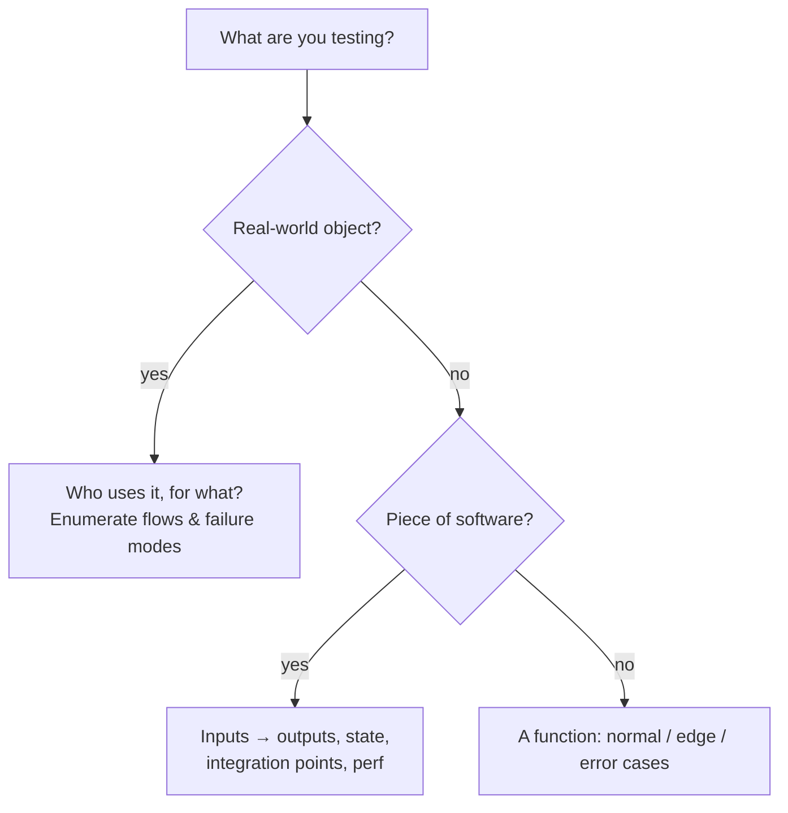
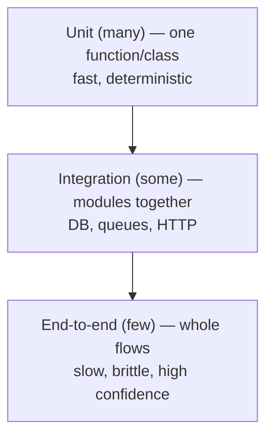
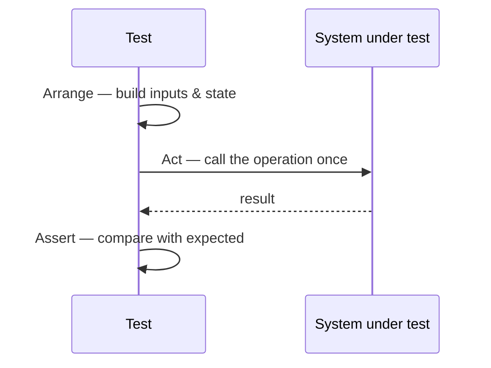
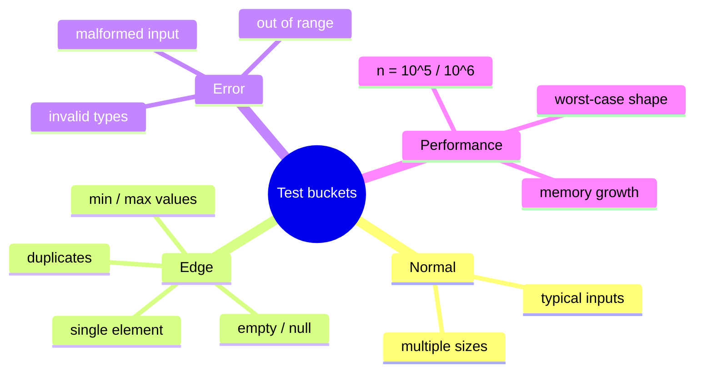
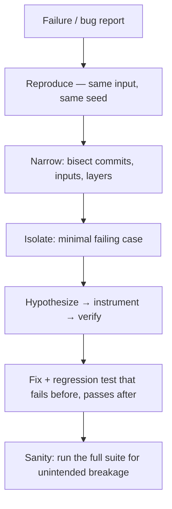
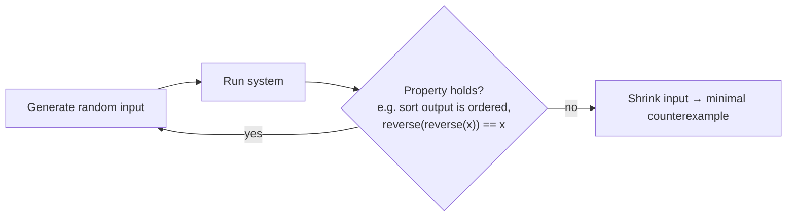
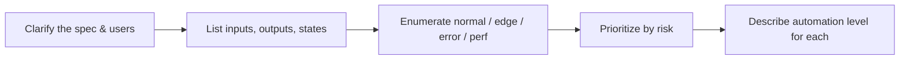

# Chapter 11 · Testing

> Book reference: **Ch 11 — Testing** (testing a real-world object, a piece of software, a function; troubleshooting).

Test questions come in two flavours: *“test this thing”* (design a test plan) and *“your test failed —
debug it”*. Both reward methodical thinking, not trivia.



---

## 1. The test pyramid



| Level | Speed | Confidence | When it fails you know… |
|-------|-------|------------|-------------------------|
| unit | ms | narrow | exactly where |
| integration | 100ms–s | medium | which boundary broke |
| e2e | s–min | broad | something broke, somewhere |

---

## 2. Anatomy of a test — Arrange / Act / Assert



```java
// Java — plain assertions, no framework needed for practice
void testReverse() {
    assertEquals("olleh", Solution.reverse("hello"));
    assertEquals("", Solution.reverse(""));              // edge: empty
    assertEquals("a", Solution.reverse("a"));            // edge: single char
    assertEquals("aa", Solution.reverse("aa"));          // edge: duplicates
}
```

```python
# Python — pytest style
import pytest
from solution import reverse

@pytest.mark.parametrize("raw, expected", [
    ("hello", "olleh"),
    ("", ""),            # empty
    ("a", "a"),          # single
    ("ab", "ba"),        # even
])
def test_reverse(raw, expected):
    assert reverse(raw) == expected
```

```csharp
// C# — xUnit
[Theory]
[InlineData("hello", "olleh")]
[InlineData("", "")]
public void Reverse_Works(string raw, string expected)
    => Assert.Equal(expected, Solution.Reverse(raw));
```

```javascript
// JavaScript — node:assert
const assert = require("node:assert");
const { reverse } = require("./solution");

assert.strictEqual(reverse("hello"), "olleh");
assert.strictEqual(reverse(""), "");
console.log("PASS");
```

---

## 3. A function test plan — the four buckets



For every task in this repo, the four-bucket scan is exactly what the self-check blocks implement.

---

## 4. Troubleshooting playbook



| Symptom | First suspects |
|---------|----------------|
| passes locally, fails in CI | timezone, locale, seed, parallelism, unordered maps |
| flaky occasionally | shared mutable state, timing, random without seed |
| correct for small n only | integer overflow, recursion depth, cache limits |
| silently wrong | floating point equality, off-by-one on boundaries |

---

## 5. Fuzzing & property-based testing



Great properties to check on this repo's own solutions:

- `reverse(reverse(s)) == s`
- sorting output is non-decreasing and a permutation of the input
- Dijkstra distance ≤ Bellman-Ford distance on the same non-negative graph
- serialize → parse round-trips to an equal object

Mapped tasks: [750 fuzzing harness](../../tasks/expert/750-implement-fuzzing-harness-with-coverage-guided-mutation-afl-like.md),
[751 grammar fuzzing](../../tasks/expert/751-implement-grammar-based-fuzzing-for-structured-inputs.md),
[957 randomized test-case generator](../../tasks/master/957-implement-randomized-test-case-generator-with-oracle-checker-for.md),
[952 autograder](../../tasks/master/952-implement-autograder-that-runs-tests-measures-complexity-and-rep.md),
[958 plagiarism detector](../../tasks/master/958-implement-plagiarism-detector-comparing-code-structure-and-logic.md),
[940 load generator](../../tasks/master/940-implement-high-fidelity-load-generator-with-correlated-user-beha.md),
[891 failure-injection benchmarking](../../tasks/master/891-implement-benchmarking-harness-for-large-distributed-systems-wit.md).

> Full list: [ctci-mapping.md → Ch 11](../ctci-mapping.md).

## Interview checklist for “test this”


