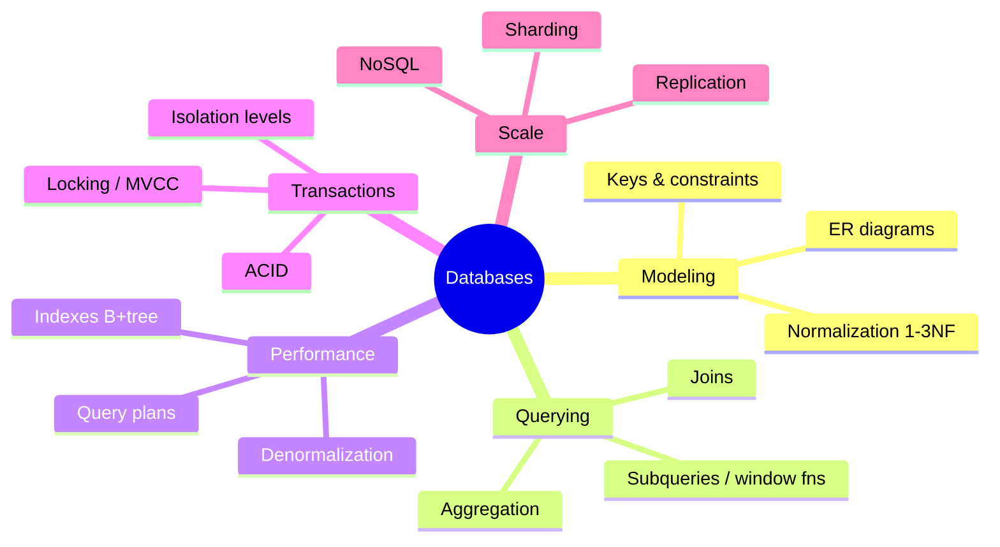
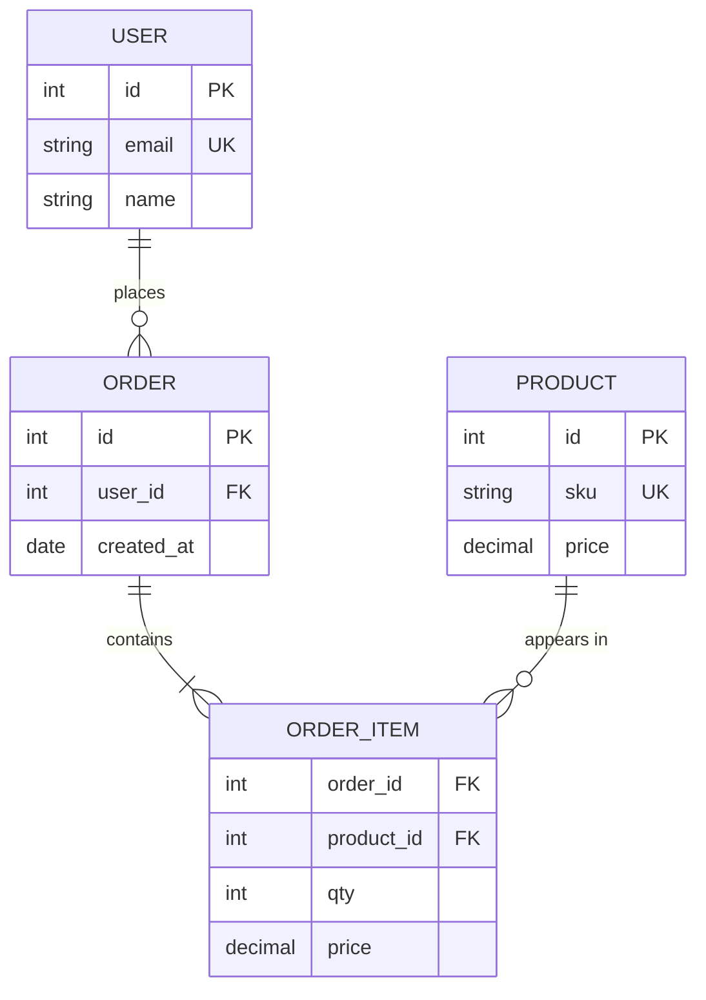
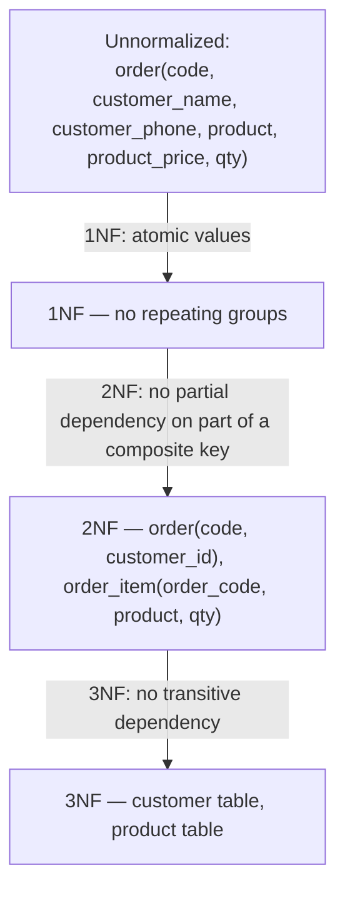
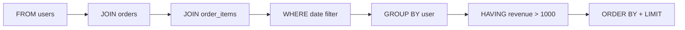
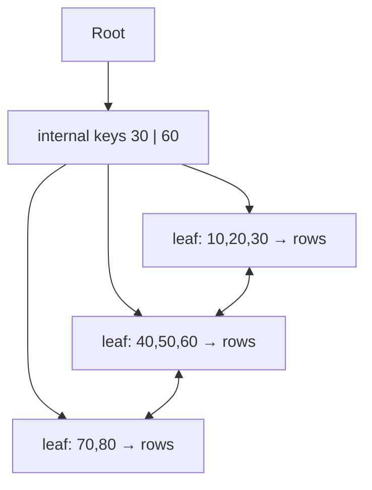
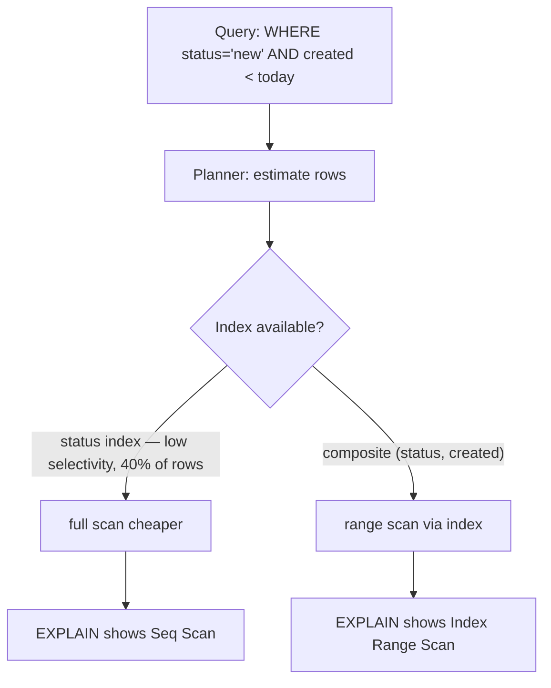
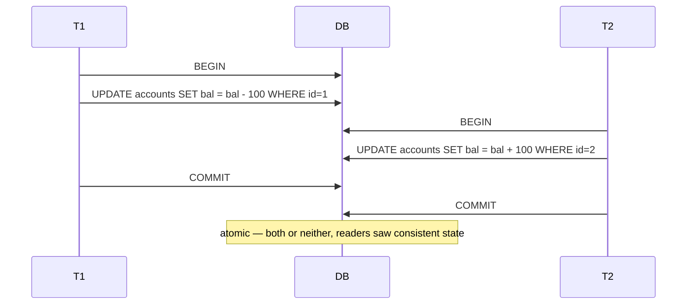
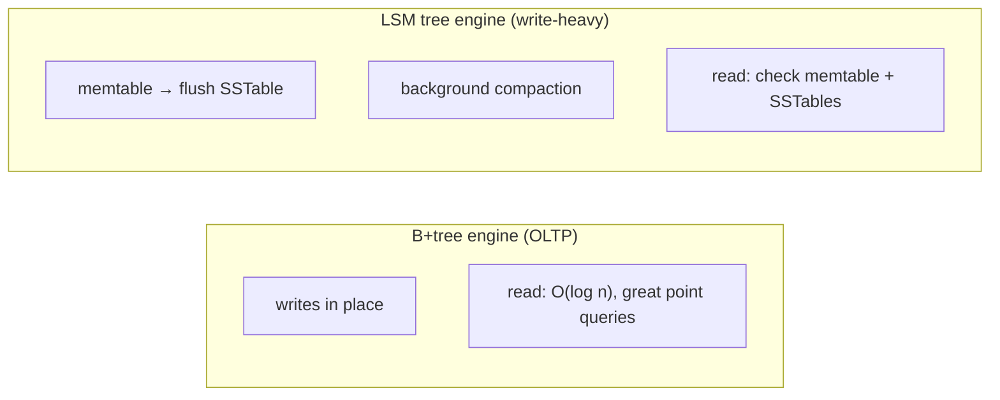

# Chapter 14 · Databases

> Book reference: **Ch 14 — Databases** (SQL syntax, normalization, small & large database design).

Database questions test whether you can model data (ER), query it (SQL), and scale it
(indexes → replication → sharding).



---

## 1. ER modeling — the interview starter



Rules: every table gets a primary key; relationships carry foreign keys on the **many** side;
many-to-many needs a junction table (`ORDER_ITEM` above).

---

## 2. Normalization — eliminate redundancy



| Form | Violation example | Fix |
|------|-------------------|-----|
| 1NF | `phones = '555-1,555-2'` in one column | separate rows/table |
| 2NF | `product_price` depends only on `product` but keyed by `(order, product)` | move to product table |
| 3NF | `customer_phone` depends on `customer_name`, not on the key | customer table |

**Denormalize deliberately** when reads dominate and joins hurt (reporting, caches) — and say why.

---

## 3. SQL you should write fluently

```sql
-- Top 3 customers by revenue this year, with their order counts
SELECT u.id, u.name,
       COUNT(DISTINCT o.id)      AS orders,
       SUM(oi.qty * oi.price)    AS revenue
FROM users u
JOIN orders o       ON o.user_id = u.id
JOIN order_items oi ON oi.order_id = o.id
WHERE o.created_at >= '2026-01-01'
GROUP BY u.id, u.name
HAVING SUM(oi.qty * oi.price) > 1000
ORDER BY revenue DESC
LIMIT 3;
```



Join types: `INNER` (both), `LEFT` (keep left), `RIGHT`, `FULL`; window functions
(`ROW_NUMBER() OVER (PARTITION BY … ORDER BY …)`) for "rank per group".

---

## 4. Indexes — B+ trees behind the curtain



| Fact | Consequence |
|------|-------------|
| B+tree lookup O(log n) | equality & range queries fast |
| leaves linked in order | `ORDER BY indexed_col LIMIT k` is cheap |
| index writes cost time | don't index everything; write-heavy tables suffer |
| leftmost prefix rule | `INDEX(a, b)` helps `WHERE a=…` and `(a,b)`, not `b` alone |
| covering index | all queried cols in the index → no table lookup |



Mapped: [437 B-tree node ops](../../tasks/advanced/437-implement-b-tree-node-insert-delete-basics.md),
[477 B+tree leaf range](../../tasks/advanced/477-implement-b-tree-leaf-range-query-and-insert-basics.md),
[642 join algorithms](../../tasks/expert/642-implement-join-algorithms-nested-loop-hash-join-sort-merge-join.md),
[895 learned index](../../tasks/master/895-implement-learned-index-replacement-for-b-tree-with-fallback-cor.md).

---

## 5. Transactions & isolation



| Isolation level | Dirty read | Non-repeatable read | Phantom rows |
|-----------------|-----------|---------------------|--------------|
| Read uncommitted | yes | yes | yes |
| Read committed | no | yes | yes |
| Repeatable read | no | no | yes (PG: no) |
| Serializable | no | no | no |

Implementations: 2-phase locking (pessimistic) vs MVCC snapshots (readers don't block writers).
Mapped: [637 write skew](../../tasks/expert/637-implement-snapshot-isolation-anomalies-demonstrator-write-skew.md),
[639 2PL simulator](../../tasks/expert/639-implement-two-phase-locking-simulator-with-deadlock-detection.md),
[476 snapshot isolation](../../tasks/advanced/476-implement-snapshot-isolation-simulator-for-transactions-conceptu.md),
[483 MVCC snapshot](../../tasks/advanced/483-implement-consistent-snapshot-retrieval-using-mvcc.md).

### Storage engines



Mapped: [478 LSM basics](../../tasks/advanced/478-implement-log-structured-merge-tree-lsm-basic-flush-merge-simula.md),
[480 WAL recovery](../../tasks/advanced/480-implement-write-ahead-logging-wal-crash-recovery-simulation.md),
[484 KV store memtable+SSTable](../../tasks/advanced/484-implement-simple-key-value-store-with-memtable-sstable.md).

---

## 6. SQL vs NoSQL — choose with reasons

| Need | Better fit |
|------|-----------|
| multi-row transactions, ad-hoc joins | relational (Postgres/MySQL) |
| huge write throughput, key access | KV/LSM (Dynamo-style) |
| flexible nested documents | document store |
| graph traversal (friends-of-friends) | graph DB |
| full-text search | inverted index (Elasticsearch-style) |

Scaling path: **index → cache → read replicas → shard** (see [Ch 9](09-system-design-scalability.md)).
Mapped at scale: [803 mini SQL engine](../../tasks/master/803-build-a-small-sql-engine-with-parser-planner-and-executor-suppor.md),
[802 ACID KV with MVCC](../../tasks/master/802-implement-fully-acid-transactional-key-value-store-with-mvcc-and.md),
[804 distributed SQL](../../tasks/master/804-implement-distributed-sql-with-sharding-routing-and-distributed.md),
[853 access control & auditing](../../tasks/master/853-implement-fine-grained-access-control-and-auditing-for-database.md).

> Full list: [ctci-mapping.md → Ch 14](../ctci-mapping.md).
