# Chapter 15 · Threads and Locks

> Book reference: **Ch 15 — Threads and Locks** (threads in Java, synchronization, deadlocks & prevention).

Concurrency questions check whether you understand **interleaving, memory visibility, and deadlock** —
the three classic failure modes.

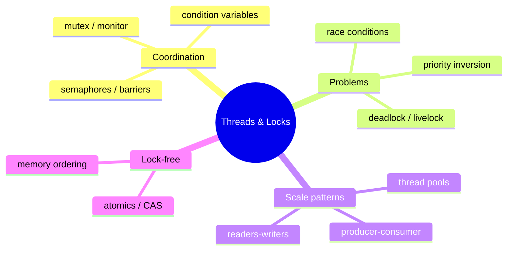

---

## 1. Threads vs processes

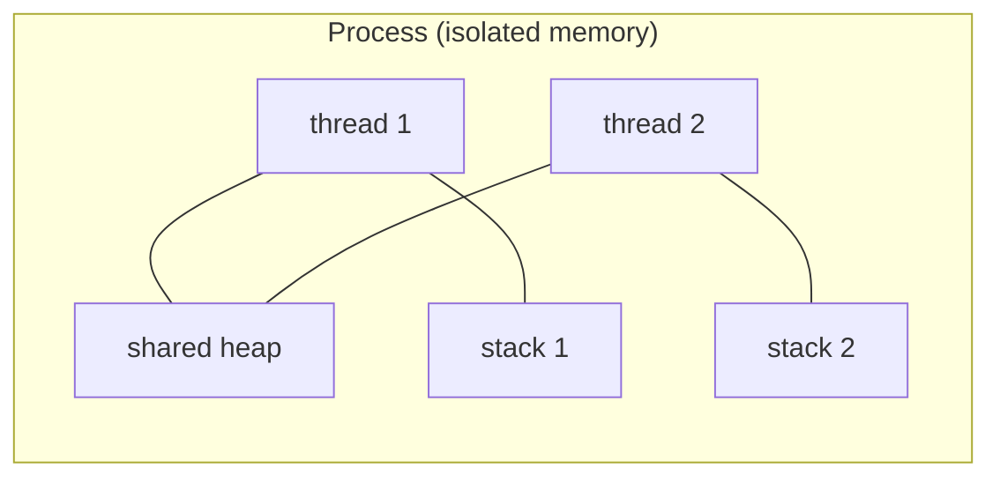

| | Processes | Threads |
|--|-----------|---------|
| memory | isolated | shared heap, private stacks |
| cost | heavy (fork) | light (~MB stack) |
| failure | contained | one crash kills all |
| communication | IPC/sockets | shared memory (+locks!) |

---

## 2. Race conditions — the interleaving timeline

`counter++` is **three** operations: load, add, store of:

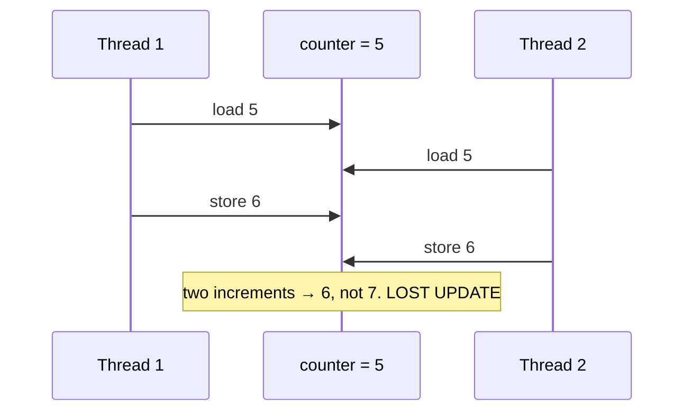

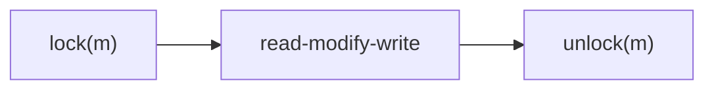

```java
// Java — synchronized makes the read-modify-write atomic & visible
class Counter {
    private int value = 0;
    synchronized void increment() { value++; }
    synchronized int get() { return value; }
}
// or: AtomicInteger value = new AtomicInteger(); value.incrementAndGet();
```

```csharp
// C#
class Counter {
    private readonly object gate = new();
    private int value;
    public void Increment() { lock (gate) { value++; } }
}
// or: Interlocked.Increment(ref value);
```

```python
# Python — threads share the GIL, but `value += 1` is still not atomic across bytecodes
import threading

class Counter:
    def __init__(self):
        self._value = 0
        self._lock = threading.Lock()

    def increment(self):
        with self._lock:
            self._value += 1
```

```javascript
// JavaScript — single-threaded event loop: no data races in user code…
let counter = 0;
counter++; // safe: one thread of execution per isolate
// …but async interleaving still causes logical races across await points.
```

---

## 3. Deadlock — four conditions & the wait-for cycle

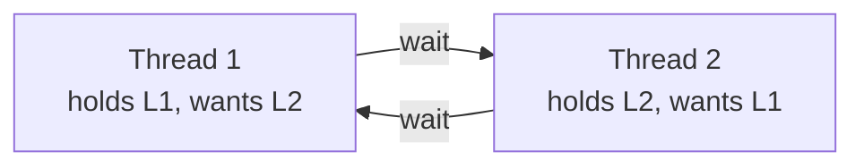

All four must hold: mutual exclusion, hold-and-wait, no preemption, circular wait.

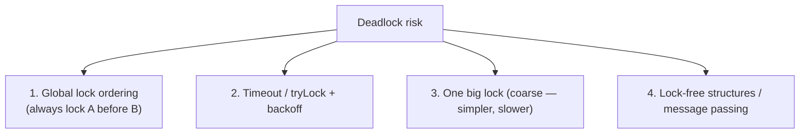

The dining-philosophers fix is exactly rule 1: order the forks, one philosopher picks right-first.

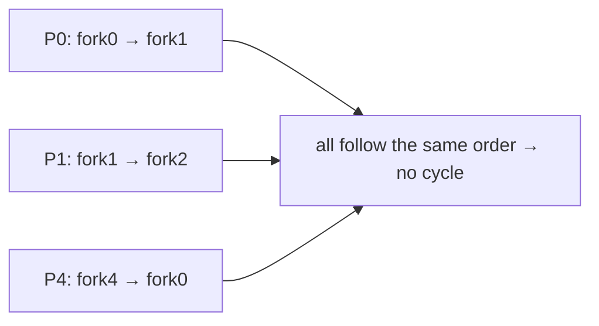

Mapped: [358 dining philosophers](../../tasks/intermediate/358-dining-philosophers-solution-using-ordered-locks.md),
[357 deadlock detection](../../tasks/intermediate/357-deadlock-detection-for-resource-allocation-graph-algorithm.md),
[670 banker's algorithm](../../tasks/expert/670-implement-resource-allocation-graph-and-banker-s-algorithm-simul.md).

---

## 4. Producer–consumer with a bounded buffer

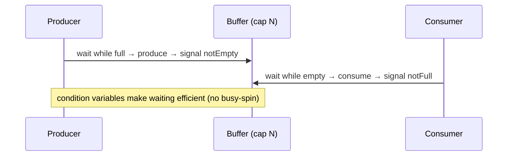

```java
// Java — the canonical three-lock (or use BlockingQueue and skip the drama)
class BoundedBuffer<T> {
    private final Queue<T> q = new ArrayDeque<>();
    private final int cap;
    BoundedBuffer(int cap) { this.cap = cap; }

    synchronized void put(T item) throws InterruptedException {
        while (q.size() == cap) wait();      // always while, never if
        q.add(item);
        notifyAll();
    }
    synchronized T take() throws InterruptedException {
        while (q.isEmpty()) wait();
        T item = q.remove();
        notifyAll();
        return item;
    }
}
```

Python equivalent: `queue.Queue` (thread-safe), or `threading.Condition`. C#: `BlockingCollection<T>`.
JavaScript: the event loop + promises play the role of the buffer.

Mapped: [195 producer-consumer](../../tasks/beginner/195-implement-basic-producer-consumer-using-threads-mutex-condition.md),
[348 multi-producer](../../tasks/intermediate/348-producer-consumer-using-semaphore-locks-with-multiple-producers.md).

---

## 5. The rest of the toolbox

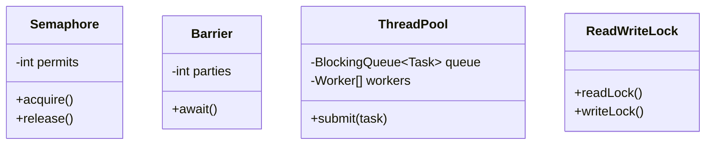

| Primitive | Use for |
|-----------|---------|
| mutex / monitor | one-at-a-time critical section |
| semaphore (counting) | limit concurrent access (pool of N) |
| condition variable | wait-for-predicate without spinning |
| barrier | phase synchronization (all threads meet) |
| read-write lock | many readers OR one writer |
| thread pool | reuse threads, bound concurrency |
| CAS / atomics | lock-free updates, counters |
| volatile | visibility (not atomicity!) |

### Lock-free — CAS in one picture

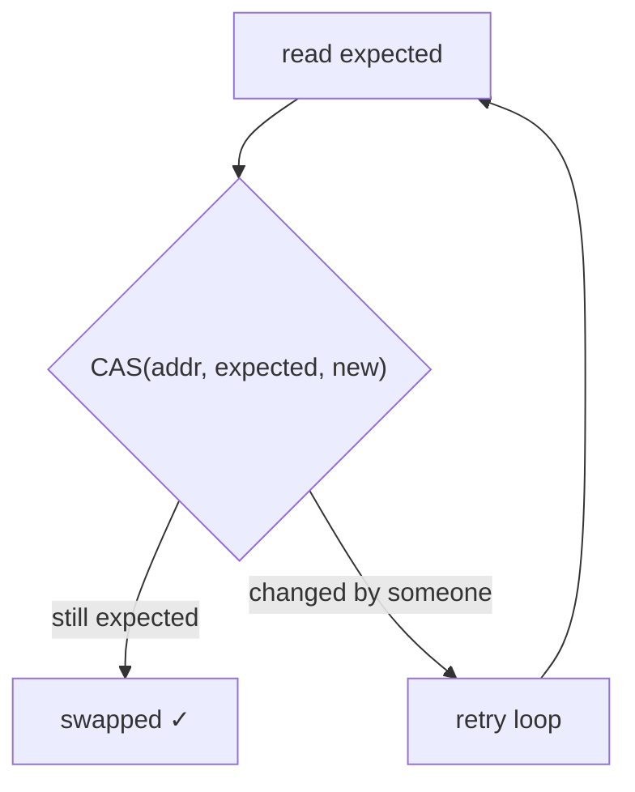

ABA problem, memory reordering (use acquire/release semantics), and safe reclamation
(epoch / hazard pointers) are the advanced traps — mapped at tasks
[354](../../tasks/intermediate/354-implement-wait-free-counter-sketch-atomic-operations.md),
[355](../../tasks/intermediate/355-implement-epoch-based-reclamation-idea-for-concurrent-data-struc.md),
[356](../../tasks/intermediate/356-implement-lock-free-stack-outline-cas.md),
[621 Michael-Scott queue](../../tasks/expert/621-implement-scalable-concurrent-queue-michael-scott-queue.md).

### Visibility — the JMM/CLR memory model

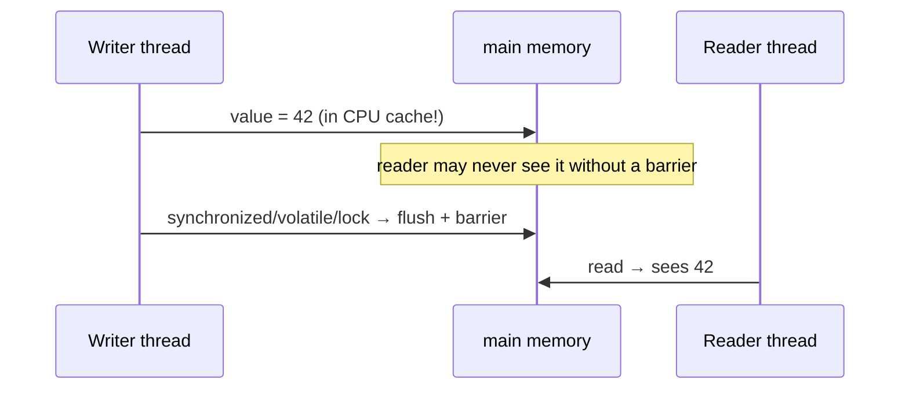

Without synchronization (or `volatile`/`Interlocked`/`threading.Lock`), writes may never become
visible to other threads. „Works on my machine" concurrency bugs are usually visibility bugs.

---

## 6. Language-specific gotchas

| Language | Reality |
|----------|---------|
| Java | `synchronized`, `wait/notify`, `java.util.concurrent`, JMM with happens-before |
| C# | `lock`, `Monitor`, `Interlocked`, `Task`/`async`, no `volatile` for compound ops |
| Python | GIL serializes bytecode but not multi-step invariants; use `threading`/`multiprocessing`/asyncio |
| JavaScript | single-threaded loop; concurrency = interleaved async tasks; workers for CPU |

## Mapped tasks to practice

- [195 producer-consumer](../../tasks/beginner/195-implement-basic-producer-consumer-using-threads-mutex-condition.md) · [347 read-write lock](../../tasks/intermediate/347-implement-read-write-lock-basic-no-starvation.md) · [349 barrier](../../tasks/intermediate/349-barrier-synchronization-primitive-simple-implementation.md) · [350 singleton](../../tasks/intermediate/350-implement-thread-safe-singleton-double-checked-locking.md)
- [351 thread pool](../../tasks/intermediate/351-implement-thread-pool-basic-with-worker-threads-and-task-queue.md) · [352 fork-join sum](../../tasks/intermediate/352-implement-fork-join-style-parallel-sum-threads.md) · [353 sharded hashmap](../../tasks/intermediate/353-implement-concurrent-hashmap-simplified-sharding.md) · [354 atomic counter](../../tasks/intermediate/354-implement-wait-free-counter-sketch-atomic-operations.md)
- [356 lock-free stack](../../tasks/intermediate/356-implement-lock-free-stack-outline-cas.md) · [358 dining philosophers](../../tasks/intermediate/358-dining-philosophers-solution-using-ordered-locks.md) · [359 readers-writers fairness](../../tasks/intermediate/359-readers-writers-fairness-implementation-and-tests.md) · [492 lock-free ring buffer](../../tasks/advanced/492-implement-circular-buffer-with-lock-free-design-atomic.md)
- [615 transactional memory](../../tasks/expert/615-implement-transactional-memory-simulator-basics.md) · [618 linearizability checker](../../tasks/expert/618-implement-linearizability-checker-for-concurrent-histories.md) · [623 hazard pointers](../../tasks/expert/623-implement-hazard-pointers-memory-reclamation-in-concurrent-struc.md) · [626 work-stealing deque](../../tasks/expert/626-implement-work-stealing-deque-chase-lev-for-task-scheduler.md)

> Full list: [ctci-mapping.md → Ch 15](../ctci-mapping.md).
