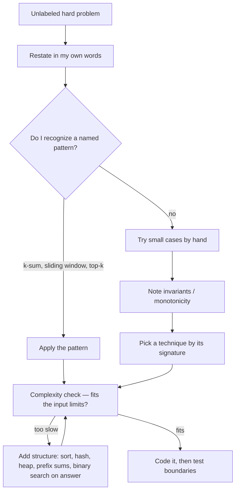
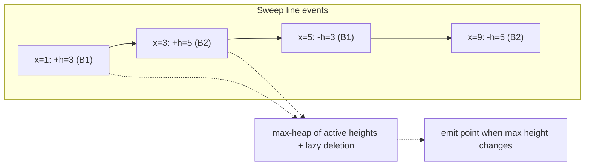
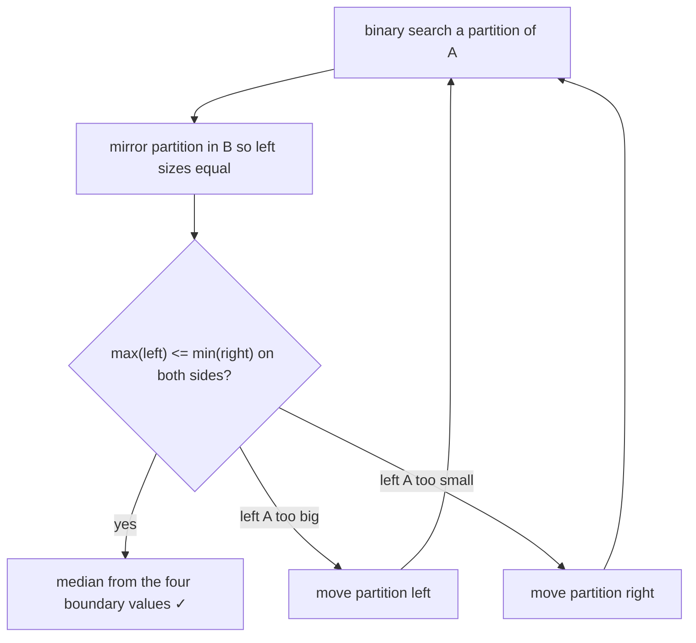

# Chapters 16–17 · Additional Review Problems (Moderate & Hard)

> Book reference: **Ch 16 — Moderate** and **Ch 17 — Hard**. These chapters mix every topic; the skill
> they test is *pattern recognition speed* on problems without labels.



## Pattern signature table

| Signature in the problem | Reach for |
|--------------------------|-----------|
| "k-th / top-k / median of stream" | heap + quickselect ([258](../../tasks/intermediate/258-kth-largest-element-in-stream-min-heap.md), [260](../../tasks/intermediate/260-quickselect-randomized-implementation.md)) |
| "find all pairs/triplets summing to…" | sort + two pointers / hash ([202](../../tasks/intermediate/202-3-sum-all-unique-triplets.md), [203](../../tasks/intermediate/203-4-sum-problem-k-sum-generalization.md)) |
| "subarray with constraint, non-negative" | sliding window |
| "subarray with constraint, with negatives" | prefix sums + hashmap ([210](../../tasks/intermediate/210-longest-subarray-with-sum-equal-to-k-with-negatives-using-hashma.md)) |
| "minimize the maximum / maximize the minimum" | binary search on answer |
| "n ≈ 40, meet in the middle" | split + sort halves ([219](../../tasks/intermediate/219-implement-meet-in-the-middle-for-subset-problems-n-40.md)) |
| "overlapping ranges/buildings" | sweep line + heap ([328](../../tasks/intermediate/328-skyline-problem-heap-sweep-line.md)) |
| "order with dependencies" | topological sort ([106](../../tasks/beginner/106-topological-sort-using-dfs-dag.md)) |
| "log n on sorted matrices/arrays pairs" | partition binary search ([261](../../tasks/intermediate/261-median-of-two-sorted-arrays-log-min-n-m-algorithm.md)) |
| "state machines / precedence" | stacks ([342](../../tasks/intermediate/342-implement-expression-evaluator-with-variables-and-precedence.md)) |

---

## Worked example 1 — the skyline problem (Ch 17 classic)

Given buildings `(left, right, height)`, draw the skyline.



```python
import heapq

def skyline(buildings):
    events = []
    for l, r, h in buildings:
        events.append((l, -h, r))     # start: negative height sorts first at same x
        events.append((r, 0, 0))      # end
    events.sort()
    result, heap, prev = [], [(0, float("inf"))], 0
    starts = {}
    for x, neg_h, r in events:
        if neg_h:                     # building starts
            heapq.heappush(heap, (neg_h, r))
        while heap[0][1] <= x:        # lazy delete ended buildings
            heapq.heappop(heap)
        top = -heap[0][0]
        if top != prev:
            result.append([x, top])
            prev = top
    return result
```

## Worked example 2 — median of two sorted arrays in O(log min(n, m))



The invariant is exactly "how much of A is on the left half", which makes the answer monotone in the
partition — hence binary searchable.

## How to practice this tier

1. Re-derive the pattern table above from memory on a blank page.
2. For every task in [`tasks/`](../../tasks), write the *signature* before coding.
3. Time-box: 25 minutes to an accepted brute force, then optimize; 45 minutes total.
4. Revisit failures after 48h — see [spaced repetition](https://en.wikipedia.org/wiki/Spaced_repetition) thinking behind task 971.

More mapped moderate/hard problems: [074 stable partition](../../tasks/beginner/074-implement-simple-stable-partition.md),
[206 closest pair sum](../../tasks/intermediate/206-pair-with-sum-closest-to-target-in-sorted-array.md),
[227 bitonic subarray](../../tasks/intermediate/227-longest-bitonic-subarray.md),
[229 alternating subsequence](../../tasks/intermediate/229-longest-alternating-subsequence.md),
[318 min window subsequence](../../tasks/intermediate/318-minimum-window-subsequence-not-necessarily-contiguous.md),
[331 weighted job scheduling](../../tasks/intermediate/331-weighted-job-scheduling-with-reconstruction.md),
[339 Mo's algorithm](../../tasks/intermediate/339-range-minimum-query-with-offline-queries-mo-s-algorithm-simple.md).

> Full lists: [ctci-mapping.md → Ch 16/17](../ctci-mapping.md).
