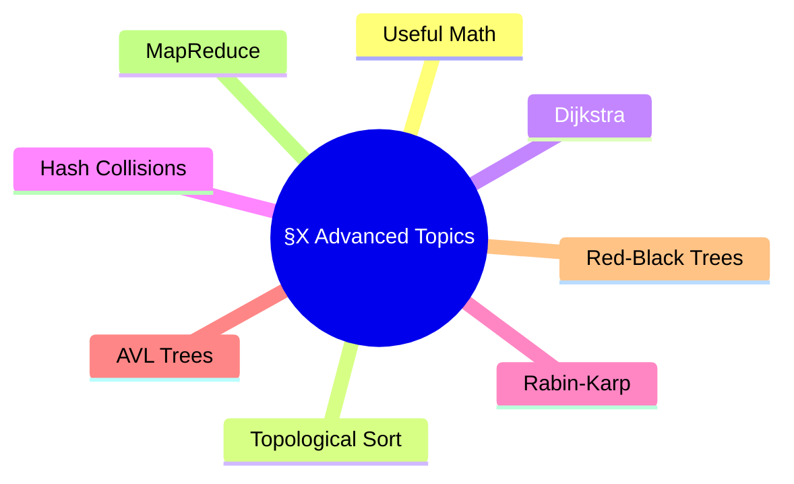
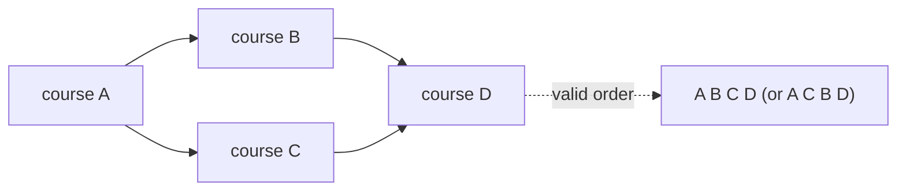
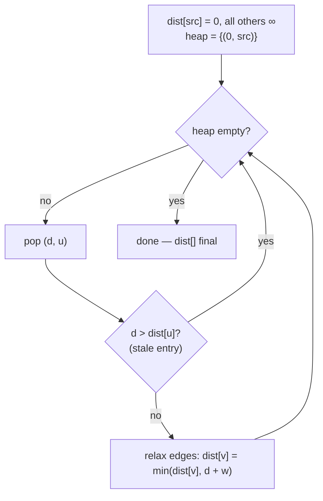
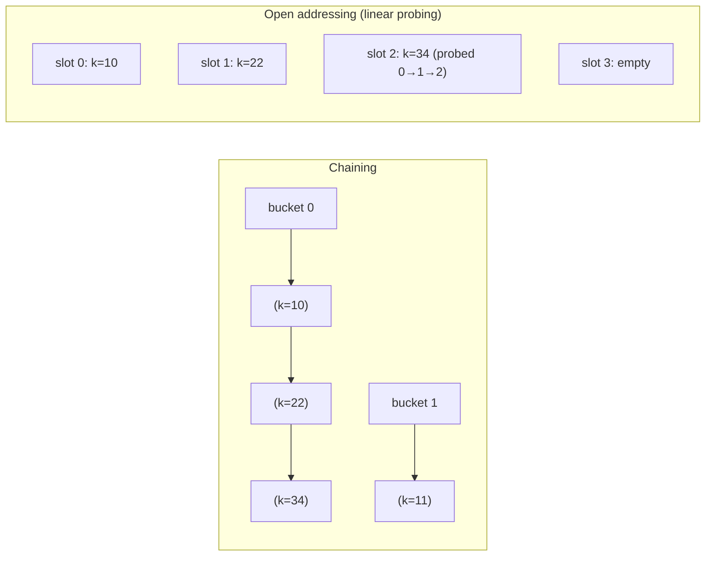
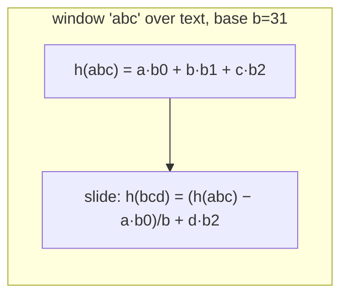
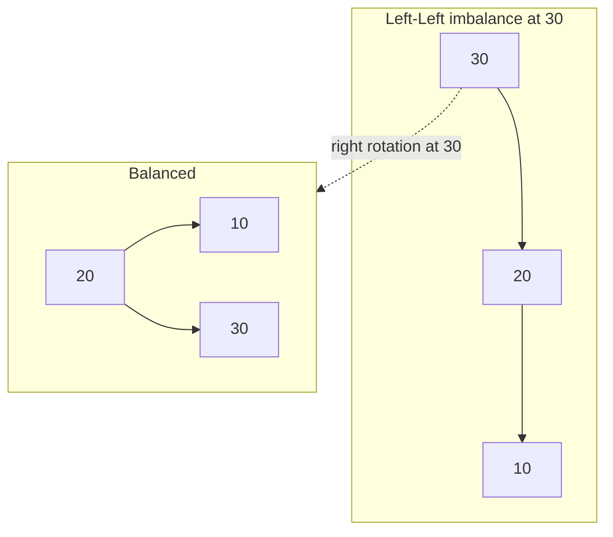
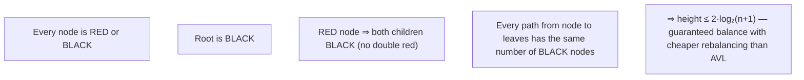
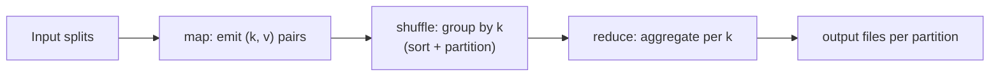
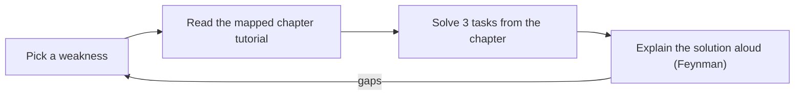

# §X · Advanced Topics (Beyond the 189)

> Book reference: **X. Advanced Topics** — useful math, topological sort, Dijkstra, hash table
> collision resolution, Rabin-Karp, AVL trees, red-black trees, MapReduce, additional studying.

These are the "bonus round" topics interviewers love at senior levels. Each one earned its place
because it appears *everywhere* in real systems.



---

## 1. Useful math

| Fact | Why it matters |
|------|----------------|
| Σ 1..n = n(n+1)/2 | pair counting, handshakes, missing-number tricks |
| log₂(10⁶) ≈ 20 | binary search on a million items = 20 probes |
| 2³² ≈ 4.3×10⁹ | 32-bit overflow boundary (beware in sums/averages) |
| prime mod 10⁹+7 | hashing / combinatorics without overflow (use long) |
| expected trials = 1/p | coupon collector, hash collision estimates |

Mapped: [032 primes](../../tasks/beginner/032-check-prime-number-naive.md), [035 gcd](../../tasks/beginner/035-greatest-common-divisor-gcd-euclid-s-algorithm.md), [380 modular inverse](../../tasks/intermediate/380-implement-modular-inverse-fast-modular-exponent.md), [381 CRT](../../tasks/intermediate/381-chinese-remainder-theorem-solver-for-pairwise-coprime-moduli.md).

## 2. Topological sort (revisit)



Kahn's algorithm (BFS on in-degrees) is the interview default: it detects cycles naturally
(output shorter than |V| ⇒ cycle). Mapped: [106](../../tasks/beginner/106-topological-sort-using-dfs-dag.md),
[107](../../tasks/beginner/107-detect-cycle-in-directed-graph-dfs-coloring.md), [746 DFS coloring recap](../../tasks/expert/746-implement-topological-sort-with-cycle-debugging-and-minimal-feed.md).

## 3. Dijkstra, from the book's perspective



Key properties to state aloud: greedy works because edge weights ≥ 0; the heap gives
O((V+E) log V); with negative edges you need Bellman-Ford.
Mapped: [113 Dijkstra](../../tasks/beginner/113-simple-dijkstra-s-algorithm-non-negative-weights.md),
[114 Bellman-Ford](../../tasks/beginner/114-bellman-ford-algorithm-with-negative-edges.md).

## 4. Hash table collision resolution



| | chaining | open addressing |
|--|----------|-----------------|
| memory | extra pointers | compact arrays |
| clustering | lists long under load | primary clustering |
| deletion | easy unlink | tombstones needed |
| load factor | can exceed 1.0 | must stay < ~0.7 |

Resizing: double when load factor crosses the threshold, rehash all entries — amortized O(1) inserts.

## 5. Rabin-Karp — rolling hash substring search



```python
def rabin_karp(text, pattern, base=256, mod=1_000_000_007):
    n, m = len(text), len(pattern)
    if m > n: return []
    high = pow(base, m - 1, mod)
    ph = th = 0
    for i in range(m):
        ph = (ph * base + ord(pattern[i])) % mod
        th = (th * base + ord(text[i])) % mod
    hits = []
    for i in range(n - m + 1):
        if ph == th and text[i:i+m] == pattern:   # verify to kill collisions
            hits.append(i)
        if i < n - m:
            th = ((th - ord(text[i]) * high) * base + ord(text[i+m])) % mod
    return hits
```

Double hashing with two moduli makes collisions vanish in practice (task [315](../../tasks/intermediate/315-rolling-hash-double-hash-to-reduce-collisions.md)).
Mapped: [184 KMP](../../tasks/beginner/184-implement-prefix-function-kmp-for-pattern-matching.md),
[185 KMP search](../../tasks/beginner/185-kmp-search-using-prefix-function.md),
[186 Rabin-Karp](../../tasks/beginner/186-rabin-karp-rolling-hash-string-search.md).

## 6. AVL trees — rotations keep the balance



LR / RL double rotations: rotate child first, then node. Balance factor = height(left) − height(right) ∈ {-1,0,1}.
Mapped: [247 AVL insert & rotations](../../tasks/intermediate/247-implement-avl-tree-insert-rotations-balance.md).

## 7. Red-Black trees — the rules in five lines



Used in C++ `std::map`, Java `TreeMap`, .NET `SortedDictionary`. Mapped: [248](../../tasks/intermediate/248-implement-red-black-tree-insert-basic-conceptual.md).

## 8. MapReduce



Covered in depth in [Ch 9](09-system-design-scalability.md). Mapped: [469 toy MapReduce](../../tasks/advanced/469-implement-distributed-aggregations-map-reduce-toy.md),
[545 PageRank iterations](../../tasks/advanced/545-implement-pagerank-iterative-solver-and-convergence-check.md).

## Additional studying (the book's own suggestion) applied here



> Full list: [ctci-mapping.md → §X Adv topics](../ctci-mapping.md).
