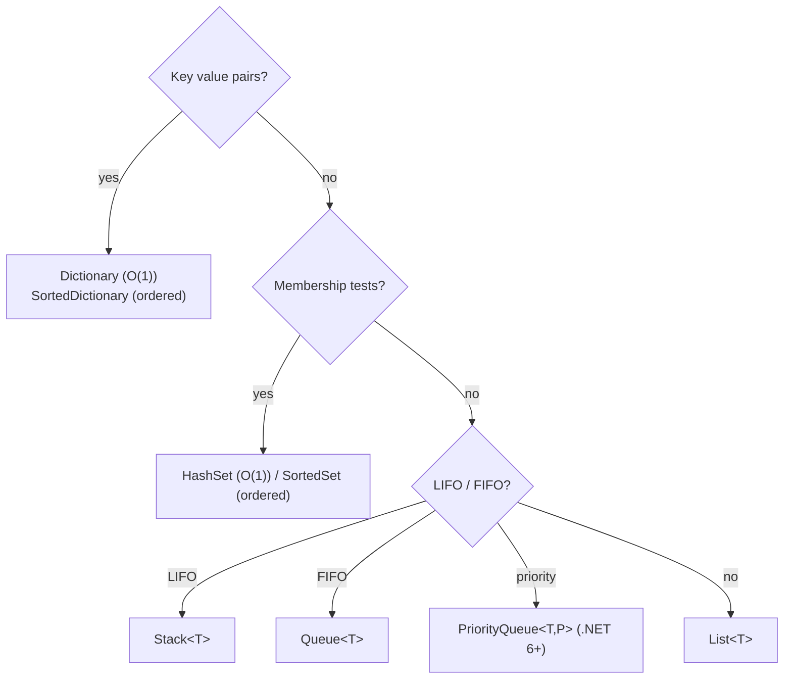
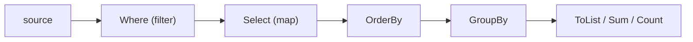

# C# Companion — Collections, LINQ & Modern Syntax

> Every solution in [`solutions/csharp/`](../../solutions/csharp) is a single `Solution.cs` with a
> `Main` that runs its own checks. See [`solutions/csharp/README.md`](../../solutions/csharp/README.md)
> for how to drop it into a console project.

```mermaid
classDiagram
    class IEnumerable
    class ICollection
    class IList
    class ISet
    class IDictionary
    IEnumerable <|-- ICollection
    ICollection <|-- IList
    ICollection <|-- ISet
    IEnumerable <|-- IDictionary
    IList <|.. ListT["List&lt;T&gt;"]
    ISet <|.. HashSetT["HashSet&lt;T&gt;"]
    ISet <|.. SortedSetT["SortedSet&lt;T&gt;"]
    IDictionary <|.. DictionaryT["Dictionary&lt;K,V&gt;"]
    IDictionary <|.. SortedDictionaryT["SortedDictionary&lt;K,V&gt;"]
```

## Collection picker



## Idioms

```csharp
// Sorting with comparators
var a = new[] { 3, 1, 2 };
Array.Sort(a);                                     // ascending
Array.Sort(a, (x, y) => y.CompareTo(x));           // descending
var byLen = words.OrderBy(w => w.Length).ToList();

// PriorityQueue — min by priority by default
var pq = new PriorityQueue<(int x, int y), int>();
pq.Enqueue((0, 0), 5);
var (x, y) = pq.Dequeue();

// Sorted containers as balanced trees
var map = new SortedDictionary<int, string>();
var set = new SortedSet<int>();

// String building
var sb = new System.Text.StringBuilder();
sb.Append("x").Append(42);
var s = sb.ToString();

// char / int
int d = '7' - '0';
char c = (char)('a' + 2);

// TryGetValue pattern
if (dict.TryGetValue(key, out var value)) { /* use value */ }
```

## LINQ in one picture



```csharp
var report = orders
    .Where(o => o.Total > 100)
    .GroupBy(o => o.CustomerId)
    .Select(g => new { Customer = g.Key, Revenue = g.Sum(o => o.Total) })
    .OrderByDescending(r => r.Revenue)
    .Take(10)
    .ToList();

// LINQ is deferred — enumerate once, materialize deliberately (ToList)
```

## Nullability & modern C# (say these in an interview and watch eyebrows rise)

```csharp
// Nullable reference types — the compiler tracks null flow
string? maybe = FindName();
string name = maybe ?? "unknown";        // coalesce
int len = maybe?.Length ?? 0;            // null-conditional

// Pattern matching
if (obj is int n && n > 0) { }
var label = value switch {
    < 0 => "negative",
    0   => "zero",
    _   => "positive",
};

// Records — value equality for small data carriers
record Point(int X, int Y);
var same = new Point(1, 2) == new Point(1, 2);   // true

// Spans — zero-alloc slicing for hot parsing code
ReadOnlySpan<char> token = text.AsSpan(3, 5);
```

## Gotchas

| Trap | Reality |
|------|---------|
| `==` on strings | value comparison is fine in C# (unlike Java) — but `ReferenceEquals` differs |
| struct vs class equality | structs are value types; a mutable struct in a collection is a trap |
| LINQ re-enumeration | each `foreach` re-runs the query — materialize once |
| deferred exceptions | `Where` throws only on enumeration |
| integer overflow | unchecked by default; use `checked`, `long`, or `BigInteger` |
| `decimal` vs `double` | use `decimal` for money, `double` for scientific |
| array covariance | `object[] objs = new string[1];` compiles then throws on write |
| recursion | deep recursion → `StackOverflowException` is not catchable — go iterative |

## Runnable template

```csharp
using System;
using System.Collections.Generic;
using System.Linq;

public static class Solution
{
    // ... methods ...

    public static void Main()
    {
        Console.WriteLine("PASS");
    }
}
```

> Running without an IDE: create a console project once (`dotnet new console -n Scratch`), replace
> `Program.cs` content or copy `Solution.cs` in and run `dotnet run`.

Practice trail: [Ch 1](../ctci/01-arrays-and-strings.md) → [Ch 4](../ctci/04-trees-and-graphs.md) →
[Ch 14 databases](../ctci/14-databases.md) — with `Solution.cs` beside every task.
