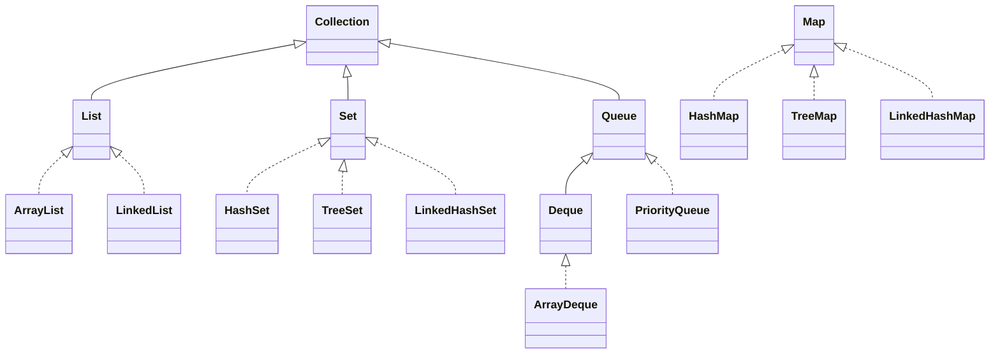
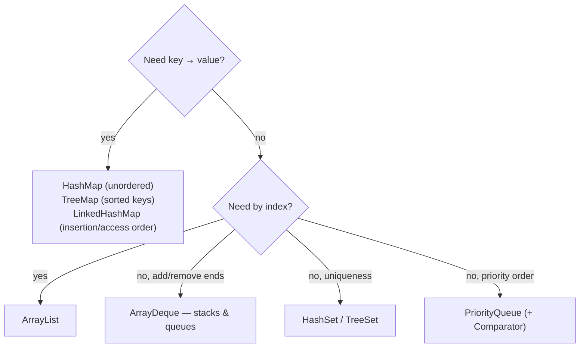

# Java Companion — Collections, Generics & Interview Idioms

> Companion to **Ch 13 — Java** in the book. Every solution in
> [`solutions/java/`](../../solutions/java) is a single self-contained `Solution.java` with a `main`
> that runs its own checks: `javac Solution.java && java Solution`.



## Pick the right collection



| Structure | get | add | remove | ordered? |
|-----------|-----|-----|--------|----------|
| `ArrayList` | O(1) | O(1) amortized | O(n) middle | index |
| `LinkedList` | O(n) | O(1) ends | O(1) known node | insertion |
| `ArrayDeque` | O(1) heads | O(1) | O(1) heads | LIFO/FIFO |
| `HashMap` | O(1) avg | O(1) avg | O(1) avg | no |
| `TreeMap` | O(log n) | O(log n) | O(log n) | sorted |
| `PriorityQueue` | peek O(1) | O(log n) | O(log n) poll | heap |

## Idioms you will use repeatedly

```java
// Sorting with a comparator (primitives: Arrays.sort; objects: Comparator)
int[] a = {3, 1, 2};
Arrays.sort(a);                                  // quicksort, ascending
Integer[] boxed = {3, 1, 2};
Arrays.sort(boxed, Comparator.reverseOrder());   // descending
Arrays.sort(words, (x, y) -> x.length() - y.length()); // by length

// Min-heap of int[] by first element; max-heap via reversed comparator
PriorityQueue<int[]> pq = new PriorityQueue<>((x, y) -> x[0] - y[0]);

// TreeMap navigation — floor/ceiling for interval problems
TreeMap<Integer, String> tm = new TreeMap<>();
tm.put(10, "a"); tm.put(20, "b");
tm.floorKey(15);    // 10
tm.ceilingKey(15);  // 20

// String building
StringBuilder sb = new StringBuilder();
sb.append("x").append(42);
String s = sb.toString();

// char ↔ int
int digit = '7' - '0';        // 7
char c = (char) ('a' + 2);    // 'c'

// Iterate a map
for (Map.Entry<String, Integer> e : map.entrySet()) {
    e.getKey(); e.getValue();
}
```

## Gotchas that bite in interviews

| Trap | Reality |
|------|---------|
| `==` on Strings/Integers | compares references past the intern cache — use `.equals` |
| `Arrays.asList(...)` | fixed-size view; `add` throws |
| autoboxing in `Integer` caches | `Integer.valueOf(127) == Integer.valueOf(127)` true; 128 → false |
| `int` overflow | max ~2.1×10⁹ — use `long` for sums, `Math.addExact` to fail fast |
| `.length` vs `.length()` vs `.size()` | array / String / collection |
| `Substring` memory | JDK 7+ copies; still avoid O(n²) string building |
| modifying while iterating | `ConcurrentModificationException` → use `Iterator.remove` or index loop |

## Recursion, generics & streams — the 10% you need

```java
// Generic method
static <T extends Comparable<T>> T maxOf(List<T> xs) {
    T best = xs.get(0);
    for (T x : xs) if (x.compareTo(best) > 0) best = x;
    return best;
}

// Streams — concise pipelines (know them for readability, benchmark loops if hot)
int sum = IntStream.rangeClosed(1, 10).sum();
List<String> upper = words.stream().map(String::toUpperCase).toList();
Map<Integer, List<String>> byLen =
    words.stream().collect(Collectors.groupingBy(String::length));

// Custom exception style — plain checks in this repo's solutions
static void check(boolean ok, String msg) {
    if (!ok) throw new AssertionError(msg);
}
```

## Runnable template (used across all 200+ Java solutions)

```java
import java.util.*;

public class Solution {
    // ... methods ...

    public static void main(String[] args) {
        System.out.println("PASS");
    }
}
```

Runtime notes: `java`/`javac` 8+ compatible (this repo is tested with JDK 25); avoid `var` in samples
you expect to compile on JDK 8. For deep recursion prefer explicit stacks — default thread stack dies
around 10⁴–10⁵ frames.

Practice trail: [Ch 1 strings](../ctci/01-arrays-and-strings.md) →
[Ch 2 lists](../ctci/02-linked-lists.md) →
[Ch 4 trees/graphs](../ctci/04-trees-and-graphs.md) with the Java solutions beside them.
