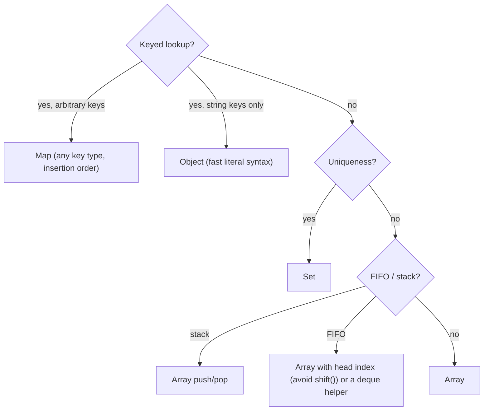
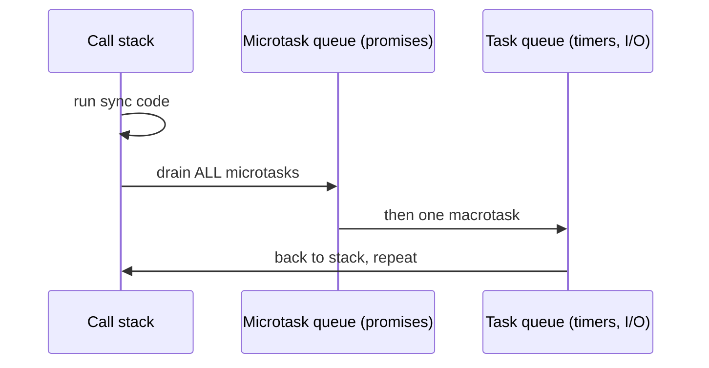

# JavaScript Companion — Arrays, Maps, Closures & the Event Loop

> Every solution in [`solutions/javascript/`](../../solutions/javascript) is a single `solution.js`
> with self-checks: `node solution.js`.



## The array methods that solve half the problems

```javascript
const a = [3, 1, 2];

a.sort();                     // ⚠️ LEXICOGRAPHIC by default: [1, 2, 3] here, but [10, 9] for [9, 10]!
a.sort((x, y) => x - y);      // numeric ascending
a.sort((x, y) => y - x);      // numeric descending

a.map(x => x * 2);            // transform
a.filter(x => x % 2 === 1);   // select
a.reduce((acc, x) => acc + x, 0);  // fold
a.find(x => x > 1);           // first match (undefined if none)
a.findIndex(x => x > 1);
a.some(x => x > 2); a.every(x => x > 0);
a.includes(2);
a.slice(1, 3);                // copy [1, 2]
a.splice(1, 1);               // in-place removal
[...a, 4];                    // append without mutation
[a, [1, 2]].flat();           // [[1,2]] → [1,2]
Array.from({ length: 5 }, (_, i) => i * i);   // [0,1,4,9,16]
Array(n).fill(0);             // ⚠️ fill objects create SHARED refs
```

## Map & Set — the interview workhorses

```javascript
const seen = new Map();               // insertion-ordered, any key type
seen.set("a", 1); seen.get("a"); seen.has("b"); seen.size;

const uniq = new Set([1, 2, 2]);      // {1, 2}
[...uniq];                            // back to array

// Frequency counting idiom
const freq = new Map();
for (const ch of s) freq.set(ch, (freq.get(ch) ?? 0) + 1);

// Sort entries by value
[...freq.entries()].sort((x, y) => y[1] - x[1]);
```

## Closures & functions

```javascript
// Counter via closure
const counter = (() => {
  let n = 0;
  return () => ++n;
})();

// Memoization
function memo(fn) {
  const cache = new Map();
  return x => cache.has(x) ? cache.get(x) : (cache.set(x, fn(x)), cache.get(x));
}

const fib = memo(n => (n <= 1 ? n : fib(n - 1) + fib(n - 2)));
```

## The event loop — why `await` ordering surprises people



```javascript
console.log("A");
setTimeout(() => console.log("D"), 0);
Promise.resolve().then(() => console.log("C"));
console.log("B");
// A, B, C, D — microtasks before macrotasks
```

## Numeric limits — the JS-specific interview trap

| Fact | Consequence |
|------|-------------|
| numbers are float64 | safe integers only up to 2⁵³−1 |
| `0.1 + 0.2 !== 0.3` | compare with `Math.abs(x - y) < 1e-9` |
| `[10, 9, 1].sort()` → `[1, 10, 9]` | always pass a comparator |
| `NaN !== NaN` | test with `Number.isNaN` |
| `1 << 31` is negative | bitwise coerces to 32-bit signed; use `>>> 0` |
| BigInt | `2n ** 64n` for crypto/hash tasks — cannot mix with Number |

```javascript
Number.MAX_SAFE_INTEGER;     // 9007199254740991
BigInt(Number.MAX_SAFE_INTEGER) + 1n;
(0xFFFFFFFF >>> 0)           // 4294967295 (unsigned view)
```

## Structured clone & deep equality (useful in tests)

```javascript
const copy = structuredClone(obj);                      // deep copy
const eq = (a, b) => JSON.stringify(a) === JSON.stringify(b);  // quick-and-dirty (order-sensitive!)
```

## Gotchas checklist

- `==` vs `===`: always prefer `===`; `==` coerces.
- Mutating during iteration: `splice` inside `forEach` skips elements — iterate backwards or build new arrays.
- `var` hoisting: use `const`/`let`; `let` in loops creates per-iteration bindings.
- Default exports vs CommonJS: this repo uses CommonJS (`module.exports`) for zero-config `node`.
- Recursion: deep recursion → RangeError; convert to explicit stacks for big depths.

## Runnable template

```javascript
"use strict";

function solve(input) {
  // ...
}

module.exports = { solve };

if (require.main === module) {
  const assert = require("node:assert");
  assert.strictEqual(solve("hello"), "olleh");
  console.log("PASS");
}
```

Practice trail: [Ch 1](../ctci/01-arrays-and-strings.md) → [Ch 3](../ctci/03-stacks-and-queues.md) →
[Ch 10](../ctci/10-sorting-and-searching.md) — with `solution.js` beside every task.
