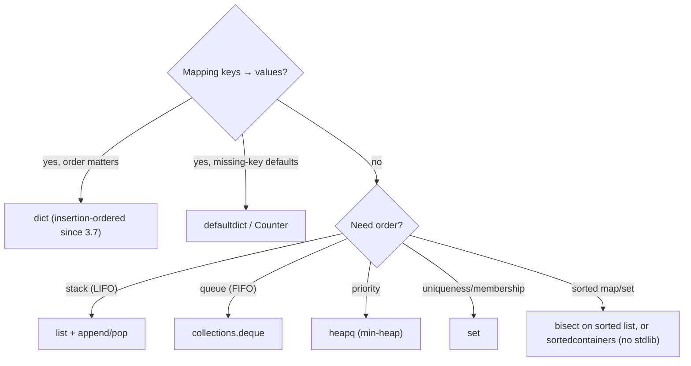

# Python Companion — Idioms for Interview Speed

> Every solution in [`solutions/python/`](../../solutions/python) is a single `solution.py` with a
> `main()` running its own checks: `python3 solution.py`.



## The five modules that carry interviews

```python
from collections import Counter, defaultdict, deque, OrderedDict
from heapq import heappush, heappop, heapify, nlargest, nsmallest
from functools import lru_cache, cache
from bisect import bisect_left, bisect_right, insort
from itertools import accumulate, permutations, combinations, product, groupby
```

| Need | Do |
|------|-----|
| char/word counts | `Counter(s)` |
| missing keys → list | `defaultdict(list)` |
| BFS queue | `deque.popleft()` — never `list.pop(0)` (O(n)) |
| max-heap | push negated values or tuples `(-v, item)` |
| memoization | `@cache` (3.9+) / `@lru_cache(maxsize=None)` |
| binary search | `bisect_left/right` on sorted lists |
| prefix sums | `accumulate(nums)` |

## Slicing & comprehension fluency

```python
a = [1, 2, 3, 4, 5]
a[::-1]            # reverse
a[1:4]             # [2, 3, 4]
a[::2]             # [1, 3, 5]
matrix_T = list(zip(*matrix))          # transpose
flat = [x for row in matrix for x in row]

# dict/set comprehensions
len_by_word = {w: len(w) for w in words}
alphabet = {c for c in "banana"}

# Fizz-buzz style one-liners
labels = ["Fizz" * (i % 3 == 0) + "Buzz" * (i % 5 == 0) or str(i) for i in range(1, 16)]
```

## Sorting like a pro

```python
points = [(1, 5), (2, 3)]
points.sort(key=lambda p: (-p[1], p[0]))     # value desc, x asc

words = ["bb", "a", "ccc"]
words.sort(key=len)                           # stable: ties keep input order

pairs = sorted(zip(values, names))            # sort by first, then second
```

## Interview patterns, the Pythonic way

```python
# Two pointers
def two_sum_sorted(a, target):
    i, j = 0, len(a) - 1
    while i < j:
        s = a[i] + a[j]
        if s == target: return [i, j]
        if s < target: i += 1
        else: j -= 1
    return []

# BFS with deque
def bfs(graph, src):
    seen, q, order = {src}, deque([src]), []
    while q:
        u = q.popleft()
        order.append(u)
        for v in graph[u]:
            if v not in seen:
                seen.add(v)
                q.append(v)
    return order

# Union-Find with path compression
parent = list(range(n))
def find(x):
    while parent[x] != x:
        parent[x] = parent[parent[x]]
        x = parent[x]
    return x
```

## Gotchas

| Trap | Reality |
|------|---------|
| mutable default args | `def f(a=[])` shares state — use `None` sentinel |
| `is` vs `==` | `is` is identity; only safe for `None`, `True`, small cached ints |
| shallow copy | `a[:]`/`dict.copy()` copy one level — `copy.deepcopy` for nested |
| ints are unbounded | no overflow — great for big sums, but bit ops need explicit masking |
| floats | `0.1 + 0.2 != 0.3` — use `math.isclose`, or decimals/fractions for money |
| recursion limit | default 1000 — `sys.setrecursionlimit` or convert to iterative |
| GIL | threads don't parallelize CPU work — use processes or numpy-level ops |
| str immutability | build with `"".join(parts)` |

## Big-int & bit extras

```python
bin(13)            # '0b1101'
13 & (13 - 1)      # clear lowest bit
13.bit_length()    # 4
hex(255)           # '0xff'
```

Practice trail: [Big-O](../00-big-o.md) → [Ch 1](../ctci/01-arrays-and-strings.md) →
[Ch 8 DP](../ctci/08-recursion-and-dp.md), with the Python solution beside every task.
