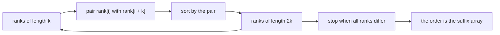
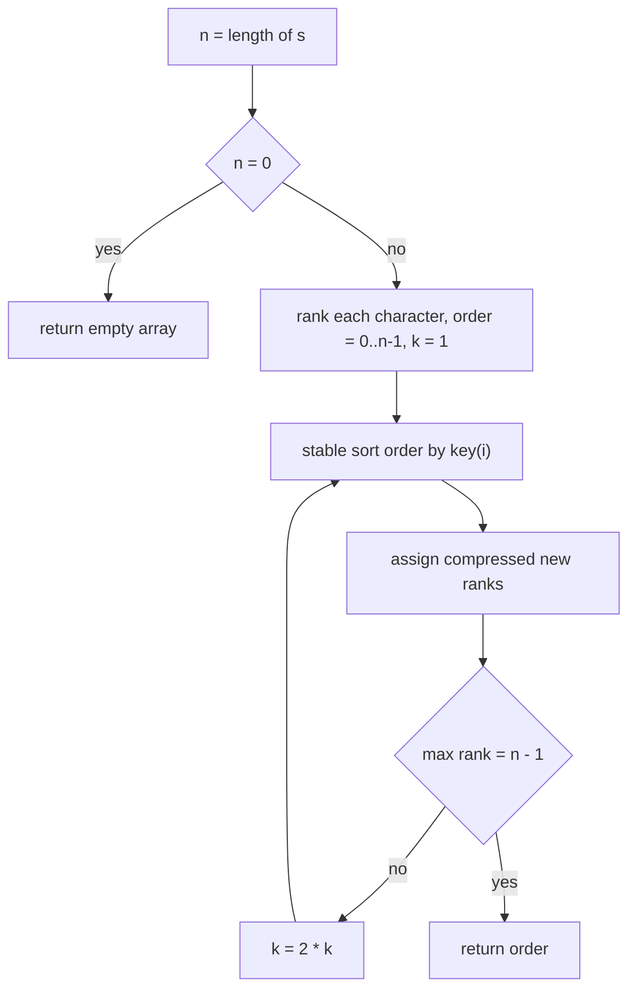
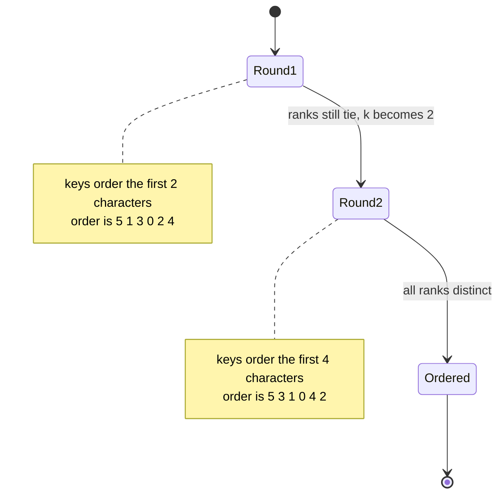

# 401 — Implement suffix array (SA-IS or doubling) for medium N.

> **Tier:** Advanced · **CTCI chapter:** Beyond — Advanced Data Structures & Algorithms
> **Task spec:** [401-implement-suffix-array-sa-is-or-doubling-for-medium-n.md](../../../tasks/advanced/401-implement-suffix-array-sa-is-or-doubling-for-medium-n.md)
> **Solutions:** [Python](../../../solutions/python/advanced/401-implement-suffix-array-sa-is-or-doubling-for-medium-n/solution.py) ·
> [Java](../../../solutions/java/advanced/401-implement-suffix-array-sa-is-or-doubling-for-medium-n/Solution.java) ·
> [JavaScript](../../../solutions/javascript/advanced/401-implement-suffix-array-sa-is-or-doubling-for-medium-n/solution.js) ·
> [C#](../../../solutions/csharp/advanced/401-implement-suffix-array-sa-is-or-doubling-for-medium-n/Solution.cs)

## 1. Problem restatement

**Input:** a string `s` of `n` characters over a small alphabet (the tests use `"ab"`,
`"abc"` and the 26 lowercase letters). `n` is "medium": the solution files exercise 500
character strings, plus the degenerate shapes `"a" * 400` and `"abcab" * 100`.

**Output:** the *suffix array* — the array of all `n` start positions `0..n-1`, ordered by the
lexicographic order of the suffix that starts at each position.

The repository implements the **doubling** family of suffix-array construction (the header of
every solution file names it `SuffixArrayDoubling`); SA-IS is the alternative the task title
allows but is not what the shipped code does. One convention decision matters everywhere:

> **No sentinel is appended.** A position past the end of the string ranks *below* every
> character, which the implementations spell `-1` when they rank a suffix by a pair. That rule
> resolves the case "one suffix is a prefix of the other" correctly, because the shorter
> suffix must win.

| Call | Result | Why |
| --- | --- | --- |
| `suffix_array_doubling("banana")` | `[5, 3, 1, 0, 4, 2]` | `a < ana < anana < banana < na < nana` |
| `suffix_array_doubling("mississippi")` | `[10, 7, 4, 1, 0, 9, 8, 6, 3, 5, 2]` | the classic 11-suffix order |
| `suffix_array_doubling("aaaa")` | `[3, 2, 1, 0]` | shortest suffix first |
| `suffix_array_doubling("abab")` | `[2, 0, 3, 1]` | `ab < abab < b < bab` |
| `suffix_array_doubling("")` | `[]` | no suffixes at all |
| `suffix_array_doubling("a")` | `[0]` | one suffix, one position |

Correctness is pinned by **two independent oracles** in each solution file:

1. `suffix_array_naive(s)` — `sorted(range(n), key=lambda i: s[i:])`, i.e. materialise every
   suffix and let the language sort them. Too slow for medium N, perfect as a reference.
2. `is_valid_suffix_array(s, order)` — a hand-written character-by-character comparator
   (`compare_suffixes`) that checks `order` is a permutation of `0..n-1` and that every
   adjacent pair in it is strictly increasing. The manual comparator is deliberately not the
   library `<` on sliced strings, so a bug in the doubling loop cannot hide behind the same
   library code in the oracle.

The medium-N block of each `main` runs both oracles on 500-character LCG strings over `"ab"`
and over the 26-letter alphabet, on `"a" * 400`, and on `"abcab" * 100`, so the doubling loop
really does several rounds instead of exiting after the first one.

## 2. Intuition

The naive idea is to sort the start positions with a comparator that walks characters:

```text
procedure suffix_array_naive(s)
  order ← [0, 1, ..., n - 1]
  sort order with the rule "compare s[i:] and s[j:] character by character"
  return order
end
```

Comparing two suffixes costs up to `O(n)` characters and there are `O(n log n)` comparisons in
a comparison sort, so the naive route is `O(n² log n)` time — and materialising the suffixes
the way `suffix_array_naive` does also costs `O(n²)` memory. For 500 characters that is still
fine, but the whole point of a suffix array is to avoid it.

**Key insight.** Fix a position `i` and a power of two `k`. The first `2k` characters of the
suffix at `i` are the first `k` characters of the suffix at `i` followed by the first `k`
characters of the suffix at `i + k`. So if you already know the *rank* of the first `k`
characters of every suffix — a number in `0..n-1` that orders those prefixes — then the order
of the first `2k` characters of every suffix is just the lexicographic order of the **pair**

```text
(rank[i], rank[i + k])          with rank[i + k] = -1 when i + k ≥ n
```

Sorting by that pair is enough to compute the rank of length `2k`, and then `k` doubles. After
`⌈log2 n⌉` rounds every suffix is distinguished by its full length, so the order *is* the
suffix array. The `-1` is the missing sentinel: a suffix that runs off the end is treated as
smaller than any suffix that still has a character there, which is exactly the "shorter suffix
wins" rule.



Each round is a comparison sort of `n` keys, and there are `log2 n` rounds.

## 3. Algorithm

1. If `s` is empty, return `[]` — there is nothing to order.
2. Start with `order = [0, 1, ..., n - 1]` and `rank[i] = code(s[i])`, the alphabet order of
   single characters. Set `k = 1`.
3. Sort `order` by the key `(rank[i], rank[i + k])`, where the second component is `-1` when
   `i + k >= n`. The sort must be *stable* so that suffixes whose keys are equal keep their
   previous relative order — that keeps the result deterministic.
4. Walk the sorted `order` and assign new ranks: the first entry gets `0`, and every later
   entry gets the previous rank plus `1` if its key differs from the previous key, or the same
   rank if the keys are equal. This is the standard "compress the sorted keys" step.
5. If the largest new rank is `n - 1`, all suffixes are already distinguished — return `order`.
   Otherwise double `k` and go back to step 3.
6. Termination is guaranteed: once `k >= n`, the key `(rank[i], -1)` or `(rank[i], rank[j])`
   separates every pair, so the ranks become `n` distinct values in at most `⌈log2 n⌉ + 1`
   rounds.

```text
procedure suffix_array_doubling(s)
  n ← length(s)
  if n = 0 then return empty array
  order ← [0, 1, ..., n - 1]
  for i ← 0 to n - 1 do
    rank[i] ← code of character s[i]
  end
  k ← 1
  while true do
    key(i) ← (rank[i], rank[i + k] if i + k < n else -1)
    stable sort order by key
    new_rank[order[0]] ← 0
    for idx ← 1 to n - 1 do
      prev ← order[idx - 1]
      cur ← order[idx]
      if key(prev) = key(cur) then
        new_rank[cur] ← new_rank[prev]
      else
        new_rank[cur] ← new_rank[prev] + 1
      end
    end
    rank ← new_rank
    if rank[order[n - 1]] = n - 1 then return order
    k ← 2 * k
  end
end
```

The loop body is the whole algorithm; the only subtlety is that the termination test reads the
rank of the *last* element of the sorted order, because ranks are assigned in increasing order
along `order`, so the last entry holds the maximum rank.



## 4. Worked example

Trace `suffix_array_doubling("banana")`, `n = 6`, characters `b a n a n a` with codes
`98 97 110 97 110 97`.

**Round `k = 1`.** Keys are `(rank[i], rank[i + 1])`, with `-1` for index `6`:

| `i` | 0 | 1 | 2 | 3 | 4 | 5 |
| --- | --- | --- | --- | --- | --- | --- |
| `rank[i]` | 98 | 97 | 110 | 97 | 110 | 97 |
| key `(rank[i], rank[i + 1])` | `(98, 97)` | `(97, 110)` | `(110, 97)` | `(97, 110)` | `(110, 97)` | `(97, -1)` |

Sorting those six keys gives `order = [5, 1, 3, 0, 2, 4]` — note that `5` comes *first*, even
though it appears last in the string, because `(97, -1)` beats `(97, 110)`: the one-character
suffix `"a"` is smaller than `"an"`. Compressing the keys gives the new ranks
`rank = [2, 1, 3, 1, 3, 0]`: positions `1` and `3` share rank `1` (`"an"` twice) and positions
`2` and `4` share rank `3` (`"na"` twice). The maximum rank is `3`, not `5`, so the loop
continues with `k = 2`.

**Round `k = 2`.** Keys are `(rank[i], rank[i + 2])`, now reading ranks of length 2:

| `i` | 0 | 1 | 2 | 3 | 4 | 5 |
| --- | --- | --- | --- | --- | --- | --- |
| `rank[i]` | 2 | 1 | 3 | 1 | 3 | 0 |
| `rank[i + 2]` | 3 | 1 | 3 | 0 | -1 | -1 |
| key | `(2, 3)` | `(1, 1)` | `(3, 3)` | `(1, 0)` | `(3, -1)` | `(0, -1)` |

The sorted keys are `(0,-1)`, `(1,0)`, `(1,1)`, `(2,3)`, `(3,-1)`, `(3,3)` from positions
`5, 3, 1, 0, 4, 2`, so `order = [5, 3, 1, 0, 4, 2]` and all six ranks are distinct
(`rank = [3, 2, 5, 1, 4, 0]`). The maximum rank `5 = n - 1`, so the loop returns `order`.
Two rounds were enough for `n = 6` because the keys already cover `2` then `4` then in effect
`8` characters.

Each round names the suffixes it can already separate, which is a useful way to picture the
doubling:



The final order `[5, 3, 1, 0, 4, 2]` reads as `a`, `ana`, `anana`, `banana`, `na`, `nana`,
which is the sorted suffix list the naive oracle produces.

## 5. Complexity

Let `n` be the length of `s`, and let `σ` be the alphabet size.

| Measure | Bound | Why it holds |
| --- | --- | --- |
| Time, best | `O(n log² n)` | the loop always runs at least one round; a string with all distinct characters leaves ties only when `k` is large, which already costs the first sort |
| Time, average | `O(n log² n)` | `⌈log2 n⌉` rounds × a comparison sort of `n` two-integer keys (`O(n log n)` each) |
| Time, worst | `O(n log² n)` | same product; the number of rounds is bounded by `⌈log2 n⌉ + 1` because each round doubles how many characters the key covers |
| Time with radix passes | `O(n log n)` | the file header notes the counting-sort variant: two linear radix passes per round instead of the comparison sort |
| Space | `O(n)` | the `order` array, the `rank` array, the `new_rank` array, and the `key` tuples are all linear |
| Time of the naive route | `O(n² log n)` | `O(n log n)` comparisons × `O(n)` characters per comparison |
| Space of the naive route | `O(n²)` | every suffix is materialised before the sort |

The `log²` factor is the whole reason SA-IS exists: a linear-time recursion on character types
removes the per-round sort, at the price of a much longer implementation. The shipped code
trades that constant for a 20-line loop.

## 6. Pitfalls and edge cases

- **Empty string.** `n = 0` and the answer is `[]`. All four solutions assert this before the
  loop, because `order[-1]` on an empty array would be an error in Python and an
  out-of-bounds read in Java, C# and JavaScript.
- **Single character.** `"a"` gives `[0]`; the first sort already leaves more than one rank
  only if `n > 1`, so the loop exits after one round.
- **All-equal strings.** `"aaaa"` starts with one shared rank, but the keys `(97, 97)` and
  `(97, -1)` split it immediately and the ranks become distinct after `log2` rounds. The
  strings become **shorter first**, so the answer is `[3, 2, 1, 0]`.
- **The `-1` must be below every character code.** All four solutions use `-1`, which is safe
  because character codes are non-negative in every language here. A sentinel that ties with a
  real character code would leave suffixes indistinguishable.
- **Stability of the sort.** When two keys are equal the previous relative order must survive
  the sort, otherwise the "compress equal keys" step would assign different ranks to equal
  keys and the loop would never terminate on strings such as `"aaaa"`. `sorted` in Python,
  `Arrays.sort` on boxed keys, `Array.prototype.sort` in JavaScript and `OrderBy` in C# are all
  stable; a raw `int[]` sort in Java would not be.
- **Comparing tuples, not characters.** A portable implementation must compare the pair
  element-wise and treat the missing second component as `-1`. Comparing `rank[i]` alone is the
  classic first-round bug that makes `"abab"` come out as `[0, 2, 1, 3]`.
- **Loop guard.** The termination test is `rank[order[n - 1]] == n - 1`, i.e. "the maximum rank
  equals `n - 1`". Testing `k >= n` instead is wrong: it exits early for strings like
  `"abracadabra"`, where the ranks are already distinct long before `k` reaches `n`.
- **Unicode.** `ord(c)` in Python and `codePointAt` in JavaScript iterate code points;
  `charAt` in Java and `s[i]` in C# return UTF-16 units, so an astral character participates in
  the order as two units. For the lowercase LCG test strings the two readings coincide.
- **Medium-N cost.** At `n = 500` the naive oracle materialises a 500-character string per
  suffix — about 125 KB of characters — which is exactly the overhead the doubling loop avoids.

## 7. Variants and follow-ups

- **Linear-time construction.** SA-IS (induced sorting by S/L character types) reaches `O(n)`
  time and is the standard choice for whole-genome work. The interface is unchanged, so the two
  oracles in the solution files would validate it as-is.
- **Rank → LCP.** The next task, [402 — Build the LCP array from the suffix array (Kasai)](../../../tasks/advanced/402-build-lcp-array-from-suffix-array-kasai.md),
  turns the suffix array into the extra information most queries actually need. The Kasai scan
  is `O(n)` precisely because it walks suffixes in *text* order, not suffix-array order.
- **Querying with the suffix array.** [403 — Use suffix array + LCP for the longest repeated substring](../../../tasks/advanced/403-use-suffix-array-lcp-for-longest-repeated-substring.md)
  reads the maximum of the LCP array, and [408 — Pattern matching with a suffix tree (outline)](../../../tasks/advanced/408-pattern-matching-with-suffix-tree-outline.md)
  binary-searches the interval of suffixes sharing a pattern prefix.
- **Many strings at once.** [407 — Implement a generalized suffix array for multiple strings](../../../tasks/advanced/407-implement-generalized-suffix-array-for-multiple-strings.md)
  concatenates the inputs with distinct sentinels, which is the cheapest correct extension of
  the "no sentinel" convention used here.
- **The same order, different objects.** The suffix automaton in
  [404 — Implement a suffix automaton and count different substrings](../../../tasks/advanced/404-implement-suffix-automaton-and-count-different-substrings.md)
  and the FM-index in
  [410 — FM-index: basic concept and small demo](../../../tasks/advanced/410-fm-index-basic-concept-and-small-demo.md)
  answer overlapping questions with other representations; all three appear side by side in
  [Advanced topics](../../ctci/x-advanced-topics.md).

## 8. Check yourself

1. Why does the doubling loop need `-1` as the second rank component instead of `0`?

<details><summary>Show answer</summary>

Because `0` is a legal rank: it belongs to the smallest suffix already seen. Using `0` would
claim that a suffix which ends at position `n` continues with the smallest possible character,
so `"a"` would compare greater than or equal to `"an"` and `"ana"` would sort after `"anana"`.
The value `-1` is below every character code, so the shorter suffix always wins — the same
decision a real sentinel would encode.

</details>

2. How many rounds does `suffix_array_doubling("banana")` execute, and how many would
   `"mississippi"` need?

<details>
<summary>Show answer</summary>

`"banana"` needs two rounds: `k = 1` leaves the ties (`an` twice, `na` twice) and `k = 2`
separates every suffix, because the keys then cover four characters and `n = 6`. `"mississippi"`
has `n = 11`, so the keys need to cover 11 characters: rounds with `k = 1, 2, 4, 8` — four
rounds — before all 11 ranks are distinct. Each round doubles the covered prefix length.

</details>

3. What breaks if the per-round sort is not stable?

<details><summary>Show answer</summary>

Equal keys can be reordered arbitrarily. The "compress equal keys" step assumes that equal keys
end up adjacent and in an order consistent with the previous round; if a stable order is lost,
two suffixes with equal keys can receive different ranks, and the rank of the last entry may
never reach `n - 1`. On `"aaaa"` that means the loop keeps running past `k = n` instead of
finishing after `log2 n` rounds.

</details>

4. The naive oracle is `O(n²)` extra space. Why is that acceptable here?

<details><summary>Show answer</summary>

It is only used as a *test* oracle on strings up to 500 characters (about 125 KB of temporary
characters), where the cost is irrelevant. The shipped algorithm is the doubling loop, which is
`O(n)` space; the naive version would never be used inside an application.

</details>
