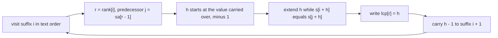
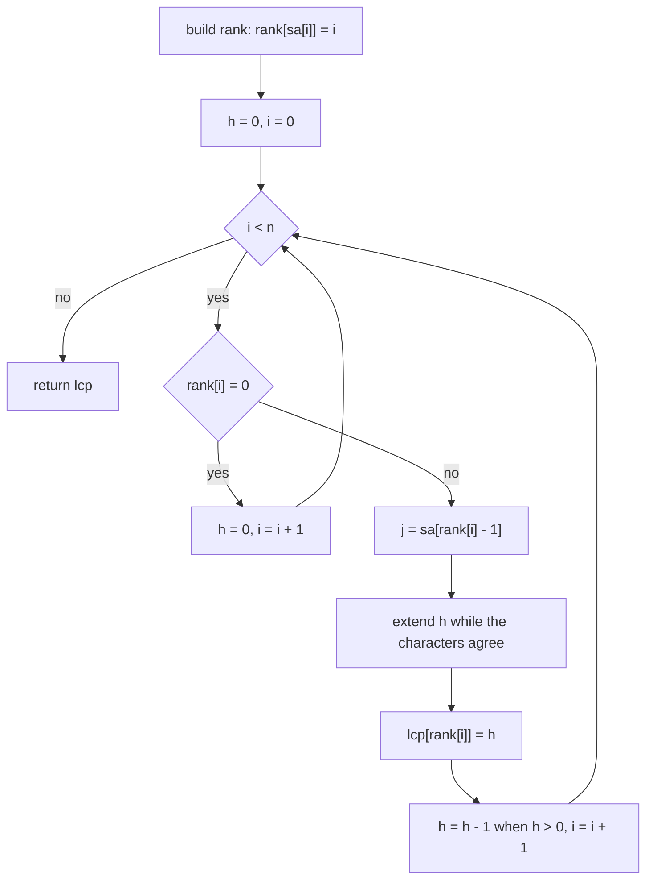
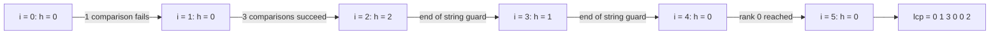

# 402 — Build the LCP array from the suffix array (Kasai).

> **Tier:** Advanced · **CTCI chapter:** Beyond — Advanced Data Structures & Algorithms
> **Task spec:** [402-build-lcp-array-from-suffix-array-kasai.md](../../../tasks/advanced/402-build-lcp-array-from-suffix-array-kasai.md)
> **Solutions:** [Python](../../../solutions/python/advanced/402-build-lcp-array-from-suffix-array-kasai/solution.py) ·
> [Java](../../../solutions/java/advanced/402-build-lcp-array-from-suffix-array-kasai/Solution.java) ·
> [JavaScript](../../../solutions/javascript/advanced/402-build-lcp-array-from-suffix-array-kasai/solution.js) ·
> [C#](../../../solutions/csharp/advanced/402-build-lcp-array-from-suffix-array-kasai/Solution.cs)

## 1. Problem restatement

**Input:** a text `s` of length `n` together with its suffix array `sa`, the permutation of
`0..n-1` that lists the suffixes of `s` in lexicographic order (see
[401 — Implement suffix array (SA-IS or doubling)](../../../tasks/advanced/401-implement-suffix-array-sa-is-or-doubling-for-medium-n.md)).

**Output:** the **LCP array** `lcp` of length `n`, where

```text
lcp[i] = length of the longest common prefix of the suffixes starting at sa[i - 1] and sa[i]
lcp[0] = 0                                        (the first suffix has no predecessor)
```

Both the definition and the `lcp[0] = 0` anchor come straight from the solution headers:
`lcp[i]` is the LCP of *adjacent* suffix-array entries, and the first entry is given the value
`0` by convention.

| Call | Result | Note |
| --- | --- | --- |
| `kasai_lcp("banana", [5, 3, 1, 0, 4, 2])` | `[0, 1, 3, 0, 0, 2]` | `a/ana = 1`, `ana/anana = 3`, `na/nana = 2` |
| `kasai_lcp("mississippi", [10, 7, 4, 1, 0, 9, 8, 6, 3, 5, 2])` | `[0, 1, 1, 4, 0, 0, 1, 0, 2, 1, 3]` | the 11-suffix anchor |
| `kasai_lcp("aaaa", [3, 2, 1, 0])` | `[0, 1, 2, 3]` | nested suffixes, every prefix shared |
| `kasai_lcp("abab", [2, 0, 3, 1])` | `[0, 2, 0, 1]` | `ab/abab = 2` |
| `kasai_lcp("", [])` | `[]` | zero length |
| `kasai_lcp("a", [0])` | `[0]` | one suffix, no predecessor |

Every solution file cross-checks the result against a **char-by-char oracle**:
`naive_lcp_array` builds `[0] + [pair_lcp(s, sa[i-1], sa[i]) ...]` by comparing characters the
slow way, and additionally asserts the classic counting identity

```text
number of distinct substrings of s = n(n+1)/2 - sum(lcp)
```

which the file verifies against a brute-force set of substrings (`15` for `"banana"`, and the
same identity on 40 LCG strings per alphabet over `"ab"` and `"abc"`, plus one 400-character
medium string). The identity is what makes the LCP array useful beyond pattern matching: it
counts how many substrings the sorted suffixes share.

## 2. Intuition

The naive idea is to answer each of the `n - 1` adjacent pairs independently by comparing
characters until they differ:

```text
procedure naive_lcp_array(s, sa)
  lcp[0] ← 0
  for i ← 1 to n - 1 do
    h ← 0
    while sa[i - 1] + h < n and sa[i] + h < n and s[sa[i - 1] + h] = s[sa[i] + h] do
      h ← h + 1
    end
    lcp[i] ← h
  end
  return lcp
end
```

That is `O(n²)` on strings such as `"aaaa"`, where one pair shares `n - 1` characters, and the
same characters get re-compared for every pair. Kasai's observation removes the repetition:

> If suffix `i` shares `h` characters with its suffix-array predecessor, then suffix `i + 1`
> shares **at least `h - 1`** characters with *its* predecessor.

The reason is a suffix relation: the predecessor of suffix `i + 1` is the suffix that follows
the predecessor of suffix `i`, and dropping the first character of a common prefix of length
`h` leaves a common prefix of length `h - 1`. So instead of restarting every comparison from
`0`, the scan carries `h` over, decrements it by one, and only ever *adds* characters that
genuinely match. Every character comparison that succeeds increments `h` by one, and `h` is
decremented at most `n` times over the whole run — so the total number of successful
comparisons is `O(n)`.

The order in which suffixes are visited is the point of the algorithm: **text order**
`i = 0, 1, ..., n - 1`, not suffix-array order. That is why `rank[]` is built first.



Each successful comparison is charged to a single increment of `h`, and `h` can only rise `n`
times in total.

## 3. Algorithm

1. Compute the inverse permutation `rank[]`: `rank[sa[i]] = i`, i.e. the position of suffix `i`
   in the sorted order.
2. Allocate `lcp` of length `n` and start the carried value at `h = 0`.
3. For `i = 0 .. n - 1` in text order:
   - let `r = rank[i]`. If `r == 0` the suffix is the first in sorted order and has no
     predecessor: reset `h = 0` and continue.
   - let `j = sa[r - 1]`, the start of the previous suffix in sorted order.
   - extend `h` while `i + h < n`, `j + h < n` and `s[i + h] == s[j + h]`.
   - write `lcp[r] = h`, then decrement `h` if it is positive (the carry-over rule).
4. Return `lcp`. Because the loop visits every `i` exactly once and writes `lcp[rank[i]]`, all
   `n` entries are filled; entries whose `rank` is `0` keep the initial `0`.

```text
procedure kasai_lcp(s, sa)
  n ← length(s)
  lcp ← array of n zeros
  for i ← 0 to n - 1 do
    rank[sa[i]] ← i
  end
  h ← 0
  for i ← 0 to n - 1 do
    r ← rank[i]
    if r = 0 then
      h ← 0
      continue
    end
    j ← sa[r - 1]
    while i + h < n and j + h < n and s[i + h] = s[j + h] do
      h ← h + 1
    end
    lcp[r] ← h
    if h > 0 then
      h ← h - 1
    end
  end
  return lcp
end
```

Two guards are load-bearing: `i + h < n` and `j + h < n` stop the walk at the end of the
string, which is how a suffix that is a prefix of another one gets an LCP equal to its own
remaining length rather than running past the buffer.



## 4. Worked example

Trace `kasai_lcp("banana", [5, 3, 1, 0, 4, 2])`. First the inverse permutation:

| `sa[i]` | 5 | 3 | 1 | 0 | 4 | 2 |
| --- | --- | --- | --- | --- | --- | --- |
| `rank[sa[i]] = i` | `rank[5] = 0` | `rank[3] = 1` | `rank[1] = 2` | `rank[0] = 3` | `rank[4] = 4` | `rank[2] = 5` |

So the suffixes in sorted order are `5:"a"`, `3:"ana"`, `1:"anana"`, `0:"banana"`, `4:"na"`,
`2:"nana"`. Now walk `i` in text order:

| Step | `i` | `r = rank[i]` | `j = sa[r - 1]` | `h` at entry | comparisons | `lcp[r]` written | `h` at exit |
| --- | --- | --- | --- | --- | --- | --- | --- |
| 1 | 0 | 3 | 1 | 0 | `s[0]='b'` vs `s[1]='a'` fails | `lcp[3] = 0` | 0 |
| 2 | 1 | 2 | 3 | 0 | `a=a`, `n=n`, `a=a`, then `s[4]='n'` vs end | `lcp[2] = 3` | 2 |
| 3 | 2 | 5 | 4 | 2 | carry-over alone satisfies `i + 2 = 4`, but `j + 2 = 6` is the end | `lcp[5] = 2` | 1 |
| 4 | 3 | 1 | 5 | 1 | carry-over alone: `j + 1 = 6` is the end | `lcp[1] = 1` | 0 |
| 5 | 4 | 4 | 0 | 0 | `s[4]='n'` vs `s[0]='b'` fails | `lcp[4] = 0` | 0 |
| 6 | 5 | 0 | — | 0 | no predecessor: reset | not written | 0 |

The result is `lcp = [0, 1, 3, 0, 0, 2]`, which matches the hand anchor: `lcp[1] = 1` for
`"a"`/`"ana"`, `lcp[2] = 3` for `"ana"`/`"anana"`, `lcp[5] = 2` for `"na"`/`"nana"`.

The amount of real work is striking: only **three** character comparisons succeeded during the
whole scan (step 2), and the remaining steps were decided by the carried value plus the
end-of-string guards. That is the amortisation in action — `sum(lcp) = 6`, yet the scan never
re-reads a character it already matched.

The carried value `h` is the state of the algorithm, and it only ever moves by increments and
one-step decrements:



## 5. Complexity

Let `n` be the length of `s`.

| Measure | Bound | Why it holds |
| --- | --- | --- |
| Time, best | `O(n)` | the loop always visits all `n` positions and fills `rank`, even when every LCP is `0` |
| Time, average | `O(n)` | successful comparisons equal the total growth of `h`, and `h` drops by at most one per position |
| Time, worst | `O(n)` | `h` starts at `0` and increases at most `n` times overall; the failing comparison per position is charged once |
| Space | `O(n)` | the `lcp` output plus the `rank` inverse permutation; nothing else is allocated |
| Time of the naive pairwise scan | `O(n²)` | each of the `n - 1` pairs may compare `O(n)` characters from scratch |
| Space of the naive scan | `O(n)` | it also produces only the array, but pays quadratic time |

The comparison-sort cost of building the suffix array in the first place (`O(n log² n)` in
[401](../../../tasks/advanced/401-implement-suffix-array-sa-is-or-doubling-for-medium-n.md)) is
not part of this task; Kasai is the cheap `O(n)` step that turns that order into something
queryable.

## 6. Pitfalls and edge cases

- **`lcp[0] = 0` is a convention, not a computation.** The first suffix has no predecessor. All
  four solutions initialise the array with zeros and never write index `0` (the `r == 0` branch
  skips it), and the tests assert `lcp[0] == 0` explicitly.
- **Empty string.** `n = 0`: the rank loop does nothing and `lcp` is `[]`. The assertion
  `kasai_lcp("", []) == []` pins it down; returning `[0]` would be a length bug.
- **Single character.** `kasai_lcp("a", [0]) == [0]`: `r = rank[0] = 0`, so the branch resets
  `h` and leaves the one entry at `0`.
- **The `r == 0` reset matters.** Without setting `h = 0` there, the carried value from the
  previous iteration would be reused for a suffix that has no predecessor, and the next
  iteration would start from a stale `h`.
- **The rank array must be the inverse of `sa`.** `rank[sa[i]] = i`, not `rank[i] = sa[i]`.
  Swapping the two turns the algorithm into a comparison of unrelated suffixes and produces
  values that the naive oracle rejects.
- **End-of-string guards.** `i + h < n` and `j + h < n` are both needed. In `"banana"` the
  guard fires twice (steps 3 and 4 above); removing it reads past the end and, in languages
  with unchecked indexing, silently returns garbage.
- **Nested suffixes.** For `"aaaa"` the LCP array is `[0, 1, 2, 3]`: the LCP is limited by the
  shorter of the two suffixes, so it can never exceed `n - sa[i]`.
- **Overlapping counts.** The identity `distinct substrings = n(n+1)/2 - sum(lcp)` holds only
  for a *correct* suffix array; the solution files assert it against a brute-force set on 40
  LCG strings per alphabet, which is how a subtly wrong `lcp` gets caught.
- **Sum overflow in fixed-width languages.** `n(n+1)/2` for `n = 400` fits comfortably in a
  `long`/`int64`, but the same expression on a very large text must be widened before the
  multiplication, not after.

## 7. Variants and follow-ups

- **Longest repeated substring.** [403 — Use suffix array + LCP for the longest repeated substring](../../../tasks/advanced/403-use-suffix-array-lcp-for-longest-repeated-substring.md)
  is a one-line read of `max(lcp)`: two occurrences of the same substring are adjacent in the
  suffix array *somewhere*, and the deepest such adjacency is the maximum LCP.
- **Distinct substring counting.** The same array answers "how many distinct substrings" as
  `n(n+1)/2 - sum(lcp)`, which the tests here use as an independent cross-check. The suffix
  automaton in [404](../../../tasks/advanced/404-implement-suffix-automaton-and-count-different-substrings.md)
  computes the identical number from a different structure, and the two are asserted equal.
- **Generalized LCP.** [407 — Implement a generalized suffix array for multiple strings](../../../tasks/advanced/407-implement-generalized-suffix-array-for-multiple-strings.md)
  concatenates several strings with distinct sentinels; Kasai's scan works unchanged on the
  concatenation, and the sentinels keep cross-string LCPs from leaking.
- **LCP intervals = suffix tree nodes.** [408 — Pattern matching with a suffix tree (outline)](../../../tasks/advanced/408-pattern-matching-with-suffix-tree-outline.md)
  uses `min(lcp[lo+1 .. hi-1]) >= len(pattern)` as the tree-locus check for a pattern interval,
  which is the array form of "this node's path label".
- **Where it is used in practice.** FM-indexes
  ([410](../../../tasks/advanced/410-fm-index-basic-concept-and-small-demo.md)) and compressed
  text indexes drop the LCP array entirely, but every Burrows–Wheeler-based tool still needs a
  suffix-array-like order to build; see [Advanced topics](../../ctci/x-advanced-topics.md).

## 8. Check yourself

1. Why does Kasai's scan visit suffixes in text order instead of suffix-array order?

<details><summary>Show answer</summary>

The carry-over lemma relates suffix `i + 1` to the *next* suffix in the text, because dropping
the first character of suffix `i` gives suffix `i + 1`. Its predecessor in sorted order is then
known from the predecessor of suffix `i`, which is why the `h - 1` bound applies. Visiting in
suffix-array order breaks that neighbour relation and the bound with it.

</details>

2. What is the total number of *successful* character comparisons on `"banana"` above, and how
   does that compare with `sum(lcp)`?

<details><summary>Show answer</summary>

Three successes, all during the step `i = 1` (`lcp[2] = 3`). `sum(lcp) = 0 + 1 + 3 + 0 + 0 + 2
= 6`, but four of those characters were paid for by carry-over rather than by new comparisons.
The difference is exactly what makes the algorithm linear instead of quadratic.

</details>

3. `lcp[i] = 0` for two adjacent suffixes means what, and how many distinct substrings does
   that adjacency contribute?

<details><summary>Show answer</summary>

It means the two suffixes start with different characters — they share no prefix at all. Such
an adjacency contributes nothing to `sum(lcp)`, so it "uses up" no shared substring in the
counting identity `n(n+1)/2 - sum(lcp)`.

</details>

4. If the suffix array is wrong but self-consistent for the test anchors, can this task's
   assertions still catch it?

<details><summary>Show answer</summary>

Yes, in two ways: `naive_lcp_array` recomputes every entry by comparing characters directly, so
a wrong order produces a different array; and the identity against `distinct_substrings_brute`
uses an unrelated brute-force set of substrings, so even an order that happened to preserve the
LCP values would be caught by the substring count.

</details>
