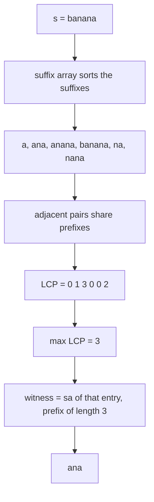
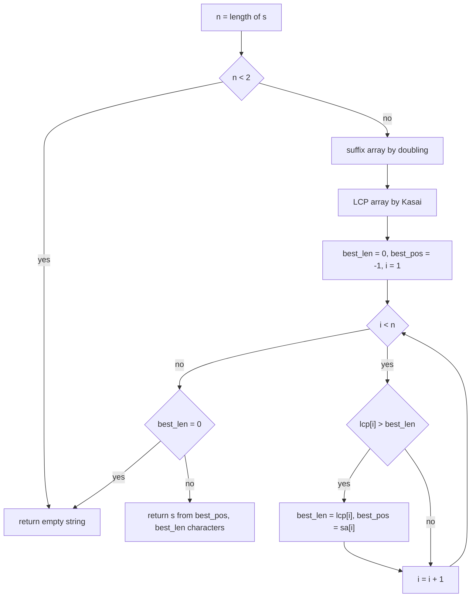
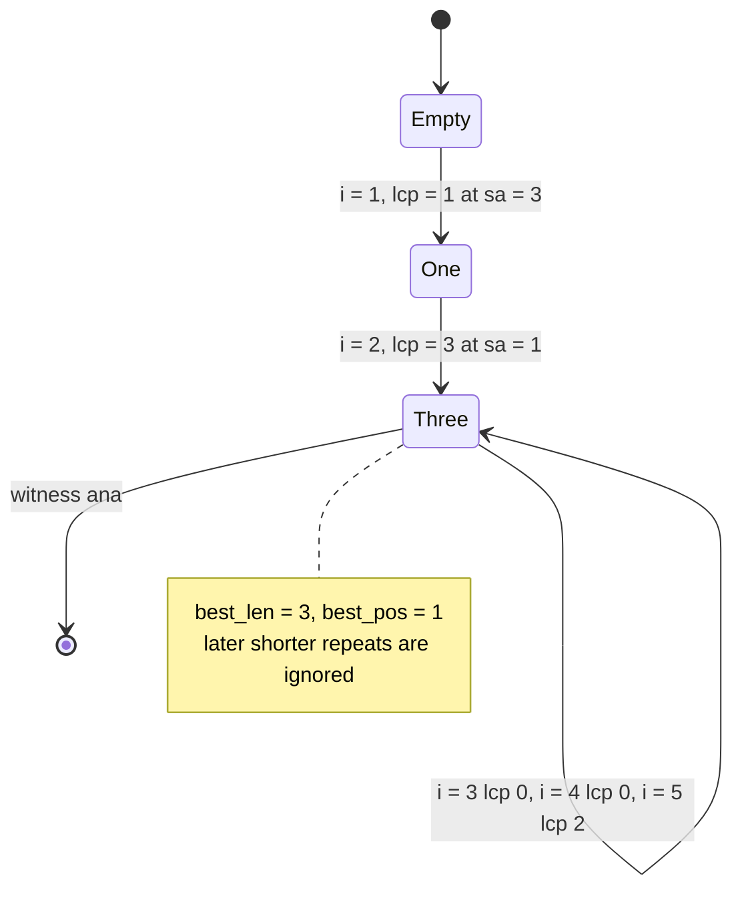

# 403 — Use suffix array + LCP for longest repeated substring.

> **Tier:** Advanced · **CTCI chapter:** Beyond — Advanced Data Structures & Algorithms
> **Task spec:** [403-use-suffix-array-lcp-for-longest-repeated-substring.md](../../../tasks/advanced/403-use-suffix-array-lcp-for-longest-repeated-substring.md)
> **Solutions:** [Python](../../../solutions/python/advanced/403-use-suffix-array-lcp-for-longest-repeated-substring/solution.py) ·
> [Java](../../../solutions/java/advanced/403-use-suffix-array-lcp-for-longest-repeated-substring/Solution.java) ·
> [JavaScript](../../../solutions/javascript/advanced/403-use-suffix-array-lcp-for-longest-repeated-substring/solution.js) ·
> [C#](../../../solutions/csharp/advanced/403-use-suffix-array-lcp-for-longest-repeated-substring/Solution.cs)

## 1. Problem restatement

**Input:** a string `s` of length `n`.

**Output:** one substring of `s` that occurs **at least twice**, of maximum length, or the empty
string when nothing repeats. The solution files document that sentinel explicitly:

> When no substring occurs twice (length `< 2`, or every substring unique, e.g. `"abc"`), the
> function returns `""` — documented here so callers can tell "no repeat" apart from a genuine
> one-character repeat only via the length.

| Call | Result | Occurrences |
| --- | --- | --- |
| `longest_repeated_substring("banana")` | `"ana"` | `2` |
| `longest_repeated_substring("mississippi")` | `"issi"` | `2` |
| `longest_repeated_substring("aaaa")` | `"aaa"` | `2` (overlapping) |
| `longest_repeated_substring("abab")` | `"ab"` | `2` |
| `longest_repeated_substring("abcabc")` | `"abc"` | `2` |
| `longest_repeated_substring("aabcaa")` | `"aa"` | `2` |
| `longest_repeated_substring("abracadabra")` | `"abra"` | `2` |
| `longest_repeated_substring("abc")` | `""` | none — every substring unique |
| `longest_repeated_substring("a")` | `""` | none |
| `longest_repeated_substring("")` | `""` | none |

The task builds on two earlier pieces: the suffix array
([401](../../../tasks/advanced/401-implement-suffix-array-sa-is-or-doubling-for-medium-n.md)) and
the Kasai LCP array
([402](../../../tasks/advanced/402-build-lcp-array-from-suffix-array-kasai.md)); the solution
files inline both (`suffix_array_doubling`, `kasai_lcp`) so the task is self-contained.

Two oracles pin the answer down: `longest_repeated_length_brute` counts every substring with a
dictionary and reports the largest length seen at least twice, and `count_occurrences` re-checks
that the returned witness really occurs at least twice. The tests compare the *length* against
the brute force on 40 LCG strings per alphabet (`"ab"`, `"abc"`), verify the witness repeats,
and demand `""` exactly when the brute-force length is `0`.

## 2. Intuition

The naive idea is to try every length from the longest down, or to count every substring:

```text
procedure longest_repeated_substring_brute(s)
  counts ← empty map
  for i ← 0 to n - 1 do
    for j ← i + 1 to n do
      counts[s[i:j]] ← counts[s[i:j]] + 1
    end
  end
  best ← ""
  for each substring t in counts do
    if counts[t] ≥ 2 and length(t) > length(best) then
      best ← t
    end
  end
  return best
end
```

There are `n(n+1)/2` substrings, so the oracle does `O(n²)` dictionary insertions of average
length `O(n)`: `O(n³)` character work and `O(n²)` distinct keys. That is exactly the shape
`longest_repeated_length_brute` has in the solution files — perfect for testing, hopeless as an
algorithm.

**Key insight.** Two occurrences of the same substring `t` are prefixes of two different
suffixes, and *any two suffixes that share a prefix of length `|t|` are adjacent somewhere in
the sorted suffix order*. Sorting groups equal prefixes together, so the deepest shared prefix
in the whole string is visible as the **maximum of the LCP array**:

```text
answer length = max(lcp)      and a witness starts at sa[i] for the first i with lcp[i] = max
```

The witness is the prefix of length `max(lcp)` of the suffix `sa[i]`: the "first `i` achieving
the maximum" rule is what the solution files implement, which also makes the answer
deterministic when two different repeats share the maximum length (`"abab"` and `"baba"` are
both length 2 in `"ababab"`, and the first index wins).



The insight converts a search over `O(n²)` substrings into a maximum over `n` numbers.

## 3. Algorithm

1. If `n < 2`, return `""` — a repeat needs at least two characters.
2. Build the suffix array of `s` with the doubling method.
3. Build the LCP array from that suffix array with Kasai's scan.
4. Scan `i` from `1` to `n - 1` (index `0` has no predecessor) and track the largest `lcp[i]`
   together with the start position `sa[i]` where it was first seen.
5. If the best length is `0`, return `""`; otherwise return `s[best_pos : best_pos + best_len]`.

```text
procedure longest_repeated_substring(s)
  n ← length(s)
  if n < 2 then return ""
  sa ← suffix_array_doubling(s)
  lcp ← kasai_lcp(s, sa)
  best_len ← 0
  best_pos ← -1
  for i ← 1 to n - 1 do
    if lcp[i] > best_len then
      best_len ← lcp[i]
      best_pos ← sa[i]
    end
  end
  if best_len = 0 then return ""
  return s[best_pos : best_pos + best_len]
end
```

The strict `>` in step 4 is the documented tie-break: the first entry reaching the maximum wins.
The witness is taken from `sa[i]` — the *later* of the two adjacent suffixes, which is the
standard choice and matches `count_occurrences("banana", "ana") == 2`.



## 4. Worked example

Trace `longest_repeated_substring("banana")`. The suffix array is `[5, 3, 1, 0, 4, 2]`, and
Kasai gives `lcp = [0, 1, 3, 0, 0, 2]`. The scan then does:

| Step | `i` | `lcp[i]` | `sa[i]` | suffix at `sa[i]` | comparison with `best_len` | `best_len` | `best_pos` |
| --- | --- | --- | --- | --- | --- | --- | --- |
| start | — | — | — | — | — | 0 | -1 |
| 1 | 1 | 1 | 3 | `ana` | `1 > 0` | 1 | 3 |
| 2 | 2 | 3 | 1 | `anana` | `3 > 1` | 3 | 1 |
| 3 | 3 | 0 | 0 | `banana` | `0 > 3` false | 3 | 1 |
| 4 | 4 | 0 | 4 | `na` | `0 > 3` false | 3 | 1 |
| 5 | 5 | 2 | 2 | `nana` | `2 > 3` false | 3 | 1 |

The loop ends with `best_len = 3`, `best_pos = 1`, so the answer is `s[1:4] = "ana"`. The check
`count_occurrences("banana", "ana") == 2` confirms it: `"banana"` contains `"ana"` at positions
`1` and `3`, and those are exactly the two suffixes `1:"anana"` and `3:"ana"` that produced
`lcp[2] = 3`.

Note that step 5 *rejects* a genuine repeat (`lcp[5] = 2` for `"na"`/`"nana"`) because it is
shorter than the incumbent — that is the max-search behaving correctly, not a miss.

For `"mississippi"` the same scan sees `lcp = [0, 1, 1, 4, 0, 0, 1, 0, 2, 1, 3]`; the maximum
`4` occurs at `i = 3` with `sa[3] = 1`, so the witness is `s[1:5] = "issi"`, which occurs twice.

The state of the scan is just the incumbent pair, and it only ever moves when a strictly longer
alternation appears:



## 5. Complexity

Let `n` be the length of `s`.

| Measure | Bound | Why it holds |
| --- | --- | --- |
| Time, best | `O(1)` | `n < 2` returns before any structure is built |
| Time, average | `O(n log² n)` | the doubling suffix array dominates; Kasai and the max scan are both linear |
| Time, worst | `O(n log² n)` | the doubling loop is the only superlinear step, and it does `⌈log2 n⌉` sorting rounds |
| Space | `O(n)` | suffix array, rank array, LCP array and the best-length pair |
| Time of the brute oracle | `O(n³)` | `O(n²)` substrings, each inserted at average cost `O(n)` for hashing and copying |
| Space of the brute oracle | `O(n²)` | the dictionary holds up to `n(n+1)/2` distinct keys |
| Time with a suffix automaton | `O(n)` | [404](../../../tasks/advanced/404-implement-suffix-automaton-and-count-different-substrings.md) answers the same question in linear time, at the price of a larger constant and a harder-to-debug structure |

If the linear-time radix variant of the doubling construction is used, the `log²` collapses to
`log` — the LCP scan here already runs in `O(n)`, as
[402](../../../tasks/advanced/402-build-lcp-array-from-suffix-array-kasai.md) explains.

## 6. Pitfalls and edge cases

- **"No repeat" is `""`, not a one-character string.** `"abc"` has `lcp = [0, 0, 0]`, so
  `best_len` stays `0` and the function returns `""`. The tests assert `""` for `""`, `"a"`,
  `"abc"` and `"abcd"`, and assert that the brute-force length is `0` for the same inputs.
- **Overlapping occurrences count as two.** `"aaaa"` returns `"aaa"`: the two occurrences share
  the middle two characters. A "non-overlapping only" reading of the problem would return
  `"aa"`, so this convention is worth stating out loud.
- **Ties are broken by the first index.** With `lcp[i] == best_len` the scan does nothing. Two
  distinct repeats of the same maximal length are both valid answers; the strict `>` makes the
  choice reproducible, which matters because the tests compare against a brute force that picks
  its own witness.
- **The witness is not guaranteed to be *the* longest distinct substring in the dictionary
  order of the oracle — only to have the same length.** The test loop therefore compares
  `len(result) == best`, then re-verifies the witness with `count_occurrences(s, result) >= 2`.
- **Empty input.** `len(s) < 2` covers both `""` and single characters; without that guard the
  suffix array is empty and `sa[0]` in the scan would be out of range.
- **`lcp[0]` is never a candidate.** Index `0` carries the convention value `0`, so the scan
  starts at `1`. Including index `0` would be harmless here but is wrong in general, since
  `lcp[0]` is not the LCP of any pair.
- **Medium inputs.** The tests run a 400-character LCG string and assert both that the witness
  repeats and that its length matches the quadratic oracle. The oracle is the slow part of the
  test suite, not of the solution.
- **Unicode.** `s[a:b]` slices code points in Python and JavaScript and UTF-16 units in Java
  and C#, so a witness that contains an astral character has a different *length* per language;
  the LCG alphabets used for the cross-checks avoid the issue.

## 7. Variants and follow-ups

- **Longest substring occurring `k` times.** Replace `max(lcp)` with a scan for a window of
  `k - 1` consecutive LCP entries whose minimum is largest — the LCP array plus a sliding
  minimum answers it.
- **Longest repeated substring across several strings.** [407 — Implement a generalized suffix
  array for multiple strings](../../../tasks/advanced/407-implement-generalized-suffix-array-for-multiple-strings.md)
  concatenates the inputs with distinct sentinels; requiring the two occurrences to come from
  *different* strings (checking the owner array) turns the same max scan into the longest common
  substring of a set.
- **Counting instead of finding.** `n(n+1)/2 - sum(lcp)` counts distinct substrings, which is
  the cross-check used in [402](../../../tasks/advanced/402-build-lcp-array-from-suffix-array-kasai.md)
  and re-derived independently in
  [404](../../../tasks/advanced/404-implement-suffix-automaton-and-count-different-substrings.md).
- **Locating occurrences.** Once a repeat is known, the pattern-range binary searches of
  [408 — Pattern matching with a suffix tree (outline)](../../../tasks/advanced/408-pattern-matching-with-suffix-tree-outline.md)
  and the FM-index of
  [410 — FM-index: basic concept and small demo](../../../tasks/advanced/410-fm-index-basic-concept-and-small-demo.md)
  enumerate all of its positions.
- **Hashing as an alternative.** A rolling hash plus a binary search on the answer length also
  finds the longest repeat in `O(n log n)` expected time, with the collision caveats discussed
  in [411 — Advanced rolling hash with modular and base tuning](../../../tasks/advanced/411-implement-advanced-rolling-hash-with-modular-and-base-tuning.md).

## 8. Check yourself

1. Why is the longest repeated substring always a common prefix of two *adjacent* suffixes in
   the suffix array?

<details><summary>Show answer</summary>

Two occurrences of the same substring `t` start two different suffixes that both begin with
`t`. In sorted order all suffixes beginning with `t` form one contiguous block, so the two
occurrences are inside that block, and the deepest common prefix inside a block is realised by
some adjacent pair. Hence the maximum LCP over the whole array equals the longest repeat.

</details>

2. `"aaaa"` returns `"aaa"`. What are the corresponding suffix-array and LCP entries?

<details><summary>Show answer</summary>

`sa = [3, 2, 1, 0]` with suffixes `"a"`, `"aa"`, `"aaa"`, `"aaaa"`, and `lcp = [0, 1, 2, 3]`.
The maximum is `lcp[3] = 3` with `sa[3] = 0`, so the witness is `s[0:3] = "aaa"`, which occurs
at positions `0` and `1`.

</details>

3. The scan uses strict `>` when comparing `lcp[i]` with `best_len`. What would change with
   `>=`?

<details><summary>Show answer</summary>

The length would be identical, but the witness could differ: the last index achieving the
maximum would win instead of the first. For `"ababab"`, where both `"abab"` and `"baba"` are
maximal repeats, the two rules return different but equally valid strings. The solution files
document the first-index rule so the output is deterministic.

</details>

4. When does this task return `""` even though `lcp` contains a positive value?

<details><summary>Show answer</summary>

Never: `best_len` is exactly `max(lcp)`, and a positive `max(lcp)` means two adjacent suffixes
share at least the first character, i.e. a repeated substring exists. The `""` return happens
only when the whole LCP array is `0`, which is precisely the "every substring unique" case.

</details>
