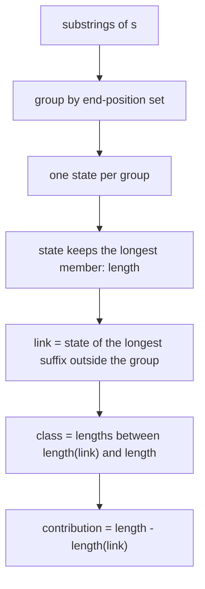
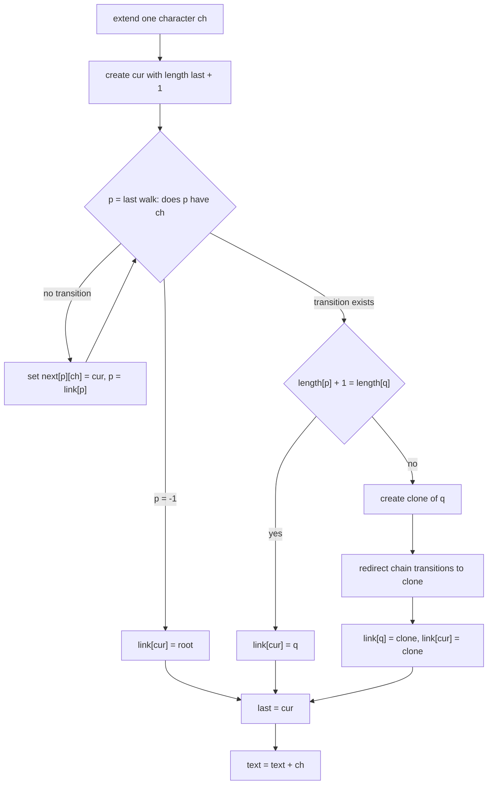
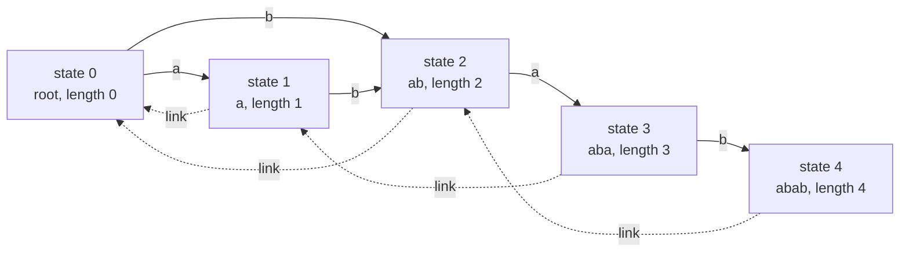
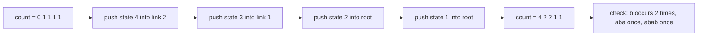

# 404 — Implement a suffix automaton and count different substrings.

> **Tier:** Advanced · **CTCI chapter:** Beyond — Advanced Data Structures & Algorithms
> **Task spec:** [404-implement-suffix-automaton-and-count-different-substrings.md](../../../tasks/advanced/404-implement-suffix-automaton-and-count-different-substrings.md)
> **Solutions:** [Python](../../../solutions/python/advanced/404-implement-suffix-automaton-and-count-different-substrings/solution.py) ·
> [Java](../../../solutions/java/advanced/404-implement-suffix-automaton-and-count-different-substrings/Solution.java) ·
> [JavaScript](../../../solutions/javascript/advanced/404-implement-suffix-automaton-and-count-different-substrings/solution.js) ·
> [C#](../../../solutions/csharp/advanced/404-implement-suffix-automaton-and-count-different-substrings/Solution.cs)

## 1. Problem restatement

**Input:** a string `s` of length `n`.

**Output:** a *suffix automaton* for `s` — the minimal DFA that recognizes exactly the substrings
of `s` — with three questions answered from it, matching the methods in the solution files:

| Method | Meaning | `"abab"` |
| --- | --- | --- |
| `distinct_substrings()` | number of different substrings of `s` | `7` |
| `contains(t)` | is `t` a substring of `s`? | `contains("aba")` is `True`, `contains("baba")` is `False` |
| `occurrence_count(t)` | how many times `t` occurs in `s` (end-position count) | `occurrence_count("a") == 2` |

The file header states the model precisely:

> A suffix automaton is the minimal DFA recognizing all substrings of `s`. Each state stands for
> an equivalence class of substrings sharing the same end-position set, with `length` the
> longest member of the class and `link` the state for the longest proper suffix outside it.
> Every substring in the class is a suffix of the state's longest string with length in
> `(length(link), length]`, so the class contributes exactly `length - length(link)` distinct
> substrings and the total is `sum over states except the initial one`.

| Call | Result |
| --- | --- |
| `build_suffix_automaton("abab").distinct_substrings()` | `7` |
| `build_suffix_automaton("aaaa").distinct_substrings()` | `4` |
| `build_suffix_automaton("abc").distinct_substrings()` | `6` |
| `build_suffix_automaton("banana").distinct_substrings()` | `15` |
| `build_suffix_automaton("").distinct_substrings()` | `0` |
| `build_suffix_automaton("a").distinct_substrings()` | `1` |
| `build_suffix_automaton("banana").occurrence_count("ana")` | `2` |
| `build_suffix_automaton("banana").occurrence_count("a")` | `3` |
| `build_suffix_automaton("mississippi").occurrence_count("issi")` | `2` |

Three independent checks back these numbers: the count is compared with a brute-force set of all
substrings (`all_substrings`), with the suffix-array identity `n(n+1)/2 - sum(lcp)` from
[402](../../../tasks/advanced/402-build-lcp-array-from-suffix-array-kasai.md) — a completely
unrelated oracle — and `occurrence_count` is compared with a naive `count_occurrences` scan for
*every* substring of the test strings.

## 2. Intuition

The naive reading of "which substrings are inside `s`?" is to enumerate them with two nested
loops over the start and end positions:

```text
procedure all_substrings(s)
  out ← empty set
  for i ← 0 to n - 1 do
    for j ← i + 1 to n do
      insert s[i:j] into out
    end
  end
  return out
end
```

That is `O(n²)` substrings and `O(n³)` characters copied, plus a set of up to `O(n²)` keys — the
oracle used by the tests, not an algorithm. A trie of all suffixes would be linear in the number
of *nodes*, but that number is `O(n²)` for repetitive strings such as `"aaaa"`.

That is `O(n²)` substrings and `O(n³)` characters copied, plus a set of up to `O(n²)` keys — the
oracle used by the tests, not an algorithm. A trie of all suffixes would be linear in the number
of *nodes*, but that number is `O(n²)` for repetitive strings such as `"aaaa"`.

**Key insight.** Instead of grouping strings by their *content*, group them by their
**end-position set** (`endpos`): the set of positions where the substring ends. Two substrings
with the same `endpos` set are indistinguishable for every future query, so they can share one
state. Each state then holds a *range* of lengths, because if a string is in the class, so are
all of its suffixes down to a certain length: the class is `(length(link), length]`, where
`link` is the state of the longest proper suffix that is *not* in the class. That single
sentence gives the counting formula

```text
distinct substrings = Σ over all states except the initial one of (length(state) − length(link(state)))
```

and it is why the automaton has `O(n)` states: extending the automaton by one character either
adds a state, or adds a state *and* splits an existing class with a **clone** — which is exactly
the moment when two strings stop sharing their end-position set.



Adding a character only ever *extends* the automaton, so the structure is built online, one
`extend(ch)` call per character, and the running count is the number of distinct substrings of
the prefix processed so far.

## 3. Algorithm

`extend(ch)` appends one character to the current text. Writing `cur` for the new state and
`last` for the state of the whole current text:

1. Create `cur` with `length(cur) = length(last) + 1`, `link(cur) = 0` (provisional), empty
   transitions, `is_clone = false`.
2. Walk the suffix-link chain from `p = last` while `ch` has no transition: set
   `next[p][ch] = cur` and step `p = link(p)`. This wires up every suffix of the old text that
   did not already continue with `ch`.
3. If the walk fell off the chain (`p` became `-1`), then `ch` never appeared in the text:
   `link(cur) = 0` (the root) and the extension is done.
4. Otherwise `q = next[p][ch]` already exists. If `length(p) + 1 == length(q)`, the existing
   class already represents exactly the strings that need to end at `cur`: `link(cur) = q`.
5. Otherwise the class of `q` must be **split**: create `clone` with a copy of `q`'s
   transitions, `length(clone) = length(p) + 1`, `link(clone) = link(q)` and `is_clone = true`.
   Redirect every transition on the chain that still points at `q` to `clone` (the loop
   `while p != -1 and next[p][ch] == q`), then set `link(q) = clone` and `link(cur) = clone`.
6. Set `last = cur` and append `ch` to the stored text.

```text
procedure extend(ch)
  cur ← new state with length = length(last) + 1, link = 0
  p ← last
  while p ≠ -1 and ch is not in next[p] do
    next[p][ch] ← cur
    p ← link[p]
  end
  if p = -1 then
    link[cur] ← 0
  else
    q ← next[p][ch]
    if length[p] + 1 = length[q] then
      link[cur] ← q
    else
      clone ← new state copying next[q], length = length[p] + 1, link = link[q]
      mark clone as a clone
      while p ≠ -1 and next[p][ch] = q do
        next[p][ch] ← clone
        p ← link[p]
      end
      link[q] ← clone
      link[cur] ← clone
    end
  end
  last ← cur
end
```

The two counting queries are then direct:

```text
function distinct_substrings()
  return Σ over states v except the initial one of (length[v] - length[link[v]])
end

function endpos_sizes()
  order ← all states except the initial one, sorted by length descending
  count[v] ← 0 if v is a clone else 1
  count[initial] ← 0
  for each v in order do
    count[link[v]] ← count[link[v]] + count[v]
  end
  return count
end
```

A state created for a real prefix of the text starts with `1` (that end position), the initial
state keeps `0`, and a clone starts with `0` because it represents a class that was split rather
than a new end position. Pushing those counts up the suffix links in decreasing length order
accumulates the end-position sets, so `count[state_for(t)]` is the number of occurrences of `t`.



## 4. Worked example

Build the automaton for `"abab"` one character at a time and watch the running distinct count,
which must equal the number of distinct substrings of each prefix.

| Step | `ch` | new state | `length` | `link` | transition walk | class of the new state | running distinct count |
| --- | --- | --- | --- | --- | --- | --- | --- |
| 1 | `a` | 1 | 1 | 0 | root had no `a` | `{"a"}` | `1` = `{"a"}` |
| 2 | `b` | 2 | 2 | 0 | state 1 had no `b`, root had no `b` | `{"b", "ab"}` | `3` = `{"a","b","ab"}` |
| 3 | `a` | 3 | 3 | 1 | state 2 had no `a`; root *did* have `a`, and `length(0) + 1 == length(1) = 1` | `{"ba", "aba"}` | `5` |
| 4 | `b` | 4 | 4 | 2 | state 3 had no `b`; state 1 *did* have `b`, and `length(1) + 1 == length(2) = 2` | `{"bab", "abab"}` | `7` |

Every step took the `length(p) + 1 == length(q)` branch, so no clone was needed. The final
contributions are `(1−0) + (2−0) + (3−1) + (4−2) = 1 + 2 + 2 + 2 = 7`, matching the anchor
`abab.distinct_substrings() == 7` and the brute-force set
`{"a","b","ab","ba","aba","bab","abab"}`.

The structure itself, with transitions as solid arrows and suffix links as dotted arrows:



**The clone in action.** Appending `"b"` to `"abc"` takes the other branch, because the state
reached by `b` from the root has `length 2` while `length(p) + 1 = 1`. On `"abcb"`:

| Step | `ch` | new state | `length` | `link` | what happened | running distinct count |
| --- | --- | --- | --- | --- | --- | --- |
| 1 | `a` | 1 | 1 | 0 | fresh | `1` |
| 2 | `b` | 2 | 2 | 0 | class `{"b","ab"}` | `3` |
| 3 | `c` | 3 | 3 | 0 | class `{"c","bc","abc"}` | `6` |
| 4 | `b` | 4 | 4 | 5 | `q = 2` with `length(0) + 1 = 1 ≠ 2`, so clone 5 takes `{"b"}` and state 2 keeps `{"ab"}` | `9` |

The split is exactly the end-position divergence: `endpos("b") = {1, 3}` but
`endpos("ab") = {1}`, so `"b"` and `"ab"` cannot stay in one state. The final contributions are
`1 + 1 + 3 + 3 + 1 = 9`, which is the number of distinct substrings of `"abcb"`
(`a, b, c, ab, bc, cb, abc, bcb, abcb`).

**Occurrence counts.** `occurrence_count(t)` walks `t` from the root and then reads the
propagated end-position count. For `"abab"` the propagation order is states `4, 3, 2, 1`
(decreasing length) and the counts start at `[0, 1, 1, 1, 1]`; `occurrence_count("ana")` on
`"banana"` returns `2` and `occurrence_count("a")` returns `3`, both matching the naive scan.



`occurrence_count("ana")` on `"banana"` returns `2` and `occurrence_count("a")` returns `3`,
both matching the naive scan.

## 5. Complexity

Let `n` be the length of `s` and `σ` the alphabet size.

| Measure | Bound | Why it holds |
| --- | --- | --- |
| Time, build | `O(n)` amortized | one `extend` per character; the suffix-link and redirect walks are amortized constant because `length(last)` grows by one per step |
| Time, `distinct_substrings` | `O(#states)` | a single sum over the state array, no sorting |
| Time, `contains` / `state_for` | `O(len(t))` | one dictionary lookup per character, no backtracking |
| Time, `occurrence_count` | `O(n log n + len(t))` | as implemented it rebuilds `endpos_sizes()` per call: a sort of the states by length plus one linear sweep |
| Space | `O(n · σ)` with a hash-map-per-state, `O(n)` states | each state stores a transition map; the number of states is linear in `n` because each `extend` adds `cur` and at most one clone |

## 6. Pitfalls and edge cases

- **Empty string.** `build_suffix_automaton("").distinct_substrings() == 0`: there is only the
  initial state, which is excluded from the sum. No `extend` call ever runs.
- **The empty pattern is a substring.** `contains("")` is `True` and `state_for("")` is `0`,
  because walking zero transitions stays at the root. All four solutions assert this; a
  `len(t) == 0` special case that returns `False` would contradict the DFA reading.
- **Clones must start at `0`.** The propagation sweep would over-count if a cloned state were
  initialised to `1`, and every `occurrence_count` assertion against the naive scan would fail
  on repetitive strings such as `"banana"`.
- **The redirect loop condition.** `while p != -1 and next[p][ch] == q` must stop as soon as a
  transition no longer points at `q`; redirecting further would corrupt the automaton for
  unrelated characters.
- **Propagation order.** Counts must be pushed in *decreasing* `length` order, so that a state's
  final count is known before it is added to its link's count. The shipped code sorts explicitly
  (`sorted(..., key=length, reverse=True)`); a radix sort by length makes it linear.
- **All-equal strings.** `"aaaa"` gives `4` (not `1`), because the states carry lengths
  `1, 2, 3, 4` in a single chain: `"a"`, `"aa"`, `"aaa"`, `"aaaa"`.
- **Rejected strings.** `state_for` returns `-1` on the first missing transition and never
  backtracks; `"ababa"` is not a substring of `"abab"` and `"baba"` is not either, so both are
  rejected even though they are "nearly" present.
- **Query cost, not build cost.** `occurrence_count` as written rebuilds the whole propagation
  array per call — fine for tests, but an application should cache `endpos_sizes()` once.

## 7. Variants and follow-ups

- **Longest repeated substring.** The same automaton answers it: walk the automaton and take the
  deepest state whose `endpos` size is at least two.
- **Occurrences of every substring.** One `endpos_sizes()` sweep gives the count for *all*
  substrings at once, which is exactly what a "count occurrences of each distinct substring"
  variant needs — no per-query walk.
- **Robustness to a small alphabet.** The DFA formulation is the natural fit for a fixed alphabet
  and leads to the minimal-DFA construction of
  [405 — Implement a minimal DFA for a string set (conceptual)](../../../tasks/advanced/405-implement-minimal-dfa-for-string-set-conceptual.md),
  where the language is finite instead of "all substrings".
- **Succinct indexing.** [410 — FM-index: basic concept and small demo](../../../tasks/advanced/410-fm-index-basic-concept-and-small-demo.md)
  keeps the Burrows–Wheeler column and rank samples instead of transitions, which is far smaller
  but needs the `LF` mapping to answer the same questions.
- The three string indexes (suffix array, suffix automaton, FM-index) are compared in
  [Advanced topics](../../ctci/x-advanced-topics.md).

## 8. Check yourself

1. Why is the class of a state `(length(link), length]` rather than a list of strings?

<details><summary>Show answer</summary>

All members of the class have the same end-position set, and any suffix of `s` that is longer
than `length(link)` and no longer than `length` also has that end-position set — otherwise it
would belong to a different class with a longer link. So the members are fully described by the
interval of lengths, and the number of them is `length − length(link)`.

</details>

2. What does a clone state represent, and why does it start with count `0`?

<details><summary>Show answer</summary>

A clone is inserted when one class has to be split into two end-position sets. It inherits the
transitions and the link of the state it splits, and its `length` is `length(p) + 1` — the
boundary at which the two sets diverge. It exists to represent a *class of already seen*
strings, so it contributes no new end position: the propagation starts it at `0`, while states
created for real prefixes start at `1`.

</details>

3. The tests compare `distinct_substrings()` with `n(n+1)/2 - sum(lcp)`. Why is that a
   meaningful check?

<details><summary>Show answer</summary>

Because the two values come from different structures and different algorithms: one from the
automaton's class lengths, the other from the suffix array plus Kasai's LCP scan. A bug in the
link structure or in the clone split would break the first while leaving the second untouched,
so agreement across all test strings is strong evidence that the automaton is correct.

</details>
