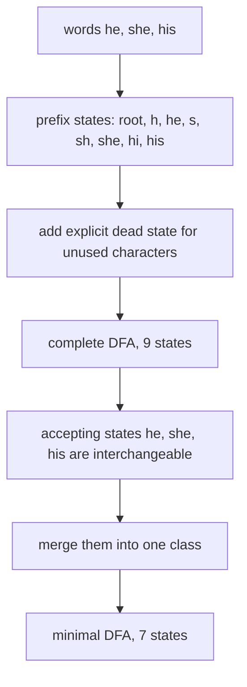
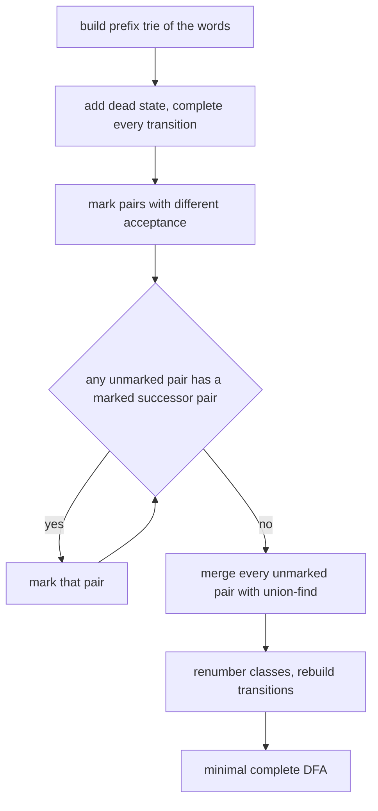
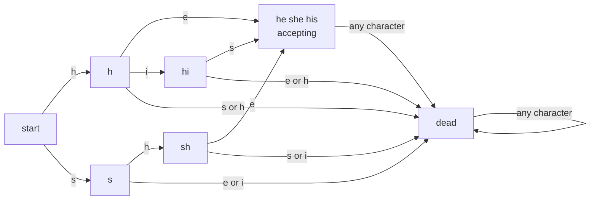

# 405 — Implement a minimal DFA for a string set (conceptual).

> **Tier:** Advanced · **CTCI chapter:** Beyond — Advanced Data Structures & Algorithms
> **Task spec:** [405-implement-minimal-dfa-for-string-set-conceptual.md](../../../tasks/advanced/405-implement-minimal-dfa-for-string-set-conceptual.md)
> **Solutions:** [Python](../../../solutions/python/advanced/405-implement-minimal-dfa-for-string-set-conceptual/solution.py) ·
> [Java](../../../solutions/java/advanced/405-implement-minimal-dfa-for-string-set-conceptual/Solution.java) ·
> [JavaScript](../../../solutions/javascript/advanced/405-implement-minimal-dfa-for-string-set-conceptual/solution.js) ·
> [C#](../../../solutions/csharp/advanced/405-implement-minimal-dfa-for-string-set-conceptual/Solution.cs)

## 1. Problem restatement

**Input:** a finite set of words and an alphabet (the sorted union of the words' characters).

**Output:** a **minimal complete DFA** whose language is *exactly* that set — no other string is
accepted. The solution headers fix the scope, and it is narrower than "a pattern matcher":

> Scope: the DFA recognizes exactly the finite set of words it was built from - no other string
> is accepted. Only the *prefixes* of the set's words matter: the builder's states are exactly
> the distinct non-empty prefixes plus the empty root, and any character that no prefix uses
> leads to an explicit dead state. The alphabet is the sorted union of the words' characters;
> characters outside it are documented to reject.

| Call | Result |
| --- | --- |
| `language_of_dfa(trans, accept, "ehis", 4)` for `{"he", "she", "his"}` | `{"he", "she", "his"}` exactly |
| `accepts(..., "his", "ehis")` | `True` |
| `accepts(..., "h", "ehis")`, `"sh"`, `"heh"`, `"hiss"`, `"shee"` | `False` |
| `accepts(..., "hey", "ehis")` | `False` — `y` is outside the alphabet, and outside the alphabet rejects |
| minimized state count for `{"he", "she", "his"}` | `7`, of which exactly one is accepting |
| minimized state count for `{"ab", "b", "ba"}` over `{"a","b"}` | `5` |

The tasks in this file are *conceptual*: the deliverable is a small, checkable construction plus
a real minimization, not a production automaton library. Concretely the shipped code provides
`build_exact_match_dfa` (prefix trie + dead state), `minimize_dfa` (table-filling/Moore),
`accepts`, `reachable_states`, `all_pairs_distinguishable`, `dead_states` and `language_of_dfa`.

The assertions are demanding for such a small structure: the enumerated language up to length 4
must equal the key set **exactly** (so an automaton that accepts one extra word fails), a list of
near-miss strings must be rejected, every state must be reachable, and the result must pass a
product-BFS test that no two states are indistinguishable — i.e. it is genuinely minimal.

## 2. Intuition

The naive idea is to store the words and compare the input against each of them. That is a
*recognizer*, not a DFA, and it does not answer "which state am I in?" — the question the task
asks. The obvious automaton to build instead is the **prefix trie** of the set:

- states = the empty prefix plus every distinct non-empty prefix of a word,
- one transition per `(prefix, character)` that forms another prefix,
- a state is accepting when its prefix is *the whole* word.

A trie already accepts the set — but it is not deterministic in the complete-DFA sense, because
prefixes that no word continues (`"h"` is a prefix of `"he"` and `"his"`, but `"x"` is nothing)
have no outgoing transitions. The fix is one explicit **dead state**: every character that no
prefix uses leads there, and the dead state loops to itself on every character. That makes the
automaton complete and gives it a natural "reject" sink.

A complete DFA with `|prefixes| + 1` states is correct but usually **not minimal**. The insight
that shrinks it: two states are mergeable when *no* continuation distinguishes them. For
`{"he", "she", "his"}` the three accepting prefixes `"he"`, `"she"`, `"his"` all have every
transition going to the dead state, so nothing after them can be accepted — they are
interchangeable and collapse into one class. The whole minimization problem is "which pairs of
states are distinguishable by some continuation?", which is exactly what the classical
**table-filling (Moore)** algorithm answers.



## 3. Algorithm

**Construction.**

1. Index the alphabet as the sorted union of the words' characters.
2. Start with state `0` for the empty prefix, non-accepting, all transitions unset.
3. For each word, walk its characters: create a state for every prefix not seen before, and set
   the transition from the current state on that character to the new state (first writer wins,
   which is what makes shared prefixes share states).
4. Mark the final state of each word accepting.
5. Append one **dead** state, non-accepting, looping to itself on every character, and point
   every still-unset transition of every state at it.

**Minimization.**

6. `marked[p][q]` is created `true` for every pair whose acceptance differs — those are
   distinguishable by the empty continuation.
7. Repeat until nothing changes: for every unmarked pair `(p, q)` and every character `c`, compare
   `trans[p][c]` with `trans[q][c]`; if that target pair is marked, mark `(p, q)` too. A pair is
   distinguishable when some character leads to a pair that is already distinguishable.
8. Every pair left unmarked is *equivalent*; merge those with union-find.
9. Renumber the classes so the class of the root is `0`, and rebuild the transition table and the
   accepting flags from the class representatives.

```text
procedure minimize_dfa(trans, accept, alphabet_size)
  mark every pair p < q with accept[p] ≠ accept[q]
  repeat
    changed ← false
    for every unmarked pair p < q do
      for every character c do
        a ← trans[p][c]
        b ← trans[q][c]
        if a ≠ b and pair (a, b) is marked then
          mark pair (p, q)
          changed ← true
          break
        end
      end
    end
  until not changed
  union-find: join every unmarked pair
  return the class table, rebuilt transitions and rebuilt acceptance
end
```



## 4. Worked example

Build `{"he", "she", "his"}` over alphabet `"ehis"`.

**Prefix states.** Root `""`, then `h`, `he`, `s`, `sh`, `she`, `hi`, `his` — eight states, of
which `he`, `she` and `his` are accepting. Then the dead state: nine states in total, and
`reachable_states(trans)` returns all nine, which the tests assert.

**Table filling.** Start by marking every accepting/non-accepting pair. Then propagate:

| Round | Newly marked | Reason |
| --- | --- | --- |
| 0 | `he` vs `hi`, `he` vs `sh`, `she` vs `h`, ... | acceptance differs |
| 1 | `h` vs `sh` | `h` on `i` reaches `hi`, `sh` on `i` reaches dead — that pair is marked |
| 1 | `h` vs `hi` | `h` on `i` reaches `hi`, `hi` on `i` reaches dead |
| 1 | `h` vs `s` | `h` on `e` reaches `he` (accepting), `s` on `e` reaches dead |
| 1 | `sh` vs `hi` | mutually distinguishable through `e` and `s` |
| 2 | nothing | fixpoint reached; the remaining unmarked pairs are equivalent |

The accepting ends `he`, `she`, `his` are never marked against each other: every transition out of
them goes to the dead state, so no continuation separates them. The minimized automaton has
**7 states**: `{""}`, `{h}`, `{s}`, `{sh}`, `{hi}`, `{he, she, his}` and the dead class. The tests
assert all of this directly — `class_of[index["he"]] == class_of[index["she"]] == class_of[index["his"]]`,
`class_of[index["h"]] != class_of[index["sh"]]`, `len(set(class_of)) == 7`, `sum(minimal_accept) == 1`.



**Near-miss rejections.** `"h"` is a prefix but not a word; `"sh"` likewise; `"heh"`, `"hehe"`,
`"shee"`, `"shes"`, `"hiss"`, `"hishe"`, `"hh"`, `"sheh"`, `"hise"` all fall into the dead state
or stop on a non-accepting state. Strings with characters outside the alphabet (`"hey"`,
`"his!"`, `"she?"`) are rejected by `accepts` before the transition table is consulted at all.

**The second fixed set.** `{"ab", "b", "ba"}` over `{"a","b"}` has prefixes `""`, `a`, `ab`, `b`,
`ba` plus dead — six states, minimized to **5**: `ab` and `ba` merge (both accepting, both lead
only to dead), while `b` stays separate from them because `b` is a word whose continuation
`"a"` forms another word. The assertions check `class_of2[index2["ab"]] == class_of2[index2["ba"]]`
and `class_of2[index2["ab"]] != class_of2[index2["b"]]`.

## 5. Complexity

Let `L` be the total number of characters in all words, `P` the number of distinct prefixes
(`states` before minimization, including the dead state) and `σ` the alphabet size.

| Measure | Bound | Why it holds |
| --- | --- | --- |
| Time, construction | `O(L + P · σ)` | one transition lookup per character in the words, then one pass to complete the unset transitions |
| Time, minimization | `O(P² · σ)` per round, `O(P² · σ)` overall rounds | the table has `P(P−1)/2` pairs; each round scans the unmarked ones over `σ` characters, and the number of rounds is bounded by the number of pairs because a round either marks something or stops |
| Space | `O(P²)` for the table plus `O(P · σ)` for the transitions | the `marked` matrix dominates |
| Time of the minimality check | `O(P² · σ)` | `all_pairs_distinguishable` runs one product BFS per pair, each exploring at most `P²` state pairs |
| Time of `language_of_dfa(alphabet, 4)` | `O(σ⁴ · |word|)` | enumerates every string up to length 4 and simulates it; the tests use it as a finite oracle |
| Comparison: no minimization | `O(1)` extra time | the trie-plus-dead automaton is already correct; minimization only removes states, at the cost of the table above |

For the tiny examples here the table is trivial (`P` is at most 9). The `O(P² · σ)` "Hopcroft
vs. table filling" trade-off only matters for automata with thousands of states.

## 6. Pitfalls and edge cases

- **The dead state is mandatory for completeness.** Without it the automaton is a partial DFA:
  `"h"` would have no transition on `e`, and `accepts` would have to special-case a missing
  entry. The tests assert `len(reachable_states(trans)) == len(states)`, which only holds when
  every state, including the dead one, is reachable.
- **Never merge the dead state with `""`.** Both are non-accepting, but `""` is the start state
  and the empty string is *rejected* while the automaton must stay total. The assertion
  `class_of[index[""]] != class_of[dead]` pins that down.
- **`"h"` and `"sh"` must not merge.** Both are non-accepting prefixes ending in `h`, but `"h"`
  still accepts the continuation `"is"` (`"his"`), while `"sh"` only accepts `"e"`. This is the
  single most instructive pair in the fixture and the tests assert the inequality explicitly.
- **Accepting states with no outgoing path merge.** That is the point of minimization for a
  finite set: `he`, `she` and `his` are interchangeable because no continuation exists.
- **Characters outside the alphabet.** `accepts` checks membership first and rejects, so
  `"hey"` and `"his!"` never index the table. `build_exact_match_dfa` never creates transitions
  for them.
- **The empty string.** The root is non-accepting for both fixtures, so `""` is rejected — the
  correct reading of "exactly the set `{"he","she","his"}`". `language_of_dfa` includes `""` in
  its enumeration and the equality assertion fails if the root were marked accepting.
- **Keeping state names readable.** The shipped builder labels states by their prefix string
  (`""`, `"h"`, `"he"`, ...) and the dead state as `"(dead)"`. The tests exploit this
  (`assert set(states[:-1]) == prefixes`), so a rename would break them.
- **Shared prefixes share states.** `"she"` and `"his"` both start at `s`/`h`; the builder only
  creates a state when the prefix is new, which is why nine states suffice instead of eleven.
- **Determinism of the class numbering.** Classes are renumbered by the minimum member so the
  root ends up as class `0`; without that, `accepts` would start from the wrong state.

## 7. Variants and follow-ups

- **Accepting a pattern set, not a word list.** Replacing the trie with an Aho–Corasick automaton
  (failure links instead of a dead state) turns "exactly these words" into "any of these words
  appears anywhere", which is the usual next step after this task.
- **An infinite language.** The same table-filling minimization works for any regular language;
  the only change is that the prefix set is replaced by whatever automaton defines the language.
- **Minimal DFA of *all substrings*.** [404 — Implement a suffix automaton and count different
  substrings](../../../tasks/advanced/404-implement-suffix-automaton-and-count-different-substrings.md)
  is the same minimization idea applied to an infinite set — every substring — where the class
  structure is discovered incrementally by `extend` instead of by a table.
- **Recognizing with a trie instead.** [406 — Implement an online suffix tree (Ukkonen outline)](../../../tasks/advanced/406-implement-online-suffix-tree-ukkonen-outline.md)
  is the "prefix trie over suffixes" extreme: no minimization at all, and `O(n²)` nodes for
  repetitive strings, but every node is a distinct substring.
- **Where it fits.** Finite automata, tries and suffix structures are grouped in
  [Advanced topics](../../ctci/x-advanced-topics.md) as the string-recognition family; the
  automaton here is the only one in that family whose language is finite.

## 8. Check yourself

1. Why is the alphabet defined as the sorted union of the words' characters rather than "all
   characters"?

<details><summary>Show answer</summary>

Because the DFA's language is exactly the word set: any character outside that union cannot
appear on a path to an accepting state, so the builder gives it no transition and `accepts`
rejects it before touching the table. Fixing the alphabet keeps the transition rows dense and
the state count finite and small.

</details>

2. The trie-plus-dead automaton has 9 states; the minimal one has 7. Which states disappeared
   and why?

<details><summary>Show answer</summary>

`he`, `she` and `his` merged into one class. All three are accepting and every transition out of
them goes to the dead state, so no continuation can distinguish them. Two states of the original
nine are removed by the merge, leaving seven.

</details>

3. Why does `"h"` stay distinct from `"hi"` even though `"hi"` is one character away?

<details><summary>Show answer</summary>

Because `"hi"`'s only completion is `"s"` (to reach the word `"his"`), while `"h"` is a strict
prefix of it. Table filling finds a separating character: on `i`, `"h"` reaches `hi` (accepting
after one more character) while `hi` on `i` reaches dead. A pair is mergeable only when *no*
character separates it.

</details>

4. What does the product-BFS test in `all_pairs_distinguishable` actually check?

<details><summary>Show answer</summary>

For every pair of states it simulates both states in parallel on all possible inputs (the product
automaton) and looks for a string that leads one to an accepting state and the other to a
non-accepting one. If no such string exists for any pair, the automaton is minimal; the tests
assert the minimized automaton passes this check and that the language is unchanged.

</details>
