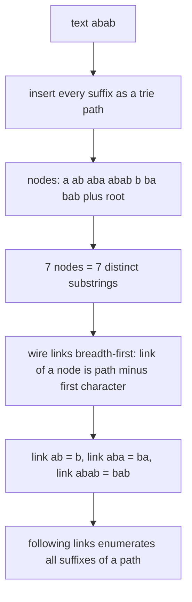
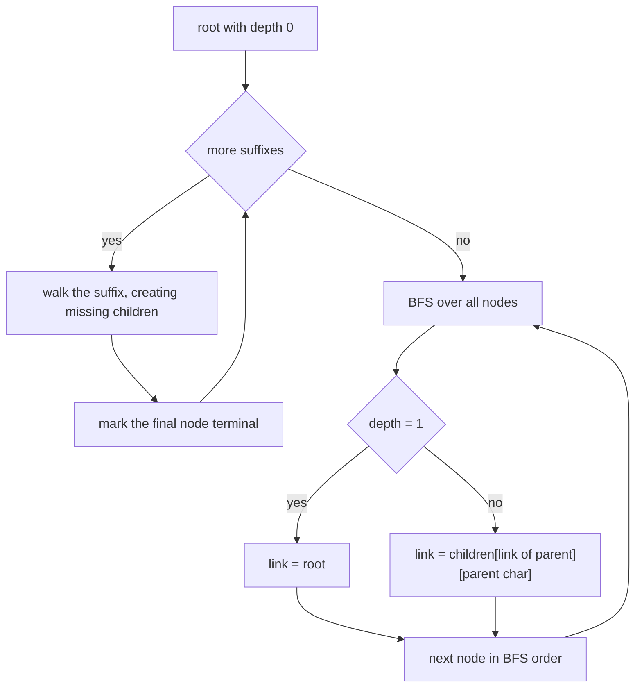
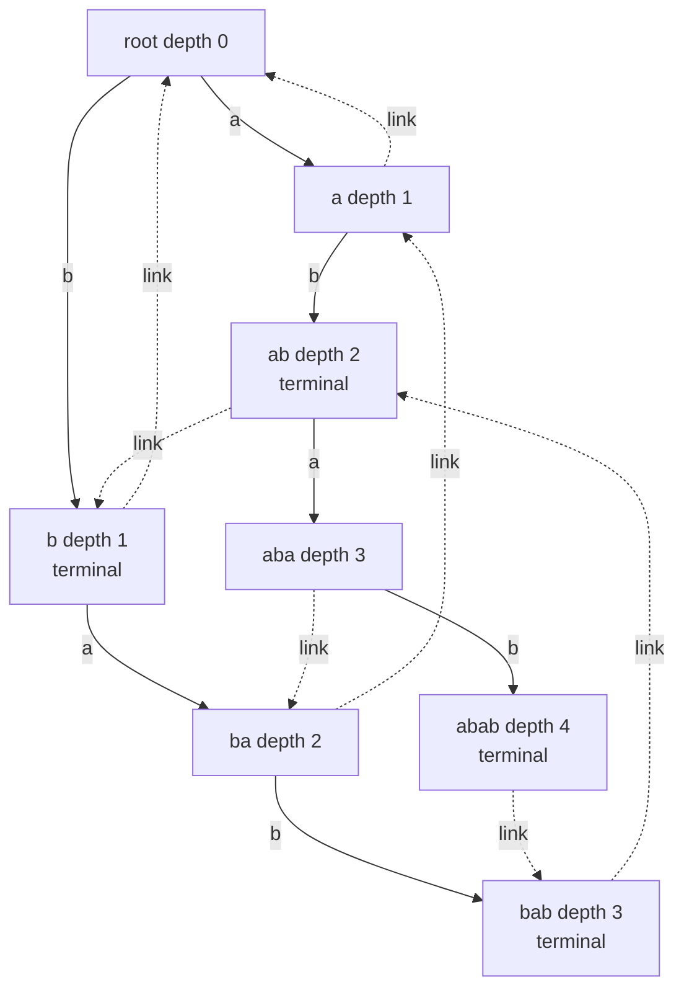
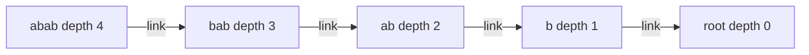

# 406 — Implement an online suffix tree (Ukkonen outline).

> **Tier:** Advanced · **CTCI chapter:** Beyond — Advanced Data Structures & Algorithms
> **Task spec:** [406-implement-online-suffix-tree-ukkonen-outline.md](../../../tasks/advanced/406-implement-online-suffix-tree-ukkonen-outline.md)
> **Solutions:** [Python](../../../solutions/python/advanced/406-implement-online-suffix-tree-ukkonen-outline/solution.py) ·
> [Java](../../../solutions/java/advanced/406-implement-online-suffix-tree-ukkonen-outline/Solution.java) ·
> [JavaScript](../../../solutions/javascript/advanced/406-implement-online-suffix-tree-ukkonen-outline/solution.js) ·
> [C#](../../../solutions/csharp/advanced/406-implement-online-suffix-tree-ukkonen-outline/Solution.cs)

## 1. Problem restatement

**Input:** a text of tiny size (`"banana"`, `"mississippi"`, `"abab"`, `"aaaa"`, `"abcab"`,
`""`, `"z"`, plus 20 LCG strings of length 8 over `"ab"` and 10 of length 7 over `"abc"`).

**Output:** a suffix-tree-like structure with three guaranteed abilities:

| Call | Meaning | Anchor on `"banana"` |
| --- | --- | --- |
| `contains(t)` / `find(t)` | descend from the root over `t`, return the node or `-1` | `contains("bananas")` is `False` |
| `occurrences(t)` | number of suffixes having `t` as a prefix | `occurrences("ana") == 2`, `occurrences("a") == 3`, `occurrences("na") == 2` |
| `distinct_substrings()` | number of distinct substrings | `banana` has `15` |
| `suffix_chain(node)` | follow suffix links to the root | for `"banana"`, `"banana"` links to `"anana"` |

The scope is stated in the header of every solution file, and this **outline** must be described
as it is, not as a full Ukkonen tree:

> Outline: a real Ukkonen tree builds the *compressed* suffix tree online in O(n) by extending
> the last suffix, following a suffix link when a split happens, and keeping the suffix link of
> every new node correct. This outline keeps the same skeleton for tiny strings: an explicit
> suffix trie of the text (every node is a distinct substring, edges are single characters) plus
> the suffix link of each node, which points at the node of its path label minus the first
> character. That link is exactly the invariant Ukkonen restores when it splits an edge, and it
> is what makes "ends with suffix link" navigation possible here: following links from a node
> walks through all suffixes of its path in O(depth) steps.

So the deliverable is the **suffix trie plus correct suffix links**, not the compressed tree. The
performance honesty comes with it: the checks run "on tiny texts only", because an explicit trie
of a long text has `O(n²)` nodes.

The tests are unusually thorough for a structure this small: every substring of the text must be
findable and its node's path label must equal it, every generated non-substring must fail, the
node count must equal the brute-force distinct-substring set, every link target must be the node
of `path[1:]`, every link chain must enumerate exactly `len(label) + 1` nodes (the node, its
suffixes, the root), and subtree terminal counts must reproduce naive occurrence counts.

## 2. Intuition

A suffix tree is normally described as the compressed trie of all suffixes: linear in nodes
because shared prefixes become edges, built in `O(n)` by Ukkonen's rule that a new suffix link
points at the node of the path label minus its first character. That suffix link is the only
genuinely hard part of Ukkonen; the compression is "just" bookkeeping on top of it.

The outline drops the compression and keeps the links:

- **Nodes are distinct substrings.** A node is identified by its `path_label`, the string spelled
  from the root; in a trie that is the same as the substring that created it.
- **Edges carry one character**, so inserting the suffixes is a plain nested walk: for each
  `start`, follow or create a child per character, then mark the final node terminal.
- **Suffix links follow the invariant.** `link(node)` is the node of `path_label(node)[1:]` —
  "the same content minus the first character". For a depth-1 node that is the root; for a node
  whose parent `p` is reached over character `c`, it is `children[link(p)][c]`, which *always*
  exists in a suffix trie: if `path` is a substring, so is `path[1:]` followed by `c`.
- **Links are wired breadth-first**, so `link(p)` is already known when `node` is processed.

Why this is worth writing: the link invariant is exactly what Ukkonen restores when it splits an
edge, and following links from a node walks all suffixes of its path in `O(depth)` steps — the
"ends with suffix link" navigation that makes compressed trees fast. The price is the node count:
for `"aaaa"` the trie has one node per distinct substring, i.e. `n(n+1)/2` in the worst case,
which is why the tests stay tiny.



## 3. Algorithm

**Build.**

1. Create the root: state `0`, empty path label, depth `0`, no parent, not terminal.
2. For each suffix start `start` in `0 .. n - 1`, walk from the root over `text[start:]`,
   creating a child node on the first character that has no edge yet, recording `parent`,
   `parent_char` and `depth = depth[parent] + 1` for every new node.
3. Mark the node reached at the end of that suffix as terminal — it represents a suffix of the
   text, which is what makes occurrence counting by subtree work later.

**Wire the suffix links.**

4. Traverse the nodes breadth-first (the shipped code builds an order by extending a list while
   iterating it, which is exactly a BFS).
5. For each node that is not the root: if its depth is `1`, `link(node) = root`; otherwise
   `link(node) = children[link(parent)][parent_char]`.

**Query.**

6. `find(t)` descends from the root one character per step and returns `-1` on the first missing
   edge; `contains(t)` is `find(t) != -1`; the empty pattern is found immediately at the root.
7. `occurrences(t)` takes the node of `t` and counts terminal nodes in its subtree with an
   explicit stack.
8. `suffix_chain(node)` follows `link` until it falls off (the root has no link), which yields
   the node, its longest proper suffix, and so on down to the root.
9. `distinct_substrings()` is `number of nodes - 1`: every non-root node is one distinct substring.

```text
procedure build_outline(text)
  create root node with depth 0, terminal = false
  for start ← 0 to length(text) - 1 do
    node ← root
    for each character ch in text[start:] do
      if node has no child for ch then
        create child with parent = node, parent_char = ch, depth = depth[node] + 1
      end
      node ← child of node for ch
    end
    mark node as terminal
  end
  for node in breadth-first order, skipping the root do
    if depth[node] = 1 then
      link[node] ← root
    else
      link[node] ← children[link[parent[node]]][parent_char[node]]
    end
  end
  return root
end
```



## 4. Worked example

Build the outline for `"abab"` (`n = 4`). The suffixes are `abab`, `bab`, `ab`, `b`.

**Nodes created, in insertion order.** Suffix `abab` creates `a`, `ab`, `aba`, `abab`; suffix
`bab` creates `b`, `ba`, `bab` (and reuses nothing); suffix `ab` reuses `a`, `ab`; suffix `b`
reuses `b`. The terminal marks are `abab`, `bab`, `ab` and `b`.

| Node | `path_label` | `depth` | terminal | `link` |
| --- | --- | --- | --- | --- |
| root | `""` | 0 | no | none |
| 1 | `a` | 1 | no | root |
| 2 | `ab` | 2 | yes (suffix of `"abab"`) | `b` |
| 3 | `aba` | 3 | no | `ba` |
| 4 | `abab` | 4 | yes | `bab` |
| 5 | `b` | 1 | yes (suffix of `"bab"`) | root |
| 6 | `ba` | 2 | no | `a` |
| 7 | `bab` | 3 | yes | `ab` |

Seven non-root nodes, so `distinct_substrings() == 7`, matching the brute-force set
`{"a","b","ab","ba","aba","bab","abab"}`. Every link satisfies the invariant
`path_label(link(node)) == path_label(node)[1:]`: `link("ab") = "b"`, `link("aba") = "ba"`,
`link("abab") = "bab"`, `link("ba") = "a"`, `link("bab") = "ab"`.



**Query traces.** `occurrences("a")` descends to node 1 and counts terminals in its subtree:
nodes `ab` and `abab` are terminal, so the answer is `2` — and `"a"` does occur twice in
`"abab"` (positions `0` and `2`). `occurrences("ab")` is `1` at node 2 (`ab` itself, no deeper
terminal). `find("baba")` fails at the fourth character, so `contains("baba")` is `False`.

**Link chains.** `suffix_chain` from `abab` walks `abab → bab → ab → b → root`: five nodes for a
label of length 4, exactly `len(label) + 1`, and the labels are precisely the four suffixes of
`"abab"` followed by the empty string. That is the invariant the tests assert as
`[path_label(n) for n in chain] == [label[k:] for k in range(len(label))] + [""]`.



**Online flavour.** The tests also build the outline for `"aban"` and then for `"abana"` and
check that the extension keeps every invariant: `occurrences("a")` goes from `2` to `3`, the
node count still equals the distinct-substring count of `"abana"`, and
`path_label(link[find("bana")])` is `"ana"` — the new deep node's link lands on the suffix
created by the added character.

## 5. Complexity

Let `n` be the length of the text and `V` the number of nodes (one per distinct substring plus
the root).

| Measure | Bound | Why it holds |
| --- | --- | --- |
| Time, build | `O(n²)` | inserting all `n` suffixes walks `n + (n-1) + ... + 1` characters |
| Time, link wiring | `O(V)` | one BFS order and one dictionary lookup per non-root node |
| Time, `find` | `O(len(t))` | one child lookup per pattern character, no backtracking |
| Time, `occurrences` | `O(V)` worst case | an explicit stack over the subtree of the found node |
| Time, `suffix_chain` | `O(depth)` | one link step per suffix of the path label |
| Space | `O(V)` nodes, `O(V)` total edge entries | each node stores its children map, parent, parent character, depth, terminal flag and link |
| Comparison: real Ukkonen | `O(n)` time, `O(n)` nodes | the compressed tree merges single-character chains into edges |
| Comparison: suffix automaton | `O(n)` build, `O(n)` states | [404](../../../tasks/advanced/404-implement-suffix-automaton-and-count-different-substrings.md) keeps the same "all substrings" language with a linear number of states |

The `O(n²)` node count of the explicit trie is exactly why the solution files say "checks on
tiny texts only": the structure is honest about being an outline of the linear-time original.

## 6. Pitfalls and edge cases

- **Empty text.** `SuffixTreeOutline("")` inserts no suffixes: `distinct_substrings() == 0`,
  `find("") == 0` and `contains("")` is `True`. The tests call `check_outline("", "ab", 2)`.
- **The empty pattern is at the root.** Descending over zero characters returns the root, so the
  empty string is "found" — that is the documented reading and the tests assert
  `tree.contains("") and tree.find("") == 0`.
- **Links must be wired breadth-first.** `link(node) = children[link(parent)][parent_char]`
  needs `link(parent)` to be final. Wiring links in insertion order can use a stale parent link
  and produce a chain that does not enumerate the suffixes.
- **Depth-1 nodes.** Their path label minus the first character is the empty string, i.e. the
  root, which has no suffix link. The code special-cases `depth == 1` for that reason.
- **Terminal marks drive occurrence counts.** A node is terminal when it is the *end* of an
  inserted suffix. In `"abab"`, node `a` is deliberately non-terminal (no suffix equals `"a"`),
  yet `occurrences("a") == 2` — the count comes from terminal *descendants*, not from the node
  itself.
- **Non-substrings must fail.** `contains("bananas")` and `contains("nana-")` are `False`
  because the walk runs out of children; the probe enumeration
  (`enumerate_strings(alphabet, probe_len)`) checks the same property exhaustively on tiny
  alphabets.
- **Repetitive strings blow up.** `"aaaa"` has `10` nodes for `n = 4`; the node count is the
  number of distinct substrings, so an `O(n²)` text gives `O(n²)` nodes even though the whole
  information is `O(n)` in a compressed tree.
- **Single character text.** `check_outline("z", "ab", 2)` — the root plus one node, and every
  probe of length at most 2 other than `"z"` must fail.
- **Link target identity.** The tests compare `path_label(link[node])` with `label[1:]` for
  *every* node, which catches an off-by-one in the "minus the first character" rule that a
  spot-check on one node would miss.

## 7. Variants and follow-ups

- **Compress the edges.** Replacing single-character edges with intervals of the text turns the
  trie into a real suffix tree with `O(n)` nodes; Ukkonen's incremental rule is the same
  suffix-link invariant this outline already implements and tests.
- **Pattern matching in the tree.** [408 — Pattern matching with a suffix tree (outline)](../../../tasks/advanced/408-pattern-matching-with-suffix-tree-outline.md)
  uses the suffix array plus LCP array as the array form of the same object: a node corresponds
  to an LCP interval, and the locus of a pattern is the maximal interval of suffixes carrying it.
- **Counting without a tree.** [404 — Implement a suffix automaton and count different substrings](../../../tasks/advanced/404-implement-suffix-automaton-and-count-different-substrings.md)
  answers `distinct_substrings` and `occurrences` with a linear-size DFA instead of a
  quadratic-size trie.
- **Suffix-less indexing.** [409 — Implement the Burrows-Wheeler transform and its inverse](../../../tasks/advanced/409-implement-burrows-wheeler-transform-and-inverse.md)
  and its FM-index follow-up
  [410](../../../tasks/advanced/410-fm-index-basic-concept-and-small-demo.md) drop the tree shape
  entirely and keep only a permutation of the text.
- **Where it fits.** [Advanced topics](../../ctci/x-advanced-topics.md) places the suffix tree
  next to the suffix array and suffix automaton as the three classic "index the text once,
  answer substring questions forever" structures.

## 8. Check yourself

1. Why does `link(node) = children[link(parent)][parent_char]` always resolve to a node in a
   suffix trie?

<details><summary>Show answer</summary>

Because a suffix trie contains every substring. If `node`'s path label is `c·w` for the first
character `c` and the rest `w`, then `w` is a substring of the text, so there is a node with path
label `w`; descending one more character reaches the node for `w·c` — the path label minus its
first character. Every such string exists, so the lookup cannot fail.

</details>

2. What is the difference between a *terminal* node and the node of a pattern?

<details><summary>Show answer</summary>

A terminal node is the end of an inserted *suffix* of the text. Any node reached by a pattern
`t` stands for the substring `t`, terminal or not: `t` occurs `occurrences(t)` times, which is
the number of terminal nodes in its subtree. In `"abab"`, node `"a"` is non-terminal, yet
`occurrences("a") == 2`.

</details>

3. How many nodes does the outline have for `"aaaa"`, and how many does a compressed suffix tree
   have?

<details><summary>Show answer</summary>

The outline has one node per distinct substring: `"a"`, `"aa"`, `"aaa"`, `"aaaa"` — four non-root
nodes, so five nodes counting the root. The tests confirm `distinct_substrings()` matches the
brute-force set. A compressed suffix tree merges the single-character chains and keeps `O(n)`
nodes, which for `"aaaa"` means a handful of nodes rather than one per substring length.

</details>

4. Why do the tests insist that a link chain has exactly `len(label) + 1` nodes?

<details><summary>Show answer</summary>

Because following `link` from a node of depth `d` must visit one node per suffix of its path
label: the label itself, then its `d - 1` proper suffixes, then the root — `d + 1` nodes total.
A shorter chain means some link skipped a level (jumping straight to a shorter suffix), which
would break the "follow links to enumerate suffixes" navigation that motivates keeping the links
at all.

</details>
