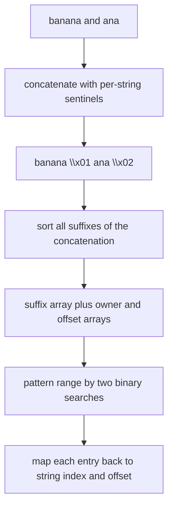
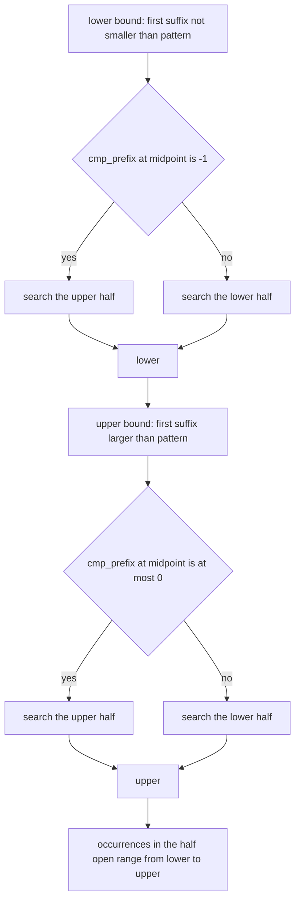
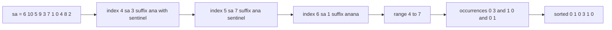

# 407 — Implement a generalized suffix array for multiple strings.

> **Tier:** Advanced · **CTCI chapter:** Beyond — Advanced Data Structures & Algorithms
> **Task spec:** [407-implement-generalized-suffix-array-for-multiple-strings.md](../../../tasks/advanced/407-implement-generalized-suffix-array-for-multiple-strings.md)
> **Solutions:** [Python](../../../solutions/python/advanced/407-implement-generalized-suffix-array-for-multiple-strings/solution.py) ·
> [Java](../../../solutions/java/advanced/407-implement-generalized-suffix-array-for-multiple-strings/Solution.java) ·
> [JavaScript](../../../solutions/javascript/advanced/407-implement-generalized-suffix-array-for-multiple-strings/solution.js) ·
> [C#](../../../solutions/csharp/advanced/407-implement-generalized-suffix-array-for-multiple-strings/Solution.cs)

## 1. Problem restatement

**Input:** a list of `m` strings of lowercase letters, for example `["banana", "ana"]`. The list
may contain an empty string, and it may be empty itself.

**Output:** one suffix array over all suffixes of all strings at once, plus a way to answer
"where does this pattern occur?" with `(string index, offset)` pairs.

The construction is fixed by the solution headers:

> The m strings are concatenated with m *distinct* sentinels: string k gets `chr(1 + k)`. All
> sentinels are below every real (lowercase) character, and they are distinct and ordered by
> string index, so a suffix from string i always beats the same text extended in string j when
> i < j. This is the cheapest correct sentinel scheme for the generalized suffix array.
>
> Every suffix also carries an owner (which string) and an offset (position inside it), so
> occurrences of a pattern are found with two binary searches over the suffix array: the
> pattern-prefixed suffixes form one contiguous range, and each entry of that range maps back to
> a (string, position) occurrence.

| Call | Result |
| --- | --- |
| `find_occurrences(["banana", "ana"], "ana")` | `[(0, 1), (0, 3), (1, 0)]` |
| `find_occurrences(["banana", "ana"], "a")` | `[(0, 1), (0, 3), (0, 5), (1, 0), (1, 2)]` |
| `find_occurrences(["banana", "ana"], "na")` | `[(0, 2), (0, 4), (1, 1)]` |
| `find_occurrences(["banana", "ana"], "anan")` | `[(0, 1)]` — only inside `"banana"` |
| `find_occurrences(["banana", "ana"], "nanan")` | `[]` |
| `find_occurrences(["banana", "ana"], "bananas")` | `[]` |
| `find_occurrences(["abab"], "ab")` | `[(0, 0), (0, 2)]` |
| `find_occurrences(["", "ab"], "ab")` | `[(1, 0)]` |
| `find_occurrences(["", ""], "a")` | `[]` |
| `find_occurrences([], "a")` | `[]` |
| `len(find_occurrences(["mississippi", "issi", "i", "ppi"], "i"))` | `4 + 2 + 1 + 1 = 8` |

The tests validate the array itself with a manual comparator (`is_valid_suffix_array` plus
`compare_suffixes`, the same independent oracle as
[401](../../../tasks/advanced/401-implement-suffix-array-sa-is-or-doubling-for-medium-n.md)),
assert that the two smallest suffixes are the sentinels in **string-index order**, and — the
sharpest check — assert that the suffixes belonging to string `k`, read off in suffix-array
order, are *exactly* `suffix_array_naive(strings[k])`. A sentinel scheme that leaked across
strings, or offsets that were off by one, would break that equality immediately.

## 2. Intuition

The naive approach uses each string's suffix array separately and merges the results of `m`
searches:

```text
procedure naive_occurrences(strings, pattern)
  found ← empty list
  for k ← 0 to m - 1 do
    for i ← 0 to length(strings[k]) - length(pattern) do
      if strings[k][i : i + length(pattern)] = pattern then
        append (k, i) to found
      end
    end
  end
  return found sorted
end
```

It is quadratic in the total length per query (and there is one suffix array per string, so no
cross-string structure exists). The generalization shares one array across all strings, which
requires separating them by an unambiguous marker.

**Key insight.** Concatenate the strings and give string `k` a **distinct** sentinel
`chr(1 + k)`, then sort the suffixes of the whole concatenation. Two properties make this work:

1. **Sentinels are smaller than any real character**, so a suffix never compares past its own
   string into the next one — the sentinel stops the comparison exactly where the string ends.
2. **Distinct sentinels are ordered by string index**, so when two strings share the same text,
   the suffix of the *earlier* string sorts first. That makes equal suffixes distinguishable by
   owner, which keeps the array deterministic and lets "the same suffix text" appear once per
   string.

An `owner` array (which string each position came from) and an `offset` array (the position
inside that string, `-1` for sentinels) turn the combined order back into per-string
coordinates. Then a pattern query is the classic suffix-array trick: the suffixes starting with
the pattern occupy **one contiguous range**, found with two binary searches, and every entry in
that range is one occurrence.



## 3. Algorithm

1. Walk the strings in order, appending each character to `text` and recording `owner[k] = k`
   and `offset = position inside the string`; after each string append its sentinel
   `chr(1 + k)` with `offset = -1` and remember its position.
2. Build the suffix array of the whole `text` with the doubling method (the sentinels are
   ordinary characters to it).
3. To locate a pattern, binary-search for the first suffix that is `>= pattern` (using
   `cmp_prefix`, which compares the pattern against the text starting at that suffix and returns
   `-1` when the suffix is smaller, `0` when it starts with the pattern, `1` when it is larger).
4. Binary-search again from that lower bound for the first suffix that is `> pattern`; the half
   open range `[lower, upper)` is the pattern's occurrence range.
5. Map each entry of the range back to `(owner[sa[i]], offset[sa[i]])`, drop the sentinel entries
   (`offset = -1`) and sort the pairs.

```text
procedure build_generalized(strings)
  text ← empty, owner ← empty, offset ← empty, sentinels ← empty
  for k ← 0 to m - 1 do
    for pos ← 0 to length(strings[k]) - 1 do
      append strings[k][pos] to text, k to owner, pos to offset
    end
    append position of the sentinel to sentinels
    append chr(1 + k) to text, k to owner, -1 to offset
  end
  sa ← suffix_array_doubling(text)
  return text, sa, owner, offset, sentinels
end

function pattern_range(text, sa, pattern)
  lo ← first suffix index whose suffix is not smaller than pattern
  hi ← first suffix index whose suffix is strictly larger than pattern
  return lo, hi
end
```

`cmp_prefix(text, start, pattern)` returns `-1` when the suffix runs out of characters first —
that is how a short suffix that is a prefix of the pattern sorts before the pattern, without
needing a sentinel at the end of the comparison.



## 4. Worked example

Build the generalized array for `["banana", "ana"]`. The concatenation is
`"banana\x01ana\x02"` — eleven characters, with the sentinels at positions `6` (for `"banana"`)
and `10` (for `"ana"`).

| Position | 0 | 1 | 2 | 3 | 4 | 5 | 6 | 7 | 8 | 9 | 10 |
| --- | --- | --- | --- | --- | --- | --- | --- | --- | --- | --- | --- |
| `text` | `b` | `a` | `n` | `a` | `n` | `a` | `\x01` | `a` | `n` | `a` | `\x02` |
| `owner` | 0 | 0 | 0 | 0 | 0 | 0 | 0 | 1 | 1 | 1 | 1 |
| `offset` | 0 | 1 | 2 | 3 | 4 | 5 | -1 | 0 | 1 | 2 | -1 |

Sorting the suffixes of that text gives

```text
sa = [6, 10, 5, 9, 3, 7, 1, 0, 4, 8, 2]
```

The first two entries are exactly the sentinels `[6, 10]` in string-index order (the assertion
`[sa[0], sa[1]] == sentinels`), because `\x01 < \x02 <` any lowercase letter. Reading the
entries owned by string `0` gives offsets `5, 3, 1, 0, 4, 2` — the plain suffix array of
`"banana"` — and the entries owned by string `1` give `2, 0, 1` — the plain suffix array of
`"ana"`. That is the per-string order check, and it is what makes the sentinel scheme
trustworthy.

Now query `"ana"`. The suffixes that start with `ana` are at positions `3` (`"ana\x01ana\x02"`),
`7` (`"ana\x02"`) and `1` (`"anana\x01ana\x02"`), which sit at indices `4, 5, 6` of `sa` — one
contiguous range. The two binary searches return `lower = 4`, `upper = 7`:

| `i` | 4 | 5 | 6 |
| --- | --- | --- | --- |
| `sa[i]` | 3 | 7 | 1 |
| suffix | `ana\x01...` | `ana\x02` | `anana\x01...` |
| `owner` | 0 | 1 | 0 |
| `offset` | 3 | 0 | 1 |
| occurrence | `(0, 3)` | `(1, 0)` | `(0, 1)` |

Sorted, that is `[(0, 1), (0, 3), (1, 0)]`, matching the anchor — and note that `"ana"` occurs at
offset `1` inside `"banana"` (as part of `"banana"`) as well as at offset `3`, plus starting the
second string.



Two more anchors show the range machinery on other patterns: `"a"` matches every suffix starting
with `a` (indices `2..6` of `sa`, i.e. positions `5, 9, 3, 7, 1` → `[(0,1),(0,3),(0,5),(1,0),(1,2)]`),
and `"nanan"` returns `[]` because the binary searches meet (`lower == upper`) — the pattern
crosses the sentinel and therefore appears in no string's own text.

## 5. Complexity

Let `N` be the total length of all strings plus the sentinels, and `m` the number of strings.

| Measure | Bound | Why it holds |
| --- | --- | --- |
| Time, build | `O(N log² N)` | concatenation is linear; the doubling suffix array dominates |
| Time, one query | `O(len(pattern) · log N + k log k)` | two binary searches over `N` entries, each comparing up to `len(pattern)` characters, then sorting `k` occurrences |
| Space | `O(N)` | the `text`, `sa`, `owner` and `offset` arrays are all linear in `N` |
| Time of the naive multi-string scan | `O(N · len(pattern))` per query | every position of every string is compared character by character |
| Space of the naive scan | `O(k)` | it only collects the matches |
| Adding one more string | `O(1)` sentinel characters | the scheme needs no reserved "forbidden" character and no cross-string deduplication logic |

The extra sentinel characters are the entire cost of generalization: `m` characters on top of
the data, with no change to the construction algorithm.

## 6. Pitfalls and edge cases

- **Sentinels must be distinct.** Using one shared terminator (the "no sentinel" convention of
  [401](../../../tasks/advanced/401-implement-suffix-array-sa-is-or-doubling-for-medium-n.md))
  makes suffixes of different strings compare equal, and the contiguous-range trick then returns
  the same occurrence twice or mixes owners. `chr(1 + k)` is distinct per string and ordered by
  index, which the tests assert via `[sa[k] for k in range(len(strings))] == sentinels`.
- **Sentinels must be smaller than real characters.** All test alphabets are lowercase ASCII, so
  `chr(1)` and `chr(2)` qualify. An implementation that used, say, `chr(256)` for one string and
  `chr(1)` for another would break the ordering guarantee.
- **Sentinel entries are not occurrences.** They carry `offset = -1`, and `find_occurrences`
  filters them out with `offset[sa[i]] >= 0`. Without that filter, a search for `""`-like short
  patterns would report phantom matches.
- **Empty strings in the list.** `find_occurrences(["", "ab"], "ab")` returns `[(1, 0)]`: the
  empty string contributes only its sentinel, so it can never match. `["", ""]` gives `[]` for
  `"a"`, and an empty list gives `[]` for anything.
- **Single string.** `find_occurrences(["abab"], "ab")` is `[(0, 0), (0, 2)]`. With `m = 1` the
  scheme degenerates to the plain suffix array, so a user-visible difference between `m = 1` and
  `m > 1` would be a bug.
- **A pattern that crosses a sentinel.** Patterns such as `"bananas"` and `"nanan"` share
  characters with the text but never occur *inside* any string; `cmp_prefix` treats the sentinel
  as an ordinary smaller character, so the search range simply comes out empty.
- **Occurrence ordering.** The range is in suffix-array order, so the pairs must be sorted before
  returning; `naive_occurrences` sorts too, and the tests compare the two lists directly.
- **Overlapping occurrences inside one string are all reported.** `"a"` in `"banana"` yields
  offsets `1, 3, 5`, not just the first.
- **Medium inputs with three strings each.** The LCG loop builds 3 strings of 12–18 characters,
  validates the combined suffix array with the manual comparator, checks the sentinel ordering
  and the per-string orders, and compares every short substring query (plus `"zzz"`, `"q"` and
  `"abcaabca"`) against the naive scan.

## 7. Variants and follow-ups

- **Longest common substring of many strings.** The same generalized order plus the LCP array of
  [402](../../../tasks/advanced/402-build-lcp-array-from-suffix-array-kasai.md) answers "longest
  substring occurring in every string": take the maximum LCP over windows that contain one
  suffix of each owner.
- **Repeated substring inside one string.** [403 — Use suffix array + LCP for the longest
  repeated substring](../../../tasks/advanced/403-use-suffix-array-lcp-for-longest-repeated-substring.md)
  is the single-string special case; the owner filter is what distinguishes "same string
  twice" from "two different strings".
- **Interval search, not binary search.** [408 — Pattern matching with a suffix tree (outline)](../../../tasks/advanced/408-pattern-matching-with-suffix-tree-outline.md)
  performs the same two binary searches and additionally validates the range with the LCP array;
  that validation works unchanged on a generalized array.
- **Compressed alternatives.** The FM-index of
  [410 — FM-index: basic concept and small demo](../../../tasks/advanced/410-fm-index-basic-concept-and-small-demo.md)
  answers the same queries with `O(N)` bits instead of an `O(N)` integer array, and the suffix
  automaton of [404](../../../tasks/advanced/404-implement-suffix-automaton-and-count-different-substrings.md)
  can be built over a sentinel-joined text as well.
- **Text indexes in context.** The use of sentinels to combine inputs is a recurring trick across
  the suffix structures collected in [Advanced topics](../../ctci/x-advanced-topics.md).

## 8. Check yourself

1. Why must the sentinels be *distinct*, when a single terminator would be enough to mark the
   end of a string?

<details><summary>Show answer</summary>

With one shared terminator, two suffixes from different strings that spell the same text would
compare equal, and the array would not distinguish them. Then the contiguous pattern range could
report the same `(string, offset)` twice or pair an offset with the wrong owner, and the
per-string order assertion would fail. Distinct sentinels ordered by string index give equal
suffixes a deterministic tie-break.

</details>

2. In the worked example, why is position `6` (the `"banana"` sentinel) the first entry of the
   suffix array, ahead of position `10`?

<details><summary>Show answer</summary>

`"\x01ana\x02"` versus `"\x02"`: the first characters are `\x01` and `\x02`, and `\x01 < \x02`,
so the suffix at `6` sorts first. Both sentinels are below every lowercase letter, so they
occupy the first two slots.

</details>

3. `find_occurrences(["banana", "ana"], "anana")` is `[]` while `"anan"` returns `[(0, 1)]`.
   Why?

<details><summary>Show answer</summary>

`"anana"` occurs only inside the concatenation as `"...b anana\x01..."`, i.e. it includes the
sentinel that follows `"banana"`. A sentinel is not a character of any string, so no
`(owner, offset)` pair can represent that match. `"anan"` fits inside `"banana"` at offset `1`
without touching a sentinel, so it is reported.

</details>

4. How many binary searches does one query need, and why not one?

<details><summary>Show answer</summary>

Two: one for the first suffix that is not smaller than the pattern, one for the first suffix that
is strictly greater. Their difference is the number of matching suffixes. A single search only
finds one boundary, so it cannot tell whether the matched suffix is unique or the first of many.

</details>
