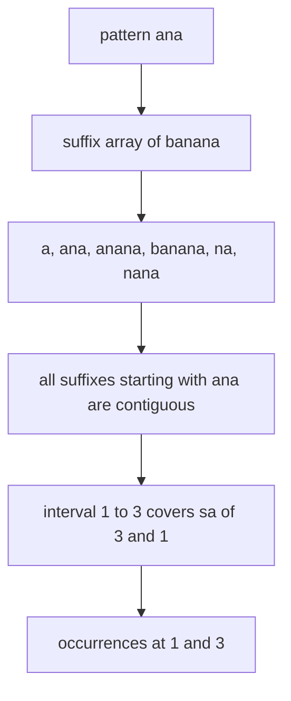
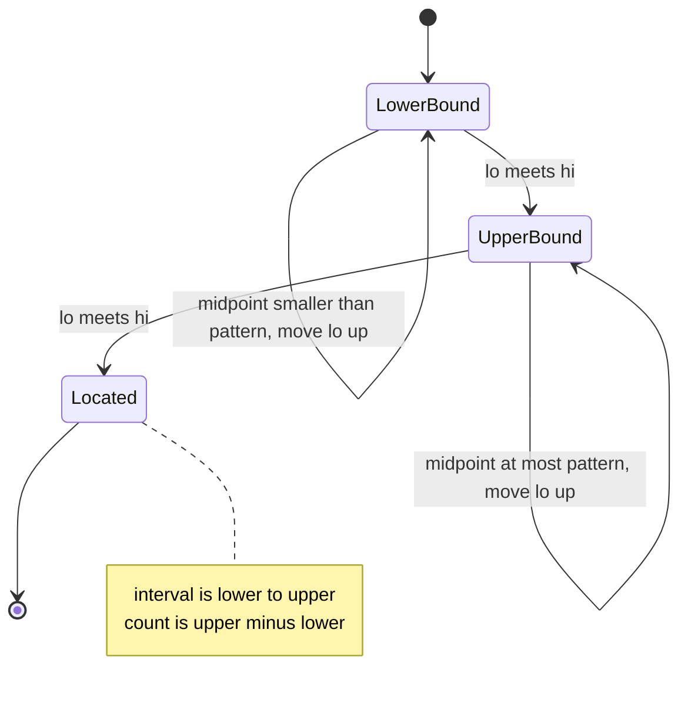
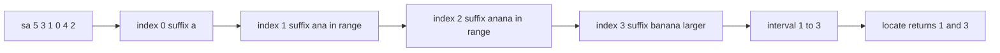

# 408 — Pattern matching with a suffix tree (outline).

> **Tier:** Advanced · **CTCI chapter:** Beyond — Advanced Data Structures & Algorithms
> **Task spec:** [408-pattern-matching-with-suffix-tree-outline.md](../../../tasks/advanced/408-pattern-matching-with-suffix-tree-outline.md)
> **Solutions:** [Python](../../../solutions/python/advanced/408-pattern-matching-with-suffix-tree-outline/solution.py) ·
> [Java](../../../solutions/java/advanced/408-pattern-matching-with-suffix-tree-outline/Solution.java) ·
> [JavaScript](../../../solutions/javascript/advanced/408-pattern-matching-with-suffix-tree-outline/solution.js) ·
> [C#](../../../solutions/csharp/advanced/408-pattern-matching-with-suffix-tree-outline/Solution.cs)

## 1. Problem restatement

**Input:** a text, plus a pattern to locate.

**Output:** every starting position where the pattern occurs, as a sorted list of indices, and a
way to count them and to name the *locus* of the pattern. The four operations mirror the
solution files:

| Method | Meaning |
| --- | --- |
| `interval(pattern)` | the maximal half-open range `[lo, hi)` of suffix-array indices whose suffixes start with the pattern |
| `locate(pattern)` | the sorted start positions of all occurrences |
| `count(pattern)` | `hi - lo`, the number of occurrences |
| `locus_shared_prefix(pattern)` | `min(lcp[lo+1 .. hi-1])`, the shared prefix length of the interval |

The scope is stated in the header, and it is the array form of a suffix tree:

> Backing store: the suffix array plus the LCP array, which represent the same object as a
> suffix tree — a suffix-tree node corresponds to an LCP interval, and the locus of a pattern is
> exactly the maximal interval `[lo, hi)` of suffixes carrying the pattern as prefix. Descent
> from the root consumes the pattern one character at a time: two binary searches over the
> suffix array locate the interval (compare the pattern against the suffix at the midpoint), and
> every suffix inside the interval is a match, because in a suffix array all pattern-prefixed
> suffixes are contiguous.

| Call on `"banana"` | Result |
| --- | --- |
| `locate("ana")` | `[1, 3]`, and `interval("ana") == (1, 3)` |
| `locate("na")` | `[2, 4]` |
| `locate("a")` | `[1, 3, 5]` |
| `locate("banana")` | `[0]` |
| `locate("anana")` | `[1]` |
| `locate("nana")` | `[2]` |
| `locate("")` | `[0, 1, 2, 3, 4, 5]` — the empty pattern is documented to match every position |
| `locate("bananas")` | `[]` |
| `locus_shared_prefix("ana")` | `>= 3` |

The tests are exhaustive: for `"banana"`, `"mississippi"`, `""`, `"a"` and `"aaaa"`, for every
substring of the text up to length 5, for mutated texts (each early character replaced by `"d"`)
and for absent patterns, the file asserts `locate(pattern) == naive_locate(text, pattern)`,
`count(pattern) == len(positions)`, that every suffix inside the interval really starts with the
pattern, that the suffix *immediately before* `lo` and *immediately after* `hi` do not, and that
an interval of two or more suffixes shares at least `len(pattern)` characters.

## 2. Intuition

The naive matcher asks the text, not an index:

```text
procedure naive_locate(text, pattern)
  if pattern is empty then return every position of text
  out ← empty list
  for i ← 0 to length(text) - length(pattern) do
    if text[i : i + length(pattern)] = pattern then append i to out
  end
  return out
end
```

That is `O(n · m)` per query (`n` positions, `m` comparisons each) and it has to be redone for
every pattern. A suffix tree answers it in `O(m)` by descending from the root one character at a
time; **the descent never backtracks because all suffixes with a given prefix form a contiguous
subtree**. The array form of that subtree is an interval.

**Key insight.** In a suffix array, all suffixes that start with a given pattern are
**contiguous**. So "descend the tree" becomes "find the boundaries of the interval":

- the **lower** boundary is the first suffix that is not smaller than the pattern,
- the **upper** boundary is the first suffix that is strictly larger than the pattern,
- every entry in `[lower, upper)` is a match, and `upper - lower` is the number of occurrences.

Both boundaries are ordinary binary searches, comparing the *pattern against the suffix* (not
two suffixes), and the comparison can stop as soon as the pattern is consumed. A suffix-tree node
is exactly such an interval, and `min(lcp[lo+1 .. hi-1])` is the depth of that node — which is
why the LCP array both documents and validates the locus.



## 3. Algorithm

1. Build the suffix array of `text` by doubling, then the LCP array with Kasai's scan.
2. `interval(pattern)`: if the pattern is empty, return the whole array `[0, len(sa))` — the
   empty pattern is the root of the tree.
3. Lower bound: binary-search `lo` over `0 .. len(sa)` for the first index whose suffix compares
   `>= pattern`, using `cmp_prefix(text, sa[mid], pattern)`.
4. Upper bound: continue from `lo` and binary-search for the first index whose suffix compares
   `> pattern`.
5. `locate` sorts `sa[lower..upper]`; `count` is `upper - lower`.
6. `locus_shared_prefix` returns `min(lcp[lower+1 .. upper-1])` when the interval holds at least
   two suffixes, and `0` otherwise, because a single-suffix interval has no adjacent pair.

```text
function cmp_prefix(text, start, pattern)
  for i ← 0 to length(pattern) - 1 do
    if start + i ≥ length(text) then return -1
    if text[start + i] ≠ pattern[i] then
      return -1 if text[start + i] < pattern[i] else 1
    end
  end
  return 0
end

function interval(text, sa, pattern)
  if pattern is empty then return 0, length(sa)
  lo ← 0, hi ← length(sa)
  while lo < hi do                       # first suffix not smaller than pattern
    mid ← (lo + hi) / 2
    if cmp_prefix(text, sa[mid], pattern) < 0 then lo ← mid + 1 else hi ← mid
  end
  lower ← lo
  hi ← length(sa)
  while lo < hi do                       # first suffix strictly larger than pattern
    mid ← (lo + hi) / 2
    if cmp_prefix(text, sa[mid], pattern) ≤ 0 then lo ← mid + 1 else hi ← mid
  end
  return lower, lo
end
```

`cmp_prefix` returns `-1` when the suffix runs out of characters first, which is the "shorter
suffix is smaller" rule from
[401](../../../tasks/advanced/401-implement-suffix-array-sa-is-or-doubling-for-medium-n.md) —
without it, a suffix that is a prefix of the pattern would compare equal to it and the lower
bound would be wrong.



## 4. Worked example

Trace on `"banana"`. The suffix array is `sa = [5, 3, 1, 0, 4, 2]` and
`lcp = [0, 1, 3, 0, 0, 2]`:

| `i` | 0 | 1 | 2 | 3 | 4 | 5 |
| --- | --- | --- | --- | --- | --- | --- |
| `sa[i]` | 5 | 3 | 1 | 0 | 4 | 2 |
| suffix | `a` | `ana` | `anana` | `banana` | `na` | `nana` |
| `lcp[i]` | 0 | 1 | 3 | 0 | 0 | 2 |

**Query `"ana"`.** The lower bound lands on index `1` (`"ana"` is not smaller than `"ana"`, while
`"a"` at index `0` is). The upper bound lands on index `3`: `sa[2] = 1` gives `"anana"` which
*starts with* `"ana"` (so `cmp_prefix` returns `0` and the search moves up), and `sa[3] = 0`
gives `"banana"` which is larger. So `interval("ana") == (1, 3)`:

| Step | Boundary | `lo` | `hi` | midpoint | suffix at midpoint | result |
| --- | --- | --- | --- | --- | --- | --- |
| 1 | lower | 0 | 6 | 3 | `banana` | larger → `hi = 3` |
| 2 | lower | 0 | 3 | 1 | `ana` | equal → `hi = 1` |
| 3 | lower | 0 | 1 | 0 | `a` | smaller → `lo = 1` |
| 4 | upper | 1 | 6 | 3 | `banana` | larger → `hi = 3` |
| 5 | upper | 1 | 3 | 2 | `anana` | at most → `lo = 3` |

`locate("ana")` sorts `sa[1..3] = [3, 1]` into `[1, 3]`, `count` is `2`, and
`locus_shared_prefix("ana")` is `min(lcp[2..2]) = lcp[2] = 3 >= 3` — the interval's two suffixes
share exactly the three pattern characters, which is the tree-locus property.



**Other anchors on the same array.** `"a"` has interval `(0, 3)` because `"a"`, `"ana"` and
`"anana"` all start with `a`, giving `[1, 3, 5]`; `"na"` has interval `(4, 6)` giving `[2, 4]`;
`"banana"` has the single-suffix interval `(3, 4)` giving `[0]`; and `"bananas"` has an empty
interval — `"banana"` is smaller (it is a proper prefix) and `"na"` is larger, so the two binary
searches both stop at index `4` and `count` is `0`.

**The empty pattern.** `interval("")` short-circuits to `(0, len(sa))`, so `locate("")` returns
the sorted suffix array `[0, 1, 2, 3, 4, 5]` — every position, which is what the header documents
and what `naive_locate` reproduces with `list(range(len(text)))`.

**Why the neighbours matter.** The tests check that `sa[lower - 1]` and `sa[upper]` do *not*
start with the pattern. For `"ana"` those are `sa[0] = 5` (`"a"`) and `sa[3] = 0` (`"banana"`) —
so the search really stopped exactly at the block boundary rather than somewhere inside it.

## 5. Complexity

Let `n` be the text length, `m` the pattern length and `k` the number of occurrences.

| Measure | Bound | Why it holds |
| --- | --- | --- |
| Time, build | `O(n log² n)` | the doubling suffix array; Kasai adds `O(n)` |
| Time, `interval` | `O(m log n)` | two binary searches over `n` entries, each comparing up to `m` characters |
| Time, `locate` | `O(m log n + k log k)` | the interval plus a sort of the `k` positions |
| Time, `count` | `O(m log n)` | no sorting, just the interval width |
| Time, `locus_shared_prefix` | `O(m log n + k)` | a minimum over the LCP entries inside the interval |
| Space | `O(n)` | suffix array and LCP array, plus `O(k)` for the result |
| Time of the naive scan | `O(n · m)` per query | every position is compared character by character |
| Time of a real suffix tree descent | `O(m)` | compressed edges skip characters, which needs the tree, not the array |

The `log n` factor is the price of the array representation: a real suffix tree descends in
`O(m)`, while the array needs a binary search per boundary. In exchange the array is `O(n)`
*integers* with no node bookkeeping, and the LCP array is what lets you verify the interval.

## 6. Pitfalls and edge cases

- **The empty pattern.** Documented to match every position: `interval("") == (0, len(sa))` and
  `locate("")` is the sorted suffix array. Returning `[]` would contradict `naive_locate`, which
  the tests compare against.
- **Empty text.** `check_index("", ["a"])` — `sa` is empty, both binary searches return `0`, and
  `locate("a")` is `[]`. The empty pattern on empty text yields `[]` as well.
- **An empty interval is the normal "not found" answer**, not an error: for `"bananas"` both
  bounds coincide at index `4` and `count` is `0`. The tests assert `locate("bananas") == []`.
- **The comparison must not materialise suffixes.** `cmp_prefix` compares one character at a
  time and stops when the pattern is exhausted, which is what keeps the query `O(m log n)`
  instead of `O(n log n)` per comparison.
- **The shorter-suffix rule.** A suffix that is a prefix of the pattern must compare *smaller*
  (return `-1`), otherwise the lower bound can land inside the match block. `"a"` vs `"ana"` is
  the case that exercises it, and it is the first comparison of the `"ana"` trace.
- **`locus_shared_prefix` on a one-element interval.** There is no adjacent pair, so the minimum
  is defined as `0`. The tests only demand `>= len(pattern)` when the interval has at least two
  suffixes.
- **Duplicated suffix values.** Without a sentinel a suffix can be a prefix of another but never
  *equal* to it, so the interval boundaries are well defined. On a generalized array with
  sentinels ([407](../../../tasks/advanced/407-implement-generalized-suffix-array-for-multiple-strings.md))
  equal suffixes are possible, and the interval then spans both — the neighbour checks still hold.
- **Repetitive texts.** `"aaaa"` has `sa = [3, 2, 1, 0]` and `lcp = [0, 1, 2, 3]`, so
  `locate("aa")` has interval `(1, 4)` giving `[0, 1, 2]` — three overlapping occurrences. The
  tests include `"aaaa"` precisely for this shape.
- **Mutated texts.** The tests replace early characters with `"d"` and require that the mutated
  substring is no longer located. This catches an off-by-one in `cmp_prefix` that a
  same-alphabet test would miss.

## 7. Variants and follow-ups

- **Where the LCP array comes from.** [402 — Build the LCP array from the suffix array (Kasai)](../../../tasks/advanced/402-build-lcp-array-from-suffix-array-kasai.md)
  is the prerequisite; `locus_shared_prefix` reads it and the tests use it as the tree-locus
  certificate.
- **From tree to trie.** [406 — Implement an online suffix tree (Ukkonen outline)](../../../tasks/advanced/406-implement-online-suffix-tree-ukkonen-outline.md)
  builds the explicit node structure this task represents as intervals; its `find` descends
  character by character, which is the same walk the binary searches perform implicitly.
- **Longest repeat from the same array.** [403 — Use suffix array + LCP for the longest repeated
  substring](../../../tasks/advanced/403-use-suffix-array-lcp-for-longest-repeated-substring.md)
  reads `max(lcp)`, which is the deepest two-suffix interval — a one-line special case of the
  locus machinery.
- **Many texts.** [407 — Implement a generalized suffix array for multiple strings](../../../tasks/advanced/407-implement-generalized-suffix-array-for-multiple-strings.md)
  reuses the identical binary searches on a sentinel-joined concat; the interval entries then
  carry owners, which is what turns "matches" into "matches per input string".
- **Succinct indexing.** [410 — FM-index: basic concept and small demo](../../../tasks/advanced/410-fm-index-basic-concept-and-small-demo.md)
  replaces binary search with backward search over the Burrows–Wheeler column — the same
  contiguous-interval idea, without random access to the text.

## 8. Check yourself

1. Why are all suffixes that start with a pattern contiguous in the suffix array?

<details><summary>Show answer</summary>

Because the suffix array is sorted lexicographically. All strings with a common prefix `p` form a
contiguous block in lexicographic order — anything between two strings starting with `p` must
also start with `p`, otherwise it would be smaller than the first or larger than the second. The
interval `[lo, hi)` is exactly that block.

</details>

2. What does `locus_shared_prefix("ana") == 3` tell you that `count("ana") == 2` does not?

<details><summary>Show answer</summary>

`count` only says two suffixes are in the interval. The minimum LCP over the interval says how
deep the shared prefix is: at least three characters, i.e. at least the whole pattern. That is
the check that the interval is a real *tree locus* rather than two unrelated suffixes that
happened to be inside the binary-search range.

</details>

3. Why does `cmp_prefix` need the case "the suffix ends first"?

<details><summary>Show answer</summary>

Because then the suffix is a proper prefix of the pattern and must sort *before* it, like `"a"`
before `"ana"`. Returning `0` (or a positive value) there would put the boundary in the wrong
place: the lower bound could skip past real matches, which breaks `locate` in exactly the cases
where the pattern extends a shorter suffix of the text.

</details>

4. `locate("")` returns every position. Is that consistent with the "count is `hi - lo`" rule?

<details><summary>Show answer</summary>

Yes: the empty pattern matches at every suffix-array index, so `lo = 0`, `hi = len(sa)` and the
width is `n`. Both `interval` and `naive_locate` are written to agree, and the tests assert the
two lists are equal for `""`, `"a"` and `"aaaa"`.

</details>
