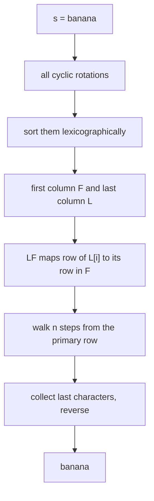
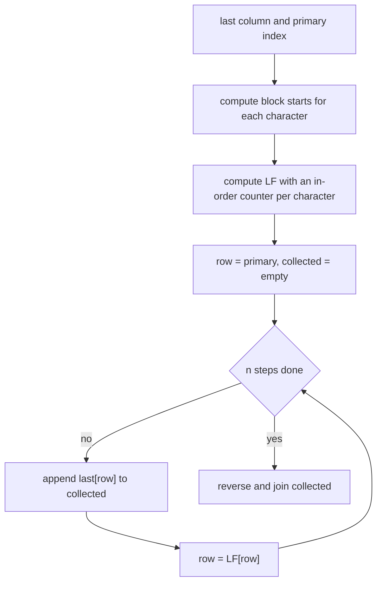
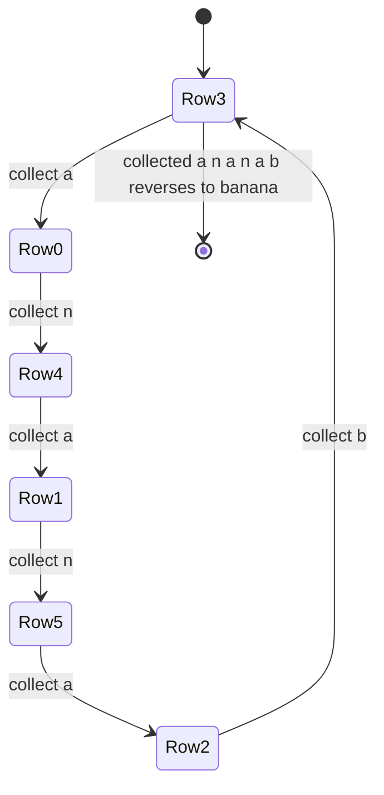

# 409 — Implement the Burrows-Wheeler transform and its inverse.

> **Tier:** Advanced · **CTCI chapter:** Beyond — Advanced Data Structures & Algorithms
> **Task spec:** [409-implement-burrows-wheeler-transform-and-inverse.md](../../../tasks/advanced/409-implement-burrows-wheeler-transform-and-inverse.md)
> **Solutions:** [Python](../../../solutions/python/advanced/409-implement-burrows-wheeler-transform-and-inverse/solution.py) ·
> [Java](../../../solutions/java/advanced/409-implement-burrows-wheeler-transform-and-inverse/Solution.java) ·
> [JavaScript](../../../solutions/javascript/advanced/409-implement-burrows-wheeler-transform-and-inverse/solution.js) ·
> [C#](../../../solutions/csharp/advanced/409-implement-burrows-wheeler-transform-and-inverse/Solution.cs)

## 1. Problem restatement

**Input:** a string `s` of `n` characters.

**Output:** the Burrows–Wheeler transform of `s` and enough information to invert it. The
solution headers fix the flavour — this is the **cyclic** transform plus a **primary index**:

> Cyclic BWT: sort all n cyclic rotations of `s`, take the last column, and record the *primary
> index* — the row holding the rotation that starts at position 0. Hand anchors: `banana` →
> `("nnbaaa", 3)`, `abab` → `("bbaa", 0)`, `aaaa` → `("aaaa", 0)`. Reversal is only possible
> with the primary index: `"ab"` and `"ba"` both transform to `"ba"` but use primary `0` and `1`.

| Call | Result | Note |
| --- | --- | --- |
| `bwt_cyclic("banana")` | `("nnbaaa", 3)` | the classic anchor |
| `bwt_cyclic("abab")` | `("bbaa", 0)` | last column only tells part of the story |
| `bwt_cyclic("aaaa")` | `("aaaa", 0)` | all rotations identical, primary `0` |
| `bwt_cyclic("ab")` | `("ba", 0)` | same last column as `"ba"` … |
| `bwt_cyclic("ba")` | `("ba", 1)` | … but a different primary index |
| `bwt_cyclic("a")` | `("a", 0)` | single character |
| `bwt_cyclic("")` | `("", 0)` | empty input |
| `inverse_bwt_cyclic("ba", 0)` | `"ab"` | primary disambiguates |
| `inverse_bwt_cyclic("ba", 1)` | `"ba"` | |
| `bwt_sentinel("banana")` | `"annb$aa"` | the sentinel variant of the transform |
| `bwt_sentinel("")` | `"$"` | the text becomes just the sentinel |
| `bwt_sentinel("a")` | `"a$"` | |

Two inverse routines ship, and the difference matters:

- `inverse_bwt_cyclic(last, primary)` — needs the primary index.
- `inverse_bwt_sentinel(last)` — needs no index, because the row whose last character is the
  unique sentinel `"$"` is exactly the rotation that starts at position 0. It raises `ValueError`
  when the row does not contain exactly one sentinel, and `bwt_sentinel` raises when the text
  already contains `"$"`.

The tests assert the hand values above, that `sorted(last) == sorted(s)` (the transform is a
permutation of the characters), that `lf_mapping(last)` is a permutation of `0..n-1`, and that
both inverses round-trip on 40 LCG strings per alphabet of lengths `0..40`, plus one
300-character medium string.

## 2. Intuition

Building the transform is mechanical: write down every cyclic rotation, sort them
lexicographically, and read the last column:

```text
procedure bwt_cyclic(s)
  n ← length(s)
  if n = 0 then return "", 0
  order ← indices 0 to n - 1 sorted by the rotation s[i] followed by s[0 .. i - 1]
  last ← the character s[(i - 1) mod n] for every i in order
  primary ← the position of 0 in order
  return last, primary
end
```

Writing all `n` rotations explicitly costs `O(n²)` memory, and that is what a first
implementation does; a real implementation sorts rotation *indices* with a doubling scheme,
which is exactly the algorithm of
[401](../../../tasks/advanced/401-implement-suffix-array-sa-is-or-doubling-for-medium-n.md). The
interesting part is not the forward transform — it is that the last column plus one index is
enough to rebuild the string.

**Key insight (the `LF` mapping).** Let `F` be the first column of the sorted rotations, i.e.
`L` sorted. Then for every row `i`, `L[i]` is the character that *precedes* the rotation of row
`i` cyclically, so the row whose rotation starts one position earlier than row `i`'s is the one
that begins with `L[i]`. Matching equal characters in order gives the position:

```text
LF[i] = (number of characters in L strictly smaller than L[i])
      + (number of earlier occurrences of L[i] in L)
```

`LF` is a permutation, and following it walks **backwards** through the string: from any row,
`LF` gives the row of the rotation that starts one character earlier. Walking `n` steps from the
primary row therefore visits every character in reverse order, and reversing the collected
characters rebuilds `s`. Without the primary index the walk cannot start: the two rotations of
`"ab"` and `"ba"` produce the same column `"ba"`, and only the index says which row is "starts at
position 0".



## 3. Algorithm

1. If `s` is empty, return `("", 0)`.
2. Sort the rotation indices `0..n-1` by the rotation starting at each index. The sort must be
   **stable** so that *equal* rotations (all-equal strings such as `"aaaa"`) keep index order,
   which makes the primary index deterministic.
3. `last[i]` is the character just before the start of the rotation in row `i`, i.e.
   `s[(order[i] - 1) mod n]`; `primary` is the row of the rotation starting at index `0`.
4. For the inverse, compute `LF`: the number of characters strictly smaller than `c` gives the
   block start of `c` in `F`, and a running counter per character adds the within-block offset.
5. Walk from `row = primary` for `n` steps: append `last[row]`, then set `row = LF[row]`. After
   `n` steps the walk returns to `primary` — the shipped code asserts that.
6. Reverse the collected characters and return them.

The sentinel variant reuses the same `LF` walk with one simplification: the row whose `last`
character is `"$"` replaces the primary index, and the walk runs `n + 1` steps over
`bwt_cyclic(s + "$")`.

```text
function lf_mapping(last)
  for every character c do
    start[c] ← number of characters in last strictly smaller than c
  end
  seen ← empty counters
  for i ← 0 to length(last) - 1 do
    c ← last[i]
    lf[i] ← start[c] + seen[c]
    seen[c] ← seen[c] + 1
  end
  return lf
end

function inverse_bwt_cyclic(last, primary)
  n ← length(last)
  if n = 0 then return ""
  lf ← lf_mapping(last)
  row ← primary
  collected ← empty
  repeat n times
    append last[row] to collected
    row ← lf[row]
  end
  return reverse(collected) joined
end
```



## 4. Worked example

Transform `"banana"` (`n = 6`). The six cyclic rotations, sorted:

| Row | Start index | Rotation | First char | Last char |
| --- | --- | --- | --- | --- |
| 0 | 5 | `abanan` | `a` | `n` |
| 1 | 3 | `anaban` | `a` | `n` |
| 2 | 1 | `ananab` | `a` | `b` |
| 3 | 0 | `banana` | `b` | `a` |
| 4 | 4 | `nabana` | `n` | `a` |
| 5 | 2 | `nanaba` | `n` | `a` |

So `last = "nnbaaa"` and `primary = 3`, matching the anchor. Note that `"anaban"` (start 3)
precedes `"ananab"` (start 1) because the fourth character `b` is smaller than `n`.

Now invert. The first column is `F = sorted("nnbaaa") = "aaabnn"`, so the block starts are
`a → 0`, `b → 3`, `n → 4` (the sentinel-free analogue of the FM-index `C` table). Reading `L`
left to right with a per-character counter:

| `i` | `L[i]` | block start | earlier equal characters | `LF[i]` |
| --- | --- | --- | --- | --- |
| 0 | `n` | 4 | 0 | 4 |
| 1 | `n` | 4 | 1 | 5 |
| 2 | `b` | 3 | 0 | 3 |
| 3 | `a` | 0 | 0 | 0 |
| 4 | `a` | 0 | 1 | 1 |
| 5 | `a` | 0 | 2 | 2 |

`LF = [4, 5, 3, 0, 1, 2]`. Walking from `primary = 3` for six steps:

| Step | `row` before | `L[row]` collected | `LF[row]` becomes the next row |
| --- | --- | --- | --- |
| 1 | 3 | `a` | 0 |
| 2 | 0 | `n` | 4 |
| 3 | 4 | `a` | 1 |
| 4 | 1 | `n` | 5 |
| 5 | 5 | `a` | 2 |
| 6 | 2 | `b` | 3 — back at the primary row |

Collected characters: `a n a n a b`. Reversed: **`banana`**, exactly the original. The return to
`primary = 3` after exactly `n` steps is asserted in the code (`assert row == primary`).



The primary index is what makes this work. For `"ab"` and `"ba"` both transforms give the column
`"ba"`, but the sorted rotations are `ab, ba` for the first (primary `0`) and `ab, ba` reached
with `ba` first (primary `1`); `inverse_bwt_cyclic("ba", 0) == "ab"` and
`inverse_bwt_cyclic("ba", 1) == "ba"`.

The sentinel variant removes the index entirely. For `"banana"` the transform of `"banana$"` is
`"annb$aa"`, and `inverse_bwt_sentinel("annb$aa")` walks the same `LF` starting at
`last.index("$") = 4`, collects `$` first, and drops it after reversing — no ambiguity, because
the sentinel is the smallest character and occurs exactly once.

## 5. Complexity

Let `n` be the length of `s`.

| Measure | Bound | Why it holds |
| --- | --- | --- |
| Time, forward (as written) | `O(n² log n)` | building each rotation costs `O(n)` and there are `O(n log n)` comparisons; the shipped code materialises `s[i:] + s[:i]` as the sort key |
| Time, forward with doubling | `O(n log n)` | sorting rotation *indices* by rank pairs instead of by materialised rotations, exactly as in [401](../../../tasks/advanced/401-implement-suffix-array-sa-is-or-doubling-for-medium-n.md) |
| Time, inverse | `O(n)` | `lf_mapping` needs the block starts and one pass over `L`; the walk is `n` steps |
| Space | `O(n)` | the sorted order, the `L` column, the `LF` array and the collected characters |
| Space, naive rotation matrix | `O(n²)` | writing all rotations before sorting is what the shipped key function avoids materialising all at once, but the key strings are still `O(n)` each |
| Time of the sentinel variant | `O(n)` extra | one sentinel character and the same `LF` walk |

The inverse is genuinely linear, which is the point of the transform: decompression needs no
sorting and no extra structure beyond the column.

## 6. Pitfalls and edge cases

- **The primary index is not optional.** `"ab"` and `"ba"` produce the identical last column
  `"ba"`; only the index distinguishes them. All four solutions assert both inversions.
- **Stability of the rotation sort.** Equal rotations occur for strings such as `"aaaa"`, where
  every rotation is the same string. A stable sort keeps index order, so `primary == 0`; an
  unstable sort could report a different row and the assertions `bwt_cyclic("aaaa") == ("aaaa", 0)`
  would be flaky.
- **Empty string.** `bwt_cyclic("") == ("", 0)` — there are no rotations, and the code returns
  before touching `order`. `inverse_bwt_cyclic("", 0) == ""` for the same reason.
- **The walk must return to `primary`.** If `LF` is computed with the wrong within-block order,
  the walk still visits `n` characters but ends on a different row; the explicit
  `assert row == primary` catches that instead of returning a plausible-looking wrong string.
- **The within-block counter must be per character.** Using a single global counter for the
  "earlier equal characters" term produces a sequence that is not a permutation, and
  `sorted(lf_mapping(last)) == list(range(n))` fails immediately.
- **The sentinel variant needs a character that cannot occur in the text.** `bwt_sentinel`
  raises `ValueError` for `"bad$text"`, and `inverse_bwt_sentinel` raises when the column does
  not contain exactly one `"$"`. The `"$"` must also be smaller than every character of the
  alphabet for the "row starting at 0" argument to hold.
- **Sentinel variant on the empty string.** `bwt_sentinel("") == "$"` and
  `inverse_bwt_sentinel("$") == ""` — a one-character column is a valid transform, not an error.
- **Multiset preservation.** `sorted(last) == sorted(s)` is asserted for every LCG string; it is
  the cheapest possible check that the transform is a permutation and not, say, a rotation.
- **Unicode.** The rotations are compared as sequences of characters, so `"$"` and any sentinel
  must be genuinely smaller in the language's character order; for non-BMP characters Java and
  C# compare UTF-16 units, as in the other string tasks here.

## 7. Variants and follow-ups

- **FM-index.** [410 — FM-index: basic concept and small demo](../../../tasks/advanced/410-fm-index-basic-concept-and-small-demo.md)
  is built directly on this transform: the `LF` mapping defined here is what makes backward
  search and position recovery work.
- **Faster forward transform.** Reuse the doubling suffix-array construction of
  [401](../../../tasks/advanced/401-implement-suffix-array-sa-is-or-doubling-for-medium-n.md) on
  `s + sentinel` to sort rotations in `O(n log n)` instead of materialising them.
- **The `LF` mapping as a permutation.** `LF` is a single cycle when the text has a unique
  smallest character, which the tests assert for the sentinel variant of `"banana"`. That cycle
  structure is exactly how the inverse recovers positions without storing them.
- **LCP information on the same order.** [402 — Build the LCP array from the suffix array (Kasai)](../../../tasks/advanced/402-build-lcp-array-from-suffix-array-kasai.md)
  and [403 — Use suffix array + LCP for the longest repeated substring](../../../tasks/advanced/403-use-suffix-array-lcp-for-longest-repeated-substring.md)
  extract repeats from the sorted order rather than transforming it.
- **Where the transform sits.** The BWT and its index are the bridge from sorting-based string
  structures to compressed ones; [Advanced topics](../../ctci/x-advanced-topics.md) groups them
  with the suffix array and suffix automaton.

## 8. Check yourself

1. Why does `bwt_cyclic("ab")` give the same last column as `bwt_cyclic("ba")`?

<details><summary>Show answer</summary>

Because `"ab"` and `"ba"` are rotations of each other, so they have the *same set* of cyclic
rotations — `"ab"` and `"ba"` — and therefore the same sorted matrix and the same last column
`"ba"`. What differs is which row contains the rotation starting at index `0`: row `0` for
`"ab"`, row `1` for `"ba"`. That is exactly the information the primary index stores.

</details>

2. What is `LF[i]` for the last row of `"banana"`, and what does following it mean?

<details><summary>Show answer</summary>

`LF[5] = 2`. Following `LF` from row `5` moves to the row of the rotation that starts one
character earlier than row `5`'s rotation; the collected `L` characters walk the string
backwards, which is why the result has to be reversed at the end.

</details>

3. Why does the sentinel variant not need a primary index?

<details><summary>Show answer</summary>

Because the sentinel is unique and smaller than every real character, the rotation that starts at
position `0` is the only one whose *last* character is the sentinel: the rotation ending at the
sentinel is the one beginning right after it, i.e. at position `0`. So the row is identified by
`last.index("$")`, which replaces the index that the cyclic variant has to store.

</details>

4. The walk collects `n` characters but only `n - 1` of them are "new"; why does the code not
   need a sentinel to stop?

<details><summary>Show answer</summary>

Because `LF` is a permutation: starting from the primary row, the walk returns to it after
exactly `n` steps, having visited all `n` rows once. The code asserts that closure rather than
counting distinct rows; with a correct `LF` the loop can run exactly `n` times.

</details>
