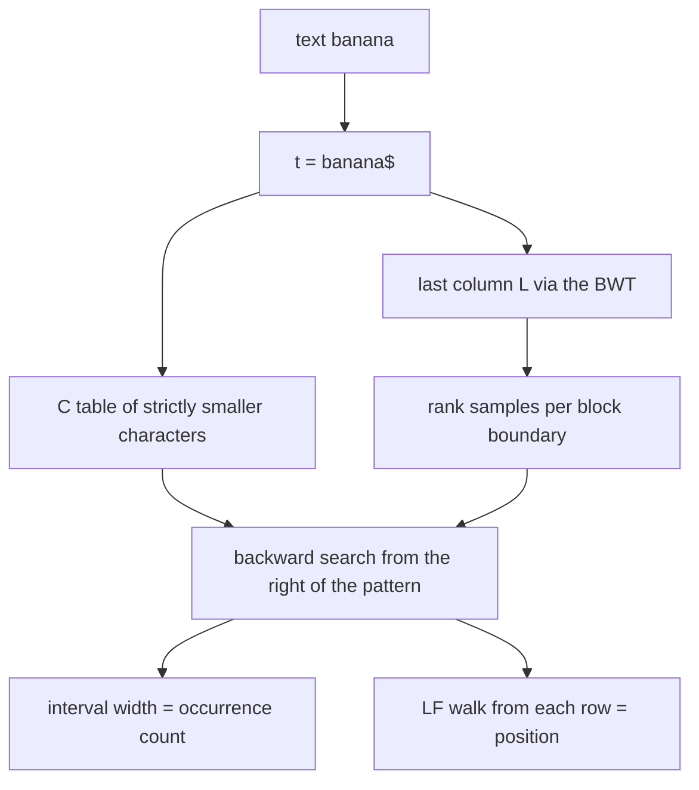
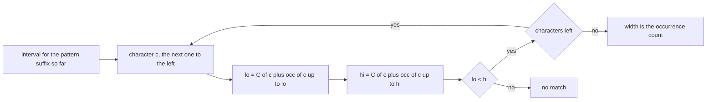
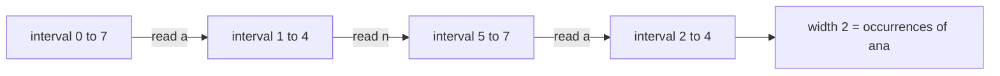
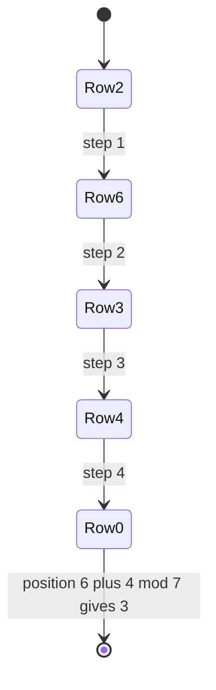

# 410 — FM-index: basic concept and small demo.

> **Tier:** Advanced · **CTCI chapter:** Beyond — Advanced Data Structures & Algorithms
> **Task spec:** [410-fm-index-basic-concept-and-small-demo.md](../../../tasks/advanced/410-fm-index-basic-concept-and-small-demo.md)
> **Solutions:** [Python](../../../solutions/python/advanced/410-fm-index-basic-concept-and-small-demo/solution.py) ·
> [Java](../../../solutions/java/advanced/410-fm-index-basic-concept-and-small-demo/Solution.java) ·
> [JavaScript](../../../solutions/javascript/advanced/410-fm-index-basic-concept-and-small-demo/solution.js) ·
> [C#](../../../solutions/csharp/advanced/410-fm-index-basic-concept-and-small-demo/Solution.cs)

## 1. Problem restatement

**Input:** a text `s`, plus a block size for the rank samples (configurable; the demo uses the
default `4` and exercises `1, 2, 3, 5, 8, 16`).

**Output:** an FM-index with the three components the header describes, and the two queries it
supports:

> Structure for text s: build `t = s + "$"` with a unique smallest sentinel, store
> * the Burrows-Wheeler last column `L` of `t`,
> * the `C` table: `C[c]` = number of characters of `t` strictly smaller than `c`,
> * rank samples: for every character, the cumulative count in `L` at each block boundary
>   (block size configurable); `occ(c, i)` = sample + direct scan of the residual (`< block` chars).

| Call on `FMIndex("banana")` | Result |
| --- | --- |
| `index.t` | `"banana$"` |
| `index.last` | `"annb$aa"` |
| `index.c_table` | `{"$": 0, "a": 1, "b": 4, "n": 5}` |
| `count("ana")`, `count("na")` | `2`, `2` |
| `count("a")` | `3` |
| `count("banana")`, `count("nana")`, `count("anana")` | `1`, `1`, `1` |
| `count("bananas")`, `count("x")` | `0`, `0` |
| `count("")` | `0` — documented: the empty pattern is not searched |
| `locate("ana")` | `[1, 3]` |
| `locate("na")`, `locate("a")` | `[2, 4]`, `[1, 3, 5]` |
| `locate("banana")`, `locate("nana")`, `locate("anana")` | `[0]`, `[2]`, `[1]` |
| `locate("bananas")`, `locate("x")`, `locate("")` | `[]`, `[]`, `[]` |

The `C` table and the last column come straight from
[409 — Implement the Burrows-Wheeler transform and its inverse](../../../tasks/advanced/409-implement-burrows-wheeler-transform-and-inverse.md);
the sentinel makes the transform invertible without a primary index, which is what allows the
position recovery in step 8 below.

The tests validate each layer separately: `occ(c, i)` against a direct `last[:i].count(c)` for
*every* character and *every* boundary, `LF` as a permutation and as a single cycle, every block
size giving identical answers for the same patterns, and both `count` and `locate` against a
naive scan on `"mississippi"`, `""`, `"a"`, `"aaaa"`, 30 LCG texts of 30 characters and one
300-character text.

## 2. Intuition

Without an index, counting occurrences is a scan:

```text
procedure naive_count(text, pattern)
  return the number of i where text[i : i + length(pattern)] = pattern
end
```

The FM-index replaces the scan with a **backward search** over the Burrows–Wheeler column, using
only two ingredients (the third, the rank samples, only makes it fast):

- `C[c]`: how many characters of `t` are smaller than `c` — i.e. where the block of rows starting
  with `c` begins in the sorted rotation matrix.
- `occ(c, i)`: how many times `c` appears in `L[0:i)`.

**Key insight.** The rows starting with a pattern suffix form a contiguous interval, and the
interval for "`c` + suffix" can be computed from the interval for "suffix" *without touching the
text*: the rows beginning with `c` are exactly `C[c] .. C[c] + (count of c in t)`, and the ones
that also continue with the current interval are selected by counting `c` in `L` up to the two
boundaries. So

```text
lo' = C[c] + occ(c, lo)         hi' = C[c] + occ(c, hi)
```

processes one pattern character from **right to left**, starting from the full range
`[0, n + 1)`. After the last character the width `hi - lo` is the number of occurrences, and an
empty interval means "no match". Nothing in this recurrence reads the text: that is what makes
the index "succinct" — the text is still needed, but only to resolve positions at the very end.

Locating the matches uses the same `LF` mapping as the BWT inverse: applying `LF` to a row moves
one rotation position earlier, so walking from a match row until row `0` (the `"$..."` rotation)
counts how many steps back the match starts.



## 3. Algorithm

**Build.**

1. `t = s + "$"` with a sentinel smaller than every character and occurring exactly once.
2. Compute the Burrows–Wheeler last column `L` of `t` (cyclic rotations, last column).
3. `C[c] = number of characters of t strictly smaller than c`, for every distinct character `c`.
4. For every character `c`, store the cumulative count of `c` in `L` at every block boundary:
   `samples[c][b] = occ(c, b * block)`.

**Query.**

5. `occ(c, i)` = `samples[c][i / block]` plus a direct scan of at most `block - 1` residual
   positions of `L`.
6. Backward search: `lo, hi = 0, len(t)`; for each character `c` of the pattern **from right to
   left**, set `lo = C[c] + occ(c, lo)` and `hi = C[c] + occ(c, hi)`, stopping early when
   `lo >= hi`.
7. `count(pattern)` = `hi - lo`, and `0` for the empty pattern (documented as "not searched").
8. `locate(pattern)`: for every row in the final interval, apply `LF` until `row == 0`, counting
   the steps; the match starts at `(n + steps) mod (n + 1)` in `t`. Sort the positions.

```text
function backward_search(pattern)
  lo ← 0, hi ← length(t)
  for c in pattern from the last character to the first do
    if c is not a key of C then return lo, lo
    lo ← C[c] + occ(c, lo)
    hi ← C[c] + occ(c, hi)
    if lo ≥ hi then return lo, hi
  end
  return lo, hi
end

function locate(pattern)
  lo, hi ← backward_search(pattern)
  positions ← empty
  for row ← lo to hi - 1 do
    steps ← 0
    while row ≠ 0 do                       # row 0 is the rotation starting with the sentinel
      row ← lf[row]
      steps ← steps + 1
    end
    append (length(t) - 1 + steps) mod length(t) to positions
  end
  return positions sorted
end
```



## 4. Worked example

Index `"banana"`. The text is `t = "banana$"`, and the transform of `t` gives
`L = "annb$aa"` — the anchor values. The `C` table counts strictly smaller characters:
`C["$"] = 0`, `C["a"] = 1` (only `$` is smaller), `C["b"] = 4`, `C["n"] = 5`.

**Backward search for `"ana"`.** The characters are consumed from the right: `a`, then `n`, then
`a`. `occ("a", 7) = 3` because `L` contains three `a`s.

| Step | `c` | `lo` before | `hi` before | `lo` after | `hi` after | interval width |
| --- | --- | --- | --- | --- | --- | --- |
| start | — | 0 | 7 | 0 | 7 | 7 |
| 1 | `a` | 0 | 7 | `1 + occ("a",0) = 1` | `1 + occ("a",7) = 4` | 3 |
| 2 | `n` | 1 | 4 | `5 + occ("n",1) = 5` | `5 + occ("n",4) = 7` | 2 |
| 3 | `a` | 5 | 7 | `1 + occ("a",5) = 2` | `1 + occ("a",7) = 4` | 2 |

So `count("ana") == 2`, matching the anchor. Compare this with a query for `"bananas"`:
`C` has no key `"s"` in the pattern walk (`"s"` is not in `t`), so the search returns
`(lo, lo)` immediately and `count` is `0`.



**Locating the two matches.** Compute `LF` over `L = "annb$aa"`. Block starts come from `C`:
`$ → 0`, `a → 1`, `b → 4`, `n → 5`. With a per-character counter:

| `i` | 0 | 1 | 2 | 3 | 4 | 5 | 6 |
| --- | --- | --- | --- | --- | --- | --- | --- |
| `L[i]` | `a` | `n` | `n` | `b` | `$` | `a` | `a` |
| `LF[i]` | 1 | 5 | 6 | 4 | 0 | 2 | 3 |

Row `0` is the `"$banana"` rotation. Walking from each match row:

| Match row | LF walk | steps | `(6 + steps) mod 7` |
| --- | --- | --- | --- |
| 2 | `2 → 6 → 3 → 4 → 0` | 4 | `10 mod 7 = 3` |
| 3 | `3 → 4 → 0` | 2 | `8 mod 7 = 1` |

Sorted, `locate("ana") == [1, 3]` — the two positions of `"ana"` in `"banana"`. The offset
formula `(n + steps) mod (n + 1)` counts backwards from the end of `t`: after `steps` steps the
match starts that many positions before the sentinel, wrapped into the text.



**Why the rank samples are tunable.** `occ(c, i)` must equal `last[:i].count(c)` for every `i`.
The stored samples give the count at `i / block * block`, and a scan of at most `block - 1`
characters finishes the job. The tests build the index for `block` in `{1, 2, 3, 5, 8, 16}` and
assert identical `occ`, `count` and `locate` results — the block size changes only the
time/space trade-off, never the answer.

## 5. Complexity

Let `n` be the text length, `m` the pattern length, `k` the number of occurrences and `b` the
block size.

| Measure | Bound | Why it holds |
| --- | --- | --- |
| Time, build | `O(n log n)` to `O(n² log n)` | the transform dominates: the shipped key materialises rotations; the doubling method of [401](../../../tasks/advanced/401-implement-suffix-array-sa-is-or-doubling-for-medium-n.md) makes it `O(n log n)` |
| Time, `occ` | `O(b)` | one sample lookup plus a residual scan of fewer than `b` characters |
| Time, `backward_search` | `O(m · b)` | one `occ` call pair per pattern character, each `O(b)` |
| Time, `count` | `O(m · b)` | the interval width, no extra work |
| Time, `locate` | `O(m · b + k · n)` worst case | each match row walks `LF` at most `n` steps in the demo; storing sampled positions would cut it to `O(k)` |
| Space | `O(σ · n / b + n)` | the per-character rank samples plus the `L` column and the `LF` array |
| Space of a suffix array | `O(n)` integers | [401](../../../tasks/advanced/401-implement-suffix-array-sa-is-or-doubling-for-medium-n.md) stores one machine word per suffix — the FM-index trades that for sublinear rank samples at the cost of the `LF` array here |

The succinct ideal is `O(n / b)` extra bits over the text itself; the demo keeps an explicit
`LF` array and a full `L` column so that both queries are easy to check against the naive scan.

## 6. Pitfalls and edge cases

- **The sentinel must be unique and smallest.** `"banana$"` works because `$` is smaller than
  every character and appears once; that makes row `0` the rotation starting at `0`, which is
  what `locate` walks to. A text already containing `$` breaks the argument (the transform task
  raises `ValueError` for exactly this).
- **The empty pattern.** `count("") == 0` and `locate("") == []` — the shipped code documents the
  empty pattern as "not searched" rather than "matches everywhere", which is the opposite
  convention from [408](../../../tasks/advanced/408-pattern-matching-with-suffix-tree-outline.md);
  the two files' tests each pin their own convention.
- **Characters outside the text.** `backward_search` returns an empty interval as soon as a
  pattern character is not in `C`, so `count("x") == 0` on `"banana"` without any special case.
- **Early exit on an empty interval.** Once `lo >= hi` the interval can never grow again, and the
  loop returns immediately; skipping that check only wastes time, but returning the *old* bounds
  would be wrong.
- **Block size 1.** `occ(c, i)` is then a pure sample lookup with no residual scan, and
  `samples[c]` has one entry per position — the tests include it to check the boundary arithmetic
  (`i / block` and the residual range) at the extreme.
- **Block size larger than the text.** `block = 16` on a 7-character `t` stores a single sample
  per character; every `occ` call then scans part of `L`, which is still correct but defeats the
  purpose of the samples.
- **Empty text.** `check_against_naive("", ["a", "x"])` — `t = "$"`, the intervals are trivial and
  every query returns `0` and `[]`.
- **Highly repetitive text.** `"aaaa"` gives `count("a") == 4` but `count("aaaaa") == 0`: the
  interval narrows to empty as soon as the pattern is longer than any occurrence.
- **`LF` as a single cycle.** With a unique sentinel every row is reachable from every other, so
  the walk from any match row always reaches row `0`; the tests assert the cycle explicitly for
  `"banana"`. A sentinel-free column does not have that property, which is why the sentinel is
  not optional.
- **Position arithmetic.** `(n + steps) mod (n + 1)` uses `n + 1 = len(t)`; mixing the text
  length with the sentinel-included length shifts every reported position by one.

## 7. Variants and follow-ups

- **Where `L` and `LF` come from.** [409 — Implement the Burrows-Wheeler transform and its
  inverse](../../../tasks/advanced/409-implement-burrows-wheeler-transform-and-inverse.md)
  defines both; the FM-index is that structure plus a rank dictionary and a backward search.
- **Comparison with the suffix array.** [408 — Pattern matching with a suffix tree (outline)](../../../tasks/advanced/408-pattern-matching-with-suffix-tree-outline.md)
  finds the same intervals with two binary searches over an `O(n)` integer array; the FM-index
  finds them in `O(m)` rank lookups but needs the text to report positions.
- **Occurrence counts for every substring.** [404 — Implement a suffix automaton and count
  different substrings](../../../tasks/advanced/404-implement-suffix-automaton-and-count-different-substrings.md)
  propagates end-position counts instead of rank samples; both answer "how often does `t` occur"
  and the tests cross-check the same anchors (`"ana"` twice in `"banana"`).
- **Longest repeats.** [403 — Use suffix array + LCP for the longest repeated substring](../../../tasks/advanced/403-use-suffix-array-lcp-for-longest-repeated-substring.md)
  needs the LCP array, which the FM-index does not build; that is the classic trade-off between
  indexing for membership and indexing for combinatorics.
- **Real systems.** The index is the core of compressed full-text search; [Advanced topics](../../ctci/x-advanced-topics.md)
  places it as the endpoint of the suffix-array → BWT → FM-index progression.

## 8. Check yourself

1. Why does backward search read the pattern from right to left?

<details><summary>Show answer</summary>

Because the recurrence extends an interval by *prepending* a character: if `[lo, hi)` is the
range of rows beginning with the suffix `p`, then the rows beginning with `c + p` are the `c`-block
positions selected by counting `c` in `L[0:lo)` and `L[0:hi)`. Prepending characters means the
pattern is consumed from its right end.

</details>

2. `occ("a", 7) = 3` on `"banana"`. What does that number mean, and which part of `L` produced it?

<details><summary>Show answer</summary>

It is the number of `a` characters in the whole last column `L = "annb$aa"` — three of them, at
rows `0`, `5` and `6`. `occ(c, i)` counts occurrences of `c` in `L[0:i)`, so `occ("a", 7)` is the
total count, which is also the size of the `a` block in `F` starting at `C["a"] = 1`.

</details>

3. Why is the empty pattern defined as "not searched" here, when the suffix-tree task returns
   every position?

<details><summary>Show answer</summary>

Because the two files document different conventions and each is asserted by its own tests: the
suffix-array task's `naive_locate` uses `list(range(len(text)))` for the empty pattern, while the
FM-index's `count` and `locate` return `0` and `[]` explicitly. The FM-index reading matches the
"is this pattern present" question, for which an empty pattern is meaningless.

</details>

4. What changes if the block size is doubled?

<details><summary>Show answer</summary>

Only the space/time trade-off: fewer rank samples are stored, so each `occ` call scans up to
`block - 1` extra characters of `L`. The samples are exact at block boundaries, and the residual
scan is exact in between, so `occ`, `count` and `locate` return identical results at every block
size — which the tests verify for `1, 2, 3, 5, 8, 16`.

</details>
