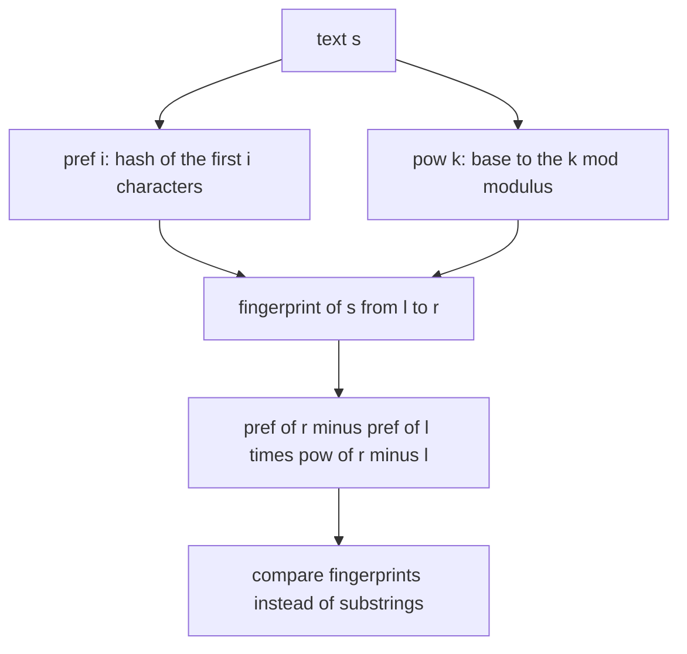
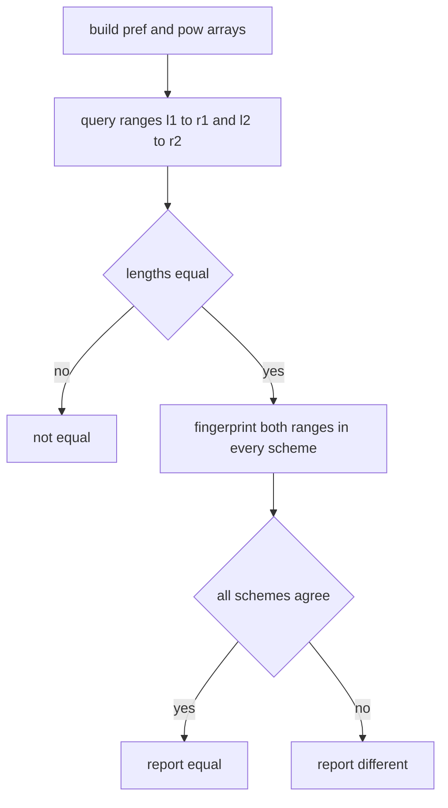
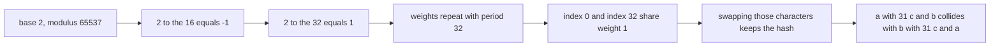

# 411 — Implement advanced rolling hash with modular and base tuning.

> **Tier:** Advanced · **CTCI chapter:** Beyond — Advanced Data Structures & Algorithms
> **Task spec:** [411-implement-advanced-rolling-hash-with-modular-and-base-tuning.md](../../../tasks/advanced/411-implement-advanced-rolling-hash-with-modular-and-base-tuning.md)
> **Solutions:** [Python](../../../solutions/python/advanced/411-implement-advanced-rolling-hash-with-modular-and-base-tuning/solution.py) ·
> [Java](../../../solutions/java/advanced/411-implement-advanced-rolling-hash-with-modular-and-base-tuning/Solution.java) ·
> [JavaScript](../../../solutions/javascript/advanced/411-implement-advanced-rolling-hash-with-modular-and-base-tuning/solution.js) ·
> [C#](../../../solutions/csharp/advanced/411-implement-advanced-rolling-hash-with-modular-and-base-tuning/Solution.cs)

## 1. Problem restatement

**Input:** a string plus a `(base, modulus)` pair chosen by the caller.

**Output:** polynomial fingerprints that can be compared, plus the machinery to compare *any* two
substrings in `O(1)`. The header defines the hash and lists the tuning rules the tests enforce:

> Polynomial hashing: `hash(s) = sum(s[i] * base^(n-1-i)) mod modulus`. Tuning notes:
> * double hashing uses bases `131/137` with the large primes `1_000_000_007 / 1_000_000_009`;
>   all cross products stay below `2^63` and the two moduli are coprime-friendly.
> * the demo pair modulus `65537` with base `2` is deliberately bad: `2^16 = -1` and `2^32 = 1`
>   (mod 65537), so same-length strings that only shift a character by 32 positions collide —
>   that is the constructed single-hash collision asserted below.
> * base `1` degenerates the hash to the plain character sum, so anagrams collide.
> * prefix hashes make every substring fingerprint `O(1)`; `MultiHash` combines several
>   `(base, modulus)` pairs so an accidental equality needs to beat all of them at once.

| Call | Result |
| --- | --- |
| `poly_hash("ab", 131, 1_000_000_007)` | `12805` (`97 · 131 + 98`) |
| `poly_hash("abc", 131, 1_000_000_007)` | `1677554` (`97 · 131² + 98 · 131 + 99`) |
| `RollingHash("abc", 131, MOD1).get(0, 3)` | `1677554` — the whole string |
| `RollingHash("abc", 131, MOD1).get(0, 1)` | `97` — the first character |
| `RollingHash("abc", 131, MOD1).get(1, 3)` | `poly_hash("bc", 131, MOD1) == 12937` |
| `RollingHash("abc", 131, MOD1).get(0, 0)`, `get(3, 3)` | `0`, `0` — the empty substring |
| `poly_hash("a" + "c"*31 + "b", 2, 65537)` | equals `poly_hash("b" + "c"*31 + "a", 2, 65537)` — a real collision |
| `MultiHash(s, [(131, MOD1), (137, MOD2)]).fingerprint(0, 33)` | differs from the same fingerprint of `t` |
| `poly_hash("ab", 1, MOD1) == poly_hash("ba", 1, MOD1)` | `True` — base 1 is degenerate |
| `poly_hash("A", 131, 256)` | `ord("A") % 256` |

The test suite uses `MultiHash.equal(l1, r1, l2, r2)` — which first requires equal lengths, then
compares the tuple of fingerprints — as an oracle against real substring equality on six
61-character LCG strings over `"abcde"`, and checks that every `RollingHash.get(l, r)` over
`"mississippi"` equals the direct `poly_hash` of that substring.

## 2. Intuition

A direct fingerprint costs `O(length)`:

```text
function poly_hash(s, base, mod)
  h ← 0
  for ch in s do
    h ← (h * base + code(ch)) mod                 # Horner's rule
  end
  return h
end
```

That is a *string* hash, not a substring hash: comparing two substrings of a long text would be
`O(length)` per probe, which is what an `O(n log n)` binary search on answer length would then
turn into `O(n log n · length)`.

**Key insight.** Prefix hashes make every substring fingerprint `O(1)`. With

```text
pref[i] = hash of the first i characters
pow[k]  = base^k mod modulus
```

the hash of `s[l:r]` is `pref[r] - pref[l] · pow[r - l] (mod modulus)`: `pref[r]` contains the
`s[l:r]` part shifted by `r - l` powers of `base`, so subtracting the shifted prefix isolates it.
The shipped `RollingHash` stores exactly those two arrays, and `MultiHash` stores several of them.

The tuning part of the header is about *which* `(base, modulus)` to store, and the two failure
modes are worth internalising:

- **A modulus whose power group is tiny makes weights repeat.** With `mod = 65537` and `base = 2`,
  `2^16 = -1` and `2^32 = 1`, so the weight of position `i` and position `i + 32` coincide. Any
  two 33-character strings that differ only by swapping the first and last characters hash
  identically — the demo collision asserted in every language.
- **A degenerate base destroys order information.** With `base = 1` every weight is `1`, so the
  hash is the plain character sum and anagrams (`"ab"`, `"ba"`) collide.

Double hashing with two large primes and two bases makes both failures vanish in practice: a
candidate equality must survive two independent modular arithmetic systems at once.



## 3. Algorithm

**Build the prefix arrays.**

1. `pref[0] = 0`; for each character, `pref[i + 1] = (pref[i] * base + code(s[i])) mod modulus`.
   This is Horner's rule and it produces exactly `sum(s[i] * base^(n-1-i))` over the whole string.
2. `pow[0] = 1`; `pow[k] = pow[k - 1] * base mod modulus`.

**Fingerprint a substring.**

3. Return `(pref[r] - pref[l] * pow[r - l]) mod modulus`, normalised into `[0, modulus)`.
   `l == r` gives `0` for the empty substring.

**Compare (with `MultiHash`).**

4. Reject immediately when the two ranges have different lengths.
5. Otherwise fingerprint both ranges under *every* stored `(base, modulus)` pair and require the
   tuples to be equal.

```text
class RollingHash
  build(s, base, modulus):
    pref[0] ← 0
    for i ← 0 to length(s) - 1 do
      pref[i + 1] ← (pref[i] * base + code(s[i])) mod modulus
    end
    pow[0] ← 1
    for k ← 1 to length(s) do
      pow[k] ← (pow[k - 1] * base) mod modulus
    end

  get(l, r):
    return (pref[r] - pref[l] * pow[r - l]) mod modulus
end

class MultiHash
  equal(l1, r1, l2, r2):
    if r1 - l1 ≠ r2 - l2 then return false
    return fingerprint(l1, r1) = fingerprint(l2, r2)      # tuple over every scheme
end
```



## 4. Worked example

Build `RollingHash("abc", 131, 1_000_000_007)` and query it.

| Step | Character | `pref[i + 1] = pref[i] * 131 + code` | Value |
| --- | --- | --- | --- |
| 0 | — | `pref[0]` | `0` |
| 1 | `a` | `0 · 131 + 97` | `97` |
| 2 | `b` | `97 · 131 + 98` | `12805` |
| 3 | `c` | `12805 · 131 + 99` | `1677554` |

`pow = [1, 131, 17161, 2248091, ...]`. Now the queries:

| Range | Formula | Result |
| --- | --- | --- |
| `[0, 3)` | `pref[3] - pref[0] · pow[3]` | `1677554` |
| `[0, 1)` | `pref[1] - pref[0] · pow[1]` | `97` |
| `[1, 2)` | `pref[2] - pref[1] · pow[1] = 12805 - 97 · 131` | `98` |
| `[2, 3)` | `pref[3] - pref[2] · pow[1] = 1677554 - 12805 · 131` | `99` |
| `[1, 3)` | `pref[3] - pref[1] · pow[2] = 1677554 - 97 · 17161` | `12937` = `poly_hash("bc")` |
| `[0, 0)` | `pref[0] - pref[0] · pow[0]` | `0` |
| `[3, 3)` | `pref[3] - pref[3] · pow[0]` | `0` |

Every substring fingerprint equals the direct polynomial hash of that substring, which is the
property the tests assert exhaustively for `"mississippi"` under both schemes.

**The constructed collision.** Take `base = 2`, `mod = 65537`, and length 33:
`s = "a" + "c" * 31 + "b"`, `t = "b" + "c" * 31 + "a"`. The weights are `2^32, 2^31, ..., 2^0`,
and because `2^32 ≡ 1 (mod 65537)` the first and last positions carry the *same* weight `1`.
Summing the weighted characters therefore gives the same value for `s` and `t`, although
`s != t`:

| Character | weight `2^(32-i)` mod 65537 for `i = 0` and `i = 32` | contribution |
| --- | --- | --- |
| `a` = 97 at index 0 | `2^32 mod 65537 = 1` | 97 |
| `b` = 98 at index 32 | `2^0 = 1` | 98 |

Swapping the two characters swaps which index contributes 97 and which contributes 98, so the
sum is unchanged; every `"c"` in between has a weight that is symmetric under the same shift.
Both `poly_hash` and `RollingHash.get(0, 33)` agree on the collision, which the tests assert.



**The fix.** `MultiHash` with `(131, 1_000_000_007)` and `(137, 1_000_000_009)` separates the two
strings: their fingerprints differ under at least one scheme, so `equal(0, 33, 0, 33)` across the
two strings is false. The same two schemes correctly report equality for identical ranges
(`multi.equal(i, j, i, j)` for every `i, j` in the test loop) and match the true substring
comparison on 60 random range pairs per LCG string.

**Base 1.** `poly_hash("ab", 1, MOD1) == poly_hash("ba", 1, MOD1) == 97 + 98 = 195`, because all
weights collapse to `1`. With `base = 131` the two differ. Similarly `poly_hash("A", 131, 256)`
is just `ord("A") % 256 = 65`: a modulus smaller than the character range immediately discards
information.

## 5. Complexity

Let `n` be the text length, `m` a substring length and `h` the number of `(base, modulus)` schemes.

| Measure | Bound | Why it holds |
| --- | --- | --- |
| Time, build | `O(n · h)` | two arrays of `n + 1` modular values per scheme |
| Time, substring fingerprint | `O(h)` | two lookups, one multiplication and one subtraction per scheme, all constant time |
| Time, equality test | `O(h)` | fingerprint both ranges and compare tuples; lengths are checked first |
| Time of a direct substring hash | `O(m)` | Horner over the substring, which is what the prefix arrays replace |
| Space | `O(n · h)` | `pref` and `pow` per scheme |
| Space of a suffix-array index | `O(n)` | [401](../../../tasks/advanced/401-implement-suffix-array-sa-is-or-doubling-for-medium-n.md) is deterministic but needs an order; hashing is probabilistic but tiny |
| Overall with binary search on answer length | `O(n log n · h)` expected | the classic "binary search the length, compare all windows by fingerprint" pattern |

All arithmetic must stay in 64-bit range for the Java and C# variants: `pref[i] * base` with
`pref[i] < 1_000_000_007` and `base = 131` is about `1.3 · 10^11`, far below `2^63`, which is the
numerical reason the header gives for those two primes.

## 6. Pitfalls and edge cases

- **Collisions are possible, by design.** The demo pair `(2, 65537)` is *not* a tuning mistake in
  the test — it is a constructed counterexample that the tests assert must collide. If your
  implementation does not reproduce that collision, your weights are wrong.
- **Base 1 and small moduli lose information.** `base = 1` makes the hash a character sum, and
  `mod = 256` keeps only the low byte. The tests assert both degenerate behaviours, so a
  "helpful" implementation that rejected them would fail.
- **Normalise moduli into `[0, modulus)`.** The Python version relies on `%` returning a
  non-negative value; in Java and C# the remainder can be negative, so the shipped code adds the
  modulus before returning. A negative fingerprint would break tuple comparisons.
- **Always compare lengths first.** Fingerprints of different lengths are rarely equal, but
  "rarely" is not "never" — `MultiHash.equal` checks `r1 - l1 != r2 - l2` before hashing.
- **The empty substring hashes to `0`.** `get(l, l) == 0` for every `l`, and the tests assert it
  at `[0, 0)` and `[3, 3)`. Zero-length comparisons are equal to each other and that is correct.
- **Two schemes must use different moduli.** Using the same modulus twice with different bases
  still survives the `2^32 ≡ 1` style collisions; the header names coprime-friendly large primes
  precisely to avoid correlated failure.
- **Overflow in fixed-width languages.** `pref[i] * pow[r - l]` is a product of two values below
  the modulus, so it stays inside `int64` for the recommended primes; a smaller modulus with a
  wide base could overflow a 32-bit type.
- **`get(l, r)` requires `0 <= l <= r <= n`.** The shipped class does not validate; callers that
  slice outside the string would produce meaningless fingerprints rather than errors.
- **Hashing answers the wrong question faster, not better.** A fingerprint equality never
  *proves* equality; every use in this repository pairs it with a comparison or an exact
  algorithm, as the `MultiHash` oracle loop does.

## 7. Variants and follow-ups

- **Replacing LCP arrays.** [402 — Build the LCP array from the suffix array (Kasai)](../../../tasks/advanced/402-build-lcp-array-from-suffix-array-kasai.md)
  computes the same "longest common prefix" information deterministically; a rolling hash plus
  binary search is the probabilistic shortcut used in competitive settings.
- **Longest repeated substring by hashing.** [403 — Use suffix array + LCP for the longest
  repeated substring](../../../tasks/advanced/403-use-suffix-array-lcp-for-longest-repeated-substring.md)
  can be solved in `O(n log n)` expected time by binary-searching the answer length and hashing
  all windows — the price is the collision risk this task measures.
- **Exact substring search.** [408 — Pattern matching with a suffix tree (outline)](../../../tasks/advanced/408-pattern-matching-with-suffix-tree-outline.md)
  and [410 — FM-index: basic concept and small demo](../../../tasks/advanced/410-fm-index-basic-concept-and-small-demo.md)
  locate patterns exactly, with no collision analysis needed.
- **Windowed hashing.** The same prefix arrays answer "is this window equal to the previous one"
  in `O(1)`, which is the primitive behind Rabin–Karp and duplicate-detection passes over large
  corpora.
- **Where it sits.** Hashing is the probabilistic sibling of the deterministic string indexes in
  [Advanced topics](../../ctci/x-advanced-topics.md).

## 8. Check yourself

1. Why is `hash(s[l:r]) = pref[r] - pref[l] · base^(r-l)` rather than a simple difference?

<details><summary>Show answer</summary>

`pref[r]` is the hash of `s[0:r]`, in which the characters of `s[l:r]` carry weights
`base^(r-1-l) ... base^0`, while `pref[l]` has the same prefix carrying weights `base^(l-1) ... base^0`.
Multiplying `pref[l]` by `base^(r-l)` aligns its weights with those in `pref[r]`, so subtracting
removes the prefix and leaves exactly the substring's own polynomial.

</details>

2. Explain in one sentence why `base = 2`, `mod = 65537` produces a collision for the two
   33-character demo strings.

<details><summary>Show answer</summary>

Because `2^32 ≡ 1 (mod 65537)`, the weight of the first position equals the weight of the last
position in a length-33 string, so exchanging the characters at those two positions leaves the
weighted sum unchanged.

</details>

3. What does `MultiHash` buy over a single scheme, and what does it not buy?

<details><summary>Show answer</summary>

It buys a much smaller collision probability: a candidate pair must collide under every
`(base, modulus)` scheme, and the recommended pairs use large, coprime-friendly primes. It does
not buy certainty — hashing is still probabilistic, so results that must be exact need a
verification step.

</details>

4. `RollingHash("abc", 131, MOD1).get(1, 3) == 12937` while `get(0, 3) == 1677554`. Why is the
   shorter substring's fingerprint so much smaller?

<details><summary>Show answer</summary>

Because weights depend on the length: in `"abc"` position `0` carries `131² = 17161`, while in
the two-character fragment `"bc"` the leading character carries only 131. The numbers are not
comparable across lengths at all — which is exactly why `MultiHash.equal` checks the lengths
before comparing fingerprints.

</details>
