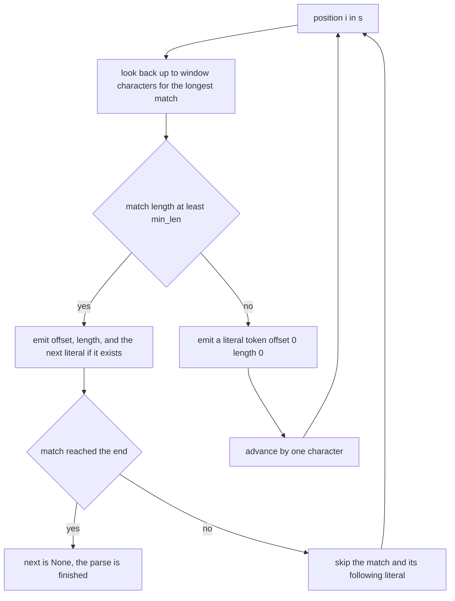
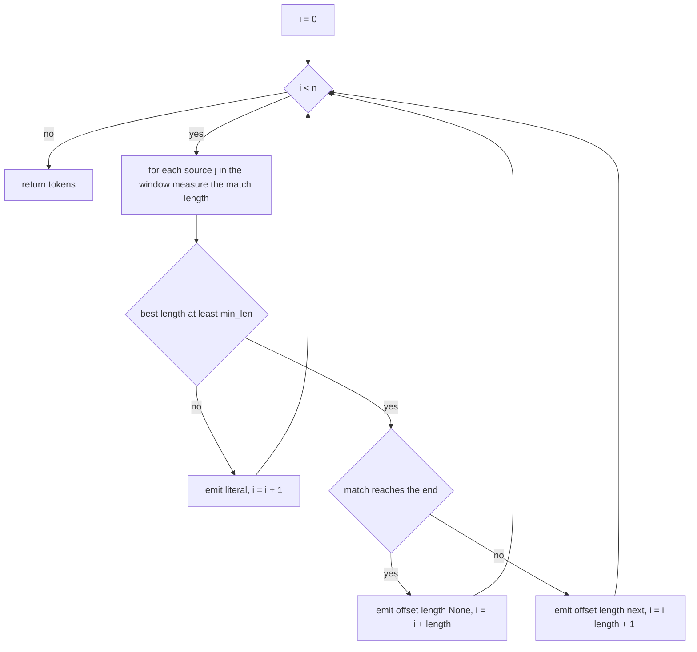
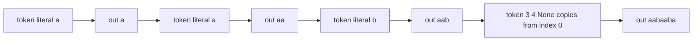

# 412 — Implement string factorization (LZ77 parse).

> **Tier:** Advanced · **CTCI chapter:** Beyond — Advanced Data Structures & Algorithms
> **Task spec:** [412-implement-string-factorization-lz77-parse.md](../../../tasks/advanced/412-implement-string-factorization-lz77-parse.md)
> **Solutions:** [Python](../../../solutions/python/advanced/412-implement-string-factorization-lz77-parse/solution.py) ·
> [Java](../../../solutions/java/advanced/412-implement-string-factorization-lz77-parse/Solution.java) ·
> [JavaScript](../../../solutions/javascript/advanced/412-implement-string-factorization-lz77-parse/solution.js) ·
> [C#](../../../solutions/csharp/advanced/412-implement-string-factorization-lz77-parse/Solution.cs)

## 1. Problem restatement

**Input:** a string `s`, a window size (`8` by default) and a minimum match length (`3` by
default).

**Output:** a token list — the LZ77 factorization — that can be replayed into the original
string. The header fixes the token shape and every tie-breaking rule:

> Every token is a triple `(offset, length, next)`:
> * `offset` = distance back to the match source (`0` for a pure literal),
> * `length` = matched characters copied from that earlier position,
> * `next` = the literal character that follows the match (`None` when the match consumes the end
>   of the string).
>
> Rules (documented, deterministic):
> * a match source `j` must satisfy `max(0, i - window) <= j < i` (window = 8 by default),
> * the greedy step takes the LONGEST match, ties broken by the SMALLEST offset,
> * matches shorter than `min_len = 3` are not worth a token, so a literal is emitted,
> * matches may overlap the source region (`s[j+L]` is read from the original string).

| Call | Result |
| --- | --- |
| `lz77_parse("abcabcabc", 8, 3)` | `[(0,0,"a"), (0,0,"b"), (0,0,"c"), (3,6,None)]` |
| `lz77_parse("aaaaaaaa", 8, 3)` | `[(0,0,"a"), (1,7,None)]` |
| `lz77_parse("abcabcx", 8, 3)` | `[(0,0,"a"), (0,0,"b"), (0,0,"c"), (3,3,"x")]` |
| `lz77_parse("aabaaba", 8, 3)` | `[(0,0,"a"), (0,0,"a"), (0,0,"b"), (3,4,None)]` |
| `lz77_parse("aabaab", 3, 3)` | `[(0,0,"a"), (0,0,"a"), (0,0,"b"), (3,3,None)]` — the source is 3 back, so `window` must be at least 3 |
| `lz77_parse("aabaab", 2, 3)` | six literals, one per character — distance 3 is out of the window |
| `lz77_parse("aaab", 8, 3)` | four literals: the only match has length 2, below `min_len` |
| `lz77_parse("aaab", 8, 2)` | `[(0,0,"a"), (1,2,"b")]` — with `min_len = 2` the match is worth a token |
| `lz77_parse("")` | `[]` |
| `lz77_parse("ab", 8, 3)` | `[(0,0,"a"), (0,0,"b")]` — too short to match |
| `optimal_parse_len("abcabcabc", 8, 3)` | `4` — the greedy token count is optimal here |
| `optimal_parse_len("aaaaaaaa", 8, 3)` | `2` |

Four properties are checked on the hand cases and on 8 LCG strings of 60–159 characters over
`"ab"`/`"abc"` with windows from `4` to `32`: `lz77_decode(lz77_parse(s)) == s`; the greedy parse
equals an independently written `lz77_bruteforce` that enumerates all lengths from longest to
shortest; every token respects `offset <= window` and `length == 0 or length >= min_len`; and
`optimal_parse_len <= len(greedy) <= len(s)`, i.e. greedy is never worse than the all-literal
parse and never better than the DP optimum.

## 2. Intuition

The trivial factorization emits one literal per character — correct, decodable, and completely
pointless. The LZ77 idea is to notice that the text that is about to be produced has usually
already appeared somewhere behind us, so instead of writing characters we can write
"copy 6 characters from 3 positions back".

**Key insight.** The encoder and the decoder must agree on where a copy's characters come from.
LZ77 resolves this by copying from the *original* string (or, equivalently, from the output as it
is being built), which makes **overlapping copies** legal: `"aaaaaaaa"` is one literal `a`
followed by "copy 7 characters from 1 position back", and the decoder produces them one at a
time, feeding each new character back into the available source. That single rule is what lets a
run of any length be encoded with two tokens.

Three documented knobs keep the result deterministic and useful:

- **`window`** bounds how far back a source may be. Without it, `offset` can be `O(n)` and the
  token becomes as expensive as the text.
- **`min_len`** rejects matches that would cost more than they save: a 2-character match needs a
  token with an offset and a length, which is worse than two literals.
- **Longest match wins, ties to the smallest offset**, so the parse is a function of the input
  and not of dictionary iteration order.



## 3. Algorithm

1. Start at `i = 0`.
2. If `i >= n`, stop.
3. Scan every candidate source `j` with `max(0, i - window) <= j < i` and measure the match
   length `L` while `i + L < n` and `s[j + L] == s[i + L]`. Keep the longest `L`, breaking ties
   by the smallest `offset = i - j` — which, because the loop walks `j` upwards, means keeping the
   first maximum found (the strict `L > best_len` test).
4. If the best length is at least `min_len`:
   - emit `(offset, length, next)` where `next` is `s[i + length]` when the match does **not**
     reach the end of the string, and `None` when it does,
   - advance `i` by `length`, plus one more if the token carried a `next` character.
5. Otherwise emit the literal `(0, 0, s[i])` and advance `i` by one.
6. Return the token list. Decoding replays it: for a token with `length > 0`, copy `length`
   characters starting at `len(out) - offset`, appending as you go (this is what makes overlaps
   work); then append `next` if it is not `None`.

```text
function lz77_parse(s, window, min_len)
  tokens ← empty, i ← 0, n ← length(s)
  while i < n do
    best_len ← 0, best_off ← 0
    for j ← max(0, i - window) to i - 1 do
      L ← 0
      while i + L < n and s[j + L] = s[i + L] do
        L ← L + 1
      end
      if L > best_len then
        best_len ← L, best_off ← i - j
      end
    end
    if best_len ≥ min_len then
      if i + best_len = n then
        append (best_off, best_len, None) to tokens
        i ← i + best_len
      else
        append (best_off, best_len, s[i + best_len]) to tokens
        i ← i + best_len + 1
      end
    else
      append (0, 0, s[i]) to tokens
      i ← i + 1
    end
  end
  return tokens
end
```

Note the `L > best_len` comparison: scanning `j` from the smallest candidate upwards and keeping
only strict improvements is exactly "longest match, smallest offset on ties".



## 4. Worked example

Parse `"aabaaba"` with `window = 8`, `min_len = 3`.

| Token | `i` | candidates `j` | match lengths `L` | best | decision | `i` after |
| --- | --- | --- | --- | --- | --- | --- |
| 1 | 0 | none (empty window) | — | none | literal `a` | 1 |
| 2 | 1 | `j = 0` | `s[0]='a'` matches `s[1]='a'`, then `s[1]='a'` vs `s[2]='b'` fails → `L = 1` | `L = 1 < 3` | literal `a` | 2 |
| 3 | 2 | `j = 0, 1` | `'a'` vs `'b'` → `0`; `'a'` vs `'b'` → `0` | `L = 0 < 3` | literal `b` | 3 |
| 4 | 3 | `j = 0` | `a a b a` matches, `i + L = 7 = n` → `L = 4` | `L = 4`, back to `j = 1` gives only `1`, `j = 2` gives `0` | match reaches the end → `(3, 4, None)` | 7 |

The result is `[(0,0,"a"), (0,0,"a"), (0,0,"b"), (3,4,None)]`, matching the anchor. Decoding shows
why the sentinel `None` matters:

| Token | `out` before | action | `out` after |
| --- | --- | --- | --- |
| `(0,0,"a")` | `""` | literal | `"a"` |
| `(0,0,"a")` | `"a"` | literal | `"aa"` |
| `(0,0,"b")` | `"aa"` | literal | `"aab"` |
| `(3,4,None)` | `"aab"` | copy 4 characters from `len(out) - 3 = 0`, no trailing literal | `"aabaaba"` |



**The overlapping case.** `"aaaaaaaa"` gives `[(0,0,"a"), (1,7,None)]`: the second token copies
7 characters from exactly 1 position back. The decoder appends `out[0]`, then `out[1]` — which it
created a moment ago — and so on, so a single token produces the whole run. The encoder measured
`L` against the original string, where `s[j + L]` is always well defined, so it could happily
report `L = 7` for a source that only has one character "available" at the time the copy starts.

**The knobs in action.** `"aabaab"` with `window = 3` still finds the distance-3 source and emits
`(3, 3, None)`; with `window = 2` that source is out of range and the parse degenerates to six
literals. `"aaab"` with `min_len = 3` rejects the length-2 match and emits four literals; with
`min_len = 2` it emits `[(0,0,"a"), (1,2,"b")]`. `"abcabcx"` emits `(3,3,"x")`: the match does
*not* reach the end, so the token carries the following literal and the index advances by four.

The DP in `optimal_parse_len` gives the best token count any parse of the string could achieve:

| String | `optimal_parse_len` | greedy tokens | comment |
| --- | --- | --- | --- |
| `"abcabcabc"` | `4` | `4` | three literals plus one long copy is optimal |
| `"aaaaaaaa"` | `2` | `2` | one literal plus one overlapping copy is optimal |

On the LCG corpus the tests only assert `optimal <= len(greedy) <= len(s)`: greedy is not always
optimal, but it is never worse than writing every character and never better than the DP bound.

## 5. Complexity

Let `n` be the string length and `w` the window size.

| Measure | Bound | Why it holds |
| --- | --- | --- |
| Time, encode | `O(n · w · L)` worst case | at each position every candidate source in the window is extended character by character, up to `L` matches each |
| Time, encode, practical | `O(n · w)` for small alphabets | runs stop early because mismatches are frequent |
| Time, decode | `O(n)` | each token appends exactly the characters it produces |
| Space, tokens | `O(n)` worst case | all-literal input produces `n` tokens; each token is three fields |
| Space, decode | `O(n)` | the output buffer |
| Space, DP oracle | `O(n)` | `optimal_parse_len` keeps one integer per position |
| Comparison: suffix automaton | `O(n)` build | [404](../../../tasks/advanced/404-implement-suffix-automaton-and-count-different-substrings.md) can enumerate repeats in linear time, which is how production LZ77 encoders find matches faster than the quadratic window scan |

The shipped encoder is the textbook `O(n · w · L)` scan; real compressors replace the inner loop
with a hash chain or a suffix structure, which is exactly what the other tasks in this tier build.

## 6. Pitfalls and edge cases

- **Overlapping copies are legal and are the point.** `"aaaaaaaa"` must produce
  `(1, 7, None)`, not a copy of length 1. The encoder measures the match against `s` itself, and
  the decoder reads its own output as it grows.
- **`next` is `None` exactly when the match consumes the end of the string.** `"abcabcabc"` ends
  with `(3, 6, None)`; `"abcabcx"` ends with `(3, 3, "x")`. Getting this wrong either drops a
  character or appends a duplicate, and the decode round-trip test catches both.
- **The index advance is `length + 1` when a `next` character was consumed.** Advancing by
  `length` alone re-encodes that character; advancing by `length + 1` unconditionally on a
  `None` token runs past the end.
- **Ties go to the smallest offset.** Scanning `j` upwards with a strict `L > best_len` test
  implements it. Using `>=` would prefer the most recent occurrence instead, and the
  re-derivation loop in the tests (`assert ln == best_len and off == pos - best_j`) would fail on
  `"abababababab"`.
- **`window` changes the parse, not just the speed.** `"aabaab"` with `window = 2` cannot see the
  distance-3 source and emits literals instead. The tests assert both parses.
- **`min_len` is measured on the match length, not on the total saving.** `"aaab"` with
  `min_len = 3` has a length-2 match available and still emits literals; with `min_len = 2` the
  same input produces a token. Both are asserted.
- **Empty string.** `lz77_parse("") == []` and `lz77_decode([]) == ""`; the loop never runs.
- **Very short strings.** `"ab"` with `min_len = 3` cannot match at all and yields two literals.
- **Self-referential sources.** A source `j` may be as close as `i - 1`, so `L` can exceed
  `i - j`; the encoder must therefore read `s[j + L]` from the original string rather than from a
  position that has already been "consumed".
- **Token invariants.** `off <= window`, `ln == 0 or ln >= 3` and `off >= 1 when ln > 0` are all
  asserted on the hand cases and on the LCG corpus; a token with `ln > 0` and `off == 0` would be
  an infinite loop at decode time.
- **Decoding is the real contract.** The tests always check `lz77_decode(lz77_parse(s)) == s`, so
  a parse that "looks right" but cannot be replayed fails immediately.

## 7. Variants and follow-ups

- **Optimal parsing.** The DP in `optimal_parse_len` finds the fewest tokens any parse can use;
  the same recurrence with the token cost replaced by a real bit cost gives the optimal
  compression ratio instead of the optimal token count.
- **Faster match finding.** A hash chain over the last `window` positions, or the suffix automaton
  of [404 — Implement a suffix automaton and count different substrings](../../../tasks/advanced/404-implement-suffix-automaton-and-count-different-substrings.md),
  removes the quadratic inner scan without changing the token format.
- **LZ78 and friends.** The LZ77 token stream keys on *distances*; the LZ78 family replaces the
  offset with a dictionary index, which trades the window for an explicit dictionary.
- **Rolling hashes for candidate filtering.** [411 — Advanced rolling hash with modular and base
  tuning](../../../tasks/advanced/411-implement-advanced-rolling-hash-with-modular-and-base-tuning.md)
  is the usual trick for finding candidate matches in `O(1)` before extending them.
- **What comes next in compression.** The Burrows–Wheeler transform of
  [409 — Implement the Burrows-Wheeler transform and its inverse](../../../tasks/advanced/409-implement-burrows-wheeler-transform-and-inverse.md)
  and the FM-index of
  [410 — FM-index: basic concept and small demo](../../../tasks/advanced/410-fm-index-basic-concept-and-small-demo.md)
  attack the same redundancy from the sorting side; [Advanced topics](../../ctci/x-advanced-topics.md)
  places the two families side by side.

## 8. Check yourself

1. Why can the second token of `"aaaaaaaa"` have length 7 when only one character has been
   emitted so far?

<details><summary>Show answer</summary>

Because the copy source may overlap the destination. The decoder appends characters one at a time
and reads `out[size - offset + k]` as it grows, so with `offset = 1` each appended `a` becomes the
source for the next one. The encoder measures the match against the original string, where all
seven characters exist.

</details>

2. What exactly does the `next` field buy, and when is it `None`?

<details><summary>Show answer</summary>

It carries the literal character that forced the match to stop, so a token can consume the match
*and* the mismatch in one step. It is `None` only when the match runs to the end of the string,
in which case there is no following character and the parse finishes.

</details>

3. `lz77_parse("aabaab", 2, 3)` returns six literals while `window = 3` returns a match. Why?

<details><summary>Show answer</summary>

The match for the second occurrence of `"aab"` starts 3 positions back. With `window = 2` the
candidate set at that position is `{i-2, i-1}`, so the source is out of range and no match of
length at least 3 exists — the greedy encoder falls back to literals.

</details>

4. Why do the tests compare the greedy parse with a brute-force re-derivation token by token
   instead of just checking the round-trip?

<details><summary>Show answer</summary>

Because many different parses decode to the same string. The round-trip only proves the decoder is
consistent with the encoder; the brute-force re-derivation and the tie-break assertions prove the
parse is the *documented* one — longest match, smallest offset, literals below `min_len`.

</details>
