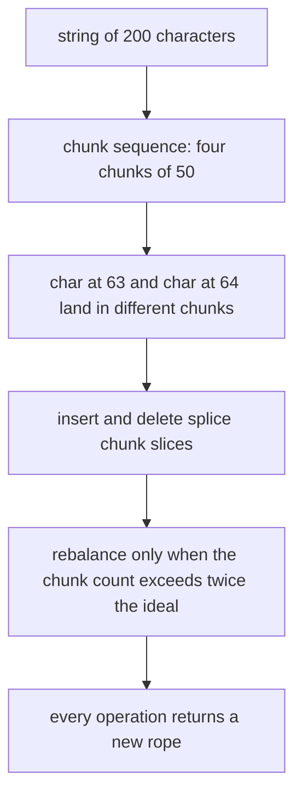
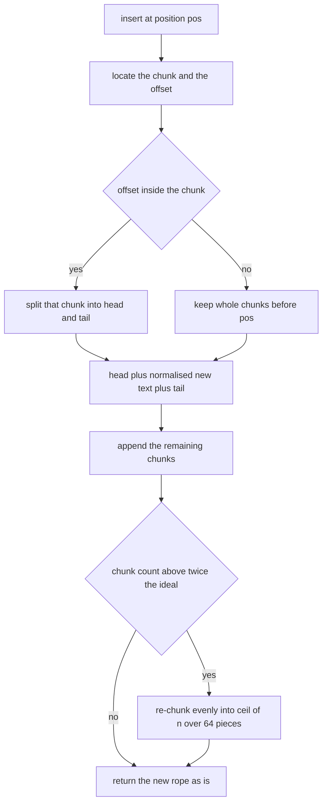
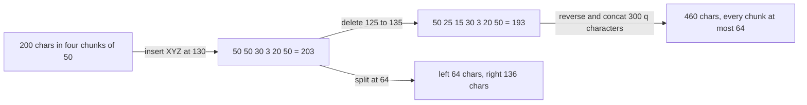

# 413 — Implement a data structure for dynamic string operations (rope).

> **Tier:** Advanced · **CTCI chapter:** Beyond — Advanced Data Structures & Algorithms
> **Task spec:** [413-implement-data-structure-for-dynamic-string-operations-rope.md](../../../tasks/advanced/413-implement-data-structure-for-dynamic-string-operations-rope.md)
> **Solutions:** [Python](../../../solutions/python/advanced/413-implement-data-structure-for-dynamic-string-operations-rope/solution.py) ·
> [Java](../../../solutions/java/advanced/413-implement-data-structure-for-dynamic-string-operations-rope/Solution.java) ·
> [JavaScript](../../../solutions/javascript/advanced/413-implement-data-structure-for-dynamic-string-operations-rope/solution.js) ·
> [C#](../../../solutions/csharp/advanced/413-implement-data-structure-for-dynamic-string-operations-rope/Solution.cs)

## 1. Problem restatement

**Input:** a string, plus a stream of edits described by positions and ranges.

**Output:** a rope — a string type whose edits do not copy the whole text — with this interface:
`length`, `to_string`, `char_at(pos)`, `slice(start, end)`, `insert(pos, text)`,
`delete(start, end)`, `split(pos)`, `concat(other)` and `reverse()`.

The header is explicit that this is a **documented simulation** of the tree version, and it
matters for every complexity claim in this tutorial:

> A rope stores a string as a sequence of chunks (leaves of a binary tree). The real structure is
> a balanced tree of chunks with `O(log n)` split/concat; this implementation keeps the chunk
> sequence FLAT and balanced instead, a documented simulation with the same interface:
> * chunks hold at most `CHUNK = 64` characters and are rebalanced so their count stays within
>   ~2x of the ideal `ceil(n / 64)`,
> * `index`/`char_at`/`slice` locate by walking the chunk lengths (`O(#chunks + CHUNK)`),
> * `insert`/`delete`/`split`/`concat`/`reverse` splice chunks and rebalance (`O(n + CHUNK)`);
>   a tree-based rope would perform the same operations by re-linking subtrees.
>
> All operations are functional: they return NEW ropes, leaving the receiver untouched.

| Call | Result |
| --- | --- |
| `Rope("hello").length`, `.char_at(0)`, `.char_at(4)` | `5`, `"h"`, `"o"` |
| `Rope("hello").slice(1, 4)` | `"ell"` |
| `Rope("abef").insert(2, "cd").to_string()` | `"abcdef"` |
| `Rope("hello").insert(0, "xyz").to_string()` | `"xyzhello"` |
| `Rope("hello").insert(0, "xyz").delete(3, 6).to_string()` | `"xyzlo"` |
| `Rope("xyzlo").split(2)` | `("xy", "zlo")` |
| `Rope("xyzlo").reverse().to_string()` | `"olzyx"` |
| `Rope("").insert(0, "abc").to_string()` | `"abc"` |
| `Rope("abc").delete(1, 2).to_string()` | `"ac"` |
| `Rope("abc").delete(0, 0).to_string()` | `"abc"` — an empty range is a no-op |
| `Rope("abc").split(0)[1].to_string()` | `"abc"` |
| `Rope("abc").split(3)[0].to_string()` | `"abc"` |

The correctness argument is a 320-step fuzz loop driven by a small LCG: at every step a rope and a
plain string are both updated with the same operation (insert, delete, reverse, slice, split,
concat) and after *every* step the file asserts `rope.to_string() == oracle` and
`rope.length == len(oracle)`. The hand-written checks on a 200-character rope additionally assert
cross-chunk behaviour at the chunk boundaries (positions `63` and `64`) and the chunk-size
invariant `all(len(c) <= CHUNK)` after a chain of structural operations.

## 2. Intuition

The naive string type copies on every edit: inserting one character into an `n`-character string
costs `O(n)`, because the result is a new contiguous buffer. For a text editor doing thousands of
keystrokes that is quadratic overall.

A rope replaces the single buffer with a **sequence of chunks**. Small edits touch the chunks
near the edit and leave the rest of the sequence shared; a tree over the chunks can then find
position `i` in `O(log n)` by comparing subtree lengths.

The flat version keeps the interface and the invariants, with an honest complexity penalty:

- **Chunks, not characters.** Every chunk holds at most `CHUNK = 64` characters. A 200-character
  rope therefore holds `ceil(200 / 64) = 4` chunks.
- **Rebalancing instead of tree balance.** After a structural edit the chunk *count* is compared
  with the ideal `ceil(n / 64)`; when the sequence grows beyond roughly twice that (plus a small
  slack), the chunks are re-chunked evenly. Chunk count, not tree height, is what stays
  proportional.
- **Functional updates.** Every operation returns a new rope built from slices of the old chunks,
  so the receiver is never mutated — asserted directly:
  `original = Rope("keepme"); original.insert(0, "X"); original.delete(0, 3); original.reverse();
  original.to_string() == "keepme"`.



## 3. Algorithm

**Locate.** `_locate(pos)` walks the chunks subtracting their lengths; it returns the chunk index
plus the offset inside it (and `len(chunks)` for a position at the very end). `char_at` is the
same walk followed by a single index operation; `slice` collects consecutive chunk slices until
the requested number of characters is produced.

**Insert.** `insert(pos, text)`:
1. locate `(idx, off)` for `pos`;
2. copy chunks `0 .. idx-1`;
3. if `off > 0`, append the head of chunk `idx` (the part before `off`);
4. append the normalised chunks of `text`;
5. if `off` is strictly inside chunk `idx`, append its tail;
6. append the remaining chunks, then rebalance.

**Delete.** `delete(start, end)` locates both ends and keeps the prefix before `start` plus the
suffix after `end`, dropping everything in between. An empty range returns an equal rope.

**Split and concat.** `split(pos)` is the same splice with an empty middle; `concat` appends the
chunk sequences and rebalances. `reverse()` reverses the chunk order *and* each chunk, which
turns a positional reversal into `O(#chunks)` work instead of `O(n)` character moves.

**Rebalance.** `_normalize` joins the chunks and re-cuts them into `ceil(n / CHUNK)` pieces of
equal size; `_maybe_rebalance` applies it only when `len(chunks) > 2 * target + 2`, so a single
edit does not pay for a full re-chunk.

```text
function locate(chunks, pos)
  for idx ← 0 to length(chunks) - 1 do
    if pos ≤ length(chunks[idx]) then return idx, pos
    pos ← pos - length(chunks[idx])
  end
  return length(chunks), 0
end

function insert(rope, pos, text)
  idx, off ← locate(rope.chunks, pos)
  out ← chunks 0 to idx - 1
  if off > 0 then append head of chunks[idx] up to off end
  append normalise(text)
  if off < length(chunks[idx]) then append tail of chunks[idx] from off end
  append chunks idx + 1 to the end
  return new rope with maybe_rebalance(out)
end

function delete(rope, start, end)
  if start = end then return a copy of the rope
  li, lo ← locate(chunks, start)
  ri, ro ← locate(chunks, end)
  out ← chunks 0 to li - 1
  if lo > 0 then append head of chunks[li] up to lo end
  if ro < length(chunks[ri]) then append tail of chunks[ri] from ro end
  append chunks ri + 1 to the end
  return new rope with maybe_rebalance(out)
end
```



## 4. Worked example

Start from the 200-character string used in the tests,
`big = "".join(chr(ord("a") + i % 26) for i in range(200))`. Normalising it into
`ceil(200 / 64) = 4` chunks gives four chunks of `50` characters:

| Chunk | 0 | 1 | 2 | 3 |
| --- | --- | --- | --- | --- |
| holds | `big[0:50]` | `big[50:100]` | `big[100:150]` | `big[150:200]` |
| length | 50 | 50 | 50 | 50 |

**`char_at(63)` and `char_at(64)`.** The first lands in chunk `0` at offset `63`, the second in
chunk `1` at offset `14` — the boundary the tests check explicitly, because an off-by-one there
is the classic flat-rope bug.

**`insert(130, "XYZ")`.** `_locate(130)` skips chunk `0` (`130 - 50 = 80`), skips chunk `1`
(`80 - 50 = 30`) and lands in chunk `2` at offset `30`. The splice produces:

| Output chunk | 0 | 1 | 2 | 3 | 4 | 5 |
| --- | --- | --- | --- | --- | --- | --- |
| contents | `big[0:50]` | `big[50:100]` | `big[100:130]` | `"XYZ"` | `big[130:150]` | `big[150:200]` |
| length | 50 | 50 | 30 | 3 | 20 | 50 |

Concatenated that is `big[:130] + "XYZ" + big[130:]` with length `203`, which is exactly the
oracle the test compares against. `_maybe_rebalance` checks `6 > 2 · ceil(203 / 64) + 2 = 10` —
false — so the chunks stay as they are. The total work was bounded by the chunks touched, not by
the 203 characters.

**`delete(125, 135)` on that rope.** `_locate(125)` lands in chunk `1` at offset `25`;
`_locate(135)` lands in chunk `1` at offset `35`. Both ends are inside the same chunk, so the
result is chunk `0`, the head of chunk `1` (`25` characters), the tail of chunk `1` (`15`
characters) and everything after — `193` characters, `203 - 10`.



**`split(64)`** returns a left rope holding `big[:64]` and a right rope holding `big[64:]`; the
test asserts `left.length == 64` and `right.length == 136`. `split(0)` and `split(3)` on
`"abc"` are the degenerate ends: the first yields an empty left rope, the second an empty right
rope, and both must still be valid ropes (`concat` of the halves reconstructs the original).

**The chunk invariant.** The chained probe
`Rope(big).insert(0, "z" * 40).delete(10, 90).reverse().concat(Rope("q" * 300))` has length
`200 + 40 - 80 + 300 = 460` and passes `all(len(c) <= CHUNK)`: the `"q" * 300` part is normalised
into `ceil(300 / 64) = 5` chunks of `60`, and the reversed part keeps its existing chunk sizes.

**The fuzz loop.** 320 LCG-driven steps against a plain-string oracle exercise exactly these
splices in random order, including degenerate cases (`delete` with `a == b`, `split` at `0` and
at `len`), and after every step both the string and the length must match. `char_at` is then
verified for every index of the final rope.

## 5. Complexity

Let `n` be the rope length, `c` the number of chunks (`≈ n / 64` in the balanced state) and `k`
the length of the inserted text.

| Measure | Bound | Why it holds |
| --- | --- | --- |
| Time, `char_at` / `index` | `O(c + 1)` | walking the chunk lengths, then one character fetch — the header's `O(#chunks + CHUNK)` with a constant chunk cap |
| Time, `slice` | `O(c + length of the slice)` | locate both ends (or walk to the start) and copy the covered chunk slices |
| Time, `insert` / `delete` | `O(c + k + n)` worst case | splicing chunks is linear in the chunk count, but a rebalance joins the text and re-cuts it, which is linear in `n` |
| Time, `concat` | `O(c + rebalance)` | append two chunk lists, then maybe re-chunk |
| Time, `reverse` | `O(c + CHUNK)` | reverse the chunk order and each chunk's characters |
| Space | `O(n)` | the chunks hold the text exactly once |
| Comparison: real tree rope | `O(log n)` index/split/concat | a balanced binary tree of chunks gives logarithmic operations; the flat simulation trades that for simplicity and a documented `O(n)` worst case |
| Comparison: immutable string | `O(n)` per edit, always | every edit copies the whole text; the rope only pays that on a rebalance |

The header's promise is that "a tree-based rope would perform the same operations by re-linking
subtrees" — the interface is the part that carries over, and the fuzz suite tests the interface,
not the asymptotics.

## 6. Pitfalls and edge cases

- **A position at the end of the rope.** `_locate(len)` returns `(len(chunks), 0)`, which is what
  makes `insert(len, text)` and `split(len)` work without a special case in the caller. Without
  that convention, appending would index past the last chunk.
- **Empty ranges.** `delete(0, 0)` and `split(0)` must not corrupt the rope: deletion returns a
  copy and `split(0)` gives an empty left side plus the whole rope. Both are asserted.
- **Empty rope.** `Rope("").length == 0`, `to_string() == ""`, and
  `Rope("").insert(0, "abc").to_string() == "abc"` — `_normalize` of an empty chunk list is an
  empty list, so there is never an empty chunk stored.
- **Offsets exactly at a chunk boundary.** When `off == len(chunk)` the head is the whole chunk
  and there is no tail; when `off == 0` there is no head. Both cases are easy to get wrong and
  the `char_at(63)`/`char_at(64)` checks sit right on that boundary.
- **Two ends in the same chunk.** `delete` and `split` must handle `li == ri`: taking the head of
  the right-hand chunk must use the *end* chunk's head, not the start chunk's. The
  `delete(125, 135)` trace above is the in-chunk case.
- **Functional semantics.** Every method returns a new rope; the tests call `insert`, `delete`
  and `reverse` on one rope and then assert the original string is unchanged. An implementation
  that mutates `self.chunks` would fail here even if every other assertion passed.
- **Chunk size cap.** `all(len(c) <= CHUNK)` is asserted after a chain of operations. A
  re-chunking formula that divides by the wrong target can produce chunks of 65 characters and
  break the invariant.
- **Rebalance threshold.** Re-chunking on *every* edit is still correct but turns every edit into
  `O(n)`; never re-chunking lets the chunk count drift to `O(n)`, which makes `char_at` linear.
  The `> 2 * target + 2` rule is the documented compromise.
- **Positions out of range raise.** `char_at`, `slice`, `insert`, `delete` and `split` all raise
  an index error rather than clamping; the tests only exercise valid positions, but the guards
  are part of the contract.
- **Unicode.** Chunk boundaries fall on characters, so a rope never splits a surrogate pair *in
  the languages where a character is a code unit it can still land inside a pair*; the tests stay
  in ASCII.

## 7. Variants and follow-ups

- **Real tree ropes.** Replace the flat list with a balanced binary tree of chunks (or a
  weight-balanced tree keyed by subtree length) to get `O(log n)` index, split and concat; the
  functional interface and the tests carry over unchanged.
- **Piece tables.** A text editor usually prefers a piece table — a list of spans into two
  immutable buffers — which has the same "do not copy the text" property with a different
  rebalancing story.
- **Gap buffers.** The single-buffer alternative keeps one array with a movable hole, giving
  `O(1)` local edits and `O(n)` moves; it is the foil to the rope in any editor design question.
- **Compressed text structures.** [409 — Implement the Burrows-Wheeler transform and its
  inverse](../../../tasks/advanced/409-implement-burrows-wheeler-transform-and-inverse.md) and
  [410 — FM-index: basic concept and small demo](../../../tasks/advanced/410-fm-index-basic-concept-and-small-demo.md)
  make text *searchable* rather than editable; a rope makes it editable rather than searchable.
- **Where it fits.** Dynamic string structures and static indexes are the two halves of the text
  section of [Advanced topics](../../ctci/x-advanced-topics.md).

## 8. Check yourself

1. Why does the flat simulation rebalance by chunk *count* rather than by tree height?

<details><summary>Show answer</summary>

Because there is no tree: the chunk list *is* the structure, so the only thing that can degrade
is how many chunks a position walk has to skip. Keeping the count within roughly twice the ideal
`ceil(n / 64)` bounds `char_at` by a small multiple of `n / 64`, which is the flat equivalent of
keeping a tree shallow.

</details>

2. `Rope("abc").delete(1, 2)` returns `"ac"`. Walk the two `_locate` calls.

<details><summary>Show answer</summary>

The rope is a single chunk `"abc"`. `_locate(1)` gives `(0, 1)` and `_locate(2)` gives `(0, 2)`,
so `li == ri == 0`. The result is the head of chunk `0` up to offset `1` (`"a"`) plus the tail of
chunk `0` from offset `2` (`"c"`) — `"ac"`.

</details>

3. Why is `reverse()` cheaper on a rope than on a plain string?

<details><summary>Show answer</summary>

Because it reverses the *chunk order* and each chunk's characters, which touches `O(#chunks)`
chunks instead of moving all `n` characters. On the 200-character example only four chunks need
reversing.

</details>

4. The fuzz loop compares against a plain string after every operation instead of only at the end.
   What does that catch?

<details><summary>Show answer</summary>

Intermediate corruption that a later operation could mask — for example a missing tail slice in
`delete` that happens to be re-inserted by the next operation. Comparing after every step localises
the failing operation instead of reporting "the final string is wrong".

</details>
