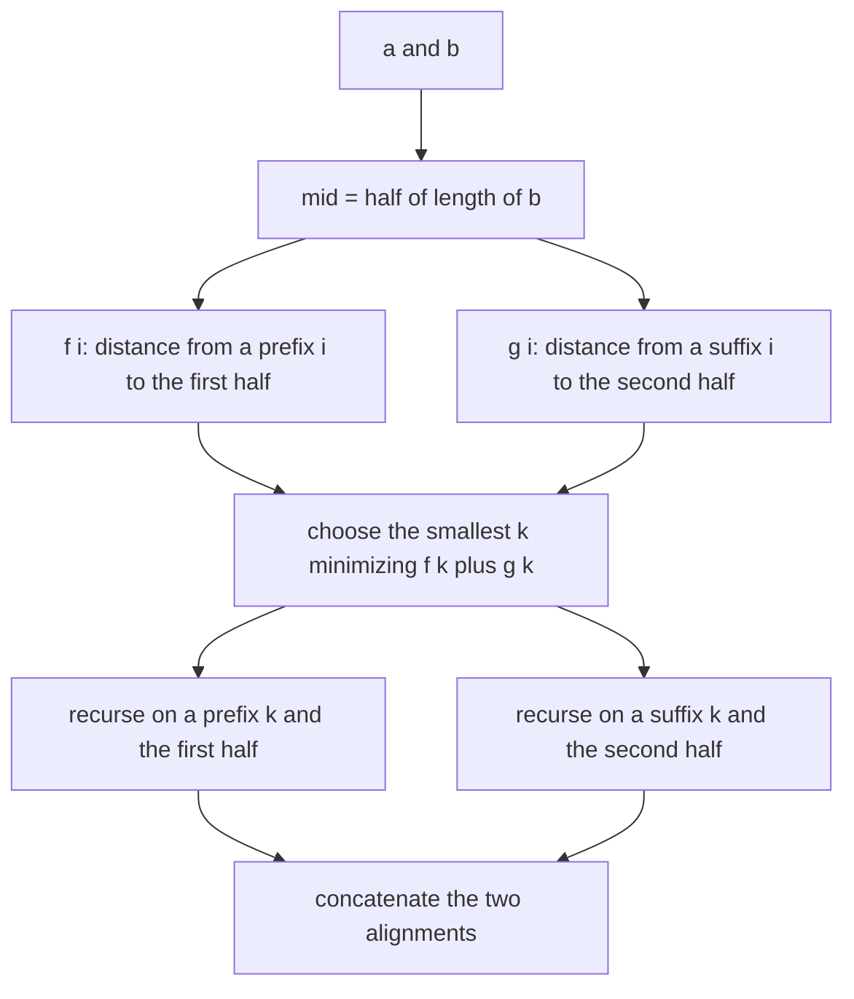
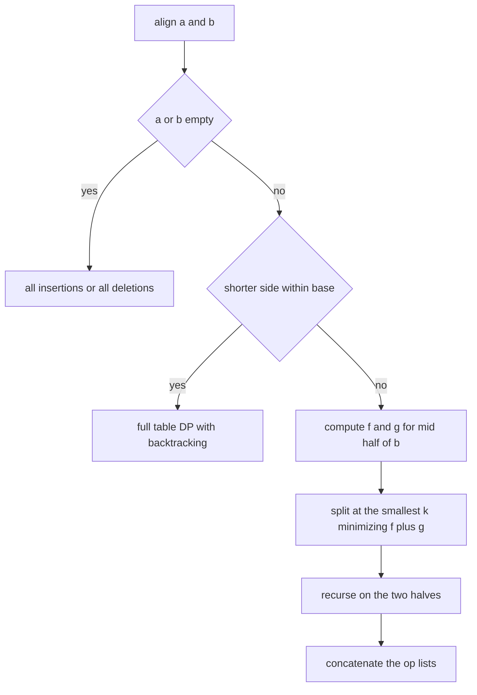
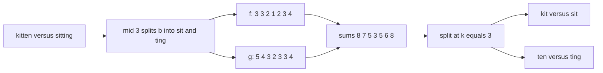

# 414 — Implement edit distance with low memory (Hirschberg).

> **Tier:** Advanced · **CTCI chapter:** Beyond — Advanced Data Structures & Algorithms
> **Task spec:** [414-implement-edit-distance-with-low-memory-hirschberg.md](../../../tasks/advanced/414-implement-edit-distance-with-low-memory-hirschberg.md)
> **Solutions:** [Python](../../../solutions/python/advanced/414-implement-edit-distance-with-low-memory-hirschberg/solution.py) ·
> [Java](../../../solutions/java/advanced/414-implement-edit-distance-with-low-memory-hirschberg/Solution.java) ·
> [JavaScript](../../../solutions/javascript/advanced/414-implement-edit-distance-with-low-memory-hirschberg/solution.js) ·
> [C#](../../../solutions/csharp/advanced/414-implement-edit-distance-with-low-memory-hirschberg/Solution.cs)

## 1. Problem restatement

**Input:** two strings `a` and `b`, plus a recursion threshold (`base = 16` by default).

**Output:** the Levenshtein distance *and* an optimal alignment, using linear auxiliary memory.
The header states the algorithm and the op format:

> Classic Levenshtein DP uses an `O(n*m)` table. Hirschberg's algorithm recovers an optimal
> alignment with `O(n)` auxiliary memory and `O(n*m)` time:
> * split `b` in half (Myers-Miller variant of the split), compute the forward row
>   `f[i] = dist(a[:i], b[:mid])` and the backward row `g[i] = dist(a[i:], b[mid:])` with two
>   rolling rows each,
> * pick the split `k` minimizing `f[k] + g[k]`, recurse on `(a[:k], b[:mid])` and
>   `(a[k:], b[mid:])`; base cases (short side, or an empty string) solve directly.
>
> Tie-break: the smallest `k` wins, so the result is deterministic.
> An alignment is a list of ops `('=', x, y)`: `x == y` match; `('!', x, y)` substitution;
> `('-', x, '')` deletion; `('+', '', y)` insertion. Replaying the ops from `a` rebuilds `b`.

| Call | Result |
| --- | --- |
| `full_dp_dist("kitten", "sitting")` | `3` |
| `full_dp_dist("flaw", "lawn")` | `2` |
| `full_dp_dist("sunday", "saturday")` | `3` |
| `full_dp_dist("abc", "yabd")` | `2` — one insertion and one substitution |
| `hirschberg_align("kitten", "sitting")` | `(3, ops)` with `4` matches (`i, t, t, n`), `2` substitutions (`k→s`, `e→i`), `1` insertion (the trailing `g`), `0` deletions |
| `hirschberg_align("flaw", "lawn", base=1)` | `(2, ops)` with `3` matches (`l, a, w`) and exactly `2` non-match ops |
| `hirschberg_align("", "abc")` | `(3, [("+","","a"), ("+","","b"), ("+","","c")])` |
| `hirschberg_align("abc", "")` | `(3, [("-","a",""), ("-","b",""), ("-","c","")])` |
| `hirschberg_align("", "")` | `(0, [])` |
| `hirschberg_align("same", "same")` | `(0, all "=" ops)` |

The tests run every hand pair with `base` in `{0, 1, 3, 16, 1000}` and ten LCG pairs of 30–89 and
25–99 characters with `base` in `{2, 16, 400}`, asserting three things each time: the distance
equals `full_dp_dist`, `replay(a, ops) == b`, and the op counts are consistent —
`matches + substitutions + deletions == len(a)`, `matches + substitutions + insertions == len(b)`
and `substitutions + deletions + insertions == distance`. The recursion itself is validated
directly: for `a = "alignment"`, `b = "alignmentx"`, `mid = 5`, the code checks every `f[i]` and
`g[i]` against `full_dp_dist` and that `f[split] + g[split] == full_dp_dist(a, b)`.

## 2. Intuition

The textbook alignment fills a table of `n + 1` rows by `m + 1` columns, where
`dp[i][j] = min(dp[i-1][j] + 1, dp[i][j-1] + 1, dp[i-1][j-1] + sub)` and `sub` is `0` for a
matching pair and `1` otherwise (`full_dp_dist` in the solution files is the rolling-row form of
exactly that recurrence).

Two rolling rows already give the *distance* in `O(m)` memory, but not the alignment: the
backtrack needs the whole table, which is `O(n · m)` space — 1 MB for two 1000-character strings,
and quadratic growth beyond that.

**Key insight.** Hirschberg splits `b` in half at `mid` and asks: for the optimal alignment, at
which position `k` of `a` does its "crossing point" between the two halves lie? If `f[k]` is the
distance from `a[:k]` to `b[:mid]` and `g[k]` is the distance from `a[k:]` to `b[mid:]`, then

```text
dist(a, b) = min over k of (f[k] + g[k])
```

because every alignment splits into a prefix alignment and a suffix alignment at some `k`, and the
two halves never interact. Both rows are computable with rolling rows: `f` by a forward pass over
`b[:mid]`, `g` with the identity `dist(a[k:], b[mid:]) = dist(reverse(a)[:n-k], reverse(b[mid:]))`,
which turns a suffix row into another prefix row of a reversed pair. Then recurse on the two
smaller problems. Halving `b` each time gives `log m` levels of `O(n · m)` work — the same total
time as the full table, but only `O(n)` cells alive at once.



## 3. Algorithm

1. **Base cases.** If `a` is empty, the alignment is `len(b)` insertions. If `b` is empty, it is
   `len(a)` deletions. If `min(len(a), len(b)) <= max(base, 1)`, solve directly with the
   full-table DP plus backtracking (`direct_align`) — at that size the table is tiny, and the
   threshold avoids recursing forever.
2. **Split.** `mid = len(b) / 2`.
3. **Forward row.** `f[i] = dist(a[:i], b[:mid])` for every `i`, computed with one rolling row
   over `b[:mid]`.
4. **Backward row.** `g[i] = dist(a[i:], b[mid:])`, computed as a prefix row of the reversed
   strings and then flipped back.
5. **Split point.** `k = argmin f[i] + g[i]`, smallest `k` on ties (a plain `min` over the range
   with `<` comparison gives exactly that).
6. **Recurse** on `(a[:k], b[:mid])` and `(a[k:], b[mid:])` and concatenate the op lists.

```text
function forward_row(a, prefix)
  m ← length(prefix)
  prev ← 0, 1, ..., m
  out ← [prev[m]]
  for i ← 1 to length(a) do
    cur[0] ← i
    for j ← 1 to m do
      sub ← 0 if a[i-1] = prefix[j-1] else 1
      cur[j] ← min(prev[j] + 1, cur[j-1] + 1, prev[j-1] + sub)
    end
    prev ← cur
    append prev[m] to out
  end
  return out
end

function hirschberg_align(a, b, base)
  if a is empty then return length(b), all insertions of b
  if b is empty then return length(a), all deletions of a
  if min(length(a), length(b)) ≤ max(base, 1) then return direct_align(a, b)
  mid ← length(b) / 2
  f ← forward_row(a, b[0 : mid])
  g ← backward_row(a, b[mid : ])
  k ← the smallest index minimizing f[k] + g[k]
  d1, ops1 ← hirschberg_align(a[0 : k], b[0 : mid], base)
  d2, ops2 ← hirschberg_align(a[k : ], b[mid : ], base)
  return d1 + d2, ops1 followed by ops2
end
```



`backward_row` is worth spelling out, because it is the only trick in the algorithm:

```text
function backward_row(a, suffix)
  m ← length(suffix)
  ra ← reverse of a
  rs ← reverse of suffix
  prev ← 0, 1, ..., m
  collected ← [prev[m]]
  for p ← 1 to length(ra) do
    advance one rolling row of ra against rs
    append prev[m] to collected
  end
  return reverse of collected
end
```

Reversal preserves edit distance, so `dist(a[i:], suffix) = dist(reverse(a)[:n-i], reverse(suffix))`,
and the collected column values are the suffix row read backwards.

## 4. Worked example

Align `a = "kitten"` with `b = "sitting"`. `n = 6`, `m = 7`, so `mid = 3`: the prefix is
`"sit"` and the suffix is `"ting"`.

**Forward row `f[i] = dist(a[:i], "sit")`.** Rolling rows over `b[:3] = "sit"`:

| `i` | `a[:i]` | row after processing | `f[i]` |
| --- | --- | --- | --- |
| 0 | `""` | `[0, 1, 2, 3]` | `3` |
| 1 | `k` | `[1, 1, 2, 3]` | `3` |
| 2 | `ki` | `[2, 2, 1, 2]` | `2` |
| 3 | `kit` | `[3, 3, 2, 1]` | `1` — one substitution `k→s` |
| 4 | `kitt` | `[4, 4, 3, 2]` | `2` |
| 5 | `kitte` | `[5, 5, 4, 3]` | `3` |
| 6 | `kitten` | `[6, 6, 5, 4]` | `4` |

**Backward row `g[i] = dist(a[i:], "ting")`.**

| `i` | `a[i:]` | `g[i]` |
| --- | --- | --- |
| 0 | `kitten` | `5` |
| 1 | `itten` | `4` |
| 2 | `tten` | `3` |
| 3 | `ten` | `2` |
| 4 | `en` | `3` |
| 5 | `n` | `3` |
| 6 | `""` | `4` |

**Split point.** Adding the two rows:

| `i` | 0 | 1 | 2 | 3 | 4 | 5 | 6 |
| --- | --- | --- | --- | --- | --- | --- | --- |
| `f[i]` | 3 | 3 | 2 | 1 | 2 | 3 | 4 |
| `g[i]` | 5 | 4 | 3 | 2 | 3 | 3 | 4 |
| `f[i] + g[i]` | 8 | 7 | 5 | **3** | 5 | 6 | 8 |

The minimum is `3` at `k = 3`, and indeed `3 = full_dp_dist("kitten", "sitting")`. So the problem
splits into `("kit", "sit")` and `("ten", "ting")`, both small enough to hit the `base = 16`
direct-DP branch.



**The two base-case alignments.**

- `direct_align("kit", "sit")` → distance `1`, ops `[("!","k","s"), ("=","i","i"), ("=","t","t")]`.
- `direct_align("ten", "ting")` → distance `2`, ops
  `[("=","t","t"), ("!","e","i"), ("=","n","n"), ("+","","g")]`.

Concatenating gives the full alignment: `k→s` substitution, `i` and `t` matches, `t` match,
`e→i` substitution, `n` match, and one insertion of the trailing `g`. That is `4` matches, `2`
substitutions, `1` insertion and `0` deletions — exactly the counts the test asserts. Replaying
the ops from `a = "kitten"` produces `"sitting"`, which is also asserted.

**Memory along the way.** The full table for this pair is `7 × 8 = 56` cells; Hirschberg never
allocates more than the two rolling rows of length `mid + 1 = 4` plus the two arrays `f` and `g`
of length `n + 1 = 7`. On the LCG corpus the pairs are up to `89 × 99` characters, where the full
table is `8910` cells and the recursion still only holds two rows at a time.

## 5. Complexity

Let `n = len(a)`, `m = len(b)`, and let `base` be the recursion threshold.

| Measure | Bound | Why it holds |
| --- | --- | --- |
| Time | `O(n · m)` | each level of recursion halves `b` and costs `O(n · length of that half)`; summing the levels gives the same `n · m` as the full table |
| Space, Hirschberg | `O(n + m)` | two rolling rows plus the `f` and `g` vectors alive per level, and recursion depth `O(log m)` level-local arrays |
| Space, full table | `O(n · m)` | the backtracking table (`direct_align` allocates exactly that, which is why it is only used for small sides) |
| Time, `direct_align` on a base case | `O(n · m)` on a side of at most `base` | negligible: it runs on strings of at most `base` characters |
| Tie-breaking cost | `O(n)` per level | one scan for the smallest minimizer, which is what makes the output deterministic |
| Comparison: distance only | `O(m)` space | the rolling-row `full_dp_dist` gets the number but not the alignment |

The threshold `base` trades recursion overhead against the size of the small full tables: it never
affects the asymptotics, and the tests run with `base` from `0` (always recurse to the empty
string case) to `1000` (never recurse) to prove the answers do not depend on it.

## 6. Pitfalls and edge cases

- **Empty strings.** `hirschberg_align("", "abc")` is `(3, three insertions)` and
  `hirschberg_align("abc", "")` is `(3, three deletions)`; `("", "")` is `(0, [])`. These are the
  recursion's terminal cases, not special-cased at the top only.
- **The base-case branch must come after the empty checks.** With `base = 0`, `min(len(a), len(b)) <= 1`
  catches single-character sides; the empty checks are what stop strings of length `1` from
  recursing into `a[:0]` forever.
- **`mid = len(b) // 2` on the second half.** If the suffix `b[mid:]` is empty, `g` is the
  distance from each suffix of `a` to `""`, which is just `len(a[i:])` — the code handles it, but
  the split then delegates everything to the first recursion.
- **The split identity needs *some* minimizer, not the first one.** Any `k` achieving
  `min(f[k] + g[k])` is valid; picking the smallest makes the output deterministic, and the test
  `f[split] + g[split] == full_dp_dist(a, b)` checks the choice is optimal, not just valid.
- **Ties in `direct_align`.** The backtrack prefers a match, then a substitution, then a deletion,
  then an insertion — see the `if/elif` chain. A different tie order gives a different but equally
  optimal alignment, and the tests only assert the op *counts*, never the exact op list (except
  for the empty-string cases, where there is no choice).
- **Op bookkeeping.** The invariant checks `matches + substitutions + deletions == len(a)` and
  `matches + substitutions + insertions == len(b)` catch an op list that drops or duplicates a
  character. `replay` catches the same class of bug more directly.
- **Non-optimal splits still decode correctly.** A wrong `k` produces an alignment that replays
  to `b` but has a larger cost; that is why the distance is asserted against `full_dp_dist`
  independently of `replay`.
- **Substitution cost 1.** The model here is unit-cost Levenshtein; a cost of 2 for substitutions
  (the classic bioinformatics setting) changes the minimizer choice and is the model used by
  [415](../../../tasks/advanced/415-implement-sequence-alignment-with-affine-gap-penalties-bio-dp.md).
- **Reversal in fixed-width languages.** `_backward_row` reverses both strings; with UTF-16
  strings that reverses code units, which is fine for the ASCII test data but would split astral
  characters in Java and C#.
- **Memory claim in the tests.** The assertions compare `f` and `g` against `full_dp_dist` for
  every `i`, which is what makes the reduced-memory rows trustworthy: they are checked against the
  same recurrences the full table uses.

## 7. Variants and follow-ups

- **Affine gaps.** [415 — Implement sequence alignment with affine gap penalties (bio DP)](../../../tasks/advanced/415-implement-sequence-alignment-with-affine-gap-penalties-bio-dp.md)
  keeps three DP rows instead of one and charges `OPEN + (L-1) * EXTEND` per gap run; the
  Hirschberg split works the same way, with `f` and `g` computed per state.
- **Weighted edit distance.** Giving substitution, insertion and deletion different costs only
  changes the `min` terms; the split identity and the recursion are untouched.
- **Distance only.** `full_dp_dist` in this task shows the `O(m)`-space rolling-row version; when
  the alignment is not needed, it is the whole answer.
- **Longest common subsequence.** Replacing substitution cost 1 with "no substitution, delete plus
  insert" turns the same recurrence into `n + m - 2 · LCS`; the Hirschberg split applies verbatim.
- **Where it fits.** Alignment sits next to the other DP-heavy advanced topics in
  [Advanced topics](../../ctci/x-advanced-topics.md).

## 8. Check yourself

1. Why is `dist(a, b) = min over k of (f[k] + g[k])`?

<details><summary>Show answer</summary>

Because any alignment of `a` with `b` can be cut at the column where the first `mid` characters of
`b` are exhausted. Everything before that column aligns a prefix `a[:k]` with `b[:mid]` and
nothing else, and everything after aligns `a[k:]` with `b[mid:]`. The two parts cost `f[k]` and
`g[k]` independently, and choosing the best `k` minimizes the sum — so the optimum of the whole is
the minimum over the split points.

</details>

2. Where exactly does `backward_row` get its values, and why is `g[0]` the last entry computed?

<details><summary>Show answer</summary>

It runs a rolling-row DP of `reverse(a)` against `reverse(b[mid:])`, which computes
`dist(reverse(a)[:p], reverse(suffix))` for each `p`. Since reversal preserves edit distance, that
equals `dist(a[n-p:], b[mid:])`, i.e. `g[n-p]`. Collecting the column values as `p` grows records
`g[n], g[n-1], ..., g[0]`, so the array is flipped at the end — `g[0]` is the last value produced
and the first one returned.

</details>

3. What do the three op-count assertions actually guarantee?

<details><summary>Show answer</summary>

`matches + substitutions + deletions == len(a)` says every character of `a` is consumed exactly
once; `matches + substitutions + insertions == len(b)` says the same for `b`; and
`substitutions + deletions + insertions == distance` says the ops are scored consistently with the
distance. Together they rule out duplicated, dropped or mis-scored ops that `replay` alone might
not expose.

</details>

4. How much memory does the recursion actually hold at once?

<details><summary>Show answer</summary>

Per level: two rolling rows over `b`'s half plus the `f` and `g` vectors of length `n + 1`. The
levels are `O(log m)` deep but each one finishes its two recursive calls before the next level
allocates, so the live memory stays `O(n + m)` — against `O(n · m)` for the traceable full table.

</details>
