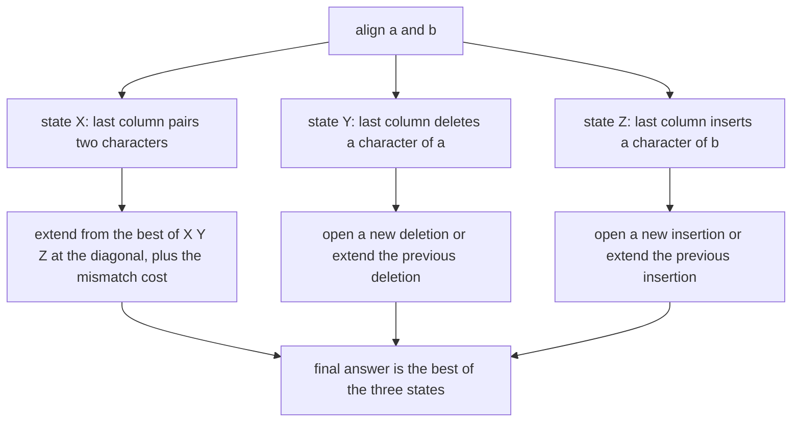
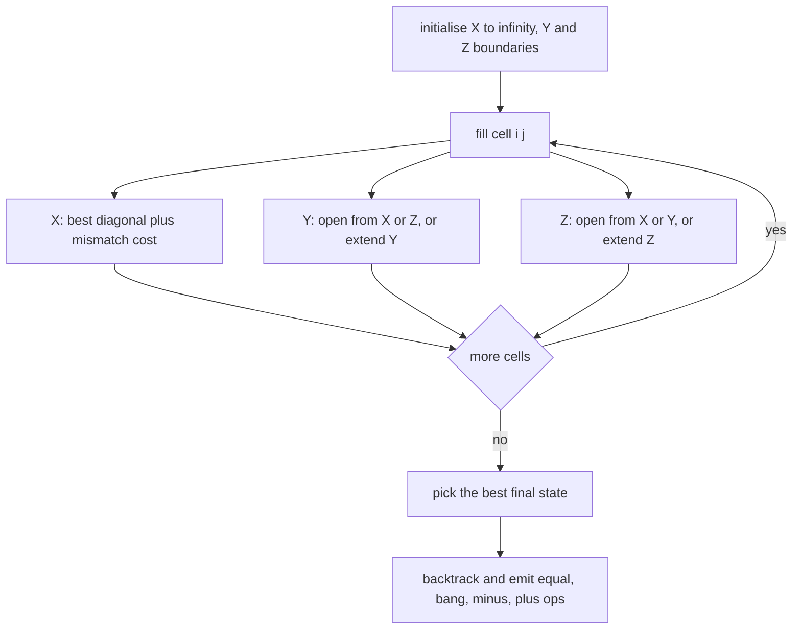
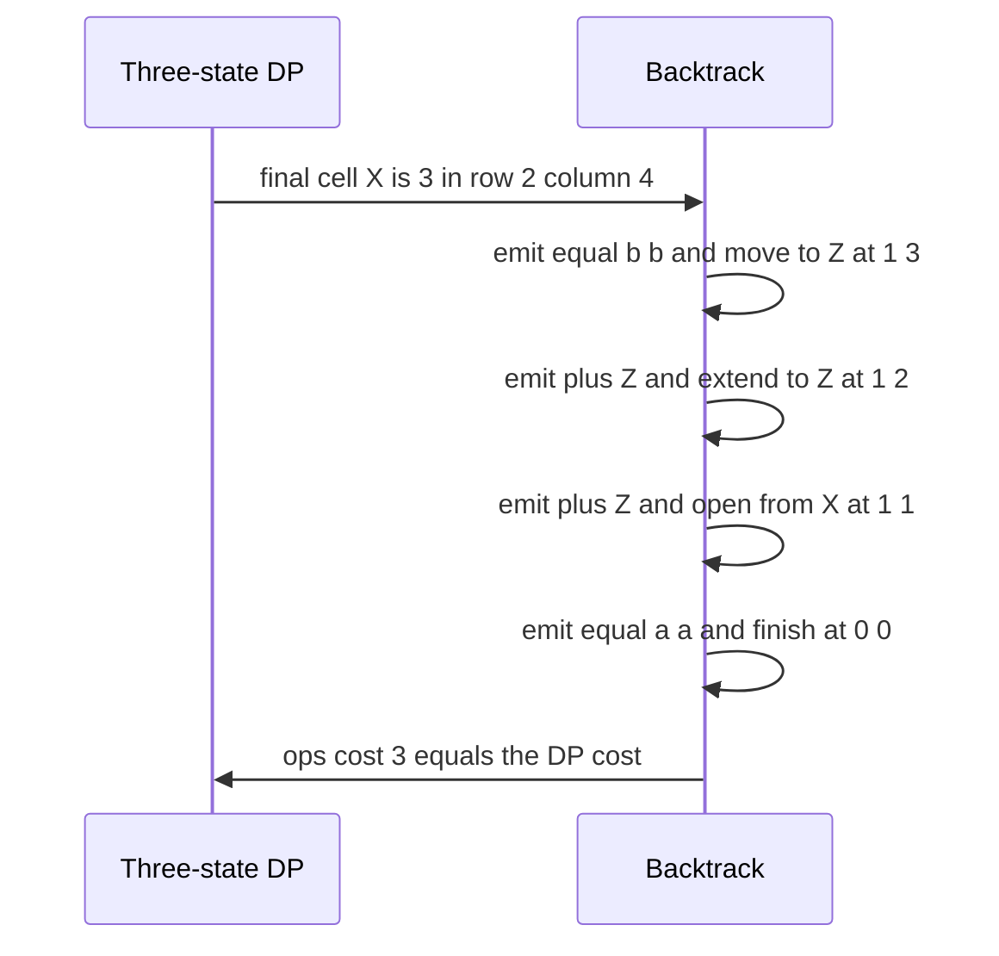

# 415 — Implement sequence alignment with affine gap penalties (bio DP).

> **Tier:** Advanced · **CTCI chapter:** Beyond — Advanced Data Structures & Algorithms
> **Task spec:** [415-implement-sequence-alignment-with-affine-gap-penalties-bio-dp.md](../../../tasks/advanced/415-implement-sequence-alignment-with-affine-gap-penalties-bio-dp.md)
> **Solutions:** [Python](../../../solutions/python/advanced/415-implement-sequence-alignment-with-affine-gap-penalties-bio-dp/solution.py) ·
> [Java](../../../solutions/java/advanced/415-implement-sequence-alignment-with-affine-gap-penalties-bio-dp/Solution.java) ·
> [JavaScript](../../../solutions/javascript/advanced/415-implement-sequence-alignment-with-affine-gap-penalties-bio-dp/solution.js) ·
> [C#](../../../solutions/csharp/advanced/415-implement-sequence-alignment-with-affine-gap-penalties-bio-dp/Solution.cs)

## 1. Problem restatement

**Input:** two strings `a` and `b`, plus the cost model (the header fixes the demo values).

**Output:** the cost and the alignment under **affine gap penalties** — Gotoh's algorithm:

> Cost model (documented):
> * substitution: `MISMATCH = 2`, matched characters cost `0`,
> * a gap of length `L` costs `OPEN + (L - 1) * EXTEND`, with `OPEN = 2` and `EXTEND = 1`:
>   opening the run costs `OPEN`, every extra character costs `EXTEND`.
>
> Three DP states drive the recurrence:
> * `X` — the column ends with a (mis)match of the last two characters,
> * `Y` — the column ends with a gap in `b` (a character of `a` is deleted),
> * `Z` — the column ends with a gap in `a` (a character of `b` is inserted).
>
> Gap-to-gap switches are allowed so that with `EXTEND == OPEN` the optimum equals
> Needleman-Wunsch with a linear gap cost of `OPEN` per character (asserted below).

| Call | Result |
| --- | --- |
| `gotoh("GATTACA", "GATTACA")` | `(0, 7 match ops)` |
| `gotoh("a", "b")` | `(2, [("!","a","b")])` — a substitution (`2`) beats delete + insert (`4`) |
| `gotoh("ACGT", "ACCGT")` | `2` — one gap of length 1 costs `OPEN` |
| `gotoh("acgt", "acgggt")` | `3` — one gap of length 2 costs `OPEN + EXTEND` |
| `needleman_wunsch("acgt", "acgggt", 2)` | `4` — the same pair under a linear gap model |
| `gotoh("ab", "aZZb")` | `3` — one open plus one extend |
| `needleman_wunsch("ab", "aZZb", 2)` | `4` — two single-character gaps |
| `gotoh("ABCD", "ABXYZCD")` | `4` = `OPEN + 2 * EXTEND` |
| `gotoh("ABCDEFGH", "AB")` | `7` = `OPEN + 5 * EXTEND` with `6` deletions |
| `gotoh("abc", "")`, `gotoh("", "abc")` | `4`, `4` = `OPEN + 2 * EXTEND` |
| `gotoh("", "AAAAA")` | `6` = `OPEN + 4 * EXTEND` |
| `needleman_wunsch("", "AAAAA", 2)` | `10` — linear gap cost per character |
| `gotoh("", "")` | `(0, [])` |

Two independent checks run throughout: `replay(a, ops) == b` verifies the alignment is
*interpretable*, and `ops_cost(ops)` recomputes the cost from the op pattern alone — counting
maximal runs of `-` and `+` and charging `OPEN + (run - 1) * EXTEND` — which must equal the DP
cost. On the LCG corpus the file also asserts the model equivalence: with `EXTEND == OPEN`
(`gotoh(a, b, 2, 3, 3)`) the affine optimum equals `needleman_wunsch(a, b, 3)`, and with the
cheaper `(2, 2, 1)` it is never larger than the linear optimum.

## 2. Intuition

Treating a gap as "one unit per missing character" is the Needleman–Wunsch model. It is wrong for
biology, where a single insertion of three bases is one mutational event, not three: the *first*
character of a gap should be expensive and the rest cheap. That is the affine model, and its
difficulty is that the cost of the current column now depends on the *previous* column's gap
state, not just on the value.

**Key insight.** Carry the last-column state explicitly. Three numbers per cell:

- `X[i][j]` — best cost of aligning `a[:i]` with `b[:j]` where the last column pairs a character
  of `a` with a character of `b`;
- `Y[i][j]` — same, but the last column is a gap in `b` (a deletion, so `a[i-1]` was consumed);
- `Z[i][j]` — same, but the last column is a gap in `a` (an insertion, `b[j-1]` consumed).

Then each transition knows whether it *opens* a gap or *extends* one:

```text
X[i][j] = min(X, Y, Z at [i-1][j-1]) + (0 if a[i-1] = b[j-1] else MISMATCH)
Y[i][j] = min(X[i-1][j] + OPEN, Z[i-1][j] + OPEN, Y[i-1][j] + EXTEND)
Z[i][j] = min(X[i][j-1] + OPEN, Y[i][j-1] + OPEN, Z[i][j-1] + EXTEND)
```

The cross-terms are deliberate: `Y` may follow `Z` (a deletion after an insertion) and vice versa,
which keeps the model general and makes `EXTEND == OPEN` collapse exactly onto the linear model —
the equivalence the tests assert. The base row/column is where the affine rule shows up directly:
a gap of length `L` against the empty string costs `OPEN + (L - 1) * EXTEND`, so `Y[i][0]` is
`2, 3, 4, ...` rather than `2, 4, 6, ...`.



## 3. Algorithm

1. Allocate three `(n+1) × (m+1)` tables initialised to infinity.
2. `X[0][0] = 0` — the empty alignment costs nothing. `Y[i][0] = OPEN + (i-1) * EXTEND` and
   `Z[0][j] = OPEN + (j-1) * EXTEND` give the pure-gap boundaries; all other boundary cells that
   would need a "gap after a match" stay at infinity.
3. Fill the tables row by row with the three recurrences above, using `MISMATCH` when the
   characters differ and `0` when they match.
4. The answer is the best of `X[n][m]`, `Y[n][m]`, `Z[n][m]`; the shipped code picks the state by
   `min(range(3), key=...)` and asserts along the way that the backtracked predecessor really
   explains the cell value.
5. Backtrack from that state to `(0, 0)`, emitting one op per column: `=` for a match, `!` for a
   substitution, `-` for a deletion (state `Y`) and `+` for an insertion (state `Z`). Ties are
   broken in a fixed order so the alignment is deterministic.
6. Reverse the op list.

```text
function gotoh(a, b, mismatch, open_cost, extend)
  X[0][0] ← 0
  for i ← 1 to n do Y[i][0] ← open_cost + (i - 1) * extend end
  for j ← 1 to m do Z[0][j] ← open_cost + (j - 1) * extend end
  for i ← 1 to n do
    for j ← 1 to m do
      sub ← 0 if a[i-1] = b[j-1] else mismatch
      X[i][j] ← min(X[i-1][j-1], Y[i-1][j-1], Z[i-1][j-1]) + sub
      Y[i][j] ← min(X[i-1][j] + open_cost, Z[i-1][j] + open_cost, Y[i-1][j] + extend)
      Z[i][j] ← min(X[i][j-1] + open_cost, Y[i][j-1] + open_cost, Z[i][j-1] + extend)
    end
  end
  state ← the argmin of X[n][m], Y[n][m], Z[n][m]
  backtrack from (state, n, m) to (0, 0) emitting one op per column
  return the cost, the reversed op list
end
```



## 4. Worked example

Align `a = "ab"` with `b = "aZZb"` under `MISMATCH = 2`, `OPEN = 2`, `EXTEND = 1`. The expected
answer is `3`: one insertion run of length 2, costing `OPEN + EXTEND`.

**Boundaries.** `X[0][0] = 0`; `Y[1][0] = 2`, `Y[2][0] = 3`; `Z[0][1] = 2`, `Z[0][2] = 3`,
`Z[0][3] = 4`, `Z[0][4] = 5`.

**Filled cells.** Only the columns that matter are shown; `INF` entries are omitted.

| Cell | `(i, j)` | `X` | `Y` | `Z` | reasoning |
| --- | --- | --- | --- | --- | --- |
| 1 | `(1, 1)` `a`/`a` | `0` | `4` | `4` | diagonal match from `X[0][0]`; `Y` opens from `Z[0][1] = 2`; `Z` opens from `Y[1][0] = 2` |
| 2 | `(1, 2)` `a`/`Z` | `4` | `5` | `2` | `Z` opens from `X[1][1] = 0` (`+2`) rather than extending `Z[1][1] = 4` (`+1`) |
| 3 | `(1, 3)` `a`/`Z` | `5` | `6` | `3` | `Z` extends again: `Z[1][2] + 1 = 3` |
| 4 | `(1, 4)` `a`/`b` | `6` | `7` | `4` | `Z` extends a third time |
| 5 | `(2, 1)` `b`/`a` | `4` | `2` | `5` | `Y` opens from `X[1][1] + 2 = 2` |
| 6 | `(2, 2)` `b`/`Z` | `2` | `4` | `4` | `X` = `min(0, 4, 4) + 2`; `Y` opens from `Z[1][2] + 2 = 4` |
| 7 | `(2, 3)` `b`/`Z` | `4` | `5` | `4` | |
| 8 | `(2, 4)` `b`/`b` | **`3`** | `6` | `5` | `X` = `min(X[1][3], Y[1][3], Z[1][3]) + 0 = 5, 6, 3` → `3` |

The final cell has `X = 3`, `Y = 6`, `Z = 5`, so the answer is `3` with the last column a match.

**Backtracking.** From `(X, 2, 4)`:

| Step | State | Cell | op emitted | next state | reason |
| --- | --- | --- | --- | --- | --- |
| 1 | `X` | `(2, 4)` | `("=","b","b")` | `Z` at `(1, 3)` | `b = b` so `sub = 0`; diagonal minimum is `Z[1][3] = 3` |
| 2 | `Z` | `(1, 3)` | `("+","","Z")` | `Z` at `(1, 2)` | `Z[1][2] + 1 = 3` is the minimum |
| 3 | `Z` | `(1, 2)` | `("+","","Z")` | `X` at `(1, 1)` | `X[1][1] + 2 = 2` beats extending (`Z[1][1] + 1 = 5`) |
| 4 | `X` | `(1, 1)` | `("=","a","a")` | done | diagonal is `X[0][0] = 0` |

Reversed, the alignment is `a`, insert `Z`, insert `Z`, `b` — which is `b` exactly. Note step 3:
the optimal alignment *opens* a second gap rather than extending the run, because one open plus
one extend costs the same as two opens here; the tie-break in the backtrack picks the fixed order,
and `ops_cost` confirms the total is `3` either way (the two `+` ops are adjacent, so `ops_cost`
counts them as a single run of length 2).



**Contrast with the linear model.** `needleman_wunsch("ab", "aZZb", 2)` charges `2` per gap
character and returns `4`, while the affine model returns `3` — the same gap run, but the second
character is discounted. On `"ABCDEFGH"` versus `"AB"` the affine cost is `OPEN + 5 * EXTEND = 7`
with six deletions, whereas the linear model would charge `12`.

## 5. Complexity

Let `n = len(a)`, `m = len(b)`.

| Measure | Bound | Why it holds |
| --- | --- | --- |
| Time | `O(n · m)` | three constant-time recurrences per cell, exactly like the linear model |
| Space | `O(n · m)` | three tables as written; two rows per state would reduce it to `O(m)` when only the cost is needed |
| Space, three states vs one | `3 ×` the table | the factor is the price of remembering how the previous column ended |
| Time, `needleman_wunsch` oracle | `O(n · m)` | one cell per pair of prefixes, linear gap cost |
| Time, `ops_cost` | `O(length of the op list)` | one pass counting maximal gap runs |
| Comparison with [414](../../../tasks/advanced/414-implement-edit-distance-with-low-memory-hirschberg.md) | `O(n · m)` time, `O(n + m)` space | Hirschberg recovers an alignment in linear memory for the *linear* model; the affine version needs the same split with three rows per half |

The gap-to-gap switches (`Z` opening a `Y` and vice versa) cost two extra comparisons per cell and
buy the `EXTEND == OPEN` equivalence with Needleman–Wunsch, which the tests assert on eight LCG
pairs.

## 6. Pitfalls and edge cases

- **Boundary rows must use the affine rule.** `Y[i][0] = OPEN + (i-1) * EXTEND` gives `2, 3, 4, ...`;
  writing `i * OPEN` instead gives `2, 4, 6, ...` and breaks `gotoh("", "AAAAA") == 6`.
- **The three states are not interchangeable.** `X` means "the last column paired two characters",
  so its diagonal may come from any state; `Y` and `Z` are gap states, so they may open from
  another state or extend themselves — but never extend the *other* gap type.
- **Gap-to-gap transitions must be allowed.** Without `Y` from `Z` (and `Z` from `Y`), the model
  stops being the general affine model and the `EXTEND == OPEN` equivalence fails on some LCG
  pairs.
- **The best end state is not always `X`.** For `gotoh("abc", "")` the answer lives in `Y[n][m]`
  and for `gotoh("", "abc")` in `Z[n][m]`; the code takes the minimum over the three.
- **A substitution costs `MISMATCH = 2`, the same as one gap open.** That is why `gotoh("a","b")`
  is `2` and not `4` (delete plus insert). The equality makes ties common, and the fixed
  backtracking order is what keeps the output reproducible.
- **Ties in the backtrack.** The code asserts that the chosen predecessor explains the cell, so a
  tie cannot silently produce an inconsistent alignment; two different alignments of equal cost are
  both acceptable, and the tests compare costs, not op lists.
- **Empty strings.** `gotoh("", "") == (0, [])`; one empty side gives one gap run whose cost is
  `OPEN + (L - 1) * EXTEND`, which the header documents explicitly.
- **Long deletion runs.** `gotoh("ABCDEFGH", "AB")` is `OPEN + 5 * EXTEND = 7` with six `-` ops;
  counting the run once is the whole point of the model, and `ops_cost` checks it.
- **Cost-model drift.** `ops_cost(ops, mismatch, open_cost, extend)` recomputes the cost from the
  op pattern, so a DP that uses one model and a backtrack that emits ops of another is caught
  immediately on every hand pair.
- **Replay vs cost.** `replay(a, ops) == b` proves the alignment is a valid transformation;
  only the cost comparison proves it is *optimal*. Both are asserted.
- **Memory in fixed-width languages.** Three `(n+1) × (m+1)` tables of 64-bit integers for long
  sequences is the practical limit; the two-row-per-state reduction is the standard remedy.

## 7. Variants and follow-ups

- **The linear model.** `needleman_wunsch` in the same file is the one-state version with a fixed
  cost per gap character; the tests use it as the `EXTEND == OPEN` reference.
- **Low-memory alignment.** [414 — Implement edit distance with low memory (Hirschberg)](../../../tasks/advanced/414-implement-edit-distance-with-low-memory-hirschberg.md)
  halves the second string and recurses; the affine version does the same with three rows per
  half, which is the standard way to get `O(n + m)` memory with affine gaps.
- **Protein scoring matrices.** Replacing `MISMATCH` with a matrix lookup (BLOSUM/PAM) changes
  only the `sub` term, and negative match scores turn the DP into a *maximisation*.
- **Local alignment.** Smith–Waterman adds a `max(0, ...)` floor and restarts the alignment,
  reusing the same three-state machinery for affine gaps.
- **Subset-style DP over the same idea.** [416 — Implement bitset DP optimizations for subset
  problems](../../../tasks/advanced/416-implement-bitset-dp-optimizations-for-subset-problems.md)
  shows the opposite trade-off — a bitset that replaces a whole DP dimension — on a different
  problem family.
- **Where it fits.** Alignment, edit distance and bit-parallel DP are grouped in
  [Advanced topics](../../ctci/x-advanced-topics.md).

## 8. Check yourself

1. Why does the gap cost need a separate state instead of a single DP table?

<details><summary>Show answer</summary>

Because the cost of the current column depends on whether the *previous* column was already inside
a gap: extending an open run costs `EXTEND`, opening a new one costs `OPEN`. A single table cell
does not record that, so the state has to be carried explicitly — hence `Y` for a gap in `b` and
`Z` for a gap in `a`.

</details>

2. `gotoh("ab", "aZZb")` returns `3` while `needleman_wunsch("ab", "aZZb", 2)` returns `4`. Where
   does the difference come from?

<details><summary>Show answer</summary>

The gap run has length 2. Affine charges `OPEN + EXTEND = 2 + 1 = 3`; the linear model charges
`2` per gap character, so `4`. The affine model discounts every character after the first in a
run, which is the whole reason it exists.

</details>

3. Why do the tests assert `gotoh(a, b, 2, 3, 3) == needleman_wunsch(a, b, 3)`?

<details><summary>Show answer</summary>

Because when `EXTEND == OPEN`, a gap of length `L` costs `OPEN + (L-1) * OPEN = L * OPEN` — exactly
the linear model with gap cost `OPEN`. The equality is a strong check that the three-state
recurrence is wired correctly, including the gap-to-gap switches.

</details>

4. What does `ops_cost` protect against that `replay` cannot?

<details><summary>Show answer</summary>

`replay` only checks that the ops transform `a` into `b`. `ops_cost` re-derives the cost from the
op pattern using the documented model, so it catches an alignment whose declared cost does not
match its own ops — for instance a DP using `OPEN` per gap character while the ops are scored with
`OPEN + (L-1) * EXTEND`.

</details>
