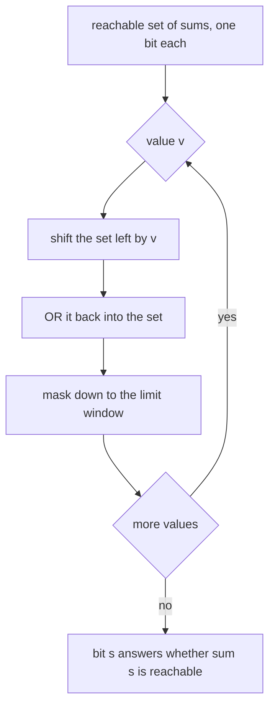
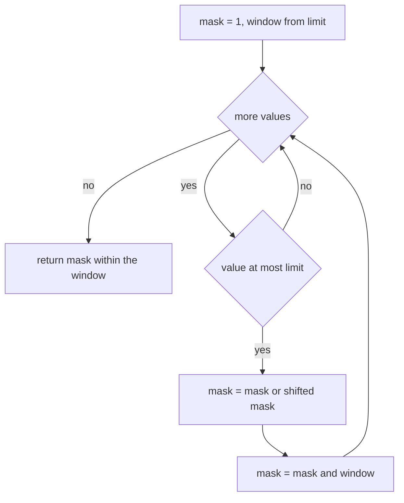
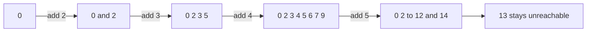

# 416 — Implement bitset DP optimizations for subset problems.

> **Tier:** Advanced · **CTCI chapter:** Beyond — Advanced Data Structures & Algorithms
> **Task spec:** [416-implement-bitset-dp-optimizations-for-subset-problems.md](../../../tasks/advanced/416-implement-bitset-dp-optimizations-for-subset-problems.md)
> **Solutions:** [Python](../../../solutions/python/advanced/416-implement-bitset-dp-optimizations-for-subset-problems/solution.py) ·
> [Java](../../../solutions/java/advanced/416-implement-bitset-dp-optimizations-for-subset-problems/Solution.java) ·
> [JavaScript](../../../solutions/javascript/advanced/416-implement-bitset-dp-optimizations-for-subset-problems/solution.js) ·
> [C#](../../../solutions/csharp/advanced/416-implement-bitset-dp-optimizations-for-subset-problems/Solution.cs)

## 1. Problem restatement

**Input:** a list of non-negative values and a `limit` (the window of sums we care about).

**Output:** the set of reachable subset sums, plus the two classic queries built on it —
subset-sum membership and equal-partition. The header states the bit-level trick and its
purpose:

> Subset-sum reachability with a bitset: bit `s` of `mask` is set iff some subset of the processed
> values sums to `s`. Adding value `v` shifts the whole reachable set by `v`:
> `mask |= mask << v` (masked to the `[0, limit]` window after every step).
>
> Python's arbitrary-precision `int` IS the bitset (one word per 30 bits internally), so a single
> OR/SHIFT pair replaces the whole inner loop of the `O(n * limit)` boolean DP. The classic
> boolean DP is kept as the oracle and the reachable sets must match exactly.
> Limits beyond 63 bits (e.g. 4000 or 20000) are exercised on purpose: fixed-width integer
> bitsets would silently overflow there, Python ints cannot.

| Call | Result |
| --- | --- |
| `can_make([3,34,4,12,5,2], 9)` | `True` — `3 + 4 + 2` |
| `can_make([3,34,4,12,5,2], 30)` | `False` |
| `can_make([3,34,4,12,5,2], 34)`, `50` | `True`, `True` (`34 + 12 + 4`) |
| `can_make([3,34,4,12,5,2], 0)`, `60` | `True`, `True` — the empty subset and everything |
| `can_make([3,34,4,12,5,2], 59)` | `False` |
| `bin(reachable_mask([3,34,4,12,5,2], 60)).count("1")` | `48` set bits |
| set bits for the same call | `0, 2..12, 14..24, 26, 34, 36..46, 48..58, 60` |
| clear bits | `1, 13, 25, 35, 47, 59` |
| `can_partition([1,5,11,5])` | `True` — `11` against `1 + 5 + 5` |
| `can_partition([1,5,3])` | `False` — odd total |
| `can_partition([2,2,2,2])` | `True` |
| `can_make([4000], 4000)`, `can_make([4000], 3999)` | `True`, `False` |
| `reachable_mask([4000], 5000).bit_length()` | `4001` |
| `can_partition(list(range(1, 41)))` | `True` — total `820` |
| `can_partition(list(range(1, 42)))` | `False` — total `861` is odd |

The bitset is validated against `classic_dp`, the plain `O(n * limit)` boolean DP, on the hand
sets and on eight LCG rounds (`n` from 10 to 40, values 1..60, `limit = min(sum, 1500)`), where
the tests assert *every* bit — not just the answers — matches the oracle. The stress block uses
`limit = 20000` with 40 values, so the masks exceed 20 000 bits and no 32- or 64-bit integer
could hold them.

## 2. Intuition

The naive DP keeps a boolean per sum:

```text
function classic_dp(values, limit)
  reach ← booleans for sums 0 to limit, all false except reach[0]
  for v in values do
    for s ← limit down to v do
      if reach[s - v] then reach[s] ← true end
    end
  end
  return reach
end
```

That is `O(n · limit)` operations and `limit + 1` booleans. The loop walks downwards so that each
value is used at most once per subset — the classic 0/1 knapsack ordering.

**Key insight.** The inner loop is just "set every bit that is `v` positions above an already set
bit". A bitset shifts the whole reachable set in a single operation:

```text
mask |= mask << v
```

Bit `s` of the result is set exactly when bit `s - v` of the old mask was set, i.e. when some
previously reachable sum `s - v` exists — which is precisely one pass of the inner loop, done for
all `s` at once. The 0/1 constraint comes for free: `mask << v` is computed from the *old* mask,
so a value cannot be used twice in the same shift.

Two consequences worth stating:

- The work becomes `O(n · limit / w)` *word* operations, where `w` is the machine word size — the
  bitset is a constant-factor speed-up that also collapses the loop into a single expression.
- The window must be re-masked after every step, otherwise bits above `limit` accumulate and the
  comparison with the oracle (which knows nothing above `limit`) no longer holds. The shipped code
  applies `& window` where `window = (1 << (limit + 1)) - 1`.

Python's arbitrary-precision `int` makes the demo literal; in Java or C# the same idea needs a
`long[]` (or `BigInteger`) and an explicit carry/shift across words — the reason the header points
out that limits beyond 63 bits are exercised on purpose.



## 3. Algorithm

1. Start with `mask = 1` — the empty subset sums to `0`, and nothing else is reachable.
2. Build `window = (1 << (limit + 1)) - 1`, the mask of the legal bit range.
3. For each value `v`: if `v <= limit`, apply `mask |= (mask << v) & window`. Values larger than
   the limit can never be part of a valid sum inside the window and are skipped.
4. `reachable_mask` returns `mask & window`; `can_make(values, target, limit)` tests
   `(mask >> target) & 1`, after rejecting `target < 0` or `target > limit`.
5. `can_partition(values)` sums the list, rejects an odd total, and otherwise asks
   `can_make(values, total / 2)`.

```text
function reachable_mask(values, limit)
  mask ← 1
  window ← (1 shifted left by limit + 1) - 1
  for v in values do
    if v ≤ limit then
      mask ← mask OR ((mask shifted left by v) AND window)
    end
  end
  return mask AND window
end

function can_make(values, target, limit)
  if limit is not given then limit ← target end
  if target < 0 or target > limit then return false end
  return bit target of reachable_mask(values, limit) is set
end

function can_partition(values)
  total ← sum of values
  if total is odd then return false end
  return can_make(values, total / 2)
end
```



## 4. Worked example

Build the reachable set for the sub-list `[2, 3, 4, 5]` under `limit = 14`, which is the shape the
solution header documents.

| Step | Value | Operation | Reachable sums |
| --- | --- | --- | --- |
| start | — | `mask = 1` | `{0}` |
| 1 | `2` | `mask \| (mask << 2)` | `{0, 2}` |
| 2 | `3` | `mask \| (mask << 3)` | `{0, 2, 3, 5}` |
| 3 | `4` | `mask \| (mask << 4)` | `{0, 2, 3, 4, 5, 6, 7, 9}` |
| 4 | `5` | `mask \| (mask << 5)` | `{0, 2, 3, 4, 5, 6, 7, 8, 9, 10, 11, 12, 14}` |

Step 4 is the interesting one: `mask << 5` produces `{5, 7, 8, 9, 10, 11, 12, 14}` and the OR adds
`8`, `10`, `11`, `12` and `14`, while `13` stays clear because the only way to reach it would be
`13 - 5 = 8`, and `8` was not reachable before this step (0/1 semantics — the new bits cannot feed
back into the same shift). That is exactly the "walk the loop downwards" ordering of the naive DP,
expressed as a single instruction.



**The full hand set.** Running the actual list `[3, 34, 4, 12, 5, 2]` with `limit = 60` produces
`48` set bits: `{0, 2..12, 14..24, 26, 34, 36..46, 48..58, 60}`, with `1, 13, 25, 35, 47, 59` the
only holes. The structure of that set is exactly what the DP builds it from: `{2,3,4,5}` reaches
`{0, 2..12, 14}` (24 values), adding `12` fills the next stretch, and `34` mirrors the whole
pattern 34 higher — `34 + 26 = 60` is the largest reachable sum, and `59` is unreachable because
`59 - 34 = 25` was never reachable.

| Query | Bit | Answer |
| --- | --- | --- |
| `can_make(base, 0)` | `0` | `True` — the empty subset |
| `can_make(base, 9)` | `9` | `True` (`3 + 4 + 2` or `5 + 4`) |
| `can_make(base, 25)` | `25` | `False` |
| `can_make(base, 30)` | `30` | `False` |
| `can_make(base, 34)` | `34` | `True` — the single element |
| `can_make(base, 50)` | `50` | `True` (`34 + 12 + 4`) |
| `can_make(base, 59)` | `59` | `False` |
| `can_make(base, 60)` | `60` | `True` — everything |

**Partition.** `can_partition([1, 5, 11, 5])` sums to `22` (even), so it asks for `11`: reachable
via `11` alone or `1 + 5 + 5`, so `True`. `[1, 5, 3]` sums to `9` (odd) and `can_partition` returns
`False` without touching the bitset. `range(1, 41)` sums to `820`, and because `1..n` reaches every
sum up to `n(n+1)/2`, the answer is `True`; `range(1, 42)` sums to `861` and is rejected
immediately.

**Beyond 63 bits.** `reachable_mask([4000], 5000)` has bit `4000` set, bit `4001` clear, and
`bit_length() == 4001`. In the stress block, `limit = 20000` with 40 values produces masks of more
than 20 000 bits, verified bit for bit against `classic_dp`, and the window is asserted to
*truncate by design*: `can_make(values, limit + 1, limit)` is `False` even when a larger subset sum
exists, because the query lies outside the window.

## 5. Complexity

Let `n` be the number of values, `limit` the window size and `w` the machine word size.

| Measure | Bound | Why it holds |
| --- | --- | --- |
| Time, bitset | `O(n · limit / w)` word operations | each value costs one shift, one OR and one AND over `limit + 1` bits |
| Time, classic DP | `O(n · limit)` boolean operations | the inner loop touches each sum once per value |
| Space, bitset | `O(limit / w)` words | one bit per sum |
| Space, classic DP | `O(limit)` booleans | one byte (or byte-packed boolean) per sum |
| Time, `can_make` after the mask is built | `O(limit / w)` for the shift and test, or `O(1)` for a single bit test | the Python demo shifts the whole integer; popping a bit from a word array is constant time |
| Time, `can_partition` | `O(n · limit / w)` + odd-total rejection | one mask build |
| Fixed-width alternative | silently wrong past 63 bits | a `long` bitset cannot hold sum 4000 of `{"4000"}`; the demo tests exactly that limit |

The speed-up factor is the word size: the same number of *bits* are processed, but `w` of them per
instruction. The asymptotic improvement is a constant factor, while the memory saving is a factor
of `w` — and the correctness boundary at 63 bits is the trap the tests probe.

## 6. Pitfalls and edge cases

- **Masking to the window.** Without `& window`, bits above `limit` accumulate and the mask stops
  matching `classic_dp`; the "no subset sum above the limit" contract is what the query helpers
  assume. The tests also assert `mask.bit_length() <= limit + 1` after every build.
- **`mask << v` must use the old mask.** `mask |= mask << v` in one expression is correct because
  the right-hand side is evaluated first; writing `mask = mask | (mask << v)` in a loop that
  updates `mask` in place is still correct in every language here, but doing the shift *after*
  assigning the OR would let a value be used twice in one step.
- **Values larger than the window are skipped, not error-checked.** `if v <= limit` is the
  documented filter; a value bigger than the limit can never contribute to a sum inside the
  window, so skipping is exact, not an approximation.
- **The empty subset.** `mask` starts at `1`, so `can_make(values, 0)` is always `True` — including
  for an empty value list. The tests assert `can_make(base, 0) is True`.
- **Odd totals short-circuit partitioning.** `[1, 5, 3]` sums to `9`; no equal split exists, and
  returning `False` before building a mask is the intended behaviour, not a missing case.
- **A target outside the window.** `can_make(values, limit + 1, limit)` is `False` *by design*,
  even when a subset sums to that value: the window is part of the contract, and the LCG loop
  asserts exactly this.
- **Bit-length beyond machine words.** `reachable_mask([4000], 5000)` needs bit `4000`; a 64-bit
  bitset would overflow silently and report `False`. The stress block with `limit = 20000` is the
  same trap at scale, and it is the reason the header calls the arbitrary-precision integer out.
- **Very large limits.** `limit = 20000` with 40 values costs 20 001 bits per operation in the
  Python demo, which is fine; the same limit with `n = 1000` would make the `O(n · limit / w)`
  work the dominant cost, and `limit = min(sum, 1500)` in the LCG loop keeps the oracle cheap.
- **Prefix sums are always reachable.** The tests assert that every running prefix sum of the
  values, when inside the limit, has its bit set — a cheap invariant that catches a dropped value.
- **Oracle agreement is bit-for-bit.** The loop compares every sum from `0` to `limit` with
  `classic_dp`; a single wrong bit fails, which is a much stronger statement than checking a few
  `can_make` answers.

## 7. Variants and follow-ups

- **Partition and knapsack.** The same `mask << v` primitive solves partition (`can_partition`),
  bounded knapsack (shift by `v` and require `k` bits set), and "how many distinct subset sums"
  (popcount).
- **Multi-set / bounded counts.** Repeating the shift `k` times models `k` copies; a binary
  decomposition of the counts into powers of two is the standard speed-up.
- **Bit-parallel string algorithms.** The same idea appears in edit distance (Myers' bit-vector
  algorithm) and in [411 — Advanced rolling hash with modular and base tuning](../../../tasks/advanced/411-implement-advanced-rolling-hash-with-modular-and-base-tuning.md),
  where the shift-and-compare pattern replaces a per-character loop.
- **Words instead of big integers.** The C#/Java versions implement the shift across a
  `long[]` with a carry, which is exactly what makes the 63-bit boundary visible; Python and
  JavaScript (BigInt) hide it.
- **Where the problems come from.** Subset-sum, partition and their DP optimisations are a
  standard interview family; [Advanced topics](../../ctci/x-advanced-topics.md) collects them with
  the other bitset and DP tricks in this tier.

## 8. Check yourself

1. Why does `mask |= mask << v` implement one full pass of the naive inner loop?

<details><summary>Show answer</summary>

Bit `s` of `mask << v` is bit `s - v` of `mask`, so the shifted bits are exactly the sums that
become reachable by adding `v` to an already reachable sum. OR-ing them in sets every such bit at
once, which is what the naive loop does one `s` at a time.

</details>

2. Why is a value `v > limit` safe to skip?

<details><summary>Show answer</summary>

Because sums are truncated to `[0, limit]`. Any subset containing `v` alone already exceeds the
window, and adding more non-negative values can only increase the sum, so no subset containing `v`
can have a sum inside the window. Skipping it therefore removes no reachable bit.

</details>

3. `[2, 3, 4, 5]` cannot reach `13` even though `13 - 5 = 8` and `8` *is* reachable after the step.
   Explain.

<details><summary>Show answer</summary>

`8` becomes reachable only *in the same step* that adds `5`, and the shift uses the mask from
before the step, where `8` was not yet set. That is the 0/1 constraint: a value may be used at
most once, so new bits cannot feed back into the shift that produced them.

</details>

4. What breaks if you forget `mask & window`?

<details><summary>Show answer</summary>

Bits above `limit` keep accumulating, so the mask no longer represents "subset sums within the
window". Every comparison against `classic_dp` would fail for sums at the top of the range, and
`mask.bit_length() <= limit + 1` would be violated — the tests assert both.

</details>
