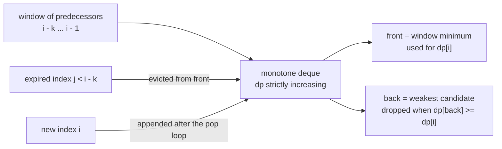
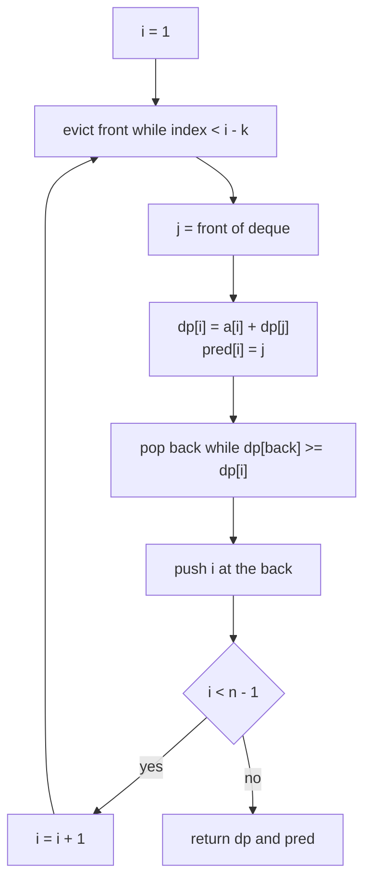
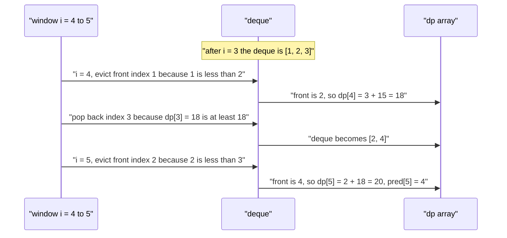

# 417 — Implement DP with monotone queue optimization.

> **Tier:** Advanced · **CTCI chapter:** Ch 8 — Recursion and Dynamic Programming
> **Task spec:** [417-implement-dp-with-monotone-queue-optimization.md](../../../tasks/advanced/417-implement-dp-with-monotone-queue-optimization.md)
> **Solutions:** [Python](../../../solutions/python/advanced/417-implement-dp-with-monotone-queue-optimization/solution.py) ·
> [Java](../../../solutions/java/advanced/417-implement-dp-with-monotone-queue-optimization/Solution.java) ·
> [JavaScript](../../../solutions/javascript/advanced/417-implement-dp-with-monotone-queue-optimization/solution.js) ·
> [C#](../../../solutions/csharp/advanced/417-implement-dp-with-monotone-queue-optimization/Solution.cs)

## 1. Problem restatement

**Input:** an array `a` of `n` integers and a window size `k >= 1`. You walk from index `0` to
index `n - 1`, and a jump from `j` to `i` costs `a[i]`. A jump may only span at most `k`
positions, so the predecessors of `i` are exactly the indices in `[max(0, i - k), i - 1]`.

**Output:** two arrays of length `n` — `dp`, where `dp[i]` is the cheapest total cost of
reaching `i` (starting at `dp[0] = a[0]`), and `pred`, where `pred[i]` is the index `j` that
achieved the minimum used by `i` (`pred[0] = -1`).

The four solution files fix the exact recurrence in their headers:

```text
dp[0] = a[0]
dp[i] = a[i] + min(dp[j] for j in [max(0, i - k), i - 1])
```

The assertions in the solution files pin down the contract:

| Call | Result | Why |
| --- | --- | --- |
| `sliding_min_dp([], 5)` | `([], [])` | no positions to reach |
| `sliding_min_dp([7], 3)` | `([7], [-1])` | the start is always taken, nothing to jump from |
| `sliding_min_dp([-4, -8], 2)` | `dp == [-4, -12]` | negative costs are allowed and add up |
| `a = [10, 1, 5, 7, 3, 2]`, `k = 2` | `dp == [10, 11, 15, 18, 18, 20]` | hand-derived in every file |
| `a = [10, 1, 5, 7, 3, 2]`, `k = 3` | `dp == [10, 11, 15, 17, 14, 16]` | a wider window opens `dp[4] = 3 + 14` |
| `a = [10, 1, 5, 7, 3, 2]`, `k = 1` | `dp == [10, 11, 16, 23, 26, 28]` | with `k = 1` the array is a running prefix sum |

`k = 1` degenerates into `dp[i] = a[i] + dp[i - 1]`, i.e. exactly the prefix sums
`[sum(a[:i+1]) for i in range(n)]`, which the Python file asserts directly. `k >= n` opens the
whole history: with `k = 100` the same `a` yields `[10, 11, 15, 17, 13, 12]`, because every
`i` may now take the global minimum so far (10 for `i = 1..4`, then 13 for `i = 5`).

## 2. Intuition

The recurrence is one line and the naive evaluation is one loop: for each `i`, scan its `k`
predecessors and take the smallest `dp`. That costs `O(n * k)` — fine for `k` small, hopeless
when `k` is close to `n`, because the same indices are re-scanned for every `i`.

The window of predecessors is a **sliding window**: when `i` grows by one, one index leaves the
window on the left and one enters on the right. So the question is the classic one — *maintain
the minimum of a sliding window* — and the answer is a monotone deque.

The insight has two halves:

1. **An index that falls out of the window can never come back**, so the deque may simply drop
   it from the front.
2. **An index that is older and has a `dp >= dp[i]` is dominated forever**: it expires no later
   than `i` does, and it is never strictly better. So it can be thrown away from the back.

After both discards, what remains is a list of candidate indices whose `dp` values are
*strictly increasing* from front to back. The front is therefore the window minimum, readable
in `O(1)`. The tie rule matters: because the pop condition uses `>=`, an equal-valued older
index is removed, so **the newest index wins a tie** — the Python file notes this and pins it
down through `pred` at `i = 5` below.



Each index enters the deque exactly once and leaves at most once, so the amortized cost of the
two inner loops over the whole run is `O(n)` — the `O(n * k)` factor disappears.

## 3. Algorithm

1. If `a` is empty, return two empty arrays.
2. Initialise `dp[0] = a[0]`, `pred[0] = -1`, and put index `0` into a deque `dq`.
3. For `i` from `1` to `n - 1`:
   1. Drop from the **front** every index `j` with `j < i - k` (no longer a legal predecessor).
   2. Read `j = front(dq)`; it is the argmin of the window. Set `dp[i] = a[i] + dp[j]` and
      `pred[i] = j`.
   3. Drop from the **back** every index whose `dp` is `>= dp[i]` (dominated).
   4. Push `i` at the back.
4. Return `dp` and `pred`.

```text
procedure sliding_min_dp(a, k)
    n ← length(a)
    if n = 0 then
        return empty list, empty list
    end
    dp[0] ← a[0]
    pred[0] ← -1
    dq ← deque holding only index 0
    for i ← 1 to n - 1 do
        while front(dq) &lt; i - k do
            pop_front(dq)
        end
        j ← front(dq)
        dp[i] ← a[i] + dp[j]
        pred[i] ← j
        while dq not empty and dp[back(dq)] &gt;= dp[i] do
            pop_back(dq)
        end
        push_back(dq, i)
    end
    return dp, pred
end
```

The oracle in the solution files is the plain recurrence, kept as a separate routine and used
to cross-check every result:

```text
function sliding_min_dp_naive(a, k)
    if length(a) = 0 then return empty list end
    dp[0] ← a[0]
    for i ← 1 to length(a) - 1 do
        best ← dp[max(0, i - k)]
        for j ← max(0, i - k) + 1 to i - 1 do
            best ← min(best, dp[j])
        end
        push_back(dp, a[i] + best)
    end
    return dp
end
```



## 4. Worked example

Take `a = [10, 1, 5, 7, 3, 2]` and `k = 2`, the hand case every solution file asserts. The
legal predecessor window of `i` is `[i - 2, i - 1]`.

| `i` | evicted from front | `j = front` | `dp[i] = a[i] + dp[j]` | popped from back | deque after the step | `pred[i]` |
| --- | --- | --- | --- | --- | --- | --- |
| 0 | — | — | `dp[0] = 10` | — | `[0]` | -1 |
| 1 | none | 0 | `1 + 10 = 11` | none (`dp[0] = 10 < 11`) | `[0, 1]` | 0 |
| 2 | none (`0 >= 0`) | 0 | `5 + 10 = 15` | none (`dp[1] = 11 < 15`) | `[0, 1, 2]` | 0 |
| 3 | `0 < 1` | 1 | `7 + 11 = 18` | none (`dp[2] = 15 < 18`) | `[1, 2, 3]` | 1 |
| 4 | `1 < 2` | 2 | `3 + 15 = 18` | **3** (`dp[3] = 18 >= 18`) | `[2, 4]` | 2 |
| 5 | `2 < 3` | 4 | `2 + 18 = 20` | none | `[4, 5]` | 4 |

Result: `dp == [10, 11, 15, 18, 18, 20]` and `pred == [-1, 0, 0, 1, 2, 4]`, exactly the two
assertions in the Python and C# files. Step `i = 4` is the interesting one: `dp[3] = dp[4] = 18`,
so index `3` is devoured by the `>=` pop, and the later `i = 5` therefore reports `pred[5] = 4`
instead of `3` — both give `20`, and the tie-break makes the newer index the recorded one. The
Python file spell-checks this with
`dp2[5] == a[5] + min(dp2[3:5])` and `pred2 == [-1, 0, 0, 1, 2, 4]`.



Widening the window only relaxes the minimum, never tightens it, so for fixed `a` every `dp`
value is non-increasing in `k`. The Python file checks that over an LCG array of length 150 for
`k = 2..10`; on the hand array with `k = 3` the window of `i = 4` is `[1, 3]`, whose minimum is
`dp[1] = 11`, so `dp[4] = 3 + 11 = 14` — strictly better than the `18` of `k = 2` — and then
`dp[5] = 2 + min(dp[2..4]) = 2 + 14 = 16`, giving `[10, 11, 15, 17, 14, 16]` as asserted.

## 5. Complexity

Let `n = len(a)`.

| Bound | Value | Why |
| --- | --- | --- |
| Time, best | `O(n)` | the deque variant costs one push and at most one pop per index |
| Time, average | `O(n)` | deterministic — no randomness anywhere |
| Time, worst | `O(n)` | amortized argument: `n` pushes total, so at most `n` pops total |
| Space | `O(n)` | `dp` and `pred` are both length `n`; the deque holds at most `k + 1` indices |
| Naive transition | `O(n * k)` per run | each `i` rescans up to `k` predecessors |
| Naive space | `O(n)` | same two output arrays, no deque |

The amortized claim is worth stating precisely: every index is pushed exactly once, and the two
`while` loops only ever remove indices that are currently in the deque, so the total number of
removals over the entire run is at most `n`. Hence the total work is `O(n)` regardless of `k` —
the arithmetic per step is constant. The comparison with the oracle is exact: the solution files
run both on the same input and require identical `dp` arrays, including the eight LCG rounds
with `n` between 120 and 299 and `k` between 1 and 15.

## 6. Pitfalls and edge cases

- **Empty input.** `n = 0` has no start and no transitions; both routines return empty results.
  The Python entry point returns the tuple `([], [])`, and `sliding_min_dp_naive([], 5) == []`.
- **Single element.** `dp[0] = a[0]` is taken unconditionally, and `pred[0] = -1` marks "no
  predecessor". `sliding_min_dp([7], 3)` returns exactly `([7], [-1])`.
- **Negative costs.** Nothing in the deque logic assumes positivity, so `[-4, -8]` with `k = 2`
  gives `dp == [-4, -12]`. A `dp` array used as a "distance" would break, but here the values
  are plain path costs.
- **Ties.** Popping on `>=` (not `>`) is deliberate: equal-valued older indices are discarded,
  and the newest one wins. The header of every solution file documents this and the tests pin it
  through `pred`, not through a different `dp` value.
- **`k = 1`.** The window is a single index, so the deque never holds more than two entries and
  `dp` becomes the running prefix sum. This is asserted explicitly for the hand array.
- **`k >= n`.** The first element can never expire, so the window is the whole history. Values
  are still recomputed per step, not memoised globally, which is why `dp[5] = 2 + 13 = 12` and
  not `12 + ...` of an even smaller prefix.
- **Window-index arithmetic.** The expiry test is `front < i - k`, never `front <= i - k`: the
  window is *inclusive* of `i - k`.
- **Deque read order.** The front index must be read *after* eviction and *before* the push,
  otherwise `i` itself could become its own predecessor.
- **Failure visibility.** An out-of-range `pred[i]` is impossible by construction; the files
  assert `max(0, i - k) <= pred[i] < i` for every `i` anyway.

## 7. Variants and follow-ups

- **Sliding-window maximum instead of minimum.** Flip the pop comparison to `<=` and keep the
  rest; the same `O(n)` argument applies. This is the form used inside many other optimisations.
- **`dp[i] = a[i] + min(dp[j] + w(j, i))`.** If the added weight is a convex function of the
  distance, the deque is replaced by the convex hull trick — the same "throw away dominated
  candidates" idea with intersection points as the eviction criterion; see
  [418 — online convex hull maintenance](418-implement-online-convex-hull-maintenance-dynamic.md).
- **Monotone queue over a tree rather than a path.** When the state space is a tree instead of
  a line, the window becomes a subtree and the same dominance reasoning reappears in
  [424 — small-to-large merging on trees](424-implement-small-to-large-merging-on-trees-for-frequency-queries.md).
- **Quadratic-cost DP with monotone decisions.** The classic form of this optimisation is
  `dp[i] = min(dp[j] + cost(j, i))` where `argmin` is non-decreasing; the deque then stores the
  decisions rather than the candidates, which is the shape used by
  [426 — tree DP for independent set](426-implement-tree-dp-for-independent-set-in-tree.md)
  when the tree is actually a path.

## 8. Check yourself

<details><summary>Show answer</summary>

**Q1.** Why is popping on `dp[back] >= dp[i]` correct, and what would change with `>`?

`>=` removes an older index with an equal value. That index expires no later than `i` (it is
older, and windows expire from the left), and it is never strictly better, so it can never be
the unique answer. Keeping it would only lengthen the deque. With `>` the deque could hold equal
values, the answers would still be numerically identical, but `pred` would report the older
index — the solutions' tie-break is "newer index wins".

</details>

<details><summary>Show answer</summary>

**Q2.** Compute `dp` for `a = [4, 9, 2, 8]` with `k = 2`.

`dp[0] = 4`. `dp[1] = 9 + 4 = 13`. `dp[2] = 2 + min(dp[0], dp[1]) = 2 + 4 = 6`.
`dp[3] = 8 + min(dp[1], dp[2]) = 8 + 6 = 14`. So `dp = [4, 13, 6, 14]`, which matches the
naive oracle.

</details>

<details><summary>Show answer</summary>

**Q3.** Where does the `O(n)` bound come from if a single step can pop many indices?

From amortization. Each index is pushed once, so the total number of pushes over the run is `n`,
and a pop is always a pop of a currently stored index. The sum of all loop iterations across the
whole run is therefore bounded by `2n`, even though one unlucky step may pop `O(n)` indices.

</details>

<details><summary>Show answer</summary>

**Q4.** `k` is doubled. Can any `dp[i]` increase?

No. The predecessor set `[max(0, i - k), i - 1]` grows, so the minimum can only decrease or stay
the same, and `a[i]` is unchanged. The Python file asserts this over an LCG array for
`k = 1..10` with `current[i] <= previous[i]`.

</details>

<details><summary>Show answer</summary>

**Q5.** What does `pred` look like when `k = 1`, and why?

`pred = [-1, 0, 1, 2, 3, 4]` on the hand array: with a one-step window the only legal
predecessor of `i` is `i - 1`, so `dp` is the prefix sum and the predecessor chain is the
sequence itself. The Python file asserts that array literally.

</details>
