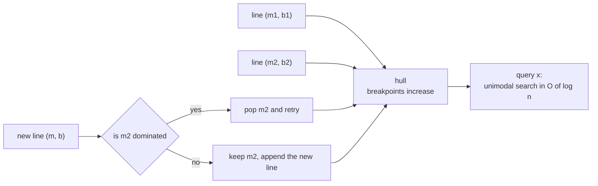
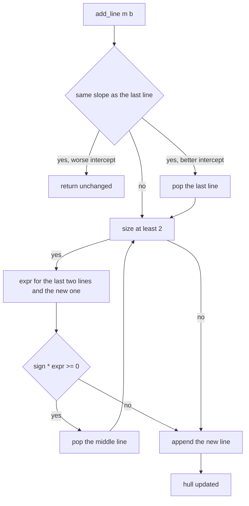
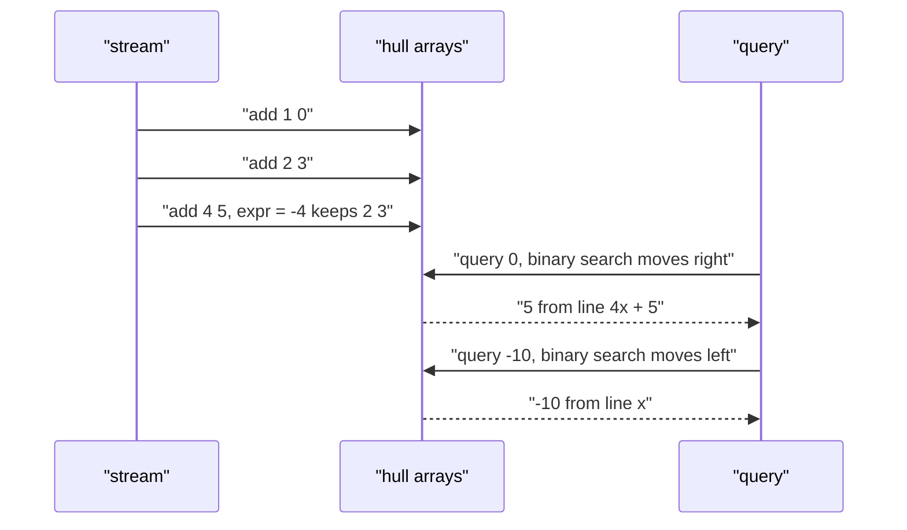

# 418 — Implement online convex hull maintenance (dynamic).

> **Tier:** Advanced · **CTCI chapter:** Beyond — Advanced Data Structures & Algorithms
> **Task spec:** [418-implement-online-convex-hull-maintenance-dynamic.md](../../../tasks/advanced/418-implement-online-convex-hull-maintenance-dynamic.md)
> **Solutions:** [Python](../../../solutions/python/advanced/418-implement-online-convex-hull-maintenance-dynamic/solution.py) ·
> [Java](../../../solutions/java/advanced/418-implement-online-convex-hull-maintenance-dynamic/Solution.java) ·
> [JavaScript](../../../solutions/javascript/advanced/418-implement-online-convex-hull-maintenance-dynamic/solution.js) ·
> [C#](../../../solutions/csharp/advanced/418-implement-online-convex-hull-maintenance-dynamic/Solution.cs)

## 1. Problem restatement

**Input:** a stream of lines `y = m*x + b`, added one at a time, plus point queries `x`. Each
line is inserted once and never removed ("add-only" — the headers state that deletions are out
of scope). Two knobs select the flavour:

- `mode`: `max` maintains the **upper** envelope, `min` the **lower** envelope.
- `order`: `inc` inserts lines with non-decreasing slopes, `dec` with non-increasing ones —
  exactly the orders you get from sorting candidate lines by slope.

**Output:** `add_line(m, b)` maintains the hull, and `query(x)` returns
`max(m*x + b)` (or `min`) over all lines added so far, in `O(log n)` after an amortized
`O(1)` insertion.

The hand cases in the solution files fix the semantics:

| Case | Result | Why |
| --- | --- | --- |
| `max`, lines `x`, `2x+3`, `4x+5`, `query(0)` | `5` | the steepest line is highest at `0` |
| same hull, `query(10)` | `45` | `4*10 + 5` beats `2*10 + 3` and `10` |
| same hull, `query(-10)` | `-10` | far left the shallow slope `x` wins |
| `min`, lines `2x+5`, `x+1`, `query(0)` | `1` | `x + 1` is the lower line at `0` |
| same hull, `query(10)` | `11` | `2*10 + 5 = 25` loses to `11` |
| same hull, `query(-10)` | `-15` | `2*(-10) + 5 = -15` |
| `max`, line `3x-1` added four times | hull size `1`, `query(7) = 20` | duplicates collapse, `21 - 1 = 20` |
| `min`, `3x+10` then `3x+5` | hull size `1`, `query(7) = 26` | the min keeps the smaller intercept |
| `max`, `3x-1` then `3x-2` | hull size `1`, `query(7) = 20` | the worse intercept is discarded |

Querying before any insertion is an error: Python raises `ValueError`, JavaScript raises
`Error` with the message `empty hull`, and the tests assert that rejection.

## 2. Intuition

With a static set of lines you sort them by slope and walk the hull once. With a stream you do
not want to re-sort, so the design assumption is that **the stream already arrives in slope
order** — that is what the `order` knob names, and it is the situation produced by "sort the
candidates once, then feed them in".

Given that order, only the *last two* hull lines can ever be invalidated by a new one. Suppose
the hull ends with `(m1, b1), (m2, b2)` and you append `(m, b)` with `m` on the correct side of
`m2`. The middle line `m2` is useless exactly when its breakpoint with `m1` is not to the left of
its breakpoint with `m`, i.e. when `m2` is never the best line anywhere. Comparing the two
intersection abscissas is the same as testing

```text
expr = (b1 - b2) * (m - m2) - (b2 - b) * (m2 - m1)
```

for the sign that corresponds to the mode/order pair. No division is performed — everything
stays exact integer arithmetic, so there is no floating-point drift at all.

Because a popped line never returns, each line is pushed once and popped at most once: the
insertion loop is amortized `O(1)`. Queries exploit a second structural fact: evaluated in `x`,
the hull values are **unimodal** — increasing then decreasing for `max`, decreasing then
increasing for `min` — so an adjacent-pair binary search finds the peak (or valley) in
`O(log n)`.



The sign constant encodes all four combinations at once:

| `mode` | `order` | envelope | `sign` |
| --- | --- | --- | --- |
| `max` | `inc` | upper | `+1` |
| `min` | `dec` | lower | `+1` |
| `max` | `dec` | upper | `-1` |
| `min` | `inc` | lower | `-1` |

## 3. Algorithm

1. Store the hull as two parallel arrays `ms` and `bs`; compute
   `sign = (+1 if mode is max else -1) * (+1 if order is inc else -1)`.
2. `add_line(m, b)`:
   1. If the last stored slope equals `m`, the new line only survives when its intercept is
      strictly better for the mode (`b > bs[-1]` for `max`, `b < bs[-1]` for `min`). Otherwise
      return; if it survives, pop the old line.
   2. While at least two lines remain, compute `expr` for the last two and the new line; if
      `sign * expr >= 0` the middle line is unnecessary, so pop it and repeat.
   3. Append `(m, b)`.
3. `query(x)`: binary-search the adjacent pair whose values straddle the extremum and return
   the better of the two.

```text
procedure add_line(ms, bs, m, b, sign, mode)
    if size(ms) > 0 and ms[last] = m then
        if mode = max then better ← b &gt; bs[last]
        else better ← b &lt; bs[last]
        end
        if not better then return end
        pop_back(ms)
        pop_back(bs)
    end
    while size(ms) &gt;= 2 do
        m1 ← ms[size(ms) - 2]
        b1 ← bs[size(bs) - 2]
        m2 ← ms[last]
        b2 ← bs[last]
        expr ← (b1 - b2) * (m - m2) - (b2 - b) * (m2 - m1)
        if sign * expr &gt;= 0 then
            pop_back(ms)
            pop_back(bs)
        else
            break
        end
    end
    push_back(ms, m)
    push_back(bs, b)
end

function query(ms, bs, x, mode)
    if size(ms) = 0 then raise error "query on an empty hull" end
    lo ← 0
    hi ← size(ms) - 1
    while lo &lt; hi do
        mid ← floor((lo + hi) / 2)
        v_mid ← ms[mid] * x + bs[mid]
        v_next ← ms[mid + 1] * x + bs[mid + 1]
        if mode = max then
            if v_mid &lt;= v_next then lo ← mid + 1 else hi ← mid end
        else
            if v_mid &gt;= v_next then lo ← mid + 1 else hi ← mid end
        end
    end
    return ms[lo] * x + bs[lo]
end
```

The oracle each solution file cross-checks against is a straight scan over all lines inserted
so far:

```text
function brute_best(lines, x, mode)
    best ← value of the first line at x
    for each line (m, b) in lines do
        value ← m * x + b
        if mode = max then best ← max(best, value)
        else best ← min(best, value)
        end
    end
    return best
end
```



## 4. Worked example

Insert `(1, 0)`, `(2, 3)`, `(4, 5)` in `max`/`inc` mode — the hand case every solution file
asserts. With `sign = +1`:

| Step | `m1, b1` | `m2, b2` | new `m, b` | `expr` | `sign * expr` | decision | hull after |
| --- | --- | --- | --- | --- | --- | --- | --- |
| 1 | — | — | 1, 0 | — | — | append | `[(1, 0)]` |
| 2 | — | — | 2, 3 | — | — | fewer than 2 lines, append | `[(1, 0), (2, 3)]` |
| 3 | 1, 0 | 2, 3 | 4, 5 | `(0-3)*(4-2) - (3-5)*(2-1) = -6 + 2 = -4` | `-4` | keep `(2, 3)` | `[(1, 0), (2, 3), (4, 5)]` |

The three lines survive because their pairwise intersections, `x = -3` and `x = -1`, are
strictly increasing breakpoints, so each line is best on a non-empty interval. The query trace:

| `x` | `lo, hi` after the binary search | comparison at `mid = 1` | result |
| --- | --- | --- | --- |
| `0` | `lo = 2, hi = 2` | `3 &lt;= 5` so move right | `4*0 + 5 = 5` |
| `10` | `lo = 2, hi = 2` | `23 &lt;= 45` so move right | `4*10 + 5 = 45` |
| `-10` | `lo = 0, hi = 0` | `-17 &lt;= -35` is false so move left | `1*(-10) + 0 = -10` |

Those are exactly the three assertions in the Python and JavaScript files. Inserting the same
three lines in `dec` order, `(4, 5)`, `(2, 3)`, `(1, 0)`, produces the mirror-image hull, and
the files sweep `x = -10..10` to check that both orders answer every query identically.



Duplicate slopes take the other branch of `add_line`. For `max`, adding `(3, -1)` four times
keeps exactly one line: the repeat call finds `m == ms[last]` and `-1 > -1` is false, so it
returns without touching the hull; `query(7) = 3*7 - 1 = 20`. Adding `(3, -2)` afterwards is
also discarded. In `min` mode the roles flip: after `(3, 10)`, the line `(3, 5)` replaces it
because `5 < 10`, leaving one line with `query(7) = 3*7 + 5 = 26`.

## 5. Complexity

Let `n` be the number of lines inserted and `q` the number of queries.

| Bound | Value | Why |
| --- | --- | --- |
| `add_line`, amortized | `O(1)` | each line is pushed once, so the total pops over `n` inserts is at most `n` |
| `add_line`, worst single call | `O(n)` | one call may pop the whole hull, but only once overall |
| `query` | `O(log n)` | unimodal array, adjacent-pair binary search |
| Space | `O(n)` | the two arrays hold at most `n` lines; the hull never exceeds the number of distinct slopes |
| Brute force oracle | `O(n)` per query, `O(n*q)` total | rescan every line for every `x` |

The amortized argument is the same as for any monotone stack: pushes and pops are both bounded
by the number of insertions, so the insertion phase is linear in total. The solution files
assert the two structural consequences of this bound directly: after every insertion
`len(hull) <= len(added)`, and after a full 60-line LCG run
`len(hull) <= number of distinct slopes`. Everything is exact integer arithmetic — the
JavaScript header notes that slopes and values stay far below 2^53, so plain numbers suffice
and no `BigInt` is needed.

## 6. Pitfalls and edge cases

- **Empty hull.** A query before the first insertion is not "0" or "minus infinity"; it is an
  error. The files assert both the empty case and the raised error.
- **`sign` per combination.** Using `+1` unconditionally works for `max`/`inc` and `min`/`dec`
  only; `max`/`dec` and `min`/`inc` need `-1`. All four combinations are exercised against the
  brute-force oracle.
- **Duplicate slopes.** Never keep two lines with the same slope: for `max` the one with the
  larger intercept dominates, for `min` the smaller one. The intercept comparison is strict, so
  re-adding an identical line is a no-op.
- **`>=` in the pop condition.** Using `>=` (not `>`) is what collapses three lines meeting in a
  single point down to two; both are numerically correct, and `>=` keeps the hull shortest.
- **Integer overflow.** The expression multiplies two differences, so it can be large. Python
  and C#/Java use machine integers of 64 bits and the test data stays small; the JavaScript
  header records the 2^53 reasoning for the same reason.
- **Insertion order is a contract.** Feeding `inc` lines into a `dec` hull (or the reverse)
  breaks the "only the last two lines matter" argument; the order knob is part of the input
  contract, not a hint.
- **No deletions.** Removing a line would un-pop previously discarded lines, which the
  amortized bound forbids; the headers say so explicitly.
- **Query direction.** For `min` the comparison is `v_mid >= v_next` (walk downhill), for `max`
  it is `v_mid <= v_next` (walk uphill). Swapping them silently returns the wrong end of the
  hull.

## 7. Variants and follow-ups

- **Adding a monotone deque instead of a hull.** If the breakpoints never matter because the
  queries arrive in sorted `x` order, a single deque pointer replaces the binary search — see
  [417 — DP with monotone queue optimization](417-implement-dp-with-monotone-queue-optimization.md).
- **Dynamic CHT with deletions.** The usual answers are Li Chao trees or offline segment-tree
  divide and conquer over the query interval; the add-only version here is the base case.
- **Hull used inside another DP.** `dp[i] = a[i] + min(dp[j] + slope_i * x_j)` is the standard
  consumer of this structure; the tree-shaped version of the same idea appears in
  [427 — rerooting DP](427-implement-rerooting-dp-technique-on-trees.md).
- **Fully dynamic hull of points (not lines).** Insertion-only convex hull with queries is the
  same code with `m` and `b` reinterpreted; the conceptual variant of dynamic connectivity
  around it is [420 — Euler tour tree](420-implement-euler-tour-tree-for-dynamic-forests-conceptual.md).

## 8. Check yourself

<details><summary>Show answer</summary>

**Q1.** In `max`/`inc` mode, why is only the *last* line ever at risk when a new line arrives?

Because slopes arrive non-decreasing, each new line is the steepest so far, so it is best for
all sufficiently large `x`. That can only destroy lines that were best on a suffix of the line,
and a hull line best on a suffix is by construction one of the last ones (its breakpoint with
its successor must lie beyond the new line's breakpoint). Lines further inside the hull keep
their non-empty interval.

</details>

<details><summary>Show answer</summary>

**Q2.** Why does the pop test use `expr` instead of computing the two intersection abscissas?

Computing `x = (b1 - b2) / (m2 - m1)` needs division and therefore floating point, which makes
the comparison fragile near ties. The cross-multiplied form
`(b1 - b2) * (m - m2)` versus `(b2 - b) * (m2 - m1)` compares the same two rational numbers with
integer arithmetic only — and the sign wrapper `sign * expr >= 0` covers all four mode/order
pairs at once.

</details>

<details><summary>Show answer</summary>

**Q3.** The hull `[(1,0), (2,3), (4,5)]` is queried at `x = -2`. Which line wins?

`1*(-2) = -2`, `2*(-2) + 3 = -1`, `4*(-2) + 5 = -3`, so the maximum is `-1` from the middle
line — consistent with the breakpoints `-3` and `-1` that place `2x+3` exactly between them.

</details>

<details><summary>Show answer</summary>

**Q4.** How long can the hull get if 60 lines with values in `[-70, 70]` and `[-2000, 2000]` are
inserted?

At most the number of distinct slopes, which is at most `141`; the solution files assert both
`len(hull) <= len(added)` after each insertion and `len(hull) <= distinct slopes` at the end of
a run.

</details>

<details><summary>Show answer</summary>

**Q5.** Where would a `min` hull and a `max` hull of the same lines differ, and where agree?

They differ wherever the upper and lower envelopes are different lines; for a single line both
return that line's value. The files sweep `x` from `-200` to `200` for each of the four
mode/order combinations and compare against `brute_best`, so agreement at a point is verified
rather than assumed.

</details>
