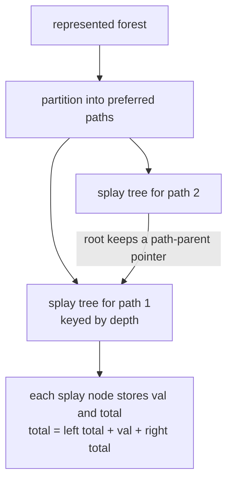
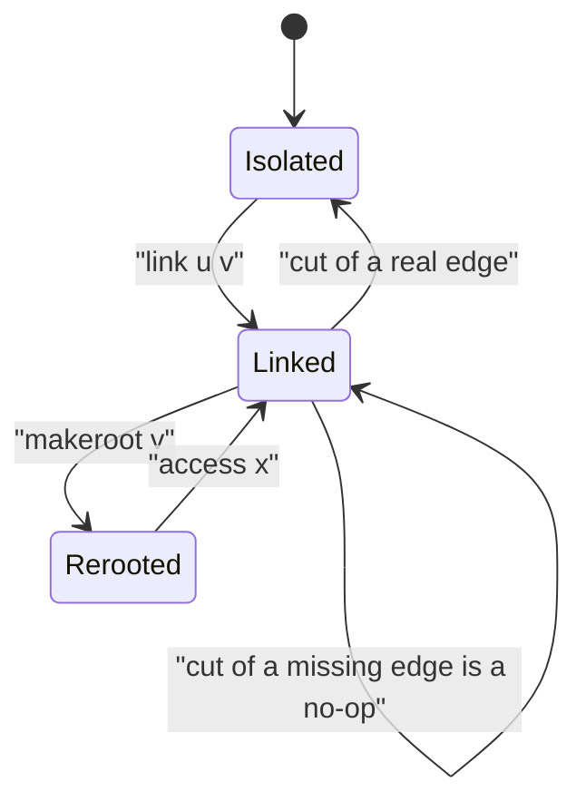
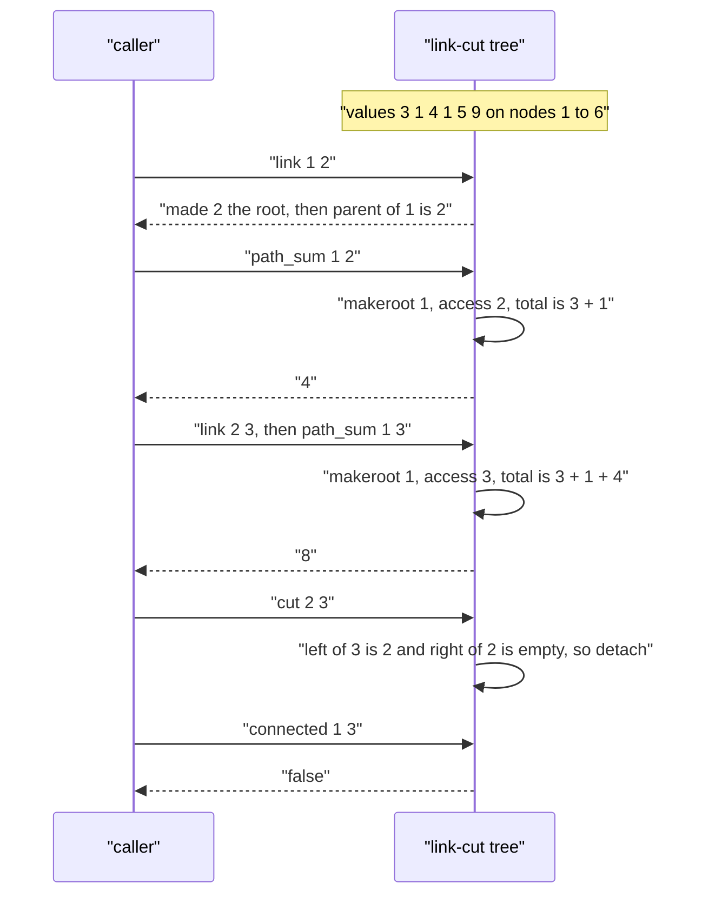

# 419 — Implement dynamic tree (link-cut tree basic operations).

> **Tier:** Advanced · **CTCI chapter:** Ch 4 — Trees and Graphs
> **Task spec:** [419-implement-dynamic-tree-link-cut-tree-basic-operations.md](../../../tasks/advanced/419-implement-dynamic-tree-link-cut-tree-basic-operations.md)
> **Solutions:** [Python](../../../solutions/python/advanced/419-implement-dynamic-tree-link-cut-tree-basic-operations/solution.py) ·
> [Java](../../../solutions/java/advanced/419-implement-dynamic-tree-link-cut-tree-basic-operations/Solution.java) ·
> [JavaScript](../../../solutions/javascript/advanced/419-implement-dynamic-tree-link-cut-tree-basic-operations/solution.js) ·
> [C#](../../../solutions/csharp/advanced/419-implement-dynamic-tree-link-cut-tree-basic-operations/Solution.cs)

## 1. Problem restatement

**Input:** `n` vertices with values `values[1..n]` (the trees are 1-based; index `0` is the null
child), followed by a sequence of operations on a forest that changes over time:

| Operation | Meaning |
| --- | --- |
| `link(u, v)` | add the edge `u-v`, but only when `u` and `v` lie in different trees |
| `cut(u, v)` | remove the edge `u-v`, but only when it exists |
| `connected(u, v)` | are `u` and `v` in the same tree? |
| `findroot(v)` | the root of `v`'s tree in the current orientation |
| `makeroot(v)` | re-root `v`'s tree at `v` |
| `path_sum(u, v)` | sum of the vertex values on the unique `u`-to-`v` path |

**Output:** each query operation returns its answer; `link` and `cut` are guarded, i.e. an
illegal request is a no-op rather than an error.

Concrete expectations from the solution files, with `values = [3, 1, 4, 1, 5, 9]` on nodes
`1..6`:

| Scenario | Result |
| --- | --- |
| fresh forest, `findroot(v)` for `v = 1..6` | each vertex is its own root |
| `link(1, 2)` then `path_sum(1, 2)` | `4` (that is `3 + 1`), and `path_sum(2, 1)` is also `4` |
| `path_sum(1, 1)` | `3` — a path from a node to itself is just its value |
| `link(2, 3)` then `path_sum(1, 3)` | `8` (`3 + 1 + 4`), symmetric in both directions |
| `makeroot(3)` then `findroot(1)` | `3` |
| `cut(2, 3)` then `connected(1, 3)` | `false`, while `connected(1, 2)` stays `true` |
| `cut(1, 3)` with no such edge | guarded no-op, connectivity unchanged |
| re-joining to a chain `1-2-3-4` and `5-6`, then `link(4, 5)`, `path_sum(1, 6)` | `23` |

## 2. Intuition

The data structure behind every one of those operations is the **link-cut tree**. The idea is
to stop thinking of the forest as a static adjacency structure and instead let each tree be
*covered* by vertex-disjoint paths. Each such path is stored in a **splay tree** keyed by depth,
and the splay trees are stitched together by *path-parent* pointers: the root of one splay tree
stores a pointer to its parent in the represented tree.

A vertex therefore has one parent slot that plays two roles at once:

- inside a splay tree it is the ordinary splay parent, and
- at the top of a splay tree it is the path-parent — an edge of the represented tree that is
  **not** part of the preferred path.

`_is_root(x)` is exactly the test that distinguishes the two cases: `x` is a splay root when
`parent[x] == 0`, or when `x` is neither the left nor the right child of its parent.

The three primitives that make the whole thing work:

- **`access(x)`** makes the path from the tree root to `x` a single preferred path, and leaves
  `x` as the root of its splay tree. It walks up the path-parent chain, splaying each ancestor
  and re-attaching the previously processed piece as its right child.
- **`makeroot(x)`** is `access(x)` followed by flipping the lazy `rev` flag on `x`, which
  reverses the whole preferred path and so reverses the root-to-`x` orientation.
- **`path_sum(u, v)`** is `makeroot(u)` then `access(v)`: after both, `v`'s splay subtree *is*
  the `u`-to-`v` path, so the aggregate `total[v]` is the answer.



Rotations and splays are standard, with one twist: a lazy `rev` flag may be pending anywhere
above `x`, so `_splay(x)` first walks up to the splay root and pushes every pending flag
downwards before touching the structure — otherwise a rotation would read stale left/right
orientations.

## 3. Algorithm

1. Allocate the arrays `left`, `right`, `parent`, `rev`, `val`, `total` of size `n + 1`;
   `total` starts equal to `val`, i.e. every vertex is an isolated preferred path.
2. `access(x)`: set `last = 0`; while `x != 0`, splay `x`, replace its right child by `last`
   (fixing the path-parent of `last`), pull `x`, then move `last = x` and `x = parent[x]`.
   Finish with `splay(x)` on the original vertex.
3. `makeroot(x)`: `access(x)`, then toggle `rev[x]`.
4. `findroot(x)`: `access(x)`, then push flags and walk left while a left child exists, then
   splay the found vertex and return it.
5. `link(u, v)`: `makeroot(u)`; if `findroot(v) != u`, set `parent[u] = v` as a path-parent.
6. `cut(u, v)`: `makeroot(u)`, `access(v)`; only when `left[v] == u` and `right[u] == 0` (the
   edge really exists) detach both sides and pull `v`.
7. `path_sum(u, v)`: `makeroot(u)`, `access(v)`, return `total[v]`.

```text
procedure access(x)
    last ← 0
    y ← x
    while y != 0 do
        splay(y)
        right[y] ← last
        if last != 0 then parent[last] ← y end
        pull(y)
        last ← y
        y ← parent[y]
    end
    splay(x)
end

procedure makeroot(x)
    access(x)
    rev[x] ← not rev[x]
end

function findroot(x)
    access(x)
    while true do
        push(x)
        if left[x] = 0 then break end
        x ← left[x]
    end
    splay(x)
    return x
end

procedure link(u, v)
    makeroot(u)
    if findroot(v) != u then parent[u] ← v end
end

procedure cut(u, v)
    makeroot(u)
    access(v)
    if left[v] = u and right[u] = 0 then
        left[v] ← 0
        parent[u] ← 0
        pull(v)
    end
end

function path_sum(u, v)
    makeroot(u)
    access(v)
    return total[v]
end
```

The supporting routines are the usual splay machinery: `_push` propagates a pending `rev` by
swapping the two children and toggling both children's flags; `_pull` recomputes
`total = total[left] + val + total[right]`; `_rotate(x)` re-links three families of pointers
(the inner `b` subtree, `p`, and `g` where the grandparent may be a path-parent) and pulls `p`
then `x`; `_splay(x)` pushes the pending flags top-down and then performs the zig-zig / zig-zag
sequence.

```text
procedure splay(x)
    path ← stack holding x and every ancestor up to the splay root
    for v from the splay root down to x do push(v) end
    while is_root(x) is false do
        p ← parent[x]
        g ← parent[p]
        if is_root(p) is false then
            if the zig direction of x and p agrees then rotate(p) else rotate(x) end
        end
        rotate(x)
    end
end

function is_root(x)
    p ← parent[x]
    return p = 0 or (left[p] != x and right[p] != x)
end
```



## 4. Worked example

Run the Python file's hand sequence on `values = [3, 1, 4, 1, 5, 9]` (node `k` has value
`values[k]`, so node 1 has 3, node 2 has 1, node 3 has 4).

| Step | Operation | Internal effect | Query result |
| --- | --- | --- | --- |
| 1 | `findroot(2)` | `access(2)` on an isolated vertex, `parent[2] = 0` | `2` |
| 2 | `connected(1, 2)` | two different splay trees, no path-parent chain | `false` |
| 3 | `link(1, 2)` | `makeroot(1)`, `findroot(2) = 2 != 1`, so `parent[1] = 2` | edge `1-2` added |
| 4 | `path_sum(1, 2)` | `makeroot(1)`, `access(2)`: the path is the single edge, `total[2] = 3 + 1` | `4` |
| 5 | `path_sum(2, 1)` | symmetric call, `makeroot(2)` then `access(1)` | `4` |
| 6 | `path_sum(1, 1)` | `makeroot(1)` then `access(1)`: a path of one node | `3` |
| 7 | `link(2, 3)` | `makeroot(2)`, `findroot(3) = 3 != 2`, so `parent[2] = 3` | chain `1-2-3` |
| 8 | `path_sum(1, 3)` | `makeroot(1)`, `access(3)`: whole chain in one splay tree | `3 + 1 + 4 = 8` |
| 9 | `makeroot(3)` | `access(3)` then `rev[3]` toggled: 3 becomes the represented root | — |
| 10 | `findroot(1)` | `access(1)`, descend left while possible, splay the leftmost | `3` |
| 11 | `cut(2, 3)` | `makeroot(2)`, `access(3)`: `left[3] == 2` and `right[2] == 0`, so detach | tree splits |
| 12 | `connected(1, 3)` | `findroot(1) = 1` versus `findroot(3) = 3` | `false` |
| 13 | `cut(1, 3)` | `left[3]` is not `1`, the guard fails | unchanged |

Steps 9-13 show both guards at work: `makeroot` silently changes what `findroot` reports, and
`cut` refuses to touch an edge that was never there.



The large hand scenario in the files pushes the same machinery further: after
`link(3, 4)`, `link(5, 6)`, `link(2, 3)` and `link(4, 5)`, the tree contains the chain
`1-2-3-4-5-6` and `path_sum(1, 6) == 3 + 1 + 4 + 1 + 5 + 9 == 23`, while `path_sum(3, 5) == 10`
and `cut(4, 5)` splits the tree back into `{1, 2, 3, 4}` and `{5, 6}`.

## 5. Complexity

Let `n` be the number of vertices and `m` the number of operations.

| Bound | Value | Why |
| --- | --- | --- |
| `link`, `cut` | `O(log n)` amortized | one or two `access`/`findroot` calls; each splay is amortized `O(log n)` |
| `access`, `makeroot`, `findroot`, `path_sum` | `O(log n)` amortized | splay potential argument over the preferred-path changes |
| `connected` | `O(log n)` amortized | two `findroot` calls, with the shortcut `u == v` answered directly |
| Space | `O(n)` | six arrays of length `n + 1`; no per-operation allocation |
| Explicit adjacency oracle | `O(n)` per query | BFS for connectivity, BFS for the path and its weight sum |

The amortized `O(log n)` is the standard result for splay-based link-cut trees: each `access`
splays along a chain of path-parents, and the splay potential pays for the repeated work. The
solution files do not measure timings; they validate correctness structurally and against the
oracle. The Python file drives 350 randomized operations on `n = 30` and then audits every pair
`u <= v` against the adjacency oracle, requiring `checks > n` so that the audit is not vacuous;
a final star built by nine `link` calls checks every leaf-to-leaf path through the hub.

## 6. Pitfalls and edge cases

- **The two meanings of `parent`.** Inside a splay tree it is the splay parent; at a splay root
  it is the path-parent. `_is_root` must test child-hood, not just `parent == 0`.
- **Push before rotate.** A pending `rev` above `x` would make every rotation decision wrong;
  `_splay` therefore collects the whole root-to-`x` chain and pushes it top-down first.
- **Self-queries.** `path_sum(u, u)` must return `val[u]` (the files assert `3` for node 1), and
  `connected(u, u)` is `true` without touching the structure.
- **Guarded link.** `link(u, v)` silently does nothing when `u` and `v` are already in the same
  tree — that is what keeps the structure a forest. The randomized script only issues legal
  links, and asserts `connected` immediately afterwards.
- **Guarded cut.** `cut` checks `left[v] == u and right[u] == 0`; cutting a non-adjacent pair
  (for example `cut(1, 3)` on the path `1-2-3`) must leave the forest unchanged.
- **Isolated vertices.** Every vertex starts as its own splay tree with `parent = 0`, so
  `findroot(v) == v`; the files loop over all six vertices to pin that down.
- **Symmetric answers.** `path_sum(u, v) == path_sum(v, u)` and `connected` is symmetric, which
  is asserted explicitly — it catches orientation bugs in `makeroot`.
- **Single vertex.** `n = 1` is valid: the vertex is its own root, and every other query is
  either a self-path or a no-op.
- **Star shapes.** Nine leaves linked to one hub exercise the worst case for path-parent chains
  and are checked leaf by leaf to the hub.

## 7. Variants and follow-ups

- **Subtree queries instead of path queries.** Link-cut trees answer path aggregates; when the
  query is a subtree, the Euler tour tree is the natural counterpart, with the same
  link/cut vocabulary over a different representation —
  [420 — Euler tour tree for dynamic forests](420-implement-euler-tour-tree-for-dynamic-forests-conceptual.md).
- **Offline dynamic connectivity.** When all operations are known in advance, divide and
  conquer over time with a rollback union-find is simpler than a link-cut tree; the online
  structure here is the general-purpose tool.
- **Rooted-tree queries without topology changes.** If the forest never changes, binary lifting
  answers LCA and ancestor queries in `O(log n)` with far less code:
  [428 — binary lifting for LCA and ancestor queries](428-implement-binary-lifting-for-lca-and-ancestor-queries.md).
- **Aggregates that need more than a sum.** Replacing `total` by any splay-subtree aggregate
  (max, min, xor, count) works unchanged as long as `_pull` is updated, which makes this the
  template for "dynamic path query" problems.

## 8. Check yourself

<details><summary>Show answer</summary>

**Q1.** Why does `path_sum(u, v)` need `makeroot(u)` rather than just `access(v)`?

`access(v)` exposes only the path from the *current* represented root to `v`. Making `u` the
root first means that path from the root to `v` is exactly the `u`-to-`v` path, so `total[v]`
after the second `access` is precisely the sum of the required vertices.

</details>

<details><summary>Show answer</summary>

**Q2.** What does `_is_root(2)` return in the chain `1-2-3` after `makeroot(1)` and `access(2)`
in the single splay tree containing all three? And why does the answer matter?

It returns `false` while 2 sits inside the splay tree, and the path-parent rule only applies at
a splay root. The distinction matters because `_rotate` must update the grandparent's child
pointer only when the old parent was itself a splay child; if the parent was a splay root, the
grandparent pointer is a path-parent and must be left alone.

</details>

<details><summary>Show answer</summary>

**Q3.** `cut(1, 3)` on the chain `1-2-3` with no edge `1-3` — what happens?

Nothing. `makeroot(1)` and `access(3)` expose the path `1-2-3`, whose left child of `3` is `2`,
not `1`, so the guard `left[v] == u` fails and the structure is left untouched. The files assert
this and then assert that `connected(1, 2)` is still `true`.

</details>

<details><summary>Show answer</summary>

**Q4.** Why is `parent[u] = v` enough for `link`, without touching `left` or `right`?

Because `u` is the root of its splay tree after `makeroot(u)`, so `parent[u]` is a path-parent
slot: it records "the tree edge from `u` upward", which is exactly what joining two trees needs.
No preferred path is merged at link time; `access` merges paths only when it has to.

</details>

<details><summary>Show answer</summary>

**Q5.** What guarantees that a randomized script against an adjacency oracle is a fair test?

The script only issues operations the oracle accepts (links across components, cuts of existing
edges), re-checks `connected` after every structural change, compares `path_sum` against the
weight sum along the oracle's BFS path, and finishes with a full pairwise audit plus a
`checks > n` sanity assertion so an accidentally empty forest cannot pass.

</details>
