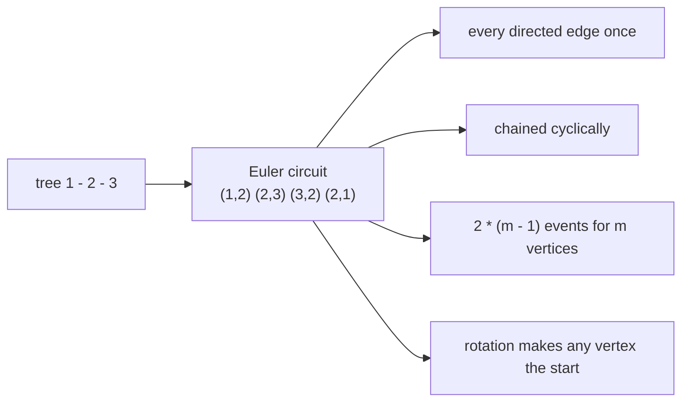
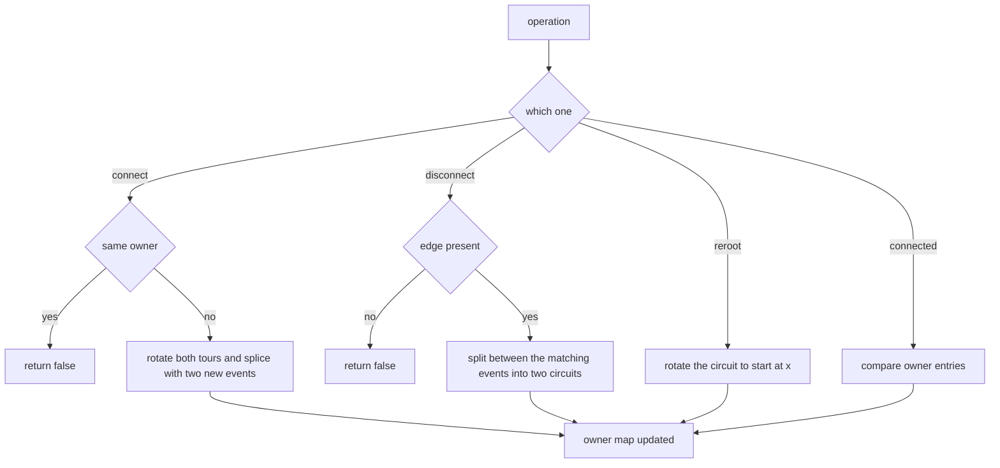
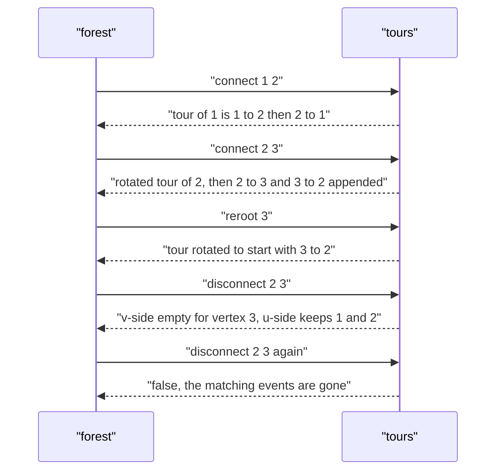

# 420 — Implement Euler tour tree for dynamic forests (conceptual).

> **Tier:** Advanced · **CTCI chapter:** Ch 4 — Trees and Graphs
> **Task spec:** [420-implement-euler-tour-tree-for-dynamic-forests-conceptual.md](../../../tasks/advanced/420-implement-euler-tour-tree-for-dynamic-forests-conceptual.md)
> **Solutions:** [Python](../../../solutions/python/advanced/420-implement-euler-tour-tree-for-dynamic-forests-conceptual/solution.py) ·
> [Java](../../../solutions/java/advanced/420-implement-euler-tour-tree-for-dynamic-forests-conceptual/Solution.java) ·
> [JavaScript](../../../solutions/javascript/advanced/420-implement-euler-tour-tree-for-dynamic-forests-conceptual/solution.js) ·
> [C#](../../../solutions/csharp/advanced/420-implement-euler-tour-tree-for-dynamic-forests-conceptual/Solution.cs)

## 1. Problem restatement

**Input:** `n` vertices, initially isolated, and a stream of `connect(u, v)` (link two trees),
`disconnect(u, v)` (cut an existing edge), `reroot(x)`, `connected(u, v)`, `component_size(x)`
and `component_vertices(x)` operations.

**Output:** the queries answer from the maintained structure; `connect` returns `false` for
vertices already in the same component, `disconnect` returns `false` when the edge does not
exist.

The representation is the **Euler tour tree**: each tree stores one Euler *circuit* as a
sequence of **directed edge events** `(u, v)`. Travelling the circuit enters `u` and leaves
towards `v`, so the events chain cyclically — the target of each event is the source of the next
— and every directed edge of the tree appears exactly once. A tree with `m` vertices therefore
has a tour of exactly `2 * (m - 1)` events, and an isolated vertex has the empty tour.

**Documented simplification.** This is a conceptual implementation: the tour sequences are plain
lists, so every operation costs `O(size)` instead of the `O(log n)` of a balanced-tree ETT. The
operations themselves are identical — only the balance is simulated away. The headers of all
four solution files say so explicitly.

| Scenario | Result |
| --- | --- |
| fresh forest, `connected(1, 1)` / `connected(1, 2)` | `true` / `false` |
| `connect(1, 2)` then `tour_of(1)` | `[(1, 2), (2, 1)]` |
| `connect(2, 3)` then `tour_of(2)` | `[(2, 1), (1, 2), (2, 3), (3, 2)]` |
| then `component_size(1)` / `component_vertices(1)` | `3` / `[1, 2, 3]` |
| `reroot(3)` then `tour_of(3)` | `[(3, 2), (2, 1), (1, 2), (2, 3)]` |
| `disconnect(2, 3)` then `tour_of(3)` | `[]` and `component_vertices(3) == [3]` |
| repeating the same `disconnect(2, 3)` | `false` (no such edge any more) |
| `disconnect(1, 3)` when only the path `1-2-3` exists | `false`, connectivity unchanged |

## 2. Intuition

A dynamic forest is hostile to arrays: an edge insertion can renumber everything. The Euler tour
tree sidesteps renumbering by storing, for each tree, a *closed walk* that visits it. Take a tree
and walk around it, writing down every directed edge you traverse; you come back to where you
started, and both directions of every edge appear exactly once. That sequence — the circuit — is
the whole state of the component.

Why is a circuit such a good idea?

- **Linking is splicing.** To join two trees with the edge `u-v`, rotate `u`'s circuit to start
  with an event leaving `u` and `v`'s circuit to start with an event leaving `v`, then
  concatenate `tour(u) + [(u, v)] + tour(v) + [(v, u)]`. The result is a single closed walk: the
  last event of `u`'s part chains into `(u, v)`, and `(v, u)` closes the loop back to the start
  of `u`'s part.
- **Cutting is splitting at the matching events.** If the tour contains `(u, v)`, then `(v, u)`
  is the event that closes that excursion. The events strictly between them form the circuit of
  the `v`-side, and the events after `(v, u)` (wrapping around) form the circuit of the `u`-side.
- **Rerooting is a rotation.** Choosing a different starting point of the same circuit is free,
  and picking the rotation that leaves `x` makes `x` the effective root.

The only thing the circuits do not answer directly is "are `u` and `v` in the same tree?" — a
real ETT answers that by comparing the roots of the balanced trees that own the tours. Here the
conceptual version keeps an `owner` map from vertex to component id (a list simulation of exactly
that lookup).



## 3. Algorithm

1. Initialise `tours[v] = []` for every vertex and `owner[v] = v`, plus a counter for fresh
   component ids.
2. `connect(u, v)`: refuse when `owner[u] == owner[v]`; otherwise build
   `rotate(tour(u), u) + [(u, v)] + rotate(tour(v), v) + [(v, u)]`, store it under a new
   component id, and re-point `owner` for all involved vertices.
3. `disconnect(u, v)`: refuse when the owners differ or when `(u, v)` or `(v, u)` is missing;
   rotate so the tour starts with `(u, v)`, find the position `q` of `(v, u)`, then split into
   `tour[1:q]` (the `v`-side) and `tour[q+1:]` (the `u`-side) and assign two new ids.
4. `reroot(x)`: rotate the tour of `x`'s component to start with an event leaving `x`.
5. `connected`, `component_vertices`, `component_size`: read the owner map and collect the
   endpoints of the component's tour.

```text
function rotate(tour, x)
    for index from 0 to length(tour) - 1 do
        if source(tour[index]) = x then
            return tour[index..] followed by tour[0..index - 1]
        end
    end
    return a copy of tour
end

procedure connect(u, v)
    if owner[u] = owner[v] then return false end
    merged ← rotate(tour_of(u), u) + edge u to v
             + rotate(tour_of(v), v) + edge v to u
    replace the two old components by one new id holding merged
    set owner of every endpoint in merged, and of u and v, to the new id
    return true
end

procedure disconnect(u, v)
    if owner[u] != owner[v] then return false end
    find the index of event u to v and the index of event v to u in the shared tour
    if either is missing then return false end
    tour ← tour rotated so that it starts with event u to v
    q ← the position of event v to u in tour
    side_v ← tour[1..q - 1]
    side_u ← tour[q + 1..]
    store side_u and side_v under two new ids and re-point owner
    return true
end
```

The validity invariant that the solution files check after every scripted step is
straightforward to state and hard to fake:

```text
function validate_circuit(tour, members)
    assert length(tour) = 2 * (length(members) - 1) when members has more than one vertex
    assert tour is empty when members is a single vertex
    for i from 0 to length(tour) - 1 do
        assert target(tour[i]) = source(tour[(i + 1) mod length(tour)])
    end
    assert no event repeats
    assert every event corresponds to an edge of the oracle tree
end
```



## 4. Worked example

Trace the hand sequence from the Python file, starting from three isolated vertices.

| Step | Operation | Tour of the affected component | Notes |
| --- | --- | --- | --- |
| 1 | `connected(1, 1)` / `connected(1, 2)` | `[]` / `[]` | `true` for the same vertex, `false` otherwise |
| 2 | `connect(1, 2)` | `[(1, 2), (2, 1)]` | both tours were empty, so the splice is just the two new events |
| 3 | `connect(2, 3)` | `[(2, 1), (1, 2), (2, 3), (3, 2)]` | `tour_of(2)` rotates to `[(2,1),(1,2)]`, then `(2,3)` and `(3,2)` are appended |
| 4 | `component_size(1)` | — | `3`; `component_vertices(1) == [1, 2, 3]` |
| 5 | `reroot(3)` | `[(3, 2), (2, 1), (1, 2), (2, 3)]` | rotated to start with the event leaving `3` |
| 6 | `disconnect(2, 3)` | `u`-side `[(2, 1), (1, 2)]`, `v`-side `[]` | rotate to start at `(2,3)`: `[(2,3),(3,2),(2,1),(1,2)]`, then `q = 1` |
| 7 | `tour_of(3)` | `[]` | vertex `3` is isolated again; `component_vertices(3) == [3]` |
| 8 | `disconnect(2, 3)` again | unchanged | the event pair is gone, so the call returns `false` |

Step 6 is the heart of the algorithm. Rotating to start with `(2, 3)` gives
`[(2,3), (3,2), (2,1), (1,2)]`; the matching `(3, 2)` sits at position `q = 1`, so
`tour[1:1]` — empty — is the `v`-side circuit (vertex 3 alone) and `tour[2:]` —
`[(2,1), (1,2)]` — is the `u`-side circuit on `{1, 2}`. Those are exactly the two circuits the
files assert, including `tour_of(1)` sorted to `[(1, 2), (2, 1)]`.



The scripted part of the test drives 320 random operations on `n = 25` against an adjacency
oracle, and after every step re-validates the full invariant: tour length `2 * (m - 1)`, cyclic
chaining, no repeated event, every event an oracle edge, and identical vertex sets from
`component_vertices` and from a BFS in the oracle.

## 5. Complexity

Let `n` be the number of vertices and `m` the current component size.

| Bound | Value | Why |
| --- | --- | --- |
| `connect`, `disconnect`, `reroot` | `O(m)` | rotations and splices copy a list of up to `2 * (m - 1)` events |
| `connected` | `O(1)` | a single owner-map lookup, plus the `u == v` case |
| `component_vertices`, `component_size` | `O(m)` | scan the circuit's endpoints and sort them |
| Space | `O(n)` events per component set | each tree stores exactly two events per edge |
| Real ETT with balanced trees | `O(log n)` per structural operation | split and merge of balanced sequences instead of list copies |

The conceptual version keeps the *shape* of the interface and the correctness argument intact but
gives up the asymptotic win: that is the documented deviation. The tests stay in the hundreds of
operations and `n = 25`, which is the size range where the list implementation is still the
honest way to demonstrate the algorithm.

## 6. Pitfalls and edge cases

- **Empty tours.** An isolated vertex has an empty tour and must stay findable through the owner
  map; `component_vertices(3) == [3]` after the cut is asserted for exactly that reason.
- **`connect` within a component.** Returns `false` and changes nothing — otherwise the
  structure would stop being a forest.
- **`disconnect` of a non-edge.** Even for two connected vertices the edge may not exist
  (`disconnect(1, 3)` on the path `1-2-3` returns `false`); the search for the event pair fails
  and the forest is untouched.
- **Repeated cuts.** After the first `disconnect(2, 3)`, the second identical call returns
  `false`, and the previously separated components stay separate.
- **Rotation with no matching source.** `rotate` is a no-op copy when no event leaves `x`
  (isolated vertex). The splice still works, because an empty tour contributes nothing.
- **Chaining must wrap.** The invariant is cyclic: the target of the last event equals the
  source of the first. A plain "pair the neighbors" check silently accepts a broken circuit.
- **No repeated events.** Each directed edge appears once, so `len(set(tour)) == len(tour)`;
  duplicates signal a splice or split bug.
- **Self-loops.** `connect(u, u)` must not create an edge to itself; scripts avoid `u == v`, and
  the owner check rejects the trivial same-component case.
- **Component ids are opaque.** New ids are drawn from a monotone counter; an id is retirable
  after a split, and reusing one would alias two components.

## 7. Variants and follow-ups

- **Balanced-tree ETT.** Replacing lists with balanced BSTs keyed by event position turns the
  `O(m)` operations into `O(log n)` split and merge; only the container changes.
- **Path queries in dynamic trees.** Euler tour trees are natural for subtree and component
  aggregates; path aggregates want preferred paths instead —
  [419 — dynamic tree, link-cut tree](419-implement-dynamic-tree-link-cut-tree-basic-operations.md).
- **Offline dynamic connectivity.** If every operation is known up front, divide and conquer over
  time with a rollback union-find answers the same connectivity questions more cheaply:
  [422 — persistent union-find, partial persistence](422-persistent-union-find-partial-persistence-basic.md).
- **Static subtree aggregation.** When the tree never changes, an Euler tour plus a Mo ordering
  answers subtree queries offline without any balancing:
  [430 — Mo's algorithm on trees](430-implement-mo-s-algorithm-on-trees-euler-tour-mo.md).

## 8. Check yourself

<details><summary>Show answer</summary>

**Q1.** Why does a tree with `m` vertices produce a circuit of exactly `2 * (m - 1)` events?

An Euler circuit of the tree as an undirected graph uses every edge exactly twice, once per
direction; with `m - 1` edges that is `2 * (m - 1)` directed events, and each appears once in the
event sequence that the structure stores. The files assert that length after every scripted step.

</details>

<details><summary>Show answer</summary>

**Q2.** `connect(1, 2)` on two isolated vertices — what is the resulting tour, and why is there
nothing to rotate?

Both tours are empty; `rotate` on an empty list returns an empty list. The spliced result is
`[] + [(1, 2)] + [] + [(2, 1)] = [(1, 2), (2, 1)]`, a circuit of length 2 for a two-vertex tree.

</details>

<details><summary>Show answer</summary>

**Q3.** In the trace, `disconnect(2, 3)` produced the `u`-side `[(2, 1), (1, 2)]`. Why are the
events after `(3, 2)` exactly the other side?

Rotating so the tour starts with `(2, 3)` makes the pair `(2, 3)` … `(3, 2)` an excursion: the
events strictly inside walk the `3`-side subtree and return to `3`, and the events after
`(3, 2)` return from `3` to `2` and continue the rest of the original circuit, which is the
`1-2` part. That is precisely the split the algorithm implements.

</details>

<details><summary>Show answer</summary>

**Q4.** What breaks if the tour test only checks `tour[i][1] == tour[i + 1][0]` for `i` up to
`len(tour) - 2`?

The circuit would be allowed to end anywhere, so a torn tour would still validate. The cyclic
step `i = len(tour) - 1` with `(i + 1) mod len(tour)` closes the loop, and the files do check it
that way.

</details>

<details><summary>Show answer</summary>

**Q5.** Which operations does the conceptual version make asymptotically worse, and by how much?

`connect`, `disconnect`, `reroot`, `component_vertices` and `component_size` all touch the whole
event list, so they are `O(m)` instead of the real ETT's `O(log n)`; `connected` stays `O(1)`
because it reads the owner map. The invariant and the observable answers are unaffected.

</details>
