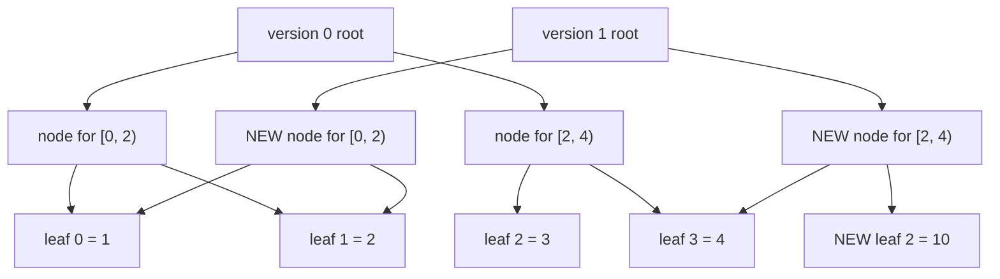
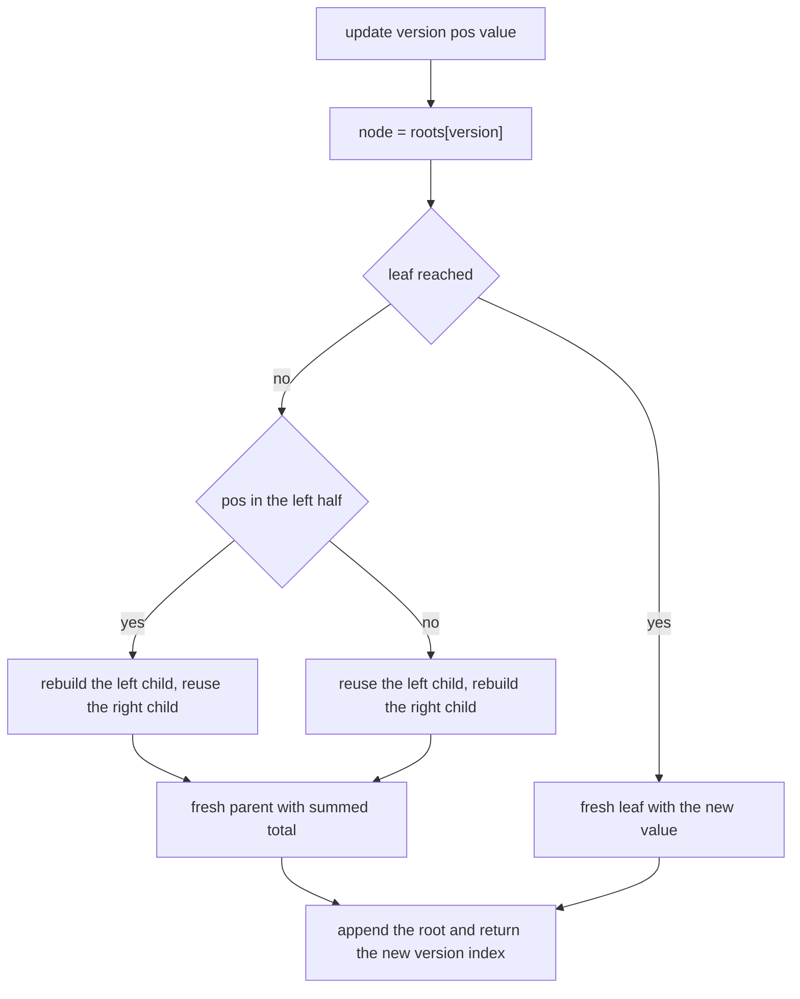
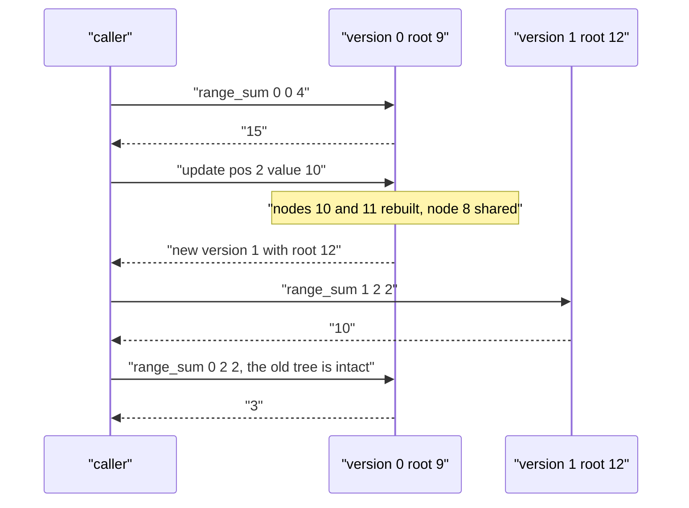

# 421 — Implement persistent segment tree (versioned).

> **Tier:** Advanced · **CTCI chapter:** Ch 14 — Databases
> **Task spec:** [421-implement-persistent-segment-tree-versioned.md](../../../tasks/advanced/421-implement-persistent-segment-tree-versioned.md)
> **Solutions:** [Python](../../../solutions/python/advanced/421-implement-persistent-segment-tree-versioned/solution.py) ·
> [Java](../../../solutions/java/advanced/421-implement-persistent-segment-tree-versioned/Solution.java) ·
> [JavaScript](../../../solutions/javascript/advanced/421-implement-persistent-segment-tree-versioned/solution.js) ·
> [C#](../../../solutions/csharp/advanced/421-implement-persistent-segment-tree-versioned/Solution.cs)

## 1. Problem restatement

**Input:** an initial array `values` of `n` integers over the fixed index domain `[0, n)`,
followed by two kinds of operation:

- `update(version, pos, value)` — the value at `pos` changes to `value` **in a new version**;
  all older versions must remain intact and queryable.
- `range_sum(version, lo, hi)` — the inclusive sum `values[lo..hi]` as of `version`.

**Output:** `update` returns the index of the newly created version; `range_sum` returns the
sum. Version `0` is the initial array, and a new version may branch off *any* old version, not
just the newest one.

The hand case in every solution file, starting from `[1, 2, 3, 4, 5]`:

| Operation | Result | Array behind that version |
| --- | --- | --- |
| `range_sum(0, 0, 4)` | `15` | `[1, 2, 3, 4, 5]` |
| `range_sum(0, 1, 3)` / `range_sum(0, 2, 2)` / `range_sum(0, 0, 0)` | `9` / `3` / `1` | same array |
| `v1 = update(0, 2, 10)` | `1` | `[1, 2, 10, 4, 5]` |
| `range_sum(1, 0, 4)` / `range_sum(1, 2, 2)` / `range_sum(1, 1, 3)` | `22` / `10` / `16` | version 1 |
| `range_sum(0, 0, 4)` / `range_sum(0, 2, 2)` after the update | `15` / `3` | version 0 is **untouched** |
| `v2 = update(1, 0, -1)` | `2` | `[-1, 2, 10, 4, 5]`, total `20`, prefix `[0..2] = 11` |
| `v3 = update(0, 4, 7)` — branch off the *old* version | `3` | `[1, 2, 3, 4, 7]`, total `17`, `[3..4] = 11`, `[2..2] = 3` |
| `range_sum(2, 0, 4)` after the branch | `20` | the other branch is unchanged |

A one-element tree is also supported: `PersistentSegTree([42]).range_sum(0, 0, 0) == 42`, and
after `update(0, 0, -8)` the new version reads `-8` while version 0 still reads `42`.

## 2. Intuition

A segment tree is a fixed binary decomposition of the index range: node `[0, 4)` splits into
`[0, 2)` and `[2, 4)`, and so on. A point update only invalidates the `O(log n)` nodes on the
path from the root to one leaf — every other node keeps its old `total`. So the naive "copy the
tree per version" costs `O(n)` per update when only `O(log n)` nodes actually change.

The insight is **structural sharing**: never overwrite a node. When a point update descends, the
child that changes is rebuilt as a new node, the child that does not change is *reused by
reference*, and the parent of the two is a new node whose `total` is the sum of the (possibly
older) children. The old root is still there, pointing at the old nodes, so version `k` is simply
a root index.

Everything lives in flat arrays instead of objects: `left`, `right`, `total` indexed by node
number, and `roots[k]` for version `k`. Node `0` is the null node — it has children `0` and
sum `0`, which makes out-of-range branches fall out of the recursion for free.

Because a version is just a root index, **branching is free**: `update(0, 4, 7)` after
`update(1, 0, -1)` builds a third version that shares most nodes with version 0 and nothing with
version 2.



The five nodes of the path to index 2 are newly allocated; the untouched leaves and the untouched
subtrees are shared between the two versions.

## 3. Algorithm

1. `_build(values, lo, hi)` creates one node per segment: a leaf carries `values[lo]`, an inner
   node its two children and `total = total[left] + total[right]`. This produces `2n - 1` nodes
   and returns the root of version 0.
2. `_update(node, lo, hi, pos, value)`:
   1. If `lo == hi`, return a fresh leaf with `total = value`.
   2. Otherwise recurse into the child that contains `pos` and **copy the other child's index
      unchanged**.
   3. Return a fresh node with those two children and their summed `total`.
3. `update(version, pos, value)` calls `_update` on `roots[version]`, appends the returned root
   and returns the new version index.
4. `_range_sum(node, lo, hi, ql, qr)`: return `0` for the null node or a disjoint segment; return
   `total[node]` for a fully covered segment; otherwise sum the two recursive calls.

```text
function build(values, lo, hi)
    if lo = hi then return new_node(0, 0, values[lo]) end
    mid ← floor((lo + hi) / 2)
    left ← build(values, lo, mid)
    right ← build(values, mid + 1, hi)
    return new_node(left, right, total[left] + total[right])
end

function update(node, lo, hi, pos, value)
    if lo = hi then return new_node(0, 0, value) end
    mid ← floor((lo + hi) / 2)
    if pos &lt;= mid then
        left ← update(left[node], lo, mid, pos, value)
        right ← right[node]
    else
        left ← left[node]
        right ← update(right[node], mid + 1, hi, pos, value)
    end
    return new_node(left, right, total[left] + total[right])
end

function range_sum(node, lo, hi, ql, qr)
    if node = 0 or qr &lt; lo or hi &lt; ql then return 0 end
    if ql &lt;= lo and hi &lt;= qr then return total[node] end
    mid ← floor((lo + hi) / 2)
    return range_sum(left[node], lo, mid, ql, qr)
         + range_sum(right[node], mid + 1, hi, ql, qr)
end
```

The oracle the tests use is deliberately low-tech: after each update they keep a **snapshot copy**
of the plain array and compare `range_sum` against `sum(snapshot[lo:hi + 1])`, which checks the
structural sharing from the outside.



## 4. Worked example

Build `[1, 2, 3, 4, 5]` over `[0, 4]`, then run `update(0, 2, 10)`. Node `0` is the null node, so
the build allocates nodes `1` to `9` in this creation order:

| Node | Segment | Children | `total` |
| --- | --- | --- | --- |
| 1 | `[0, 0]` | — | `1` |
| 2 | `[1, 1]` | — | `2` |
| 3 | `[0, 1]` | 1, 2 | `3` |
| 4 | `[2, 2]` | — | `3` |
| 5 | `[0, 2]` | 3, 4 | `6` |
| 6 | `[3, 3]` | — | `4` |
| 7 | `[4, 4]` | — | `5` |
| 8 | `[3, 4]` | 6, 7 | `9` |
| 9 | `[0, 4]` | 5, 8 | `15` |

`roots = [9]`. Now `update(0, 2, 10)` descends `9 → 5 → 4` and rebuilds on the way back:

| Step | Node visited | Action | New node |
| --- | --- | --- | --- |
| 1 | 9, segment `[0, 4]` | `pos = 2 <= mid = 2`, so the left child is rebuilt and the right child `8` is reused | pending |
| 2 | 5, segment `[0, 2]` | `pos = 2 > mid = 1`, so the left child `3` is reused and the right child is rebuilt | pending |
| 3 | 4, segment `[2, 2]` | leaf, replaced by a fresh leaf with value `10` | node 10, `total = 10` |
| 4 | back in 5 | parent of the reused `3` and the new `10` | node 11, `total = 3 + 10 = 13` |
| 5 | back in 9 | parent of the new `11` and the reused `8` | node 12, `total = 13 + 9 = 22` |

So `roots = [9, 12]`, version 1 reads `22` over the whole array, `10` at index 2 and `16` over
`[1, 3]` — the three assertions the files make — while version 0's root `9` still owns nodes
`1..8` with `total = 15` and `range_sum(0, 2, 2) = 3`. Only three nodes were allocated for the
update, not `2n - 1`.



The branching assertion is the interesting one: `v3 = update(0, 4, 7)` reads the old root `9` and
builds three new nodes along the path to index 4, giving total `17` and `range_sum(3, 3, 4) = 11`,
while versions 1 and 2 keep answering `22` and `20`. The random part of the test repeats this
pattern for seeds 11, 421 and 9001 with `n = 1 + seed % 29` and 60 operations each, comparing every
query against a snapshot list.

## 5. Complexity

Let `n` be the number of leaves and `q` the number of updates.

| Bound | Value | Why |
| --- | --- | --- |
| Build | `O(n)` time and space | exactly `2n - 1` nodes are created |
| `update` | `O(log n)` time, `O(log n)` new nodes | one root-to-leaf path, one fresh node per level |
| `range_sum` | `O(log n)` | the standard segment-tree recursion, `O(1)` extra nodes touched per level |
| Total space for `q` updates | `O(n + q log n)` nodes | persistent updates never free the old path |
| Naive "copy the whole tree per version" | `O(n)` time and space per update | everything is duplicated, nothing is shared |

Persistence is bought with memory, not time: queries see exactly the same recursion as in a
non-persistent tree, and the only extra cost is the `log n` allocations per update. There is no
path compression or rebalancing anywhere, and every version is a plain index into `roots`.

## 6. Pitfalls and edge cases

- **The null node.** Node `0` must have `left = right = total = 0` and be the initial content of
  the arrays, so that a query that walks off the built region returns `0` instead of crashing.
- **Mutating a shared node.** Writing `total[node] = ...` in place would corrupt every older
  version; every change must go through `new_node`.
- **Branching off an old version.** `update(0, 4, 7)` after two later updates is legal and is
  asserted; the implementation must not assume that the version being extended is the newest.
- **Single element.** `n = 1` builds one leaf, and the update path is a single node; `[42]` then
  `-8` is asserted, including that version 0 stays `42`.
- **Inclusive ranges.** `range_sum(version, lo, hi)` includes both endpoints; the files use
  `[0, 0]`, `[2, 2]`, `[1, 3]` and `[0, 4]` to pin the boundary behaviour.
- **Empty query range.** `qr < lo or hi < ql` returns `0` early, and a fully covered segment
  short-circuits to `total[node]` — without that check the recursion would double-count.
- **Negative values.** Nothing assumes non-negativity; `range_sum(2, 0, 4) == 20` for
  `[-1, 2, 10, 4, 5]` and the LCG data uses values in `[-20, 20]`.
- **Version indices.** Versions are append-only indices starting at `0`; `update` returns
  `len(roots) - 1`, which the tests compare against their own snapshot counter.

## 7. Variants and follow-ups

- **Range k-th smallest.** The same persistent prefix tree, queried as a difference of two
  versions, answers "which value is the k-th smallest in `a[l..r]`" —
  [429 — range k-th order statistic using a persistent segment tree](429-implement-range-kth-order-statistic-using-persistent-segtree.md).
- **Databases and MVCC.** Keeping old versions queryable while new writes proceed is exactly the
  multi-version idea; the storage-engine side of it is sketched in the repository's
  [Ch 14 — Databases chapter](../../ctci/14-databases.md) context.
- **Persistent sets and union-find.** The same "record only what changed, keep the rest shared"
  trick appears in a partially persistent union-find:
  [422 — persistent union-find, partial persistence](422-persistent-union-find-partial-persistence-basic.md).
- **Fully persistent balanced trees.** Making *every* update site copyable turns the structure
  into a fully persistent version tree, the usual next step after this one.

## 8. Check yourself

<details><summary>Show answer</summary>

**Q1.** How many nodes does a `PersistentSegTree` over five values allocate during `build`, and
how many does a later point update allocate?

The build creates `2n - 1 = 9` nodes (plus node `0` as the null placeholder), and each point
update creates one node per level: for `n = 5` the tree has 3 levels, so 3 nodes — as the worked
trace shows with nodes 10, 11 and 12.

</details>

<details><summary>Show answer</summary>

**Q2.** Why does `update` copy the index of the child it does **not** recurse into, instead of
recomputing it?

Because that subtree did not change, and the whole point of persistence is to share it. Copying
the index costs `O(1)` and preserves the invariant that old versions still reference the old
nodes — while a recursive rebuild would double the work and destroy sharing.

</details>

<details><summary>Show answer</summary>

**Q3.** After `v1 = update(0, 2, 10)`, why does `range_sum(0, 0, 4)` still return `15`?

Version 0's root is node `9`, whose `total` field is never modified: the update created fresh
nodes 10, 11 and 12 and left `9` pointing at the old children `5` and `8`. Reading version 0
therefore reads the original tree.

</details>

<details><summary>Show answer</summary>

**Q4.** Can a query mix versions, and what would the files catch if it did?

`update` resolves `roots[version]` once at the start, and the recursion only ever walks nodes
reachable from that root, so a version's query cannot see another version's data. Mixing would
show up as a mismatch against the snapshot oracle the tests keep per version.

</details>

<details><summary>Show answer</summary>

**Q5.** What is the memory cost of `q` updates on an array of size `n`, and when is the naive
approach actually cheaper?

`O(n + q log n)` nodes, against `O(q n)` for copying the tree per version. The naive copy is
never asymptotically cheaper; it is only ever competitive when `n` is so small that `log n` and
`n` are the same order of magnitude, e.g. `n = 1`, where both approaches allocate one node per
update and the naive one merely avoids the two child arrays.

</details>
