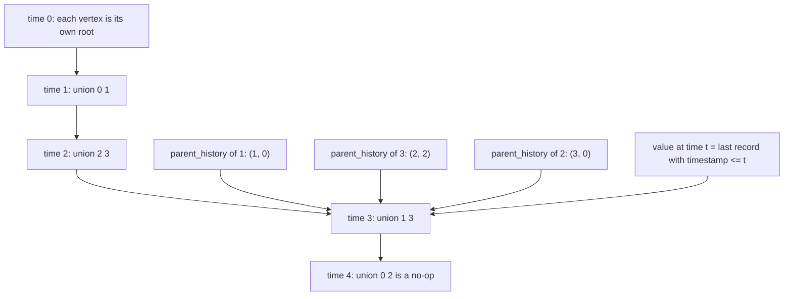
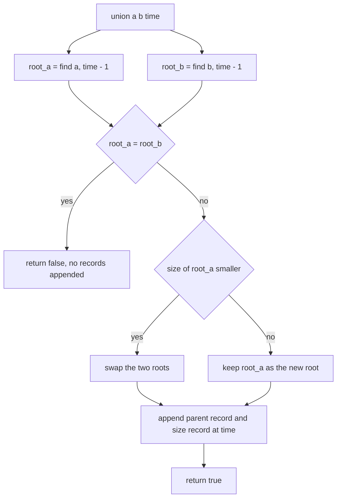
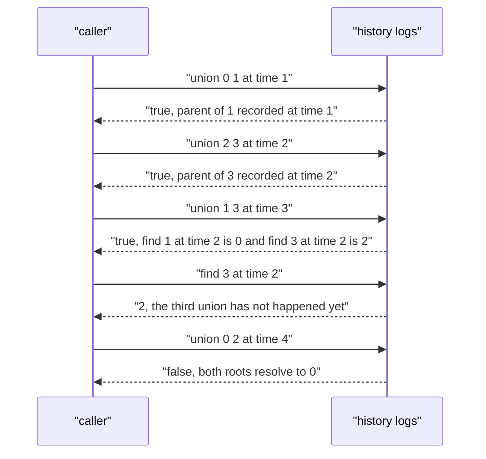

# 422 — Persistent union-find (partial persistence) basic.

> **Tier:** Advanced · **CTCI chapter:** Ch 14 — Databases
> **Task spec:** [422-persistent-union-find-partial-persistence-basic.md](../../../tasks/advanced/422-persistent-union-find-partial-persistence-basic.md)
> **Solutions:** [Python](../../../solutions/python/advanced/422-persistent-union-find-partial-persistence-basic/solution.py) ·
> [Java](../../../solutions/java/advanced/422-persistent-union-find-partial-persistence-basic/Solution.java) ·
> [JavaScript](../../../solutions/javascript/advanced/422-persistent-union-find-partial-persistence-basic/solution.js) ·
> [C#](../../../solutions/csharp/advanced/422-persistent-union-find-partial-persistence-basic/Solution.cs)

## 1. Problem restatement

**Input:** `n` elements and a stream of unions, each carrying a **strictly increasing timestamp**
`time = 1, 2, 3, ...` (the timestamp is the number of operations applied so far).

**Output:** past states must stay queryable:

| Query | Meaning |
| --- | --- |
| `find(node, time)` | representative of `node` after the first `time` unions |
| `size(node, time)` | size of `node`'s component at that time (`1` when no record exists yet) |
| `component_count(time)` | number of distinct components at that time |
| `union(a, b, time)` | merge at the given timestamp; `true` when a merge happened, `false` when the two were already together |

The hand case in every solution file uses `operations = [(0,1), (2,3), (1,3), (0,2)]`:

| `time` | Operation | `component_count` after | Interesting `find` |
| --- | --- | --- | --- |
| 0 | none | `4` | `find(1, 0) == 1`, `find(2, 0) == 2` |
| 1 | `union(0, 1)` | `3` | `find(1, 1) == 0`, `find(0, 1) == 0`, `find(3, 1) == 3` |
| 2 | `union(2, 3)` | `2` | `find(3, 2) == 2` |
| 3 | `union(1, 3)` | `1` | `find(3, 3) == 0`, `find(2, 2) == 2` |
| 4 | `union(0, 2)` — already merged | `1` | `find(3, 4) == 0` |

The returned flags are exactly `[True, True, True, False]`. Note the pair of answers at `time = 1`
and `time = 2`: node `3` was its own representative after the first union and became `2` after
the second, which is the whole point of the exercise.

## 2. Intuition

A textbook union-find mutates two arrays in place: `parent[x]` and `size[root]`. Both are
overwritten by every union, so the state after operation `k` is gone the moment operation `k + 1`
runs. **Partial persistence** means "old versions must remain queryable, but new versions may only
be derived from the newest one" — a version chain, not a version tree.

The trick that makes partial persistence cheap here is to stop overwriting and start **logging**:

- `parent_history[x]` collects pairs `(time, new_parent)` for the moments when `x` stopped being
  a root. Entries are appended with increasing timestamps.
- `size_history[r]` collects pairs `(time, new_size)` for the moments when the root `r` absorbed
  another component.
- The concrete value at time `t` is simply the **last record with timestamp `<= t`** — a binary
  search, because the history list is sorted by construction.

Two consequences follow immediately. First, old states are never destroyed: nothing is ever
removed. Second, the standard optimisations have to be reconsidered — **path compression is
forbidden**, because it rewrites a parent pointer that older versions still need to see. What
remains is **union by size**, which is exactly what the headers describe: the merge always makes
the larger root the parent, which keeps the tree depth at `O(log n)` even without compression.



Because the parent of `3` is recorded at time `2` (as `2`) and again — for a different node — the
history of `2` is recorded at time `3` (as `0`), walking `find(3, t)` for `t = 1, 2, 3, 4` gives
`3`, `2`, `0`, `0`: four different answers from four queries over the same two arrays.

## 3. Algorithm

1. Create `parent_history[v] = []` and `size_history[v] = []` for every vertex.
2. `value_at(history, time)` — binary search for the last entry with timestamp `<= time`; return
   its value, or `None` when every entry is newer.
3. `find(node, time)`: repeatedly look up `parent_history[node]` at `time`. `None` means `node`
   is the representative; otherwise jump to that recorded parent. No path compression, no
   cycles.
4. `size(node, time)`: the last recorded size of `node`, or `1` when there is none (the vertex
   was still a single-element component).
5. `union(a, b, time)`: resolve `root_a = find(a, time - 1)` and `root_b = find(b, time - 1)`
   (the state *before* this union); return `false` when they coincide; otherwise swap so that
   `root_a` is the larger component, append `(time, root_a)` to `parent_history[root_b]` and
   `(time, size_a + size_b)` to `size_history[root_a]`, and return `true`.
6. `component_count(time)`: count the distinct values of `find(v, time)` over all vertices.

```text
function value_at(history, time)
    lo ← 0
    hi ← length(history)
    while lo &lt; hi do
        mid ← floor((lo + hi) / 2)
        if timestamp(history[mid]) &lt;= time then lo ← mid + 1 else hi ← mid end
    end
    if lo = 0 then return None end
    return value(history[lo - 1])
end

function find(node, time)
    loop
        parent ← value_at(parent_history[node], time)
        if parent = None then return node end
        node ← parent
    end
end

procedure union(a, b, time)
    root_a ← find(a, time - 1)
    root_b ← find(b, time - 1)
    if root_a = root_b then return false end
    size_a ← size(root_a, time - 1)
    size_b ← size(root_b, time - 1)
    if size_a &lt; size_b then swap root_a with root_b and size_a with size_b end
    append (time, root_a) to parent_history[root_b]
    append (time, size_a + size_b) to size_history[root_a]
    return true
end
```

The oracle is a replay: apply the first `time` operations to a *fresh* union-find that makes
identical union-by-size decisions, then compare every `find` and the component count.

```text
function replay(n, operations, time)
    parent ← identity of length n
    size ← all ones
    for step ← 1 to time do
        (a, b) ← operations[step - 1]
        root_a ← plain_find(parent, a)
        root_b ← plain_find(parent, b)
        if root_a != root_b then
            if size[root_a] &lt; size[root_b] then swap root_a with root_b end
            parent[root_b] ← root_a
            size[root_a] ← size[root_a] + size[root_b]
        end
    end
    return path of every vertex to its root
end
```



## 4. Worked example

Run the hand operations with `n = 4` and record every history entry.

| `time` | Operation | Roots found at `time - 1` | Sizes | Records appended | Merge? |
| --- | --- | --- | --- | --- | --- |
| 1 | `union(0, 1)` | `0`, `1` | `1`, `1` — no swap needed | `parent_history[1] ← (1, 0)`, `size_history[0] ← (1, 2)` | `true` |
| 2 | `union(2, 3)` | `2`, `3` | `1`, `1` | `parent_history[3] ← (2, 2)`, `size_history[2] ← (2, 2)` | `true` |
| 3 | `union(1, 3)` | `find(1, 2) = 0`, `find(3, 2) = 2` | `2`, `2` | `parent_history[2] ← (3, 0)`, `size_history[0] ← (3, 4)` | `true` |
| 4 | `union(0, 2)` | `find(0, 3) = 0`, `find(2, 3) = 0` | — | none | `false` |

The final histories are `parent_history[1] = [(1, 0)]`, `parent_history[3] = [(2, 2)]`,
`parent_history[2] = [(3, 0)]`, and `size_history[0] = [(1, 2), (3, 4)]`. Now the interesting
query trace, all on `find(3, t)`:

| `t` | Lookup in `parent_history[3]` | Then in `parent_history[2]` | Result |
| --- | --- | --- | --- |
| 1 | `(2, 2)` has timestamp `2 > 1` → `None` | not reached | `3` |
| 2 | `(2, 2)` → `2` | no entry with timestamp `<= 2` | `2` |
| 3 | `(2, 2)` → `2` | `(3, 0)` → `0` | `0` |
| 4 | `(2, 2)` → `2` | `(3, 0)` → `0` | `0` |

`size(0, 4)` returns `4` (the last record of `size_history[0]`), `size(0, 2)` returns `2`, and
`size(1, 4)` returns `1` because `1` never records a size of its own. Counting distinct
representatives gives `4, 3, 2, 1, 1` for `t = 0..4`, matching the assertions.



## 5. Complexity

Let `n` be the number of elements and `m` the number of unions performed.

| Bound | Value | Why |
| --- | --- | --- |
| `value_at` | `O(log h)` | binary search over a history of length `h` |
| `find(node, t)` | `O(log n * log m)` | at most `O(log n)` hops thanks to union by size, each hop one binary search |
| `union(a, b, t)` | `O(log n * log m)` | two `find` calls plus two appends |
| `component_count(t)` | `O(n log n * log m)` | one `find` per element |
| Space | `O(n + m)` records | each union appends at most one parent record and one size record |
| Same structure with path compression | — | not available: compression would overwrite a parent pointer that older versions still query |

Union by size is what keeps `O(log n)` hops; without it the chain of recorded parents could be
`O(n)` long and the `log m` per hop would multiply into `O(n log m)` per find. The randomization
in the tests uses `n = 2 + seed % 9` and 40 operations for seeds 422, 31415 and 271828, then
answers 60 random `(node, time)` queries against the replay oracle.

## 6. Pitfalls and edge cases

- **Querying before any operation.** `time = 0` is legal and every vertex is its own
  representative; `component_count(0) == 4` is asserted for the hand case.
- **Redundant unions.** `union(0, 2, 4)` finds both roots equal and returns `false` without
  appending anything — if it appended, `component_count` would drift.
- **No path compression.** Adding it would make older `find` calls return the compressed (newer)
  parent, silently breaking the "state at time `t`" contract.
- **Timestamps must be strictly increasing.** `union` resolves roots at `time - 1`, so a
  non-increasing timestamp would look into its own or a later state.
- **`size` before any merge.** A vertex with no size record has size `1` — the empty-history
  default, not `0` and not `None`.
- **Self-union and duplicates.** `union(x, x, t)` returns `false` through the same root path as
  any other already-merged pair.
- **Answers differ per time.** `find(3, 1)`, `find(3, 2)`, `find(3, 3)` return `3`, `2`, `0`;
  caching a single "current" answer per vertex would break all but one of them.
- **Component count is derived.** `component_count` is computed, not stored, which keeps it
  consistent with `find` by construction; the oracle checks it equals the number of distinct
  roots after replaying `time` operations.
- **`n = 1`.** A single vertex is always its own representative and the count is `1` at every
  time.

## 7. Variants and follow-ups

- **Fully persistent union-find.** Copying only the changed path of the parent array turns the
  linear version chain into a version tree, at the cost of extra nodes per union.
- **Rollback union-find.** If versions are only needed for an undo stack, recording the record
  positions and truncating them is simpler than answering arbitrary past queries.
- **Offline dynamic connectivity.** Divide and conquer over time plus a rollback union-find
  answers the same questions when operations are known in advance;
  [420 — Euler tour tree](420-implement-euler-tour-tree-for-dynamic-forests-conceptual.md) is the
  fully online alternative.
- **Versioned aggregates in general.** The "log the change with its time, binary-search the
  history" pattern is the same one that makes a persistent segment tree queryable per version:
  [421 — persistent segment tree](421-implement-persistent-segment-tree-versioned.md).

## 8. Check yourself

<details><summary>Show answer</summary>

**Q1.** Why is path compression incompatible with partial persistence here?

Compression rewrites `parent[x]` to point directly at the root. The history log would then have
to contain a record for a time at which nothing actually changed in the represented state, and
any query with an older time would follow the compressed pointer and see a tree shape that never
existed at that moment.

</details>

<details><summary>Show answer</summary>

**Q2.** What does `find(3, 4)` do, step by step, after the four hand operations?

It looks in `parent_history[3]`, finds `(2, 2)` with timestamp `2 <= 4`, so it moves to `2`; it
looks in `parent_history[2]`, finds `(3, 0)` with timestamp `3 <= 4`, so it moves to `0`; it
looks in `parent_history[0]`, finds nothing with a timestamp `<= 4`, so `0` is the answer. That
is three binary searches, two hops.

</details>

<details><summary>Show answer</summary>

**Q3.** Why does `union` resolve its roots at `time - 1` rather than at `time`?

At `time` the merge has not happened yet, and it must not influence its own decision: resolving
at `time` would let the union see a partially applied state. Using `time - 1` reproduces exactly
the semantics of a sequential union-find where the merge happens at the given moment.

</details>

<details><summary>Show answer</summary>

**Q4.** How much history does one union append, and what happens for a redundant union?

At most two records: one parent record at the absorbed root and one size record at the new root.
A redundant union (same root) appends nothing at all, which is what keeps the total record count
linear in the number of *successful* merges, at most `n - 1` of them.

</details>

<details><summary>Show answer</summary>

**Q5.** The tests assert `uf.component_count(time) == n - applied` inside the random script. Why
is that identity true?

Every successful union on distinct components decreases the component count by exactly one and
leaves the roots untouched otherwise, starting from `n` singleton components. After `applied`
successful merges the count is `n - applied`, regardless of the order in which the merges
happened.

</details>
