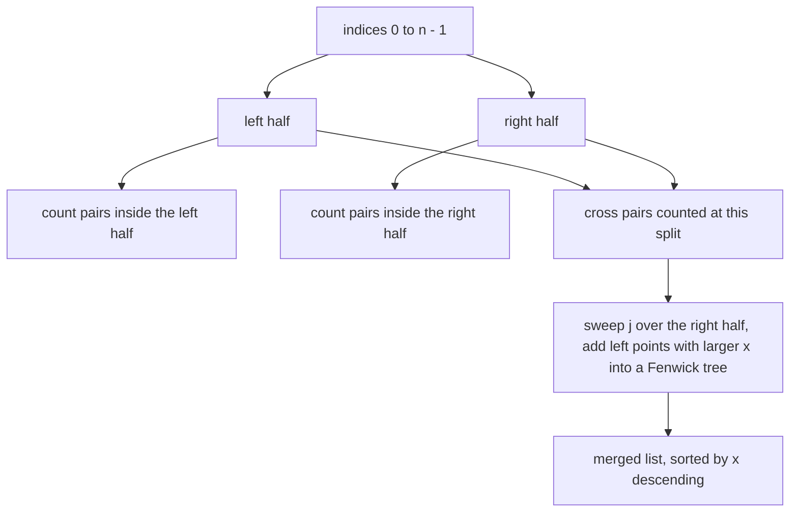
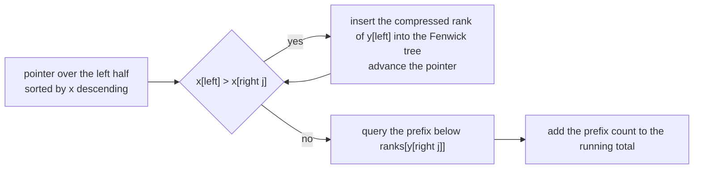
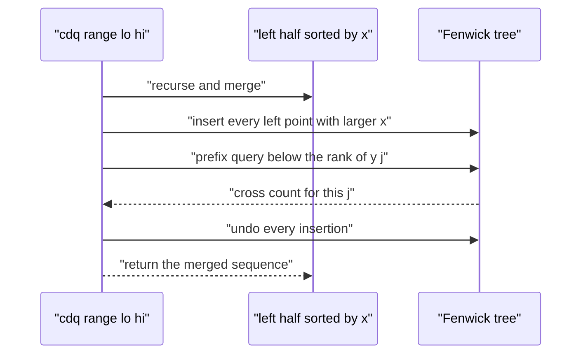

# 423 — Implement offline queries with divide & conquer on value (CDQ).

> **Tier:** Advanced · **CTCI chapter:** Ch 8 — Recursion and Dynamic Programming
> **Task spec:** [423-implement-offline-queries-with-divide-conquer-on-value-cdq.md](../../../tasks/advanced/423-implement-offline-queries-with-divide-conquer-on-value-cdq.md)
> **Solutions:** [Python](../../../solutions/python/advanced/423-implement-offline-queries-with-divide-conquer-on-value-cdq/solution.py) ·
> [Java](../../../solutions/java/advanced/423-implement-offline-queries-with-divide-conquer-on-value-cdq/Solution.java) ·
> [JavaScript](../../../solutions/javascript/advanced/423-implement-offline-queries-with-divide-conquer-on-value-cdq/solution.js) ·
> [C#](../../../solutions/csharp/advanced/423-implement-offline-queries-with-divide-conquer-on-value-cdq/Solution.cs)

## 1. Problem restatement

**Input:** `n` weighted points `(x[i], y[i])`, in the given order.

**Output:** the number of pairs `i < j` with **both** coordinates strictly decreasing:
`x[i] > x[j]` **and** `y[i] > y[j]`. This is the two-dimensional dominance count, also called the
two-coordinate inversion count.

The assertions in the four solution files:

| Input | Result | Why |
| --- | --- | --- |
| `[]` | `0` | nothing to count |
| `[(1, 1)]` | `0` | no pair |
| `[(3, 1), (2, 2)]` | `0` | `x` decreases but `y` increases |
| `[(2, 2), (3, 1)]` | `0` | the pair is in the wrong index order |
| `[(5, 5), (3, 4), (1, 2)]` | `3` | every one of the three pairs dominates |
| `[(1, 1), (2, 2), (3, 3)]` | `0` | both coordinates increase |
| `[(3, 3), (3, 2)]` | `0` | equal `x` is **not** a strict decrease |
| `[(4, 4), (3, 4)]` | `0` | equal `y` is **not** a strict decrease |
| `[(7 - i, 9 - i) for i in 0..4]` | `10` | a fully decreasing chain: all `C(5, 2) = 10` pairs count |
| `[(5, 1), (4, 4), (6, 2), (3, 3)]` | `1` | exactly one pair qualifies |
| twelve copies of `(7, 7)` | `0` | equal coordinates never dominate |

The randomized part uses 40 trials with `n = 2 + local % 59` and coordinates in `[-5, 5]`, and
compares every result against an `O(n^2)` double loop.

## 2. Intuition

A one-dimensional inversion count (`i < j` and `x[i] > x[j]`) is a classic merge-sort statistic:
split the array, count the crossings while merging, recurse. The two-dimensional version is
tempting to attack by just requiring both conditions during the same merge — that fails, because
the merge is ordered by `x` alone and the `y` condition needs its own bookkeeping.

**CDQ divide and conquer** ("divide and conquer on value", after Chen Danqi) handles exactly this
shape of problem: *offline counting or DP where the transitions depend on a partial order*. The
recipe is:

1. Split the **index range** in half. Every qualifying pair either lies entirely in a half
   (handled by recursion) or crosses the split — there is no third option, so recursion plus
   crossing counting is exhaustive and each pair is counted exactly once, at the unique level
   where the two indices end up in different halves.
2. Count the crossing pairs in one left-to-right sweep. Because the recursion returns each half
   **sorted by `x` descending**, a single pointer moves through the left half: as long as
   `x[left] > x[j]`, insert that left point's `y` into a Fenwick tree counted by compressed rank.
   Then the number of already-inserted points with a strictly smaller `y` is a prefix query.
3. Undo the insertions (or use a fresh tree) so the parent level starts clean, then return the
   merged sequence, still sorted by `x` descending.

The Fenwick tree is what makes the `y` condition cheap: it answers "how many inserted points have
`y` smaller than this rank" in `O(log n)`, and only ranks strictly below `ranks[ys[j]]` are
queried, which is why the comparison is strict in both coordinates.



The two-pointer sweep is the heart of the crossing count:



## 3. Algorithm

1. Compress the `y` values: sort the distinct values and map each to a rank in `[0, m)`.
2. `cdq(lo, hi)` returns the indices of `[lo, hi)` sorted by `x` descending, and adds the
   crossing count to a shared accumulator:
   1. If the range holds fewer than two indices, return it unchanged.
   2. Recurse on both halves; both come back sorted by `x` descending.
   3. Walk `j` over the right half; while the left pointer is still inside the left half and
      `x[left[pointer]] > x[j]`, insert `left[pointer]`'s rank into the Fenwick tree and advance.
      Then add `pointer - prefix(ranks[y[j]] + 1)` — the number of inserted points whose rank is
      **strictly below** `ranks[y[j]]`.
   4. Undo every insertion, then merge the two halves by `x` descending.
3. Answer: the accumulated total.

```text
function count_dominating_pairs(points)
    n ← length(points)
    if n &lt; 2 then return 0 end
    xs ← the x coordinate of every point
    ys ← the y coordinate of every point
    ranks ← rank of each distinct y value, smallest rank 0
    tree ← Fenwick tree of size equal to the number of distinct y values
    total ← 0
    cdq(0, n)
    return total
end

function cdq(lo, hi)
    if hi - lo &lt;= 1 then return the single index lo end
    mid ← floor((lo + hi) / 2)
    left ← cdq(lo, mid)
    right ← cdq(mid, hi)
    touched ← empty list
    pointer ← 0
    for j in right do
        while pointer &lt; length(left) and xs[left[pointer]] &gt; xs[j] do
            add 1 at rank of ys[left[pointer]] in the Fenwick tree
            append that rank to touched
            pointer ← pointer + 1
        end
        total ← total + pointer - prefix_count(rank of ys[j] + 1)
    end
    for rank in touched do
        add -1 at rank in the Fenwick tree
    end
    merged ← merge left and right so that x is non-increasing
    return merged
end
```

The Fenwick helpers are the standard ones:

```text
procedure fenwick_add(rank, delta)
    index ← rank + 1
    while index &lt;= size of the tree do
        tree[index] ← tree[index] + delta
        index ← index + (index AND -index)
    end
end

function fenwick_prefix(count)
    result ← 0
    index ← count
    while index &gt; 0 do
        result ← result + tree[index]
        index ← index - (index AND -index)
    end
    return result
end
```



## 4. Worked example

Take `points = [(5, 5), (3, 4), (1, 2)]`, indices `0, 1, 2`. Distinct `y` values sorted are
`[2, 4, 5]`, so `ranks = {2: 0, 4: 1, 5: 2}` and the tree has size `3`.

`cdq(0, 3)` splits at `mid = 1`:

| Sub-call | Range | Returns (sorted by `x` descending) | Crossing count added |
| --- | --- | --- | --- |
| `cdq(0, 1)` | index 0 alone | `[0]` | `0` |
| `cdq(1, 3)` | indices 1, 2 | `[1, 2]` | `1` |
| `cdq(0, 3)` | indices 0, 1, 2 | `[0, 1, 2]` | `2` |

Inside `cdq(1, 3)`, split `mid = 2`:

| `j` | Condition | Fenwick action | Prefix query | Added |
| --- | --- | --- | --- | --- |
| 2 (`x = 1`, `y = 2`, rank 0) | `x[1] = 3 > 1` → insert rank 1 | tree has {1} | `prefix(0 + 1)` counts ranks `&lt; 1` → `0` | `1 - 0 = 1` |

Then the insertions are undone and the halves merge into `[1, 2]`. Back in `cdq(0, 3)`, `left =
[0]` (point `(5, 5)`, rank 2) and `right = [1, 2]`:

| `j` | Condition | Fenwick action | Prefix query | Added |
| --- | --- | --- | --- | --- |
| 1 (`x = 3`, `y = 4`, rank 1) | `x[0] = 5 > 3` → insert rank 2 | tree has {2} | `prefix(1 + 1)` counts ranks `&lt; 2` → `0` | `1 - 0 = 1` |
| 2 (`x = 1`, `y = 2`, rank 0) | left pointer exhausted | tree has {2} | `prefix(0 + 1)` → `0` | `1 - 0 = 1` |

Total `1 + 2 = 3`, matching the assertion. The three counted pairs are `(0, 1)`, `(0, 2)` and
`(1, 2)` — every pair, because the sequence is strictly decreasing in both coordinates.

The single-pair case `[(5, 1), (4, 4), (6, 2), (3, 3)]` returning `1` shows the two conditions
interacting: only `(4, 4)` followed by `(3, 3)` has both coordinates decreasing, even though
several pairs have one coordinate decreasing.

## 5. Complexity

Let `n` be the number of points and `m <= n` the number of distinct `y` values.

| Bound | Value | Why |
| --- | --- | --- |
| Time, best | `O(n log^2 n)` | the recursion shape is data-independent: `log n` levels, each level `O(n)` Fenwick operations of `O(log n)` |
| Time, average | `O(n log^2 n)` | no randomness in the algorithm — the LCG data only varies the input |
| Time, worst | `O(n log^2 n)` | the recurrence is `T(n) = 2 T(n/2) + O(n log n)` |
| Space | `O(n)` | two index lists per recursion level plus the Fenwick tree of size `m` |
| Naive double loop | `O(n^2)` time, `O(1)` extra space | the oracle the files cross-check against |

Each crossing count inserts each element of a level at most once and queries once per element, so
a level costs `O(n)` Fenwick operations at `O(log m)` each; with `log n` levels that is
`O(n log n log m)`. Both the recursion depth and the merge work are deterministic, and the strict
comparisons mean that equal coordinates are simply not inserted/queried together, which is what
the `(3, 3), (3, 2)` and `(4, 4), (3, 4)` cases pin down.

## 6. Pitfalls and edge cases

- **Strictness on both coordinates.** The sweep inserts only while `x[left] > x[j]` (not `>=`),
  and queries only ranks strictly below `ranks[y[j]]`; flipping either to a non-strict comparison
  silently counts ties, which the `(3, 3), (3, 2)` and `(4, 4), (3, 4)` cases detect.
- **Index order matters.** The pair `(2, 2), (3, 1)` counts nothing because the domination would
  have to go from a later index to an earlier one; the recursion only ever counts left-to-right
  crossings.
- **Empty and singleton inputs.** `n < 2` returns `0` immediately; the recursive routine is only
  entered for `n >= 2`.
- **All-equal points.** Twelve copies of `(7, 7)` give `0`: nothing is ever inserted for a query
  that needs a strictly larger `x`, and the prefix query is always empty.
- **Rank compression.** `ranks` maps *distinct* values, so a `y`-value repeated many times does
  not inflate the tree; the tree size is the number of distinct values, `m`, not `n`.
- **Undo the insertions.** The touched-rank list exists so that the tree is empty when the parent
  level starts; forgetting the undo double-counts across levels.
- **Merge tie handling.** The merge uses `>=` so that a left index with an equal `x` is merged
  before the right one; the ordering of equal `x` values does not change the count, but an
  inconsistent merge breaks the sorted-by-`x` precondition of the parent.
- **Negative coordinates.** The randomized trials use `[-5, 5]` in both coordinates; because only
  ranks and comparisons are used, sign is irrelevant.
- **Count size.** The count can reach `C(n, 2)` — `10` for five fully decreasing points — so the
  result needs a wide enough integer type in the compiled languages.

## 7. Variants and follow-ups

- **Three-dimensional dominance.** The same recursion with a Fenwick tree of Fenwick trees, or a
  second CDQ layer, extends the pattern; the classic example is Mo-less 3D partial order counting.
- **CDQ for DP transitions.** When the DP value of `i` depends on all `j < i` satisfying a partial
  order, CDQ is applied directly to the transition instead of to a count — the same `O(n log^2 n)`
  shape, and the reason the technique is filed under dynamic programming in this task.
- **Offline range queries.** Divide and conquer over the *time* axis with a rollback union-find
  answers dynamic connectivity, the structural sibling of this recursion:
  [422 — persistent union-find](422-persistent-union-find-partial-persistence-basic.md).
- **Small-to-large merging.** When the pairs to count are defined by subtrees rather than by a
  partial order, the same "count at the split, decide exactly once" idea reappears in
  [424 — small-to-large merging on trees](424-implement-small-to-large-merging-on-trees-for-frequency-queries.md).

## 8. Check yourself

<details><summary>Show answer</summary>

**Q1.** Why is every qualifying pair counted exactly once, and never twice?

A pair `(i, j)` with `i < j` has a unique lowest recursion node whose split separates `i` into the
left half and `j` into the right half. Inside that node it is counted by the sweep; in every
ancestor node both indices fall in the same half, so the sweep never mixes them; in every
descendant node they are in different sub-problems and never considered together.

</details>

<details><summary>Show answer</summary>

**Q2.** Why must the two halves be returned sorted by `x` descending?

Because the sweep consumes the left half with a single non-decreasing pointer. If the left half
were unsorted, a point with a large `x` could appear after the pointer moved past the threshold,
and later right-half queries would miss it; each `j` would then need a full scan of the left half,
destroying the `O(n log n)` level cost.

</details>

<details><summary>Show answer</summary>

**Q3.** Where exactly does the `y` comparison become strict?

In the query `pointer - prefix_count(ranks[y[j]] + 1)`. The prefix covers ranks strictly below
`ranks[y[j]]`, so a left point with an equal `y` is not counted, which is what
`count_dominating_pairs([(4, 4), (3, 4)]) == 0` asserts.

</details>

<details><summary>Show answer</summary>

**Q4.** Compute the answer for `[(2, 2), (2, 1), (1, 0)]`.

Pairs: `(0, 1)` has `x` equal, so no; `(0, 2)` has `2 > 1` and `2 > 0`, yes; `(1, 2)` has `2 > 1`
and `1 > 0`, yes. Answer `2`.

</details>

<details><summary>Show answer</summary>

**Q5.** What is the extra space, and why is it not `O(n log n)`?

`O(n)` at any moment: each recursion level holds two index slices of total size `n`, and the
levels are processed depth-first, so only the current root-to-leaf path of slices is alive at
once. The `touched` list is also bounded by the left half's size, and the Fenwick tree has `m`
entries.

</details>
