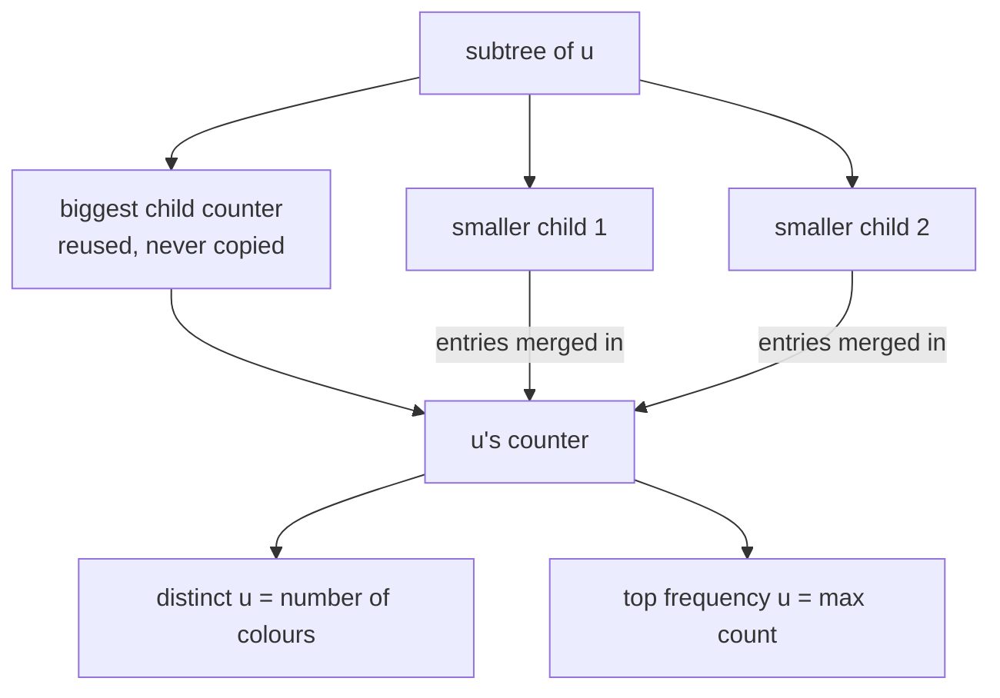
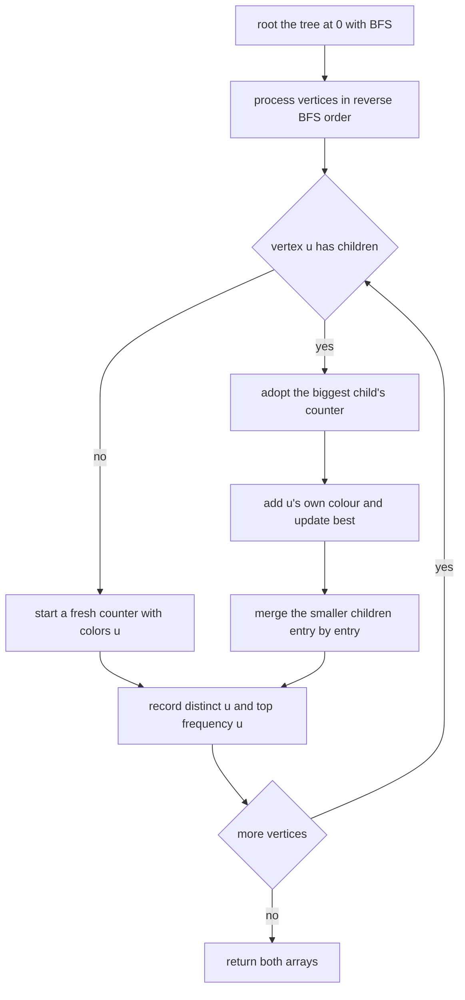
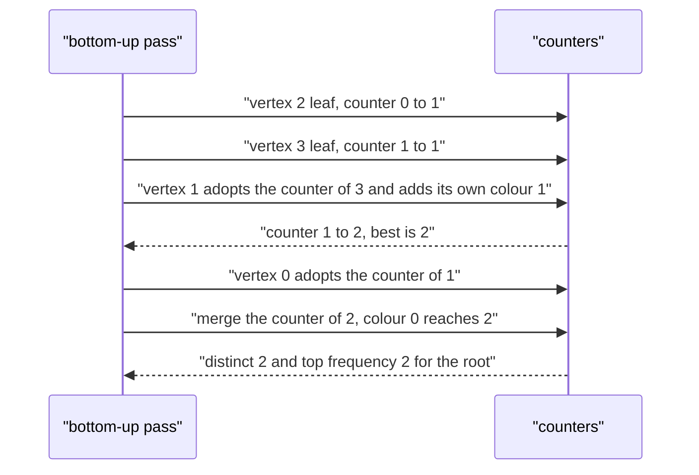

# 424 — Implement small-to-large merging on trees for frequency queries.

> **Tier:** Advanced · **CTCI chapter:** Ch 4 — Trees and Graphs
> **Task spec:** [424-implement-small-to-large-merging-on-trees-for-frequency-queries.md](../../../tasks/advanced/424-implement-small-to-large-merging-on-trees-for-frequency-queries.md)
> **Solutions:** [Python](../../../solutions/python/advanced/424-implement-small-to-large-merging-on-trees-for-frequency-queries/solution.py) ·
> [Java](../../../solutions/java/advanced/424-implement-small-to-large-merging-on-trees-for-frequency-queries/Solution.java) ·
> [JavaScript](../../../solutions/javascript/advanced/424-implement-small-to-large-merging-on-trees-for-frequency-queries/solution.js) ·
> [C#](../../../solutions/csharp/advanced/424-implement-small-to-large-merging-on-trees-for-frequency-queries/Solution.cs)

## 1. Problem restatement

**Input:** an unrooted tree with `n` vertices given as an edge list, a colour `colors[v]` for every
vertex, and the convention that the tree is rooted at vertex `0`.

**Output:** two arrays of length `n`, one entry per vertex:

- `distinct[u]` — how many **different** colours occur in the subtree of `u`;
- `top_frequency[u]` — the **highest** number of times a single colour occurs in that subtree.

The assertions in the four solution files:

| Tree | Colours | `distinct` | `top_frequency` |
| --- | --- | --- | --- |
| edges `0-1, 0-2, 1-3` | `[0, 1, 0, 1]` | `[2, 1, 1, 1]` | `[2, 2, 1, 1]` |
| path `0-1-2-3-4` | `[1, 2, 2, 3, 3]` | `[3, 2, 2, 1, 1]` | `[2, 2, 2, 2, 1]` |
| single vertex, no edges | `[7]` | `[1]` | `[1]` |
| star `0` to `1..4` | `[3, 3, 3, 3, 3]` | `[1, 1, 1, 1, 1]` | `[5, 1, 1, 1, 1]` |

Every entry is cross-checked against a naive DFS collection for every vertex, over 20 random trees
per seed for seeds 424, 2024 and 77777 (`n = 2 + local % 59`, colours modulo `2 + seed % 5`), plus
ten trees with a nearly unique palette (`colors` modulo `1000`) that stress the distinct counts
instead of the frequencies.

## 2. Intuition

The naive approach is per-vertex: for each `u`, walk its subtree and count colours. That is
`O(n^2)` on a path, because the same colour is recounted at every level.

The natural improvement is a bottom-up merge: build a colour counter for each subtree out of its
children's counters. The straightforward version merges every child into the parent, which is also
`O(n^2)` on a path — each level copies the whole subtree's counter again.

**Small-to-large merging** (also called DSU on tree) fixes precisely that:

1. Choose the child with the **largest counter** and *reuse its dictionary as the parent's
   counter*. No copying at all for that child.
2. Merge the counters of the remaining (smaller) children into it, entry by entry.

Why is this `O(n log n)`? Consider a single colour entry. Whenever its dictionary is merged into
another one, the target already holds at least as many entries as its own — because the target is
the largest child's counter, and the entry's own dictionary is not the largest. After the merge,
the dictionary that contains this entry holds at least **twice** as many entries as before. A
dictionary can only double `log n` times, so each entry is moved at most `O(log n)` times.

The summary values then come for free from the final dictionary: `distinct[u] = len(counter)` and
`top_frequency[u]` is the maximum count, which the merge loop tracks incrementally instead of
rescanning.



The bottom-up order is what makes this a single pass: the tree is rooted once at vertex `0` with
a BFS, which yields an order in which every child appears after its parent; processing that order
in reverse guarantees every child's counter is complete before the parent needs it.

## 3. Algorithm

1. Build the adjacency lists; run a BFS/DFS from vertex `0` to compute `parent[v]`, the child lists,
   and `order` (a pre-order where parents precede children).
2. Process the vertices in reverse `order` (so leaves first). For vertex `u`:
   1. Pick `biggest`, the child whose counter is the longest (`-1` when `u` is a leaf).
   2. If `u` is a leaf, start a fresh counter `{colors[u]: 1}` with `best = 1`.
   3. Otherwise adopt the biggest child's counter as `u`'s counter, inherit its `best`, then add
      `u`'s own colour to it and update `best`.
   4. Merge every other child's counter entry by entry, updating `best` whenever a count grows.
   5. Record `distinct[u] = len(counter)` and `top_frequency[u] = best`.
3. Return both arrays.

```text
function subtree_frequency_summary(n, edges, colors)
    children, order ← root the tree at vertex 0
    counters ← array of n empty slots
    distinct ← array of n zeroes
    top_frequency ← array of n zeroes
    for u in reverse(order) do
        biggest ← the child of u with the longest counter, or -1 when u has no children
        if biggest = -1 then
            table ← new counter holding colors[u] with count 1
            best ← 1
        else
            table ← counters[biggest]
            best ← top_frequency[biggest]
            count ← count of colors[u] in table plus 1
            store count for colors[u] in table
            if count &gt; best then best ← count end
            for v in children[u] do
                if v != biggest then
                    for each color with amount in counters[v] do
                        count ← count of color in table plus amount
                        store count for color in table
                        if count &gt; best then best ← count end
                    end
                end
            end
        end
        counters[u] ← table
        distinct[u] ← number of colours in table
        top_frequency[u] ← best
    end
    return distinct, top_frequency
end
```

The oracle every file uses is deliberately brute force:

```text
function naive_frequency_summary(n, edges, colors)
    children ← the rooted child lists
    for u from 0 to n - 1 do
        counts ← empty counter
        stack ← [u]
        while stack is not empty do
            node ← pop(stack)
            increment the count of colors[node] in counts
            push every child of node onto stack
        end
        distinct[u] ← number of colours in counts
        top_frequency[u] ← maximum count in counts
    end
    return distinct, top_frequency
end
```



## 4. Worked example

Take the hand tree `0-1, 0-2, 1-3` with `colors = [0, 1, 0, 1]`. Rooted at `0`, the child lists are
`children[0] = [1, 2]`, `children[1] = [3]`, `children[2] = []`, `children[3] = []`, and the
pre-order is `0, 1, 3, 2`, so the reverse processing order is `2, 3, 1, 0`.

| Vertex | Biggest child | Counter before the own colour | After adding `colors[u]` | After merging the others | `distinct` | `top_frequency` |
| --- | --- | --- | --- | --- | --- | --- |
| 2 | none (leaf) | — | `{0: 1}` | — | `1` | `1` |
| 3 | none (leaf) | — | `{1: 1}` | — | `1` | `1` |
| 1 | 3 (only child) | `{1: 1}`, `best = 1` | `{1: 2}`, `best = 2` | nothing left to merge | `1` | `2` |
| 0 | 1 | `{1: 2}` (reused, `best = 2`) | `{1: 2, 0: 1}` | merge `counters[2] = {0: 1}` → `{1: 2, 0: 2}` | `2` | `2` |

The result is `distinct = [2, 1, 1, 1]` and `top_frequency = [2, 2, 1, 1]`, exactly the arrays the
files assert. Note that vertex `0` reuses vertex `1`'s dictionary — no colour is copied for that
child — and that the `best` value inherited from the biggest child (`2`) is only improved when a
count actually grows.

The path case `0-1-2-3-4` with `colors = [1, 2, 2, 3, 3]` shows the accumulation in one
direction:

| Vertex | Counter after processing | `distinct` | `top_frequency` |
| --- | --- | --- | --- |
| 4 | `{3: 1}` | `1` | `1` |
| 3 | `{3: 2}` | `1` | `2` |
| 2 | `{3: 2, 2: 1}` | `2` | `2` |
| 1 | `{3: 2, 2: 2}` | `2` | `2` |
| 0 | `{3: 2, 2: 2, 1: 1}` | `3` | `2` |

giving `[3, 2, 2, 1, 1]` and `[2, 2, 2, 2, 1]`. On a path nothing is ever merged into anything
else, so the total work is `O(n)` — the small-to-large rule pays off exactly on the bushy shapes.



## 5. Complexity

Let `n` be the number of vertices.

| Bound | Value | Why |
| --- | --- | --- |
| Time, best | `O(n)` | a path merges nothing, only the per-vertex work remains |
| Time, average | `O(n log n)` | every entry moves only into a counter that afterwards holds at least twice as much |
| Time, worst | `O(n log n)` | the doubling argument is data-independent |
| Space | `O(n log n)` retained entries as written | merged child dictionaries stay reachable through `counters[v]`; clearing them after the merge gives `O(n)` |
| Naive per-vertex DFS | `O(n^2)` time | every subtree is recounted from scratch |
| Naive merge-every-child | `O(n^2)` time on a path | each level copies the whole accumulating counter |

The doubling argument is worth spelling out: an entry is merged only when its dictionary is *not*
the largest child's, so the target already holds at least as many entries as the dictionary it
comes from. After the merge, the dictionary containing the entry has at least twice as many
entries as before, so it can double at most `log n` times. Summing over all entries gives
`O(n log n)` dictionary operations in total. The `O(n)` best case is real, not just an artifact of
the tests: on the path case every vertex has a single child, so the merge loop body never runs.

## 6. Pitfalls and edge cases

- **Single vertex.** `n = 1` with no edges: the vertex is a leaf, its counter is
  `{colors[0]: 1}`, and both answers are `1`.
- **Star with one colour.** Every leaf has `distinct = 1`, the centre accumulates `5` copies in
  the star case, and only the centre's `top_frequency` is `5` — the leaves stay at `1`.
- **Ties in child size.** The "biggest" child is chosen with a strict `>` comparison, so with
  equal counters the first child wins; either choice preserves the bound, since the target is
  still at least as large as the merged-in one.
- **The vertex's own colour.** It must be added *after* adopting the biggest child's counter but
  counted into the same dictionary, otherwise a colour that occurs only at `u` and in one child is
  counted twice or zero times.
- **`best` must be inherited.** Recomputing the maximum by scanning the dictionary after every
  merge would give `O(n^2)`; the inherited `best` is only bumped when an individual count grows.
- **Shared dictionaries.** After `counters[u] = table`, several vertices may reference the same
  dictionary; nothing may mutate it later except merges that happen while processing an ancestor.
- **Rooting convention.** The answer arrays are indexed by vertex, and the subtree meaning depends
  on rooting at vertex `0`; the naive oracle roots the tree the same way, which is what makes the
  comparison meaningful.
- **Disconnected or invalid edges.** The input contract is a tree; the BFS sets `parent[0] = 0`
  and never revisits a parent, so a cycle would silently drop edges rather than crash.
- **Big palettes.** With colours modulo `1000` and `n` around 60, almost every subtree is fully
  distinct — that case exercises the `distinct` count, while the small palettes exercise the
  frequency count.

## 7. Variants and follow-ups

- **DSU on tree with an Euler tour.** Instead of merging dictionaries, flatten the tree and use a
  global count array plus a "keep the heavy child's data" pass; the amortization argument is
  identical and the memory drops to `O(n)`.
- **Centroid decomposition.** When the queries are about *paths* rather than subtrees, splitting at
  centroids replaces subtree merging — see
  [425 — centroid decomposition for k-distance pairs](425-implement-centroid-decomposition-for-k-distance-pairs.md).
- **Mo's algorithm on a tree.** Subtree colour queries can also be answered offline by turning the
  Euler tour into intervals; that alternative avoids the dictionaries entirely:
  [430 — Mo's algorithm on trees](430-implement-mo-s-algorithm-on-trees-euler-tour-mo.md).
- **Divide and conquer over a value axis.** When the counting pairs are dominance pairs rather than
  subtree colours, the same "count each pair at the level where it crosses" idea appears in
  [423 — CDQ divide and conquer](423-implement-offline-queries-with-divide-conquer-on-value-cdq.md).

## 8. Check yourself

<details><summary>Show answer</summary>

**Q1.** Why does merging *every* child into the parent give `O(n^2)` on a path, while reusing the
biggest child does not?

On a path each vertex has exactly one child. Merging that child's dictionary copies every entry at
every level, so the total is `n + (n - 1) + ... = O(n^2)`. Reusing it by reference copies nothing;
the dictionary simply grows by the vertex's own colour, and the total work becomes `O(n)`.

</details>

<details><summary>Show answer</summary>

**Q2.** Justify the `O(n log n)` bound in one sentence.

An entry is merged only when its dictionary is not the largest of its parent's children, so the
target holds at least as many entries; after the merge the containing dictionary has at least
doubled, which can happen at most `log n` times per entry.

</details>

<details><summary>Show answer</summary>

**Q3.** In the hand tree, why is `distinct[0] = 2` while `distinct[1] = 1`?

Vertex `1`'s subtree is `{1, 3}` with colours `1` and `1`, one distinct colour. Vertex `0`'s
subtree adds vertices `0` and `2`, both colour `0`, so the root's counter is `{1: 2, 0: 2}` — two
distinct colours.

</details>

<details><summary>Show answer</summary>

**Q4.** What goes wrong if the vertex's own colour is added before adopting the biggest child's
counter?

If a fresh `{colors[u]: 1}` is created first and the biggest child's dictionary is then merged into
it, the reuse disappears — every entry of the largest child is copied, and the path case degrades
to `O(n^2)`. The count itself would still be right, which is why only a complexity test would
catch it.

</details>

<details><summary>Show answer</summary>

**Q5.** Why does the implementation keep the merged children's dictionaries around, and what would
you do to reduce the memory?

`counters[v]` is the natural way to return a subtree's summary to its parent, and the merged
dictionaries are still referenced from it. Setting `counters[v]` to empty after the merge would
release them and bring the retained space down to `O(n)`.

</details>
