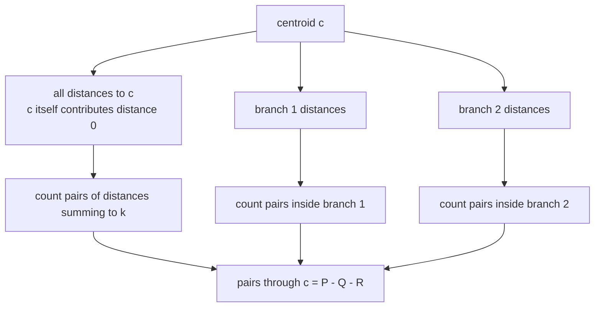
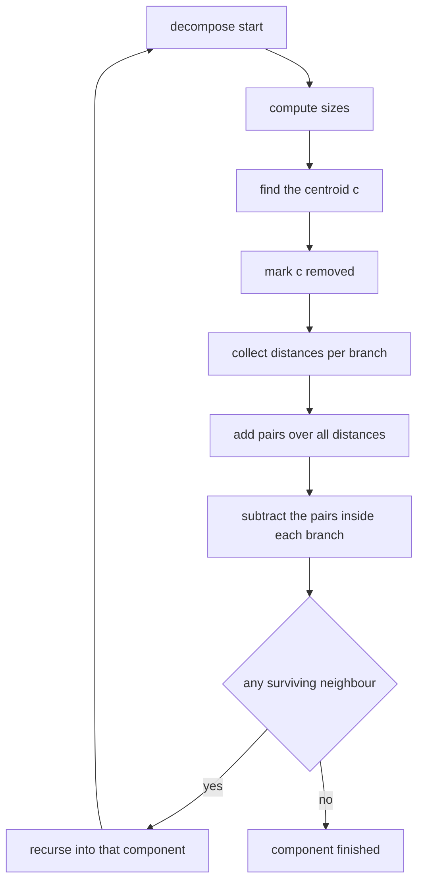
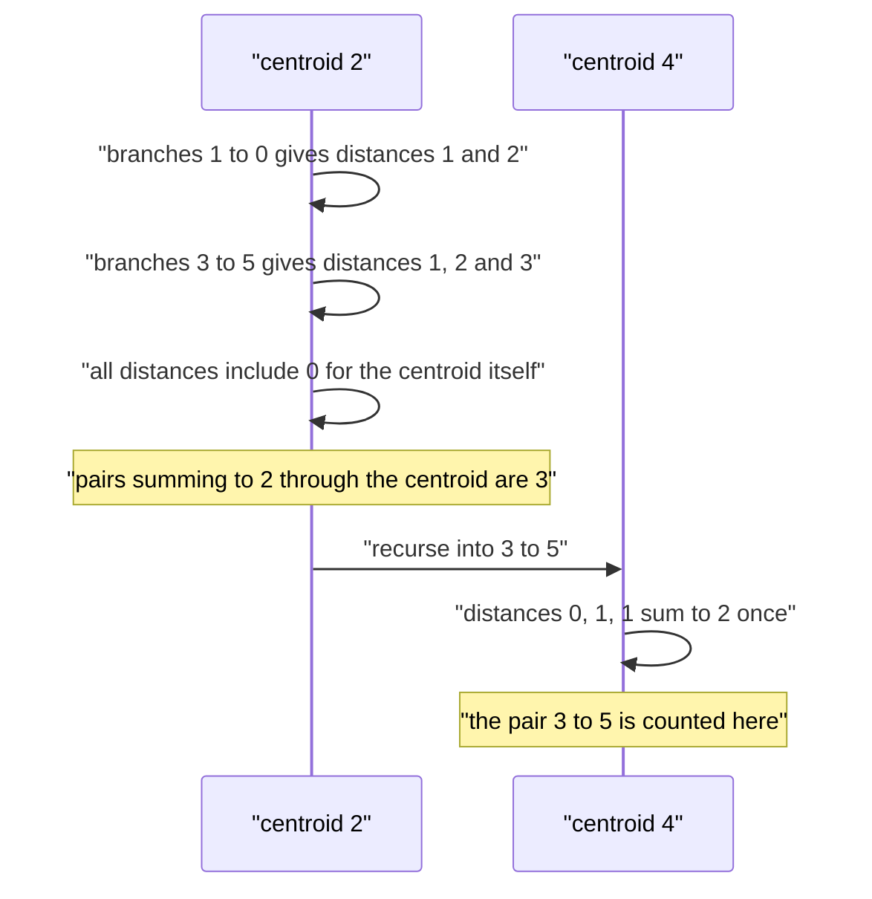

# 425 — Implement centroid decomposition for k-distance pairs.

> **Tier:** Advanced · **CTCI chapter:** Ch 4 — Trees and Graphs
> **Task spec:** [425-implement-centroid-decomposition-for-k-distance-pairs.md](../../../tasks/advanced/425-implement-centroid-decomposition-for-k-distance-pairs.md)
> **Solutions:** [Python](../../../solutions/python/advanced/425-implement-centroid-decomposition-for-k-distance-pairs/solution.py) ·
> [Java](../../../solutions/java/advanced/425-implement-centroid-decomposition-for-k-distance-pairs/Solution.java) ·
> [JavaScript](../../../solutions/javascript/advanced/425-implement-centroid-decomposition-for-k-distance-pairs/solution.js) ·
> [C#](../../../solutions/csharp/advanced/425-implement-centroid-decomposition-for-k-distance-pairs/Solution.cs)

## 1. Problem restatement

**Input:** a tree with `n` vertices given by its edge list, and a target distance `k >= 0`.

**Output:** the number of **unordered** pairs of distinct vertices `{u, v}` whose tree distance is
exactly `k`.

The assertions in the four solution files:

| Tree | `k` | Result | Which pairs |
| --- | --- | --- | --- |
| `n = 0`, no edges | `0` | `0` | nothing to pair |
| `n = 1`, no edges | `0` and `1` | `0` | a single vertex has no partner |
| `n = 2`, edge `0-1` | `1` | `1` | `{0, 1}` |
| `n = 2`, edge `0-1` | `0` and `2` | `0` | no two nodes share a position, and the diameter is 1 |
| path `0-1-2` | `0` / `1` / `2` / `3` | `0` / `2` / `1` / `0` | `{0-1, 1-2}`, then `{0-2}` |
| star `0` to `1,2,3` | `1` / `2` / `3` | `3` / `3` / `0` | hub-to-leaf, then `C(3, 2)` leaf pairs |
| path `0-1-2-3` | `1` / `2` / `3` / `4` | `3` / `2` / `1` / `0` | one pair per distance up to the diameter |
| path with 6 vertices | `k = 0..6` | `[0, 5, 4, 3, 2, 1, 0]` | `5 - k` pairs for `k >= 1` |

The randomized part checks 30 LCG trees with `n = 2 + seed % 59` against a BFS brute force for
every `k` from `0` to `12`.

## 2. Intuition

Counting pairs at a fixed distance is easy from any single source (BFS), but doing it from every
source is `O(n^2)`. The obstacle is that a pair's path can be arbitrarily long, so there is no
"local" place to count it.

**Centroid decomposition** creates such a place. Repeatedly remove the *centroid* of each component
— the vertex that splits it into parts of size at most half — and recurse on the parts. Every pair
of vertices has a unique first centroid on its path, the highest one in this decomposition, so if
each centroid counts exactly the pairs whose path passes *through* it, and no others, every pair is
counted exactly once.

Counting at a centroid uses distances rather than paths: a pair passes through centroid `c` exactly
when `dist(u, c) + dist(v, c) = k`. So gather all distances to `c` (with `c` itself at distance 0)
and count pairs of gathered distances summing to `k`. That over-counts, though: two vertices in the
*same branch* of `c` have their path entirely inside that branch, and the equation still holds for
them because both distances pass through `c`. So the inclusion-exclusion is:

```text
pairs through c = pairs over ALL distances to c  -  sum over branches of pairs over that branch's distances
```

The subtraction is legitimate because a pair inside one branch is counted exactly once in the
"all" multiset and exactly once in its own branch's multiset.



Finding the centroid is a two-pass routine on the current component: compute subtree sizes, then
walk down into any child whose subtree is larger than half the component. The walk stops at a
vertex whose every part is at most half — the centroid.

## 3. Algorithm

1. Build the adjacency lists; keep `removed[v]` and a `size[v]` array.
2. `sizes(u, parent)`: standard DFS computing `size[u]` over the not-yet-removed vertices.
3. `find_centroid(u, parent, component)`: descend into the child with `size[child] > component / 2`
   and return the first vertex where no such child exists.
4. `collect(u, parent, distance, out)`: DFS appending `distance` for every reachable vertex, using
   `distance + 1` for children.
5. `pairs_with_sum(distances)`: one pass with a counting dictionary; for each `d`, add
   `seen[k - d]` to the total, then increment `seen[d]`. This counts unordered pairs, and each pair
   once.
6. `decompose(start)`:
   1. Find the centroid `c` of `start`'s component and mark it removed.
   2. Gather `all_distances = [0]` plus, for each surviving neighbour, its branch's distance list.
   3. `total += pairs_with_sum(all_distances)`; then for each branch subtract its own
      `pairs_with_sum`.
   4. Recurse into every surviving neighbour's component.
7. Answer: `total`.

```text
function count_pairs_at_distance(n, edges, k)
    build adjacency, removed all false, size all zero
    total ← 0
    if n &gt; 0 then decompose(0) end
    return total
end

procedure decompose(start)
    sizes(start, no parent)
    c ← find_centroid(start, no parent, size[start])
    removed[c] ← true
    all_distances ← list containing 0
    branches ← empty list
    for each neighbour v of c do
        if v is not removed then
            distances ← empty list
            collect(v, c, 1, distances)
            append distances to branches
            append every element of distances to all_distances
        end
    end
    total ← total + pairs_with_sum(all_distances)
    for each distances in branches do
        total ← total - pairs_with_sum(distances)
    end
    for each neighbour v of c do
        if v is not removed then decompose(v) end
    end
end

function pairs_with_sum(distances)
    seen ← empty counter
    pairs ← 0
    for d in distances do
        pairs ← pairs + count of (k - d) in seen
        increment count of d in seen
    end
    return pairs
end
```

The `pairs_with_sum` routine never sees two nodes twice: it is called on the "all distances" list
and on each branch list, and the difference of counts is exactly the number of pairs whose path
passes through the centroid.



## 4. Worked example

Take the path `0-1-2-3-4-5` with `k = 2`. The file asserts exactly `4` pairs, namely
`{0-2}, {1-3}, {2-4}, {3-5}`. Trace the decomposition:

| Centroid | Component | Branches (distance lists) | `all_distances` | pairs over all | subtract per branch | running total |
| --- | --- | --- | --- | --- | --- | --- |
| `2` | `{0, 1, 2, 3, 4, 5}` | via `1`: `[1, 2]`; via `3`: `[1, 2, 3]` | `[0, 1, 2, 1, 2, 3]` | `3` | `[1, 2]` → `0`; `[1, 2, 3]` → `0` | `3` |
| `1` | `{0, 1}` | via `0`: `[1]` | `[0, 1]` | `0` | `[1]` → `0` | `3` |
| `0` | `{0}` | none | `[0]` | `0` | — | `3` |
| `4` | `{3, 4, 5}` | via `3`: `[1]`; via `5`: `[1]` | `[0, 1, 1]` | `1` | `[1]` → `0` twice | `4` |
| `3`, `5` | singletons | none | `[0]` | `0` | — | `4` |

Why `{0, 1, 2, 3, 4, 5}`'s centroid is `2`: subtree sizes along the path from `0` are
`6, 5, 4, 3, 2, 1`, and the descent looks for a child with size `> 6 / 2 = 3`, which is true for
`1` and `2` but false for `3`, so the walk stops at `2`. Its two branches then hold `{1, 0}` and
`{3, 4, 5}`, both of size at most `3`.

The `3` pairs counted at centroid `2` are the ones whose path really crosses it: `{2, 0}` and
`{2, 4}` — both matching the centroid's own distance `0` against a distance `2` — and `{1, 3}`,
matching the two distances `1`. The fourth pair at distance 2, `{3, 5}`, is not visible from `2`
at all: it comes from the recursive component `{3, 4, 5}`, whose centroid `4` contributes
`1 + 1 = 2` for it. That is the decomposition working as intended — each pair is decided at the
first centroid on its path.



The star case shows the subtraction doing real work: for the star `0-1, 0-2, 0-3` with `k = 2`, the
centroid is `0`, the branch distance lists are `[1]`, `[1]`, `[1]` and `all_distances` is
`[0, 1, 1, 1]`. The all-list contributes `3` pairs (`C(3, 2)` leaf pairs summing `1 + 1 = 2`) and
each branch contributes `0`, so the answer is `3`. For `k = 1` the all-list contributes `3`
(centroid to each leaf) and the branches still contribute `0`.

## 5. Complexity

Let `n` be the number of vertices.

| Bound | Value | Why |
| --- | --- | --- |
| Time | `O(n log n)` | each decomposition level touches every vertex once for sizes and once for distance collection, and a centroid guarantees parts of at most half the size, so there are `log n` levels |
| Space | `O(n)` | adjacency, `removed`, `size`, plus the per-centroid distance lists whose total size per level is `O(n)` |
| Recursion depth | `O(log n)` | the centroid property bounds the nesting |
| Naive BFS brute force | `O(n^2)` time | one BFS per source, `O(n)` each |

The `log n` level count is the whole payoff of choosing centroids: after removing a centroid, no
resulting component has more than half the vertices, so the recursion depth is `O(log n)` and the
sum of component sizes per level is at most `n`. The `pairs_with_sum` passes are linear in the
gathered distances, and each gathered list belongs to exactly one centroid visit. The tests do not
measure timings; they compare the counts for `k = 0..12` against a BFS brute force over 30 random
trees.

## 6. Pitfalls and edge cases

- **`k = 0`.** Two distinct nodes can never be at distance 0, so the answer is always `0` — the
  file asserts it for the two-vertex tree and for the six-vertex path. `pairs_with_sum` gets this
  right because a distance `0` only matches a previously seen `0`, and the centroid's own `0` is
  the only one.
- **Single vertex.** `n = 1` has no pairs for any `k`; `decompose` still runs and returns `0`.
- **Empty tree.** `n = 0` skips decomposition entirely and returns `0`.
- **Small `k` beyond the diameter.** `k` larger than the diameter gives `0` — the six-vertex path
  asserts `0` for `k = 6` and the star asserts `0` for `k = 3`.
- **The centroid itself.** It must be included in `all_distances` at distance 0, otherwise every
  pair of the form "centroid and a vertex at distance `k`" is lost. That is exactly the star's
  `k = 1` case: three pairs, all involving the centroid.
- **Subtracting whole branches.** The subtraction uses each branch's distances *excluding* the
  centroid, which is what makes a pair inside one branch appear once in the all-list and once in
  its branch list.
- **Recursion into removed vertices.** After marking `c` removed, the recursion must skip every
  neighbour already removed, or the same component would be processed twice.
- **Unordered pairs.** `pairs_with_sum` counts each pair once by only looking backwards in the
  distance list; adding the mirror direction would double every answer.
- **Overflow.** The count can reach `C(n, 2)`, so the compiled solutions need a 64-bit counter for
  large inputs; the test trees stay small.

## 7. Variants and follow-ups

- **Distance-count queries with weights.** Replacing the `+1` per edge by an edge weight turns the
  same decomposition into a weighted-distance counting structure; only `collect` changes.
- **Subtree queries instead of path queries.** When the question is about a subtree rather than a
  path, small-to-large merging avoids the decomposition altogether:
  [424 — small-to-large merging on trees](424-implement-small-to-large-merging-on-trees-for-frequency-queries.md).
- **Paths in dynamic forests.** If edges are also inserted and removed, the tree is no longer
  static and a link-cut tree answers path aggregates instead:
  [419 — dynamic tree, link-cut tree](419-implement-dynamic-tree-link-cut-tree-basic-operations.md).
- **Divide and conquer as a general pattern.** Choosing a central element, counting what crosses it
  and recursing on the parts is the same skeleton as CDQ over values:
  [423 — CDQ divide and conquer](423-implement-offline-queries-with-divide-conquer-on-value-cdq.md).

## 8. Check yourself

<details><summary>Show answer</summary>

**Q1.** Why does `pairs_with_sum([0, 1, 2, 1, 2, 3])` with `k = 2` return `3`?

Walking the list: `0` records nothing new; `1` sees no `1` yet; `2` sees one earlier `0`; the
second `1` sees one earlier `1`; the second `2` sees one earlier `0`; `3` needs a `-1`, which never
occurs. That is `1 + 1 + 1 = 3` pairs.

</details>

<details><summary>Show answer</summary>

**Q2.** Why is subtracting the branch counts necessary, and why is it not double-subtracting?

A pair of vertices inside one branch satisfies `dist(u, c) + dist(v, c) = k` even though its path
does not pass through `c`, so the all-list over-counts it. It is counted exactly once in the
all-list and exactly once in that branch's list, so subtracting each branch once removes exactly
those spurious pairs and leaves the pairs whose path does pass through `c`.

</details>

<details><summary>Show answer</summary>

**Q3.** How is the centroid found, and what property makes the recursion shallow?

Compute subtree sizes with one DFS, then descend from `start` into any child whose subtree size
exceeds half of the component size, stopping at the first vertex where no child does. The removed
centroid leaves components of at most half the size, so the recursion depth is `O(log n)`.

</details>

<details><summary>Show answer</summary>

**Q4.** For the star `0-1, 0-2, 0-3`, compute the answer for `k = 2` from the algorithm's own
numbers.

The centroid is `0`; `all_distances = [0, 1, 1, 1]` contributes three pairs of `1 + 1`, one for
each unordered leaf pair; each single-element branch list contributes `0`. Total `3`, matching the
asserted `C(3, 2)`.

</details>

<details><summary>Show answer</summary>

**Q5.** Why does every pair get counted at exactly one centroid?

In the decomposition every pair of vertices belongs to the same component until the moment the
first vertex of its path is chosen as a centroid. That vertex lies on the pair's path, so the pair
is counted there; afterwards the two vertices fall into different components, and no later
centroid sees them together.

</details>
