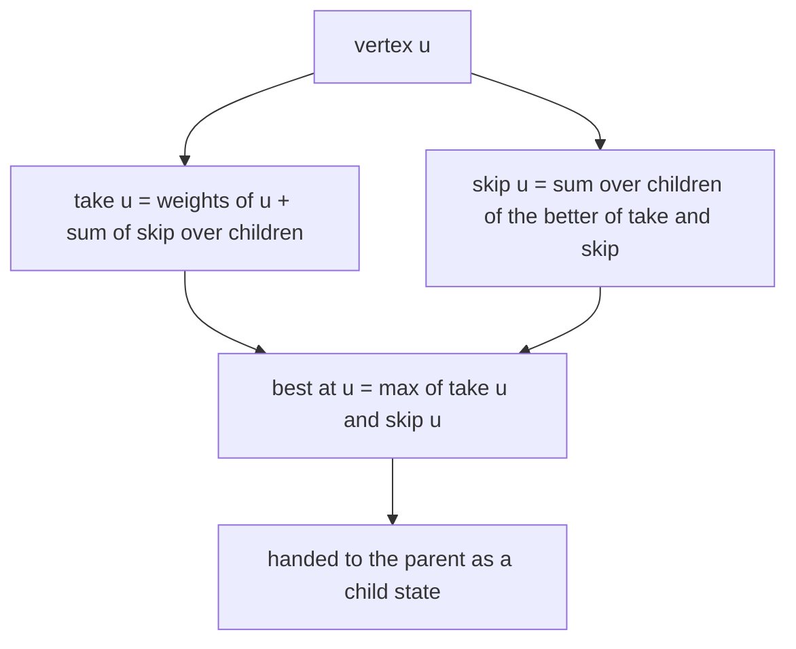
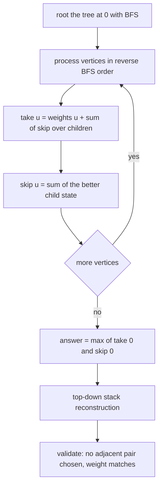
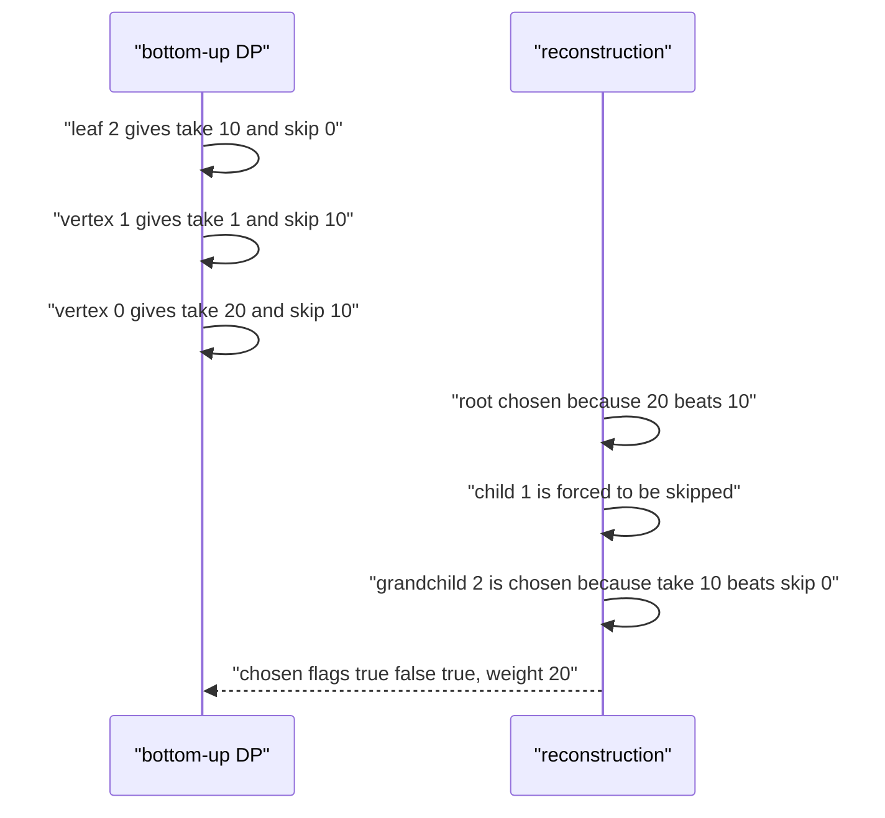

# 426 — Implement tree DP for independent set in tree.

> **Tier:** Advanced · **CTCI chapter:** Ch 4 — Trees and Graphs
> **Task spec:** [426-implement-tree-dp-for-independent-set-in-tree.md](../../../tasks/advanced/426-implement-tree-dp-for-independent-set-in-tree.md)
> **Solutions:** [Python](../../../solutions/python/advanced/426-implement-tree-dp-for-independent-set-in-tree/solution.py) ·
> [Java](../../../solutions/java/advanced/426-implement-tree-dp-for-independent-set-in-tree/Solution.java) ·
> [JavaScript](../../../solutions/javascript/advanced/426-implement-tree-dp-for-independent-set-in-tree/solution.js) ·
> [C#](../../../solutions/csharp/advanced/426-implement-tree-dp-for-independent-set-in-tree/Solution.cs)

## 1. Problem restatement

**Input:** a tree with `n` vertices given by an edge list, rooted at vertex `0`, and an integer
weight `weights[v]` for every vertex.

**Output:** the maximum total weight of an **independent set** — a set of vertices containing no
two adjacent ones — together with the chosen vertices as a boolean array.

The assertions in the four solution files:

| Tree | Weights | Best weight | Chosen |
| --- | --- | --- | --- |
| path `0-1-2` | `[10, 1, 10]` | `20` | `[True, False, True]` |
| star `0` to `1, 2` | `[5, 4, 4]` | `8` | `[False, True, True]` |
| edge `0-1` | `[-1, -2]` | `0` | `[False, False]` |
| single vertex | `[7]` | `7` | `[True]` |
| single vertex | `[-7]` | `0` | `[False]` |
| path `0-1-2-3` | `[3, 10, 3, 10]` | `20` | `[False, True, False, True]` |

The reconstruction is verified to have no two adjacent chosen vertices, to weigh exactly the DP
value, and to be finite (the empty set is always legal, so the answer is never below `0`). On
trees with `n <= 16` the value is compared against brute force over all `2^n` subsets; on larger
trees the reconstruction is still checked for validity and weight, but brute force is off limits.

## 2. Intuition

The naive answer is exponential: enumerate subsets, keep the legal ones, take the heaviest. The
structure of a tree offers a much better recursion, because a choice at one vertex only constrains
its neighbours.

Root the tree at vertex `0`. For every vertex `u`, ask two questions about its **subtree**:

- `take[u]` — the best weight of an independent set inside `u`'s subtree when `u` **is** chosen.
- `skip[u]` — the best weight of an independent set inside `u`'s subtree when `u` is **not**
  chosen.

Then the cases simply split:

- If `u` is chosen, none of its children may be chosen, so each child contributes `skip[child]`:
  `take[u] = weights[u] + sum(skip[child])`.
- If `u` is skipped, each child is free, so each child contributes the better of its two states:
  `skip[u] = sum(max(take[child], skip[child]))`.

Those two lines are the whole dynamic program. Because they only mention children, a single
reverse-BFS pass computes every state: the BFS from the root yields an order in which parents come
before children, and processing it backwards guarantees a vertex is evaluated after all of its
children. The overall answer is `max(take[0], skip[0])`.

Negative weights are handled for free: `skip[leaf] = 0` means "choose nothing here", so an
all-negative tree simply returns `0` with the empty set — the `[-1, -2]` case.



Reconstructing the set is a top-down mirror image of the same decision. The root is chosen when
`take[0] > skip[0]` (strict, so ties prefer the *untaken*, i.e. the empty-leaning, option). Then
each child is pushed onto a stack with the flag its parent's state implies: if the parent was
chosen, the child must be skipped; otherwise the child is chosen exactly when
`take[child] > skip[child]`. The stack is LIFO, which is what makes the traversal iterative and
avoids recursion depth limits.

## 3. Algorithm

1. Build the adjacency lists and a BFS order from vertex `0`, recording `parent[v]`; derive the
   child lists from the order.
2. Process the vertices in **reverse BFS order**. For each `u`:
   1. `take[u] = weights[u] + sum(skip[v] for each child v)`.
   2. `skip[u] = sum(max(take[v], skip[v]) for each child v)`.
3. The answer is `max(take[0], skip[0])`.
4. Reconstruct: start with the stack holding `(0, take[0] > skip[0])`. Pop `(u, choosing)`; mark
   `chosen[u] = choosing`; for every child `v` push `(v, false)` when `choosing` is true, otherwise
   push `(v, take[v] > skip[v])`.
5. Verify: no edge has both endpoints chosen, and the sum of the chosen weights equals the DP
   value.

```text
function max_weight_independent_set(n, edges, weights)
    children, order ← root the tree at vertex 0
    take ← array of n zeroes
    skip ← array of n zeroes
    for u in reverse(order) do
        chosen_weight ← weights[u]
        not_chosen_weight ← 0
        for v in children[u] do
            chosen_weight ← chosen_weight + skip[v]
            not_chosen_weight ← not_chosen_weight + max(take[v], skip[v])
        end
        take[u] ← chosen_weight
        skip[u] ← not_chosen_weight
    end
    chosen ← array of n false values
    stack ← [(0, take[0] &gt; skip[0])]
    while stack is not empty do
        (u, taking) ← pop(stack)
        chosen[u] ← taking
        for v in children[u] do
            if taking then push(stack, (v, false))
            else push(stack, (v, take[v] &gt; skip[v]))
            end
        end
    end
    total ← sum of weights of every vertex with chosen true
    return total, chosen
end
```

The oracle used for small trees enumerates every subset and keeps the heaviest legal one:

```text
function brute_force(n, edges, weights)
    best ← 0
    for mask from 0 to 2 to the power n minus 1 do
        weight ← sum of weights[i] over the bits of mask
        if weight &lt;= best then continue end
        if mask leaves no edge with both endpoints selected then best ← weight end
    end
    return best
end
```



## 4. Worked example

Take the path `0-1-2` with `weights = [10, 1, 10]`, rooted at `0`, so `children[0] = [1]` and
`children[1] = [2]`, and the reverse order is `2, 1, 0`.

| Vertex | `take[v]` of children | `skip[v]` of children | `take[u] = weights[u] + sum(skip)` | `skip[u] = sum(max(take, skip))` |
| --- | --- | --- | --- | --- |
| 2 | — | — | `10` | `0` |
| 1 | `take[2] = 10` | `skip[2] = 0` | `1 + 0 = 1` | `max(10, 0) = 10` |
| 0 | `skip[1] = 10` | `10` | `10 + 10 = 20` | `max(1, 10) = 10` |

The answer is `max(20, 10) = 20`, asserted as the best weight. Reconstruction:

| Step | Stack entry popped | Decision | Children pushed |
| --- | --- | --- | --- |
| 1 | `(0, take[0] > skip[0])` = `(0, 20 > 10)` = `(0, true)` | `chosen[0] = true` | child `1` forced to `false` |
| 2 | `(1, false)` | `chosen[1] = false` | child `2` decided by `take[2] > skip[2]` = `10 > 0` → `true` |
| 3 | `(2, true)` | `chosen[2] = true` | no children |

Result `[True, False, True]` with weight `10 + 10 = 20` and no adjacency between the chosen
vertices — exactly what the file asserts.

The star `0` to `1, 2` with weights `[5, 4, 4]` goes the other way:

| Vertex | `take[u]` | `skip[u]` | Reason |
| --- | --- | --- | --- |
| 1 | `4` | `0` | leaf |
| 2 | `4` | `0` | leaf |
| 0 | `5 + skip[1] + skip[2] = 5` | `max(4, 0) + max(4, 0) = 8` | choosing the hub forbids both leaves |

Here `take[0] = 5` loses to `skip[0] = 8`, so the reconstruction skips the hub and takes both
leaves: `[False, True, True]`, weight `8`. That is the classic "the hub is not worth two leaves"
case, and it is the reason the reconstruction cannot simply prefer taking a vertex.



## 5. Complexity

Let `n` be the number of vertices.

| Bound | Value | Why |
| --- | --- | --- |
| Time, best / average / worst | `O(n)` | every vertex is visited once in the BFS and once in the reverse pass; every edge is inspected once |
| Space | `O(n)` | `take`, `skip`, `chosen`, the child lists and the reconstruction stack |
| Recursion depth | `O(1)` extra | both passes are iterative, so a path of `n` vertices does not overflow the call stack |
| Brute force over subsets | `O(2^n * n)` time | every subset is built and checked against every edge |

The two lines of the transition are evaluated once per vertex and each child contributes one term,
so the total work is proportional to the edge count, i.e. `O(n)`. The tests use brute force only
for `n <= 16`, where `2^16 = 65536` subsets are still feasible, and switch to validity checks for
the larger random trees with `n` between `20` and `60`.

## 6. Pitfalls and edge cases

- **All-negative weights.** The empty set is legal, so the answer is never negative: `[-1, -2]`
  gives `0` with `[False, False]` and `[-7]` gives `0` with `[False]`. This falls out of
  `skip[leaf] = 0`; initialising the answer to "minus infinity" would get it wrong.
- **Ties prefer the untaken option.** The comparisons are strict (`take[u] > skip[u]`), which is
  what the files document as "ties prefer the empty/untaken option". A tie typically means an
  equal-weight alternative, so the choice is free, but it must be *consistent* between the value
  and the reconstruction.
- **A taken vertex forces its children.** The reconstruction pushes `(v, false)` for every child of
  a taken vertex; forgetting that produces an invalid set that the validity check catches.
- **Single vertex.** `n = 1` has no edges: `take[0] = weights[0]`, `skip[0] = 0`, so a positive
  weight is taken and a negative one is not.
- **The star trap.** Taking a valuable hub can be worse than taking its several cheap neighbours;
  the `[5, 4, 4]` case exists precisely to pin that down.
- **Rooting assumptions.** `take`/`skip` describe subtrees of the tree rooted at `0`; the choice of
  root does not change the optimal value, but the reconstruction is written in terms of that
  rooting, so the child lists must come from the same BFS.
- **Iterative reconstruction.** A recursive reconstruction can hit the recursion limit on a path of
  several thousand vertices; the explicit stack avoids it.
- **Value/flag consistency.** The files assert both that the chosen set has no adjacent pair and
  that its weight equals the reported best weight — the second check is what catches a
  reconstruction that follows the wrong branch.

## 7. Variants and follow-ups

- **Independent set on general graphs.** The same recurrence has no linear-time analogue; the
  problem is NP-hard in general, which is why the tree structure matters so much here.
- **Rerooting to get the answer for *every* root.** The downward pass here computes subtree
  answers; sliding the root across each edge is the rerooting technique:
  [427 — rerooting DP](427-implement-rerooting-dp-technique-on-trees.md).
- **Other tree DP objectives.** Counting independent sets, minimum vertex cover (the complementary
  problem), or maximum matching all use the same two-state shape with different combination rules;
  a knapsack variant appears in the tree-DP-with-sizes family of tasks.
- **Ordered queries on the same tree.** Once the DP is built, ancestor and LCA queries need a
  different preprocessing pass: [428 — binary lifting for LCA and ancestor queries](428-implement-binary-lifting-for-lca-and-ancestor-queries.md).

## 8. Check yourself

<details><summary>Show answer</summary>

**Q1.** Write the two transitions and explain each term.

`take[u] = weights[u] + sum(skip[v] over children v)`: choosing `u` forbids every child, so each
child's subtree must contribute its "not chosen" state. `skip[u] = sum(max(take[v], skip[v]))`:
skipping `u` leaves each child free, so each subtree contributes its own best state.

</details>

<details><summary>Show answer</summary>

**Q2.** For a chain of four vertices with weights `[3, 10, 3, 10]`, what is the answer and which
vertices are chosen?

`take/skip` from the far end: vertex 3 gives `take = 10`, `skip = 0`; vertex 2 gives `take = 3 + 0 = 3`,
`skip = max(10, 0) = 10`; vertex 1 gives `take = 10 + 10 = 20`, `skip = max(3, 10) = 10`; vertex 0
gives `take = 3 + 10 = 13`, `skip = max(20, 10) = 20`. The best is `20`, and the reconstruction picks
vertices 1 and 3: `[False, True, False, True]`.

</details>

<details><summary>Show answer</summary>

**Q3.** Why is the answer `0` rather than `-1` for the two-vertex tree with weights `[-1, -2]`?

The empty set is independent and weighs `0`, so no legal set can be worse than that. In the DP this
appears as `skip[leaf] = 0`: every vertex has the option of contributing nothing from its subtree.

</details>

<details><summary>Show answer</summary>

**Q4.** Why does the bottom-up pass use the reverse BFS order instead of a post-order DFS?

Both work, but the reverse of a BFS order is available without recursion and still guarantees that
every child is processed before its parent, which is the only property the transition needs.
Avoiding recursion matters for degenerate inputs such as a long path.

</details>

<details><summary>Show answer</summary>

**Q5.** The star `0` to `1, 2` with weights `[5, 4, 4]` returns `8`. What does that say about the
tie-breaking rule?

Nothing — there is no tie here; `skip[0] = 8` strictly beats `take[0] = 5`. The strict comparison
matters in the opposite case, where both options give the same value: then the untaken option is
chosen, which the files document and lean on for a deterministic reconstruction.

</details>
