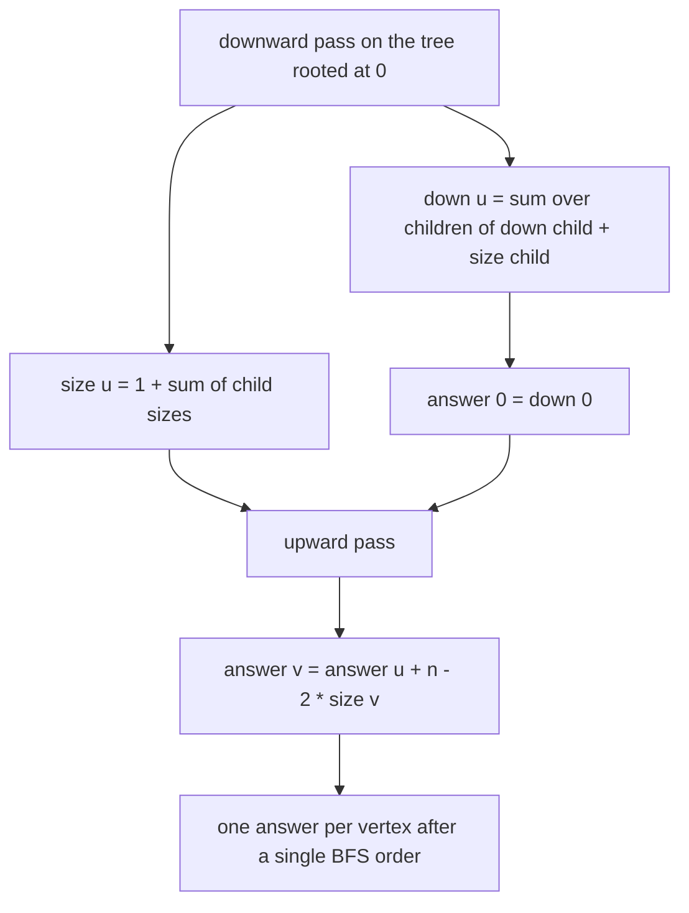
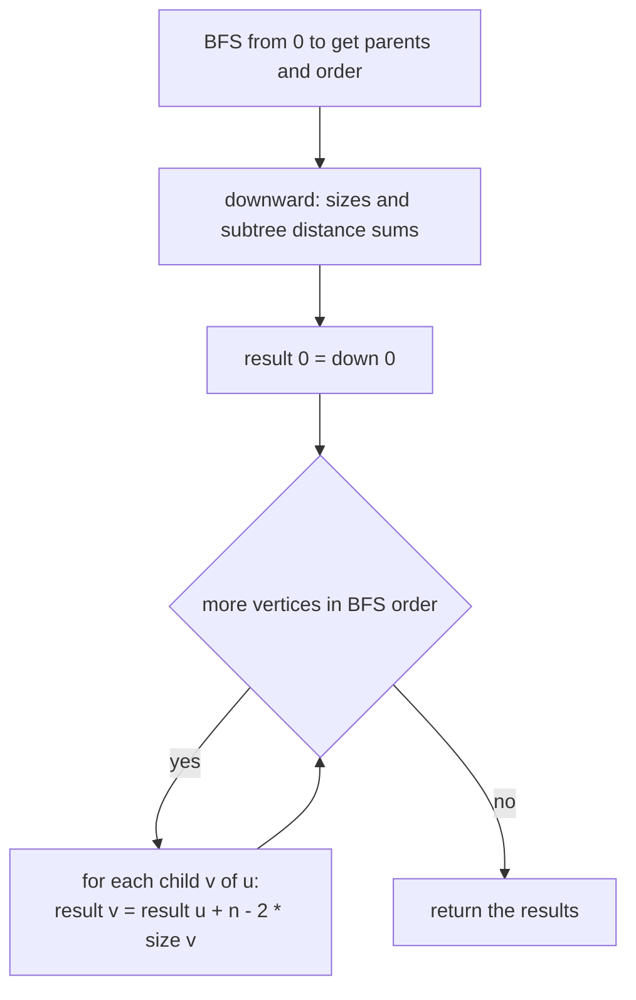
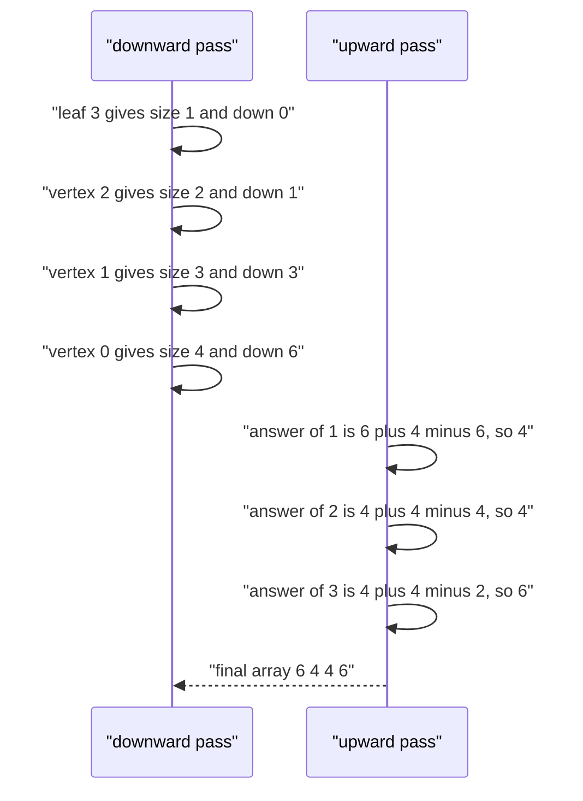

# 427 — Implement rerooting DP technique on trees.

> **Tier:** Advanced · **CTCI chapter:** Ch 4 — Trees and Graphs
> **Task spec:** [427-implement-rerooting-dp-technique-on-trees.md](../../../tasks/advanced/427-implement-rerooting-dp-technique-on-trees.md)
> **Solutions:** [Python](../../../solutions/python/advanced/427-implement-rerooting-dp-technique-on-trees/solution.py) ·
> [Java](../../../solutions/java/advanced/427-implement-rerooting-dp-technique-on-trees/Solution.java) ·
> [JavaScript](../../../solutions/javascript/advanced/427-implement-rerooting-dp-technique-on-trees/solution.js) ·
> [C#](../../../solutions/csharp/advanced/427-implement-rerooting-dp-technique-on-trees/Solution.cs)

## 1. Problem restatement

**Input:** an unrooted tree with `n` vertices given by its edge list.

**Output:** an array of length `n` where entry `v` is the **sum of the distances from `v` to every
other vertex**. (The distance from a vertex to itself is `0`, so it does not affect the sum.)

The assertions in the four solution files:

| Tree | Result | Notes |
| --- | --- | --- |
| `n = 1`, no edges | `[0]` | nothing to walk to |
| `n = 2`, edge `0-1` | `[1, 1]` | each vertex is one step from the other |
| path `0-1-2` | `[3, 2, 3]` | the middle vertex is closest to everything |
| path `0-1-2-3` | `[6, 4, 4, 6]` | longest from the ends, shortest in the middle |
| star `0` to `1, 2, 3` | `[3, 5, 5, 5]` | the hub is closest to all leaves |
| tree `0-1, 0-2, 1-3` | `[4, 4, 6, 6]` | vertices `2` and `3` are the worst places to start |

The randomized part checks 30 LCG trees with `n = 2 + seed % 59` against a brute force that runs a
BFS from every vertex.

## 2. Intuition

Computing the sum of distances from *one* vertex is a single BFS: `O(n)`. Doing it for every vertex
is `O(n^2)` by the same method, and that is exactly the cost profile to avoid.

Rerooting DP removes the factor `n` with two passes over the same tree:

1. **A downward pass.** Root the tree at vertex `0` (arbitrarily) and compute, for each vertex `u`,
   the sum of distances from `u` to the vertices of its **own subtree** (`down[u]`), together with
   the subtree size (`size[u]`). This is the usual bottom-up tree DP:
   `size[u] = 1 + sum(size[child])` and `down[u] = sum(down[child] + size[child])` — the `+ size[child]`
   appears because every vertex in a child's subtree is one step farther from `u` than from the
   child.
2. **An upward pass.** Now slide the root along each edge. When the root moves from `u` to its
   child `v`, exactly the vertices in `v`'s subtree get **one step closer**, and all the other
   `n - size[v]` vertices get **one step farther**:

```text
answer[v] = answer[u] - size[v] + (n - size[v]) = answer[u] + n - 2 * size[v]
```

That single formula is the entire second pass. Process vertices in BFS order (parents first) so
that `answer[u]` is known before it is used for `v`.

The two passes together give every answer in `O(n)`, because each pass visits each vertex once and
each edge twice.



Why is the formula correct? Distances split the vertex set into two groups relative to the edge
`u-v`: the subtree of `v`, and everything else. Moving the reference point from `u` to `v` shortens
the former by one each and lengthens the latter by one each, so the change is
`-size[v] + (n - size[v])`. No other vertex's distance changes at all, which is the reason a single
edge slide is enough.

## 3. Algorithm

1. Build the adjacency lists.
2. Run a BFS from vertex `0` to get `parent[v]` and an order in which parents precede children.
3. Initialise `size[v] = 1` and `down[v] = 0` for every vertex.
4. Process the vertices in **reverse BFS order**: for each `u` and each child `v`,
   `size[u] += size[v]` and `down[u] += down[v] + size[v]`.
5. Set `answer[0] = down[0]`, then process the vertices in **BFS order**: for each child `v` of `u`,
   `answer[v] = answer[u] + n - 2 * size[v]`.
6. Return `answer`.

```text
function sum_of_distances_from_each_node(n, edges)
    adjacency ← build from edges
    parent, order ← BFS from vertex 0
    size ← array of n ones
    down ← array of n zeroes
    for u in reverse(order) do
        for v in neighbours(u) do
            if v != parent[u] then
                size[u] ← size[u] + size[v]
                down[u] ← down[u] + down[v] + size[v]
            end
        end
    end
    result ← array of n zeroes
    result[0] ← down[0]
    for u in order do
        for v in neighbours(u) do
            if v != parent[u] then
                result[v] ← result[u] + n - 2 * size[v]
            end
        end
    end
    return result
end
```

The oracle re-derives every entry independently with one BFS per vertex:

```text
function brute_force(n, edges)
    adjacency ← build from edges
    totals ← empty list
    for source from 0 to n - 1 do
        distance ← array of n values set to -1
        distance[source] ← 0
        queue ← [source]
        for u in queue do
            for v in neighbours(u) do
                if distance[v] = -1 then
                    distance[v] ← distance[u] + 1
                    push_back(queue, v)
                end
            end
        end
        push_back(totals, sum of distance)
    end
    return totals
end
```



## 4. Worked example

Take the path `0-1-2-3`, so the BFS order is `0, 1, 2, 3` with `parent = [0, 0, 1, 2]`. The
reverse order is `3, 2, 1, 0`, and the downward pass fills the tables:

| Vertex | Children | `size[u]` | `down[u]` | Check |
| --- | --- | --- | --- | --- |
| 3 | none | `1` | `0` | a leaf has no subtree distances |
| 2 | `3` | `1 + 1 = 2` | `down[3] + size[3] = 0 + 1 = 1` | distance 1 to vertex 3 |
| 1 | `2` | `1 + 2 = 3` | `down[2] + size[2] = 1 + 2 = 3` | distances 1 and 2 to vertices 2 and 3 → `3` |
| 0 | `1` | `1 + 3 = 4` | `down[1] + size[1] = 3 + 3 = 6` | distances 1, 2, 3 to 1, 2, 3 → `6` |

`result[0] = down[0] = 6`, and then the upward pass slides the root across each edge:

| Vertex | `result[u]` | `size[v]` | `n - 2 * size[v]` | `result[v]` |
| --- | --- | --- | --- | --- |
| 1 (child of `0`) | `6` | `3` | `4 - 6 = -2` | `4` |
| 2 (child of `1`) | `4` | `2` | `4 - 4 = 0` | `4` |
| 3 (child of `2`) | `4` | `1` | `4 - 2 = 2` | `6` |

Result `[6, 4, 4, 6]`, exactly the asserted array. The interpretation matches the geometry: the two
ends of the path are the worst places to start, the two middle vertices are the best.

For the star `0` to `1, 2, 3` the downward pass gives `down[0] = 1 + 1 + 1 = 3` (each leaf is one
step away), and each leaf's size is `1`, so `result[leaf] = 3 + 4 - 2 = 5`:
`[3, 5, 5, 5]` — the hub serves everybody in one step, each leaf needs two.



## 5. Complexity

Let `n` be the number of vertices.

| Bound | Value | Why |
| --- | --- | --- |
| Time, best / average / worst | `O(n)` | two passes, each visiting every edge once from both ends, plus one BFS |
| Space | `O(n)` | adjacency, `parent`, `order`, `size`, `down`, `result` |
| Brute force oracle | `O(n^2)` time | one BFS per source |
| Naive per-vertex DFS | `O(n^2)` time | same reason, with recursion instead of a queue |

Both passes are iterative over a precomputed order, so the recursion depth is constant regardless
of the tree shape — important for the LCG trees, whose `n` reaches `60`, and for any degenerate
path input. There is no arithmetic overflow concern at these sizes; the sums grow like `n^2`.

## 6. Pitfalls and edge cases

- **Single vertex.** `n = 1` has no other vertices, so `down[0] = 0` and the answer is `[0]`.
- **Two vertices.** The upward pass runs a single time, `size[1] = 1`, giving
  `result[1] = 1 + 2 - 2 = 1`, so both entries are `1`.
- **The root of the *input* is arbitrary.** The DFS/BFS root is an implementation detail; the
  answers do not depend on it, and the brute-force oracle never roots the tree at all.
- **Parents versus children.** Both passes distinguish a vertex's parent from its children, so
  `parent[v]` must come from the same BFS that produced the order; mixing the two gives duplicated
  or missing terms.
- **Order of the two passes.** `result[u]` must be final before it is used for its children, which
  is why the second pass runs in BFS order, not reverse BFS order.
- **The `n - 2 * size[v]` term is negative for large subtrees.** That is expected: `result[v]`
  decreases when moving into a heavy subtree, and the star case shows the steepest decrease.
- **Paths and stars are the extremes.** Path `0-1-2-3` gives `[6, 4, 4, 6]` with a symmetric
  profile; the star `0` to `1, 2, 3` gives `[3, 5, 5, 5]` with a single low entry — both are
  asserted, and a bug in the subtree accounting usually breaks one of them.
- **Sums fit in 64 bits.** The maximum possible sum is `O(n^2)`, so a 32-bit accumulator is fine
  for the test sizes but not for large inputs; the compiled solutions use wide integers.

## 7. Variants and follow-ups

- **Other rerooting objectives.** The same two-pass skeleton computes the maximum distance to any
  vertex (eccentricity), the sum of squared distances, or a count of vertices at distance at most
  `k`; only the slide formula changes.
- **Subtree DP without rerooting.** If the answers only concern subtrees of one fixed root, the
  downward pass alone is enough:
  [426 — tree DP for independent set](426-implement-tree-dp-for-independent-set-in-tree.md).
- **Distance counting for a fixed `k`.** Counting *pairs* at exactly distance `k` needs a different
  decomposition, since the tree has no single reference point:
  [425 — centroid decomposition](425-implement-centroid-decomposition-for-k-distance-pairs.md).
- **Aggregates that need path structure.** When the query is about a path rather than all
  distances, binary lifting answers it in `O(log n)` per query:
  [428 — binary lifting for LCA and ancestor queries](428-implement-binary-lifting-for-lca-and-ancestor-queries.md).

## 8. Check yourself

<details><summary>Show answer</summary>

**Q1.** Derive `answer[v] = answer[u] + n - 2 * size[v]` from scratch.

Splitting the vertices by the edge `u-v`: the `size[v]` vertices in `v`'s subtree are one step
closer to `v` than to `u`, and the remaining `n - size[v]` vertices are one step farther. The sum
of distances changes by `-size[v] + (n - size[v]) = n - 2 * size[v]`.

</details>

<details><summary>Show answer</summary>

**Q2.** Why does `down[u] = sum(down[child] + size[child])` have the `+ size[child]` term?

`down[child]` counts distances to the vertices of that child's subtree measured from the child.
Every one of those `size[child]` distances grows by one when measured from `u`, so the term is
added for each child.

</details>

<details><summary>Show answer</summary>

**Q3.** For the star `0` to `1, 2, 3`, why is `result[0] = 3` while each leaf gets `5`?

The hub is one step from each of the three leaves, so its sum is `3`. A leaf is one step from the
hub and two steps from each of the two other leaves: `1 + 2 + 2 = 5`. The formula reproduces it as
`3 + 4 - 2 * 1 = 5`.

</details>

<details><summary>Show answer</summary>

**Q4.** What would break if the second pass ran in reverse BFS order?

When processing a child before its parent, `result[u]` would still be `0` for the parent, so every
derived entry would be wrong. The slide needs a *final* value at the parent, which only the BFS
order guarantees.

</details>

<details><summary>Show answer</summary>

**Q5.** Which vertex minimises the sum of distances in a tree, in general?

A centroid: removing it leaves components of at most half the size. On the path `0-1-2-3` both
middle vertices tie at `4`, and on the star the hub wins with `3` — consistent with the asserted
arrays, and the same centroid notion used by
[425 — centroid decomposition](425-implement-centroid-decomposition-for-k-distance-pairs.md).

</details>
