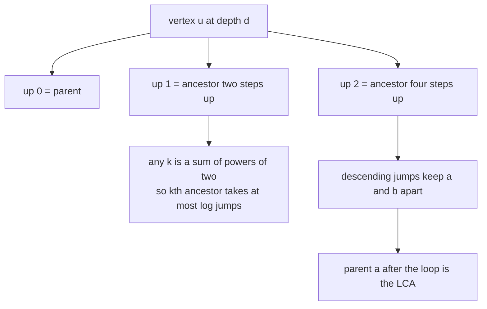
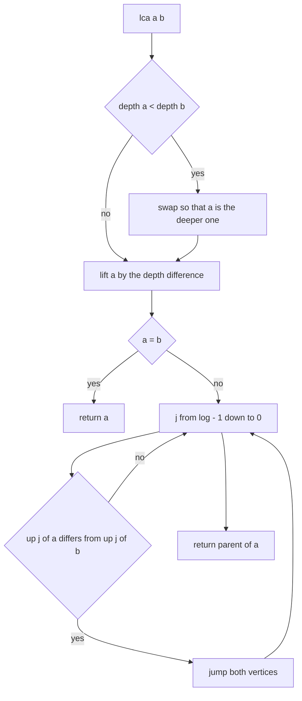
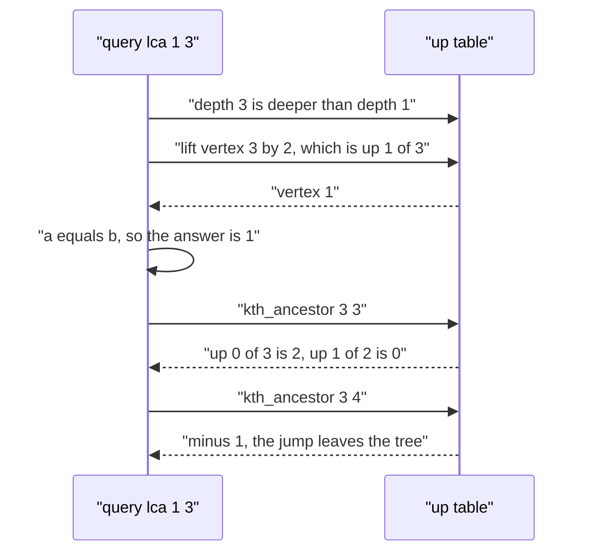

# 428 — Implement binary lifting for LCA and ancestor queries.

> **Tier:** Advanced · **CTCI chapter:** Ch 4 — Trees and Graphs
> **Task spec:** [428-implement-binary-lifting-for-lca-and-ancestor-queries.md](../../../tasks/advanced/428-implement-binary-lifting-for-lca-and-ancestor-queries.md)
> **Solutions:** [Python](../../../solutions/python/advanced/428-implement-binary-lifting-for-lca-and-ancestor-queries/solution.py) ·
> [Java](../../../solutions/java/advanced/428-implement-binary-lifting-for-lca-and-ancestor-queries/Solution.java) ·
> [JavaScript](../../../solutions/javascript/advanced/428-implement-binary-lifting-for-lca-and-ancestor-queries/solution.js) ·
> [C#](../../../solutions/csharp/advanced/428-implement-binary-lifting-for-lca-and-ancestor-queries/Solution.cs)

## 1. Problem restatement

**Input:** a tree with `n` vertices given by an edge list, rooted at vertex `0` (the root is its own
parent, so `parent[0] = 0`), and two kinds of query:

| Query | Meaning |
| --- | --- |
| `lca(a, b)` | the lowest common ancestor of `a` and `b` |
| `kth_ancestor(u, k)` | the vertex `k` steps up from `u`, or `-1` when `k` exceeds the depth of `u` |

**Output:** both queries answer in `O(log n)` after a preprocessing phase.

The assertions in the four solution files, using the path `0-1-2-3`:

| Query | Result | Why |
| --- | --- | --- |
| `lca(0, 3)` | `0` | the root is the only common ancestor |
| `lca(2, 3)` / `lca(1, 2)` | `2` / `1` | the shallower vertex is an ancestor of the other |
| `lca(3, 3)` / `lca(0, 0)` | `3` / `0` | the answer to an easy query is the vertex itself |
| `kth_ancestor(3, 0)` | `3` | zero steps up |
| `kth_ancestor(3, 1)` / `(3, 2)` / `(3, 3)` | `2` / `1` / `0` | walk to the root one level at a time |
| `kth_ancestor(3, 4)` / `kth_ancestor(0, 1)` | `-1` | the jump leaves the tree |

On the star `0-1, 0-2, 0-3` the files assert `lca(1, 2) == 0`, `lca(1, 3) == 0`, `lca(2, 2) == 2`,
`kth_ancestor(2, 1) == 0` and `kth_ancestor(2, 2) == -1`; for the single-vertex tree,
`lca(0, 0) == 0`, `kth_ancestor(0, 0) == 0` and `kth_ancestor(0, 1) == -1`. The randomized part walks
`25` LCG trees with `n = 2 + seed % 29` and checks `lca` for **every** pair, including the
symmetry `lca(a, b) == lca(b, a)`, plus `kth_ancestor` for every `k` from `0` to `depth[u] + 2`.

## 2. Intuition

Climbing a tree one edge at a time answers both queries in `O(depth)`, which degrades to `O(n)` on a
path. The trick that removes the factor is to precompute the answers for *doubling* steps:

```text
up[0][u] = parent[u]
up[j][u] = up[j - 1][ up[j - 1][u] ]      for j = 1 .. log - 1
```

`up[j][u]` is the `2^j`-th ancestor of `u`. The table has `n * log n` entries with
`log = max(1, bit_length(n))`, and it takes `O(1)` per entry: the `2^j`-th ancestor is the `2^(j-1)`-th
ancestor of the `2^(j-1)`-th ancestor.

Two facts make queries cheap:

- **Any step count is a sum of powers of two.** `kth_ancestor(u, k)` reads off the binary
  representation of `k` and jumps once per set bit: at most `log` jumps instead of `k`.
- **The LCA loop can climb both vertices at once.** After equalising the depths, if `a` and `b` are
  already equal that vertex is the answer; otherwise, descending from the largest jump
  `2^(log-1)` down to `1`, whenever `up[j][a] != up[j][b]` both vertices jump — they are still on
  different sides of the branch point. When the loop ends, `a` and `b` are the two distinct children
  of the LCA, so `parent[a]` is the answer.



The equalise-then-climb shape is what avoids overflow cases: the deeper vertex is lifted by exactly
`depth[a] - depth[b]` steps, which is always representable, and `kth_ancestor` reports `-1` instead of
running off the top when `k > depth[u]`.

## 3. Algorithm

1. Build the adjacency lists and BFS/DFS from vertex `0`, recording `parent[v]` and `depth[v]`.
   `parent[0] = 0` and `depth[0] = 0`.
2. Set `log = max(1, bit_length(n))`; build `up[0] = parent` and then
   `up[j][u] = up[j - 1][up[j - 1][u]]` for `j = 1 .. log - 1`.
3. `kth_ancestor(u, k)`: return `-1` when `k > depth[u]`; otherwise walk the bits of `k` from the
   least significant one, jumping `up[j][u]` and advancing `j` for each bit position.
4. `lca(a, b)`: make `a` the deeper vertex; lift `a` by `depth[a] - depth[b]`; if `a == b`, return
   `a`; otherwise descend `j` from `log - 1` to `0`, jumping both vertices whenever
   `up[j][a] != up[j][b]`; return `parent[a]`.

```text
procedure build(n, edges)
    parent, depth ← root the tree at vertex 0 with BFS
    log ← max(1, number of bits in n)
    up[0] ← parent
    for j ← 1 to log - 1 do
        for u ← 0 to n - 1 do
            up[j][u] ← up[j - 1][ up[j - 1][u] ]
        end
    end
end

function kth_ancestor(u, k)
    if k &gt; depth[u] then return -1 end
    bit ← 0
    while k &gt; 0 do
        if k is odd then u ← up[bit][u] end
        k ← floor(k / 2)
        bit ← bit + 1
    end
    return u
end

function lca(a, b)
    if depth[a] &lt; depth[b] then swap a with b end
    a ← kth_ancestor(a, depth[a] - depth[b])
    if a = b then return a end
    for j ← log - 1 down to 0 do
        if up[j][a] != up[j][b] then
            a ← up[j][a]
            b ← up[j][b]
        end
    end
    return parent[a]
end
```

The oracle is the straightforward walk, used for every pair and every `k`:

```text
function naive_lca(parent, depth, a, b)
    while depth[a] &gt; depth[b] do a ← parent[a] end
    while depth[b] &gt; depth[a] do b ← parent[b] end
    while a != b do
        a ← parent[a]
        b ← parent[b]
    end
    return a
end

function naive_kth_ancestor(parent, depth, u, k)
    if k &gt; depth[u] then return -1 end
    repeat k times: u ← parent[u]
    return u
end
```



## 4. Worked example

Build the table for the path `0-1-2-3`: `parent = [0, 0, 1, 2]` and `depth = [0, 1, 2, 3]`. With
`n = 4`, `bit_length(4) = 3`, so `log = 3` and three levels are stored:

| Level | Meaning | Values |
| --- | --- | --- |
| `up[0]` | `parent[u]` | `[0, 0, 1, 2]` |
| `up[1]` | `2` steps up | `[0, 0, 0, 1]` |
| `up[2]` | `4` steps up | `[0, 0, 0, 0]` |

The root is its own parent, which is why every entry for vertex `0` stays `0` and why the
"descend while the ancestors differ" loop in `lca` can never accidentally jump above the root — if
both vertices would exceed the top, their entries are both `0` and equal, so no jump happens.

Now query `lca(0, 3)`:

| Step | `a` | `b` | Action |
| --- | --- | --- | --- |
| 1 | `3` (depth 3) | `0` (depth 0) | `depth[a] > depth[b]`, so no swap |
| 2 | `3` | `0` | lift `a` by `3 - 0 = 3`: bits `1, 1` → `up[0][3] = 2`, then `up[1][2] = 0` |
| 3 | `0` | `0` | `a == b`, so return `0` |

and `lca(1, 3)`, which needs the descending loop:

| Step | `a` | `b` | Action |
| --- | --- | --- | --- |
| 1 | `3` (depth 3) | `1` (depth 1) | no swap, lift `a` by `2`: bits `0, 1` → `up[1][3] = 1` |
| 2 | `1` | `1` | equal, return `1` |

`kth_ancestor(3, 3)` walks the bits of `3 = 11`: `up[0][3] = 2`, then `up[1][2] = 0`, giving `0` —
the root. `kth_ancestor(3, 4)` returns `-1` immediately because `4 > depth[3] = 3`, and
`kth_ancestor(0, 1)` returns `-1` because the root has depth `0`.



The star `0` to `1, 2, 3` exercises the other LCA path: `up[0] = [0, 0, 0, 0]` and all depths are
`0` or `1`. `lca(1, 2)` lifts nothing (equal depths), enters the descending loop, finds
`up[j][1] == up[j][2] == 0` for every `j`, so no jump happens, and returns `parent[1] = 0` — the hub,
which is indeed the lowest common ancestor of two leaves.

## 5. Complexity

Let `n` be the number of vertices and `log = O(log n)`.

| Bound | Value | Why |
| --- | --- | --- |
| Preprocessing time | `O(n log n)` | one BFS plus `log` levels of `n` entries each, `O(1)` per entry |
| Preprocessing space | `O(n log n)` | the full `up` table |
| `lca` | `O(log n)` | one lift plus one descending loop over `log` levels |
| `kth_ancestor` | `O(log n)` | at most one jump per bit of `k` |
| Naive parent walk | `O(depth)` per query, `O(n)` worst case | climbing one edge at a time |

The randomized check is exhaustive rather than sampled for `lca`: it compares against the naive walk
for every ordered pair of the 25 test trees, and asserts symmetry, and it checks `kth_ancestor` for
every `k` up to two steps past the depth — including the `-1` boundary.

## 6. Pitfalls and edge cases

- **The root's parent.** Setting `parent[0] = 0` makes the root its own ancestor, which keeps the
  table well-defined and makes the descending loop stop safely. Any other sentinel (like `-1`)
  would need extra guarding inside the loop.
- **Jumps past the root.** `kth_ancestor` must check `k > depth[u]` *before* jumping; without the
  check, jumps would silently clamp to the root and return `0` instead of `-1`.
- **Same vertex.** `lca(a, a)` returns `a` through the equality check right after the lift, which is
  asserted for `(3, 3)`, `(0, 0)` and `(2, 2)`.
- **Ancestor relations.** `lca(1, 2) == 1` on the path: after equalising depths the two vertices are
  equal, so the loop is skipped entirely.
- **Single vertex.** `n = 1` gives `log = max(1, bit_length(1)) = 1`, one table level, and both
  queries answer correctly: `lca(0, 0) == 0`, `kth_ancestor(0, 0) == 0`, `kth_ancestor(0, 1) == -1`.
- **`log` must be at least 1.** With `n = 1` the bit length is `1` anyway, but the `max(1, ...)`
  guard documents the intent and avoids an empty table.
- **Symmetry.** `lca(a, b) == lca(b, a)` is asserted across all pairs; a missing swap of the deeper
  vertex would break it immediately.
- **Star-shaped trees.** All leaves share the root as their `2^j` ancestor, so the descending loop
  never jumps — a good check that the loop does not require a jump to terminate.
- **Depth as a 64-bit value.** Nothing special; depths are bounded by `n`.

## 7. Variants and follow-ups

- **Euler tour plus sparse table.** An alternative `O(1)`-per-query LCA using a first-occurrence array
  and range-minimum over depths; the same first-occurrence array is the basis of Mo's algorithm on
  trees: [430 — Mo's algorithm on trees](430-implement-mo-s-algorithm-on-trees-euler-tour-mo.md).
- **Weighted ancestors and path aggregates.** Storing a sum or maximum next to each jump pointer turns
  binary lifting into a path-aggregate structure; the tree version of the same idea computes all
  distance sums by rerooting: [427 — rerooting DP](427-implement-rerooting-dp-technique-on-trees.md).
- **LCA used as a building block.** `dist(u, v) = depth[u] + depth[v] - 2 * depth[lca(u, v)]` feeds
  distance counting and virtual trees; for counting pairs at a fixed distance the decomposition
  approach of [425 — centroid decomposition](425-implement-centroid-decomposition-for-k-distance-pairs.md)
  is more direct.
- **Versioned queries.** Persistent structures answer "was `u` an ancestor of `v` at time `t`" style
  questions: [421 — persistent segment tree](421-implement-persistent-segment-tree-versioned.md).

## 8. Check yourself

<details><summary>Show answer</summary>

**Q1.** Why does `up[j][u] = up[j - 1][up[j - 1][u]]` compute the `2^j`-th ancestor?

`up[j-1][u]` is the `2^(j-1)`-th ancestor of `u`; taking the `2^(j-1)`-th ancestor of *that* vertex
adds another `2^(j-1)` steps, for a total of `2^j`. Each entry therefore costs `O(1)` once the
previous level is known.

</details>

<details><summary>Show answer</summary>

**Q2.** On the path `0-1-2-3`, what does `lca(3, 3)` return and which branch of the algorithm decides
it?

`3`. After the swap check and the lift (`k = 0`, so no movement), `a == b` holds and the function
returns immediately — the descending loop is never entered.

</details>

<details><summary>Show answer</summary>

**Q3.** Why can the descending loop in `lca` use `up[j][a] != up[j][b]` without worrying about
jumping above the root?

Because the root is its own parent, `up[j][u]` is `0` once `2^j` exceeds the depth of `u`. If a jump
would overshoot the root for both vertices, both entries are `0` and equal, so the condition is
false and no jump occurs.

</details>

<details><summary>Show answer</summary>

**Q4.** For the star `0` to `1, 2, 3`, give `kth_ancestor(2, 1)` and `kth_ancestor(2, 2)`.

The leaf `2` has depth `1`, so one step up gives `up[0][2] = 0` (the hub) and two steps up exceed the
depth, returning `-1`.

</details>

<details><summary>Show answer</summary>

**Q5.** What are the preprocessing costs, and when would the naive walk actually be preferable?

`O(n log n)` time and space, against `O(1)` space for the naive walk. The naive walk wins when the
tree is shallow (a star: one step per query) or when only a handful of queries are asked, since the
table costs more to build than the queries would.

</details>
